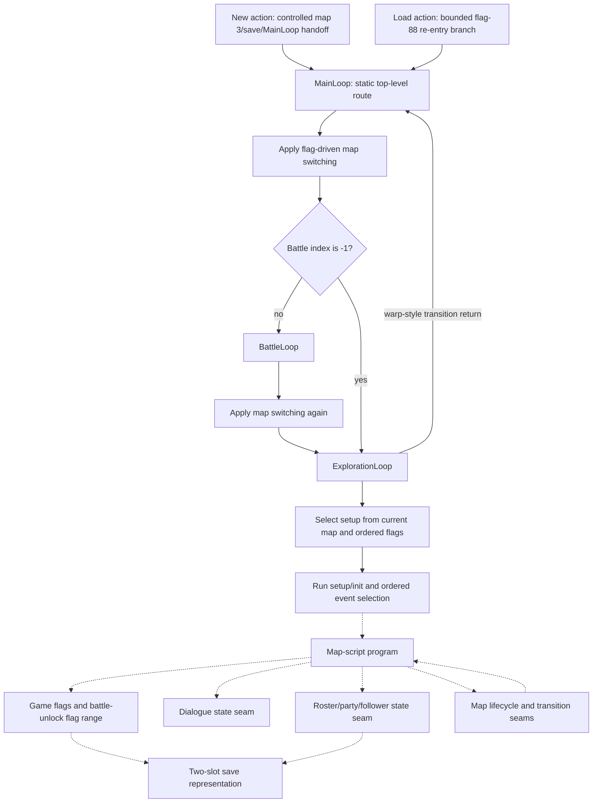

# Story Progression

- **Confirmed original behavior:** bounded New-game/re-entry handoffs, top-level map/battle/exploration
  routing, ordered setup and event selection, the complete map-script program graph, handler-local
  story-flag mutation, dialogue cursor/control seams, roster mutations, map lifecycle/transition
  boundaries, and the in-process save actions described below.
- **Inferred original behavior:** these independently confirmed seams form a reusable progression
  architecture in which map, flag, party, and battle state select later local behavior.
- **Unknown original behavior:** a complete normal-play chronology, unreviewed plot/choice
  consequences, route exclusivity, full save persistence and unobserved story presentation. Selected
  static chapter meanings and bounded original observations keep their narrower linked owners.
- Remake status: implementation-neutral Layer B synthesis; current engine direction belongs to
  [ADR 0019](../../decisions/0019-state-and-content-driven-remake-engine.md). This document selects no
  campaign rewrite or narrative data model.
- Framework evidence date: 2026-08-02; chapter orientation and the worked example consume the
  accepted owners at `5366df4333330091430bfd3c7940db1f9223661f` under the
  [current Standard-rigor scope agreement](../documentation-roadmap.md#current-baseline-and-near-term-synthesis).
- Source baseline: `ShiningForceCentral/SF2DISASM` `master`
  `c834c652b6862bc5679fd7f69a38a7093206efc6`.

## Judgment Boundary

This document explains how accepted original-game state and control boundaries can support story
progression. It is not a plot summary and not a chronological walkthrough. A source label, a static
incoming reference, or a successful handler-local replay does not establish that a normal save reaches
that code, when it reaches it, what the player sees, or what the event means in the fiction.

The chapter reading route below explains selected accepted content dependencies. The underlying
**progression framework** remains bounded; it does not establish a naturally played campaign:

1. top-level control chooses battle or exploration from current state;
2. current map plus ordered flags selects a six-part map setup;
3. ordered map events and map-script branches select local programs;
4. local programs may inspect or mutate flags, dialogue state, roster state, and map state;
5. warp-style exploration returns and returning `BattleLoop` handoffs re-enter the top-level route;
6. save services can serialize the bounded combatant-data region, but complete subsystem persistence
   is not yet demonstrated.

Enter from the [gameplay overview](gameplay-overview.md#follow-the-loop-and-choose-a-reading-depth),
then use the chapter groups for world changes and the worked example for one connected dependency.
[Tactical Battle Loop](tactical-battle-loop.md) and [Progression and Economy](progression-and-economy.md)
explain the local systems these chapters coordinate. The
[documentation roadmap](../documentation-roadmap.md) owns the scope and review sequence; none of
these explanations supplies missing natural chronology.

## Read Story Content in Segments

These six groups are an **Inferred editorial reading order**, based on meaningful world changes and
content dependencies. They are not the original authors' chapters, a mandatory battle sequence or
proof of a continuous walk. **Confirmed static** below means that a named accepted owner supports
the particular selector, operation or conditional handoff. Its source order does not prove natural
arrival, completed presentation, player control or durable saves.

Read each orientation first. Expand its detailed English guides for exact local behavior, then use
the linked research for proof. The northern chapter continues through conditional Battle32 admission;
the Moun/Nazca and final groups retain bounded skeletons and accepted-evidence routes. They do not
create a new detailed late-campaign series. The
[coverage owner](../../research/story-content-coverage.md#four-different-frontiers) distinguishes
static research, original observations, English synthesis and remake support.

1. [Grans opening and departure](#grans-opening-and-departure).
2. [New Granseal and eastern Parmecia](#new-granseal-and-eastern-parmecia).
3. [Southern travel, Caravan and Creed](#southern-travel-caravan-and-creed), including the
   [Taros/Caravan worked example](#worked-example-taros-and-the-caravan).
4. [Northern travel, Pacalon, Tristan and Mitula](#northern-travel-pacalon-tristan-and-mitula).
5. [Moun, Nazca and the return to Grans](#moun-nazca-and-the-return-to-grans).
6. [Final confrontations and ending](#final-confrontations-and-ending).

### Grans opening and departure

The opening connects town interaction, castle/tower events and battle, then changes the world through
captivity, the tower aftermath, earthquake and departure by ship. **Confirmed:** the selected opening
has bounded original observations; later local guides explain static outcome/return and event gates.
The earthquake-town exit, boarding choice, departure scene and damaged-ship arrival are distinct
handoffs rather than one transition. A scripted relocation is not another player movement decision.

Use [opening through Battle01](opening-through-battle01.md) for the connected start and
[docks departure](earthquake-town-through-docks-departure.md) for its actual Yes/No branch. Optional
Kiwi and other opening interactions remain beside their local conditions in the guides below.
[Grans coverage](../../research/story-content-coverage.md#grans-opening-captivity-and-the-first-tower)
and [departure coverage](../../research/story-content-coverage.md#leaving-grans-and-establishing-new-granseal)
route to accepted evidence. Defeat, escape and repeat setups keep their own returns; neither a
battle number nor the departure staging proves a naturally uninterrupted journey.

Detailed English guides and their local limits

[Opening through Battle 01](opening-through-battle01.md) connects the selected Map 3 opening,
messenger, castle/royal/tower phases, encounter and usable return. It supplies the location/entity/
dialogue/encounter reading route over accepted evidence, with additional interactions and conditional
branches kept separate from mandatory observed content.

Continue with [Battle 01 return through Battle 02 admission](battle01-return-through-battle02.md)
for the next conditional source-connected segment: castle return, exorcism/commission, Jaha's join
and west-exit admission. It preserves alternate callers and state/selector conditions. Its **Confirmed
static** content and **Inferred** narrative connection do not extend the original observed frontier
or remake acceptance below; natural continuity and legal walking remain **Unknown**.

[Battle 02 outcome through Battle 03 admission](battle02-outcome-through-battle03.md) follows with
outcome/return, conditional Yeel/Kazin guidance and the separate Map66 zone request/consumer path.
Following is distinct from recruitment; Yeel is not a demonstrated encounter prerequisite. This
segment also retains static/natural and original/remake boundaries.

[Battle 03 outcome through Battle 04 admission](battle03-outcome-through-battle04.md) continues
through the conditional return, Hawel-house initialization, Kazin recruitment and separate exit
request/encounter selector. House default versus repeat setup and joined/follower/unlock state remain
distinct; natural walking, caller/presentation/persistence and initialized Battle04 remain Unknown.

[Battle 04 outcomes through Battle 05 admission](battle04-outcomes-through-battle05.md) follows with
victory/special-defeat/escape distinctions, Galam prison/castle content, Slade following and the guard's
conditional unlock/request. It stops at before/start and preserves natural walking, actor/reentry and
active-party Unknowns; source branches do not establish a forced loss or a continuous walkthrough.

[Battle05 outcomes through Battle06 admission](battle05-outcomes-through-battle06.md) continues
with the separate position/HP consumer, first-completion jewel scene and Slade join, Galam exits and
conditional row-6 selection/before/start. F407 is written at entry, rather than completion or a proved
Battle07 route; walking, caller/party/reentry and presentation remain Unknown.

[Battle06 outcomes through Battle07 admission](battle06-outcomes-through-battle07.md) continues
with variable outcome returns, F506 town/castle content, optional Kiwi recruitment, royal following
and conditional tower requests. F407 admission remains separate from F506 content; F401 interception,
F999 substitution and F457/F88 skips retain walking, follower/reentry and party Unknowns.

[Battle07 outcomes and the exploration handoff](battle07-outcomes-and-aftermath.md) follows with
victory/repeat/defeat/escape, phased tower aftermath and separate jewel/current-follow/persistent-flag
effects. The return request precedes script/caller completion; void Map58 setup reconstructs followers
before conditional control restoration. F999, conflicting follower flags, natural service completion
and onward walking remain explicit limits; the guide stops at the immediate Map58 outgoing owner.

[Post-tower return through earthquake-town entry](post-tower-return-through-earthquake-entry.md) continues
through selected tower/castle exits, independent Astral dialogues, earthquake-map substitution and
first/repeat town initialization. It stops at the conditional control/event read; legal walking,
caller/follower state and natural service completion remain Unknown, with later evacuation separate.

[Earthquake-town exit through docks departure](earthquake-town-through-docks-departure.md) continues
through the changed harbor, same-map boarding, the old man's Yes/No choice and phased departure.
It distinguishes follower-flag clearing, actor reconstruction and in-script Map66 loading from the
conditional Map73 request handoff. Walking, occupancy, follower/service/pending state and the separate
zone-table anomaly retain their limits; destination initialization and later voyage remain outside it.

[Voyage and landing through damaged-ship control](voyage-through-damaged-ship-control.md) follows with
Map73 first/repeat selection, optional Kiwi content, landing/crowd instructions and the scripted
Jaha/plank scene. Two in-script Map14 loads bypass its init; F700 is written after script return
and before conditional control. Actor-reference reuse, follower/party state, natural arrival and
services/pending outcomes retain their limits; player plank progression and Battle08 remain separate.

### New Granseal and eastern Parmecia

Landing does not immediately establish a settled new town. The plank/rescue encounter and its
outcome precede the selected construction/address and rebuilt population boundaries. From New
Granseal, local conditions connect Peter's introduction and audience with eastern travel, Ribble,
Polca and Bedoe. **Confirmed static:** speaking, following, joining the force and admission to the
next encounter have separate consumers. Twelve formation places do not recruit twelve allies.

Read the [plank and rescue guide](damaged-ship-plank-through-battle08.md),
[Peter's audience](peter-castle-audience-through-town-return.md) and
[Volcanon audience](bedoe-to-volcanon-audience.md) for those changes. Optional
[May](ribble-may-through-battle10-admission.md), [East Shrine](battle10-outcomes-through-east-shrine-visit.md),
[Bedoe hatchling rescue](bedoe-hatchling-flight-and-rescue.md) and
[Oddler choices](polca-oddler-choice-and-following.md) are conditional branches, not a required chain.
The [eastern chapter evidence](../../research/story-content-coverage.md#eastern-parmecia-ribble-polca-and-bedoe)
keeps the separate encounters and returns. Polca's raft grant prepares a later travel option;
[boarding](polca-raft-boarding-through-south-parmecia-entry.md) is a separate action boundary.

Detailed English guides and their local limits

[Damaged-ship plank choices through Battle08 admission](damaged-ship-plank-through-battle08.md) continues
with the optional plank response, explicit/same-map entry alternatives, timber handover and repeated
rescue request. F408/request production precedes caller F703/EGRESS_MAP writes; Map72 admission and
F458 before/start dispatch remain distinct from scene casts and the combat roster. It stops before
ActivateEnemies, preserving pending, walking, follower/service and suspended-entry limits.

[Battle08 outcomes through the New Granseal castle handoff](battle08-outcomes-through-new-granseal-handoff.md)
continues with first/repeat victory, defeat/escape, the worker and blocked-tunnel scene, conditional
Map73 construction and its outgoing request. BattleLoop's direct return-field read differs from
exploration pending consumption; F705 is written by the init caller after the script. Actor/follower,
reset, service and natural-route limits remain explicit. It stops before Map7 destination init.

[New Granseal castle: the year-later address and first control handoff](new-granseal-castle-year-later-control.md)
continues through setup priority, first/repeat init, rebuilding/trade speeches, dismissal and the
explicit ordinary-population reload. Caller F707/F411 writes precede the first pending/control
read; same-map display loads, actor mapping and named/unjoined waits retain their limits. It stops
at that read without claiming natural arrival, completed services or actual usable control.

[New Granseal town: Peter's first introduction](new-granseal-town-through-peter-introduction.md)
continues through conditional castle departure, town setup/init, the sailor/guard introduction and
Peter's reception. F706 and F701 independently gate the two zones; caller flags follow script return.
Hiding and named/unjoined actions remain distinct from recruitment, persistent dismissal and arrival.
It stops at the first post-Peter pending/control read without claiming natural travel or usable input.

[Peter's castle audience and the return to town](peter-castle-audience-through-town-return.md)
continues with conditional castle admission, Astral staying behind, Peter's join/AI and distinct
following mechanisms, the gift's narrative/state mismatch and town re-entry. Request production
precedes caller F702 then F67; destination setup/init precede the first pending/control read.
It stops there with natural travel, observed gold, service completion and usable input Unknown.

[New Granseal departure through Battle09 admission](new-granseal-departure-through-battle09.md)
continues through town departure, the selected east-then-south overworld connections and conditional
encounter admission. Scrolling retains exploration/cohort state; ordinary entry and a partial reload
reach ordered battle selection. Specific/default zones, carried request bytes and F409/F509/F459
remain distinct. It stops at the empty start-dispatcher return before enemy activation, with natural
travel, actor/request survival, service completion and battle readiness Unknown.

[Battle09 outcomes through Ribble's welcome](battle09-outcomes-through-ribble-welcome.md) continues
through variable battle returns, separate town entry, suspicion and Peter's explanation. Independent
welcome gates and distinct resident reload, door reconstruction, roof restoration and current follow
effects remain explicit. It stops after the mayor caller and first conditional restored control,
with natural travel, actor/service completion, pending and visible village changes Unknown.

[Ribble's optional May recruitment through Battle10 admission](ribble-may-through-battle10-admission.md)
continues with the linear invitation, distinct joined/active/current-follow state, directions and
selected departure. Ordinary entry rebuilds entities; the east scroll bypasses battle selection,
and a partial zone request reaches ordered Battle10/14 admission. It stops at the empty
start-dispatcher return before ActivateEnemies, with actor/party, request, service, cross-save
presentation and natural-route limits explicit.

[Battle10 outcomes through the optional East Shrine visit](battle10-outcomes-through-east-shrine-visit.md)
continues with variable battle return, separate shrine entry, mistaken identity, the grandfather's
account and invitation. Independent persistent/temporary gates permit different interaction orders;
current 129 following differs from the F77 rebuild under 30. It stops after the old-man caller and
first conditional control handoff, retaining mapping, service, save/reentry and natural-route limits.
This optional branch does not establish a mandatory Battle11 route.

[East Shrine return through Battle11 cave admission](east-shrine-return-through-battle11-admission.md)
continues from the optional shrine exit or direct Battle10 return through selected scroll/fixed
connections, exact F411 admission and Peter's exchange with the hobgoblin. F461 intro/F88 resume,
no-setup cave exploration, follower-selected placement and later combatant replacement remain distinct.
It stops at the new-battle start-dispatcher return before ActivateEnemies, retaining interruptions,
actor/party/service/pending and darkness-presentation limits. No mandatory shrine route is established.

[Battle11 outcomes through Polca's first Oddler arrival](battle11-outcomes-through-polca-arrival.md)
continues with variable cave return, carried egress, selected exits and separate F413 town admission.
The first X24 event stages the injured boy and villagers' response, then explicitly reloads the
F710 residents before caller F711 handling and the F710 write. Following is rebuilt and can retain
the same target/offset. It stops at first conditional restored control, preserving actor/HP/mapping,
service/pending, presentation and natural-route limits; it recruits neither Oddler nor Gerhalt.

[Polca's fairy interaction through Battle12 admission](polca-fairy-through-battle12-admission.md)
continues with the optional turtle test, fairy departure, independent east exit and searching-devils
confrontation. F711 caller/alternative-producer state, actual event lookup and transient/rebuilt
following remain distinct. F412 immediate admission, F512 empty population and F714/F712 init can
change the ordinary scene branch. The scene's unlock/request precedes caller F713 and consumption;
wildcard admission, actual battle placement and F462/F88 branches remain separate. It stops at the
new-battle start-dispatcher return before ActivateEnemies, with natural travel, supplied actors,
services/pending and rendered transformation Unknown; helping the turtle is not an exit prerequisite.

[Battle12 outcomes through Bedoe's initial guard encounter](battle12-outcomes-through-bedoe-entry.md)
continues with leader recognition, first/repeat mountain returns, Peter's response, selected Bedoe
entry and the guards' challenge, recognition and requests. HP/F512 leader/join tails, independent
F714/F712 response and F722 setup selection remain distinct. Final guard placements precede caller
F719 and optional F720 out-of-map movement; current following does not establish persistence.
It stops after default/alternate init and first conditional restored control, before the king's
address/audience, retaining natural-route, actor/party/AI, service/pending and presentation Unknowns.

[Bedoe's king address and first audience](bedoe-king-address-through-first-audience.md) continues
with the report, dispersing guards, Luke's greeting, introductions, Zeon warnings and the invitation
to Volcanon. F720/F721 independently admit the scenes; F722 replaces their zone table. Real hiding
differs from re-entry out-of-map movement, and shared 147/148 positions depend on prior scenes and
supplied state. The final command installs Peter following Bowie without joining anyone. It stops
after the audience caller and conditional control, preserving natural floor/order, actor/mapping,
service/pending and presentation Unknowns; shrine travel and Volcanon remain separate.

[Bedoe to the Volcanon audience](bedoe-to-volcanon-audience.md) continues through explicit shrine
entry, retained-population current-map entrance, Peter's return/introduction, Volcanon's refusal,
jewel advice and Peter's commitment. Scene attribution to Volcanon differs from speaker128's
birdman mapping. F722 alone admits the scene; later F722/F711 writes, F7 membership,
capacity-dependent F39/cached lists, AI bit2 clear, unchanged F67 and current following remain
distinct. It stops at first conditional Map11 control, retaining supplied-state, natural-floor,
service/pending and presentation Unknowns; its selected return continues separately below.

[Volcanon return through the Bedoe king choice](volcanon-return-through-bedoe-king-choice.md)
continues with selected shrine return, the optional Zeon question, refusal/repeat and Creed/river/raft
advice through Luke's requested departure. F722 selects setup independently of F799/F724; F75 can
supply follower Luke instead of the fixed row, and F67 supplies Peter. Yes requires confirmation,
No/B share refusal and no input stays pending. Destination-based facing has no HP guard; waited
actions, hide invalidation, later coordinate-only init and saved physical king-facing restore remain
distinct. Only script return reaches F799. It stops after the caller and conditional control, retaining
natural-floor, supplied-state, input/service/pending and presentation Unknowns. Bedoe exit, Polca/raft
fulfillment, hatchling/rescue, Luke recruitment and Battle13 remain separate.

[Bedoe's hatchling flight and rescue](bedoe-hatchling-flight-and-rescue.md) explains separate optional
content: the demonstration, repeat claim, fall/rescue and conditional return from each caller. F722
selects setup; F723 controls flight/repeat, while F13/F724 independently control rescue, without an
F799 king-choice prerequisite. Shared speed/sprite/priority state, nonwaited actors, real hide versus
coordinate-only init, HP-dependent following and retained versus rebuilt mappings remain distinct.
It stops at those caller/control boundaries, preserving natural access, supplied-state, contact,
service/presentation and persistence Unknowns; no future Skreech recruitment is promised.

[Bedoe return through Battle13 admission](bedoe-return-through-battle13-admission.md) continues the
selected main route through south/west exit requests, changed Polca population, the devils' confrontation,
Gerhalt joining and conditional new-battle start. F513/F799/F710 setup priority differs from the
F710/F799/F715 zone and independent F413 admission; F74 supplies Astral/king/minister, not Gerhalt.
F9/F41/cache timing, health, following and AI remain separate. Scripted birdmen death presentation
and Luke's interrupted animation/movement do not establish combat deaths or a frozen position.
Unlock/request precede caller F715 and consumption; empty before/start scripts, F463/F88 alternatives
and battle-population rebuilding retain their boundaries. It stops before ActivateEnemies, with
natural travel, supplied state, services/presentation and playability Unknown; hatchling content
imposes no prerequisite or forced order, and no raft fulfillment or Luke recruitment is asserted.

[Battle13 outcomes through Polca's raft grant](battle13-outcomes-through-polca-raft-grant.md)
continues through first/repeat victory, distinct Bedoe defeat/Egress, Luke's accompanying flag,
fresh Polca population and the optional mayor bargain. F75 differs from Luke membership/HP/AI;
F718/F717/F716 caller priority precedes temporary contacts, and only scene return reaches the
ordered F716/F64/Map72 `(43,48)` writes. Current following, hide133 and future recreation remain
separate. It stops at conditional caller/control return, retaining natural reach, actors/services,
presentation and persistence Unknowns; configured raft state proves no current Polca raft,
river availability or boarding. Oddler choice/departure and later travel remain outside scope.

[Polca's Oddler choices and following](polca-oddler-choice-and-following.md) explains the independent
Y11/Y30 requests, first refusal return and second refusal appeal that converges without another
prompt. F89 records the returned choice; F717/F718 caller predicates differ from internal
F68/clear75/F718 and future population. Current Peter→Bowie,140→Peter,Luke→140 differs from list
order and later FOLLOWER_B31 construction/NPC140 init removal. It stops at both caller/conditional
control returns, preserving input, actor/HP, service/presentation and persistence Unknowns;
actual Polca departure, river/boarding, Battle14 and recruitment remain separate.

[Polca departure and Luke recruitment](polca-departure-through-luke-recruitment.md) continues with
the selected south warp, conditional battle interruption and independent F716-set/F10-clear init.
Fresh followers and separate raft mapping differ from current-map population; new Luke allocation
can retain an old F75 follower. All six attributed texts and join446 lead through separate F10,
conditional F42/cache, current hide and later F416 effects, without transaction or retry repair.
It stops at conditional exploration control, retaining actor/HP, natural-route, service/presentation,
input and persistence Unknowns; Luke's Down1 proves neither boarding nor Battle14/16 route order.

### Southern travel, Caravan and Creed

Transport and item custody connect this group's systems. A raft grant differs from boarding or
landing; Hassan's Rohde proposal differs from Taros admission; Sword custody differs from Bowie's
equipped attack eligibility. First victory can change the Caravan population condition while
leaving the player walking. The [worked example](#worked-example-taros-and-the-caravan) explains
these selected dependencies and their failure/refusal branches without prescribing a travel order.

Beyond the Caravan, [Elven Village entry](battle19-outcomes-through-elven-village-entry.md) is
independent of Battle19 victory. [Elric's recruitment](battle20-outcomes-and-elric-recruitment.md),
Fairy Cave and Creed's small-world passages have separate interaction and outcome gates. Returning
to normal size, consulting the Evil Spirit and leaving with the Fairy are likewise distinct
boundaries. Optional [Rick](hassan-rick-recruitment.md), village exploration, the
[Fairy Woods trial](../../research/battle44-fairy-woods-trial-and-records.md) and
[Creed recruitment choices/refusal](creed-return-fairy-and-recruitment-choices.md) retain their own
owners; the trial link is research, not a detailed English guide.

Accepted evidence routes cover [southern transport and Taros](../../research/story-content-coverage.md#southern-parmecia-transport-the-sword-and-taros),
[Elven Village through Fairy Cave](../../research/story-content-coverage.md#elven-village-harpy-pond-and-fairy-cave)
and [Creed/consultation](../../research/story-content-coverage.md#creeds-small-worlds-and-the-consultation).
The [desert encounter](../../research/battle14-desert-encounter-and-outcomes.md) and
[separate shrine approach](../../research/battle15-shrine-approach-and-outcomes.md) are accepted
static research branches; numbering them Battle14/15 does not place them on a mandatory itinerary.

Detailed English guides and their local limits

[Polca raft boarding and South Parmecia entry](polca-raft-boarding-through-south-parmecia-entry.md)
continues from that control boundary through separate type3 production/physical alignment, staged
Bowie/raft/list changes and mode2 committed last. Physical31, FOLLOWER_D159/lookup63 and FOLLOWER_B31
remain distinct; the group wait polls only the last listed actor. Actual mode2 selects opcode8,
with type5 as the disembark-request stopping alternative. Both selected southern rows resolve to
Map69, distinct from Southeast70: row6 returns through conditional F409/F417 admission and fresh
population, while row9 preserves X/facing and retained actors within exploration without that scan.
It stops at the request, pre-init battle admission or conditional control, preserving natural-route,
supplied-state, service/presentation/input and persistence Unknowns; F416 alone starts no Map69 battle.

[South Parmecia, the Kraken reveal and Battle16 entry](south-parmecia-through-kraken-battle16-entry.md)
continues with selected Map69 row0→Map49 and F416/F516 admission, distinct from F466 intro/start
and F88 saved entry. The complete encounter has four Peter and three conditional FOLLOWER_B text
sites; scene actors, shared ENTNUM sprite slots and requested services differ from the later healed,
membership-sensitive combatant rebuild. Map49's no-admission fallback selects ms_Void. It stops
after the empty start wrapper, before activation/turns/combat/outcomes, preserving supplied-state,
natural-route, service/presentation/input and persistence Unknowns without Battle14/15 prerequisites.

[Battle16 outcomes, disembark and conditional Hassan entry](battle16-outcomes-through-hassan-entry.md)
continues through leader/defeat priority, first/repeat victory and distinct Polca loss/escape returns.
Victory reads the after-scene tuple and skips CheckBattle; the selected Hassan warp uses ordinary
exploration consumption without an explicit disembark prerequisite. Tuple saving, actor moves,
last-listed-actor waiting and flag-based follow restoration precede mode0. F518 cast selection and
F518/F65/F12 init preserve absent-Rick lookup→main0 and F84 Rohde-following limits. It stops at
conditional control before town interactions, retaining natural-route, supplied-state, service/input
and persistence Unknowns; town entry preserves transport mode and proves no usable walking.

[Hassan ancestry and Rohde's Caravan choice](hassan-ancestry-and-rohde-caravan-choice.md)
explains independent priest zones and Rohde talk/selected-item admission, complete initial/repeat
choices and conditional following/control. Joined-member sword search differs from selected sword
Use at physical0's `(16,58)`; repeat talk skips the search and suppressed item use returns to the
submenu. F726, F727 and F725 retain separate suppression roles; F84/F418 and Rohde-to-current-
FOLLOWER_B following confer no force membership, F65 unlock or item consumption. Attributed lore,
actual supplied actors/HP/input, unfinished services, fresh-population differences and usable control
remain bounded or Unknown. It stops before acquisition, Rick, departure, Taros and Caravan operation.

[Ribble's tree opening and the Achilles Sword](ribble-tree-opening-and-achilles-sword.md) explains
the selected chest-capacity and item-use puzzle separately from a chronological route. Search uses a
facing-offset tile; Panel Use needs physical 0 at the exact Up-facing row. Scene return precedes F731,
force-wide removal-by-item and handled use, with partial/repeat/fresh-load effects distinct. Map50's
F415 wildcard Battle15 admission competes with tree-side exploration; F515 clears unlock after
selection. The guide stops at conditional Sword custody and Ribble return, linking Rohde's possession
check without a walk between shrine regions, mandatory battle order or Caravan claim.

[Hassan departure, Battle17 entry and conditional returns](hassan-departure-and-battle17-outcomes.md)
explains the north exit and ordered wildcard Battle9/17 priority, independently of Rohde's F418.
Walking zones, default Battle9 and actual raft control differ; repeat counter/RNG decisions and
residual reload bytes do not establish probability or position preservation. Empty hooks retain
shared entry/outcome work. First/repeat victory uses the selected member's final-position seed;
defeat/Egress choose Hassan with conditional saved-raft reset. It stops at admission/start or
conditional fresh exploration/control, retaining state, service, natural-route and persistence limits.

[Southwest Parmecia, Taros's warning and conditional Battle18 entry](southwest-parmecia-through-taros-battle18-entry.md)
explains the western in-place scroll and separate shrine request, where F418 battle admission
precedes F725 exploration init. Complete warning/retreat and confrontation retain actor/HP/service
limits. Fresh combat rebuild replaces scene Caravan129/Down with F518-clear neutral159/Left/HP0;
F468 intro and F518 completion act independently. It stops at conditional exploration return,
unrelated admission or pre-activation start, without vehicle acquisition, Sword damage or observed
playability. Natural route, supplied state, completion/input and persistence remain Unknown.

[Battle18 outcomes and Caravan acquisition](battle18-outcomes-and-caravan-acquisition.md) explains
leader cleanup versus defeat-before-victory, first/repeat aftermath, Rohde's complete demonstration
and the actual F65/F84 changes with the shared Bowie join. Scene Caravan128, before129, neutral159
and raw physical1 remain distinct; speech and staged motion do not supply membership or transport
operation. Victory preserves its earlier return seed, with F725 warning before F518 movement-out;
defeat/Egress uses supplied EGRESS_MAP rather than forced Hassan. It stops at immediate conditional
exploration/control or unrelated admission, retaining savepoint/raft, actor/service, presentation,
natural-route and persistence limits. Caravan operation, Rick and later travel remain outside it.

[Optional Rick recruitment in Hassan](hassan-rick-recruitment.md) explains the separate F518
population, F12/F44 membership, temporary F256 and F65 context, ordinary talk admission and complete
conversation. Immediate join/acknowledgement and current physical following retain HP/capacity,
roster-snapshot, destination-facing, lookup and duplicate/self-target limits. Fresh and existing
population reentry differ; no persistent Rick follower flag or mandatory return route is supplied.
It stops at conditional ordinary control/reentry, with natural reach, service/input/presentation and
persistence Unknown. Caravan operation and later travel remain separate.

[Caravan boarding and Southwest Parmecia travel](caravan-boarding-and-southwest-parmecia-travel.md)
explains selected shrine exit/admission before fresh Map68 population, F65 following versus supplied
mode, numeric2 boarding, actual mode1/opcode7 movement and numeric4 landing. Logical actors, raw
physical slots, suffix/last-actor waits and flag-driven action reinstallation remain distinct.
Walking's separate default19 callback preserves first/repeat counter/RNG decisions, packed reload
X0/zoneY/residual-facing/sound and F419 wildcard admission. It stops at conditional walking control
or Battle19 handoff, preserving partial-execution/service/natural-route/persistence limits without
menu transactions, terrain reconstruction, village content or battle outcomes.

[Battle19 outcomes and independent Elven Village entry](battle19-outcomes-through-elven-village-entry.md)
explains empty scene targets with shared wrapper/leader/Bowie-join effects, fresh/resumed entry,
first/repeated victory seeds and defeat/escape savepoints. Independent Map68 entrance to Map23 has
no victory19 prerequisite; default/F762 residents, supplied followers/mode, return-only init and
conditional control remain distinct from outcome returns. It stops before village interactions,
stairs, Map24/Battle20 and later travel, preserving natural-route, service and persistence Unknowns.

[Elven Village conversations and local exploration](elven-village-conversations-and-local-exploration.md)
explains optional default/F762 dialogue, the text-only F13 branch, church call boundary and local
descriptions/items. Item-kind priority precedes descriptions; joined-list recipient selection,
repeat/full-inventory rollback and current-map stair retention remain conditional. It stops at the
church call/return or conditional Map23 control, retaining caller, natural-access, service/input and
persistence Unknowns without recruitment, item use or later travel.

[Elven Village departure through Harpy Pond entry](elven-village-departure-through-harpy-pond-entry.md)
explains selected village exits, independent west scroll with retained population, complete call-for-help
and shared pond prompt. Direct/scripted requests, before-init F420 admission and F520 population versus
F470 prompt remain separate. It stops at conditional pond control, another pending/admitted continuation
or Battle20 admission before opening, preserving actor/HP/mode/service and natural-route Unknowns
without rescue/recruitment, passage, approach/exit-warning or battle-content claims.

[Harpy Pond approach through Battle20 entry](harpy-pond-approach-through-battle20-entry.md)
explains the selected confrontation, independent southern warning/exit and ordered F420/request/F470
handoff. Shared empty before/start targets, conditional party placement, rebuilt enemies and separate
neutral Elric 159 remain distinct from the exploration cast and force membership. It stops fresh entry
before ActivateEnemies or suspended entry before individual turns, preserving supplied-state,
service/input/presentation and natural-route Unknowns without outcomes, rescue/recruitment or later travel.

[Battle20 outcomes and Elric recruitment](battle20-outcomes-and-elric-recruitment.md) explains
first/repeat victory, defeat/escape and the complete recruitment scene through immediate conditional
pond control or the selected savepoint continuation. Force membership, temporary scene following and
fresh F520 population remain distinct; supplied flags/party/HP/lookups and service/persistence
Unknowns remain explicit. It stops before pond departure, passage, Fairy Cave/Creed and Battle21.

[Harpy Pond departure through Fairy Cave entry](harpy-pond-departure-through-fairy-cave-entry.md)
explains the separate pond exit, Map67 admission/population, Elric's conditional passage scene and
Map32's actual ms_Void/shared-entry boundary. Live blocks, post-return F751, pending request and
completed control remain distinct. It stops at conditional cave control, an unrelated pending
continuation or Battle21 admission before opening, retaining actor/mode/service, natural-route
and persistence Unknowns without later cave exploration or Creed content.

[Fairy Cave exploration and Devil's Tail return](fairy-cave-exploration-and-devils-tail-return.md)
continues with four chest rewards, entity-first C versus Search, recipients/rollback and later layout
reapplication. Both cave exits retain independent F421/F521 admission and conditional Map67 control;
east return `(57,24)` does not select F520. Rock inspection retains F751/F13/HP and current Peter
mapping, separately from passage opening. It stops at completed conditional local interaction/search,
Map67 control/request or Battle21 admission before opening; natural access, services and persistence
remain Unknown, with no Creed or battle content.

[Battle21 opening and initial roster](battle21-opening-and-initial-roster.md) explains the complete
refusal/threat confrontation and conditional fresh setup. Supplied F421/F521 admission, F471 scene
selection and F88 saved entry remain independent; cropped/source coordinates, scene cast, actual
party placement and successful item masking retain separate consumers. It stops fresh before
ActivateEnemies or suspended before individual turns, without outcomes/Creed or tactical claims;
natural reach, services, upgraded roster, presentation and persistence remain Unknown.

[Battle21 outcomes and Devil's Tail return](battle21-outcomes-and-devils-tail-return.md) continues with
leader cleanup versus HP mutation, both ordered outcome checks and the complete first after scene.
Repeat seed, cropped scene versus full-map return, membership versus follower mappings and fresh
population remain separate. It stops at conditional Map67 control/pending or supplied loss continuation,
before mansion init; natural reach, supplied state, completed services and persistence remain Unknown.

[Creed Mansion entry and the first Goliath obstruction](creed-mansion-entry-and-first-goliath-scene.md)
continues through separate doorway/request/admission, baseline setup and the complete first zone scene.
Last-set pointers, supplied actors, live door copies versus F774 and delayed wrapper/control remain
separate. It stops at conditional first-scene return/repeat before shrinking; natural access, completed
services, rendered performance, usable control and persistence remain Unknown.

[Creed's magic door and the Desktop transfer](creed-magic-door-and-desktop-transfer.md) continues with
the independent F783 zone gate, complete warning/shrinking/collection scene and conditional Map22
request/admission. Temporary sprite work, narrated pickup, live door copy and F422/F522 battle
selection remain separate. It stops before destination population/init or Battle22 opening;
natural reach, supplied state, concurrent/service completion, rendered pickup and usable control
remain Unknown.

[Desktop Kingdom first arrival and conditional control](desktop-kingdom-first-arrival.md) continues
from admitted fresh exploration through baseline population, the complete landing/discussion/farewell
and installed following. Supplied mappings, temporary sprite work, selected concurrent waits and
caller-written F776 remain separate from narrative attribution and persistent scale. It stops at
conditional local first-arrival return/repeat before interactions, cs_5996E or Battle22 content;
natural reach, actual state, completed services/actions, visible/heard performance, useful control
and persistence remain Unknown.

[Desktop conversations and the Chessboard challenge](desktop-kingdom-interactions-through-battle22-entry.md)
continues with villagers, Eric/Karna, bounded Caravan/Church handoffs, King Ponpei's permission
and the chess pieces. F777 permission, independent guard flags, wildcard-X zone dispatch at Y16,
encounter completion, pending warp and actual battle admission remain distinct. It stops at
BattleLoop entry before opening/roster, or conditional local bypass/return; talking does not
recruit or start combat, and lore/boasts do not define mechanics. Natural reach, actual state,
service/wrapper/presentation completion, useful control and persistence remain Unknown.

[Chessboard initialization and initial roster](battle22-initialization-and-roster.md) continues from
conditional BattleLoop admission through empty hooks, eligible healing, twelve processed party
slots, sixteen enemy rows, full-map crop and rebuilt actors. F422/F472/F522/F88, copied equipment
versus row NOTHING, battle-local coordinates and neutral state159/158 versus B/A script lookups
remain distinct. It stops before fresh ActivateEnemies or suspended IndividualTurns_Loop; natural
admission, supplied/current state, completed services, presentation/control and persistence remain
Unknown. No tactics, outcomes or postbattle Desktop are implied.

[Chessboard outcomes and Desktop return](battle22-outcomes-and-desktop-return.md) continues with
leader cleanup/counting, victory/loss/Egress and rebuilt F522 exploration. The member-derived
full-map seed differs from later scene placements; F776/522/778 independently select arrival
and announcement. Fourteen population rows, existing follower actions/aliases, working-layout
reload and Maid F256 reset/repeat retain their limits. It stops at conditional local control/pending
or changed King/Maid callback return, before Balloon acquisition/use, guard clearance and Floor World.
Natural outcome, supplied state, service completion, presentation/control and persistence remain Unknown.

[Cotton Balloon acquisition and the departure to Floor World](cotton-balloon-through-floor-world-entry.md)
continues with chest search/delivery, F212/F258 guard clearance and own-tile `(35,24)` use in
any facing. Menu selection differs from the first joined-holder/reverse-slot removal; the complete
twenty-nine-command departure uses six supplied actors, with timed jumps and actor-specific waits.
A surviving request passes SwitchMap/CheckBattle to Map26 `(26,8)`, Down, which has no battle row.
It stops at conditional destination exploration-loader admission, before population/init or Battle23.
Natural reach/custody/selection, supplied state, completed movement/services, presentation/control
and persistence remain Unknown; descent framing is Inferred.

[Floor World first arrival and conditional exploration](floor-world-first-arrival.md)
continues from accepted Map26 admission with nine population rows and the complete
41-command landing/pop scene. Randolf/Tyrin presence is not recruitment; followers,
HP, mode/raft and aliases remain supplied premises. Six independent movements wait
only for 132; hides invalidate lookups while F780 separately parks 129. Scene return
precedes F779 then EGRESS_MAP26, but F779-set repeats skip that EGRESS write.
Current-map/reload paths, interruption prefixes, final following and event-before-input
controller installation retain their separate limits. It stops at conditional local
control/pending handling before residents/services, ring/search/exits or Battle23.
Natural arrival/state, completed services, presentation/control and persistence
remain Unknown; balloon portrayal is Inferred.

[Floor World residents, the giant ring and outbound exits](floor-world-interactions-and-exits.md)
continues from local control with all six resident callbacks/default, repeated
1742–1747 dialogue, fixed NAME16 and Church/Caravan call-return boundaries.
The independent destination-derived X14/anyY zone checks F780, then runs all
eight ring commands and the moveUp8 body; only129 is joined before hide, with
caller F780 and the wrapper's physical0 wait separate. Same-visit lookup
invalidation differs from later fresh-load parking. All three no-scroll records
separate CURRENT255 local routes from Map27 admission, retain shared pending
storage and signed quotient/low-byte/whole-word coordinate limits, and test no
F780 exit gate. F423/F523 battle lookup is separate. The guide stops before
destination init, tunnel or Battle23 content. Natural reach/state, completed
services/presentation/control and persistence remain Unknown; failed ring
lifting is Inferred, without an implemented mass/lift/item-receipt rule.

[Willard Burrow exploration and Battle23 admission](willard-burrow-through-battle23-entry.md)
continues from the conditional Map27 request. Independent F423 battle lookup,
F523 fresh population and F781 scene admission explain direct-entry bypasses,
three baseline residents versus the shared empty-list terminator, and retained
CURRENT255 actors. Silent local callbacks and all eight no-scroll records
describe requests, not a maze solution or completed post-battle route. The
destination-derived Y19 zone runs all 41 confrontation commands, with complete
named actions, actual speakers/six texts and selective HP/alias/wait limits.
F423, warp request, scene return, caller F781, physical0 wrapper wait and pending
consumption precede CheckBattle's BattleLoop call; completed F523 can clear423
without canceling that selection. Signed quotient/low-byte override/whole-word
coordinate limits remain. The guide stops before battle initialization or
destination Floor World/Creed init. Natural reach/supplied state, completed
actions/presentation/control and persistence remain Unknown; the eating threat
is Inferred without an implemented smell/growth/food/harm rule.

[Battle23 initial formation and suspended entry](battle23-initialization-and-roster.md)
continues from the admitted BattleLoop call. It explains independent intro F473,
empty hooks with wrapper effects, fresh healing and twelve processed-member
placement capacity, all twelve enemy records and initialized stats, one region
and point, and the rebuilt local crop/entity mapping. Supplied party, HP/class/
items and aliases prevent a fixed living roster or presentation guarantee.
F88 instead bypasses fresh setup and loads actual current/saved state. Fresh
stops before ActivateEnemies/round creation; saved stops before individual-turn
reading/execution. Configured orders prove no tactics, displayed agility or turn
result. Natural admission, completed services, actual presentation/control and
persistence remain Unknown; the formation's encounter staging is Inferred.

[Battle23 outcomes and the return to Willard Burrow](battle23-outcomes-and-burrow-return.md)
continues at the post-action end check: leader cleanup versus enemy count,
zero-allies defeat precedence and separate after-turn check. Victory uses the
first ascending joined/active member's current position and mapped facing,
then common Bowie join/flags and alternate MainLoop return. Defeat and Egress/
Angel Wing instead have distinct costs and use EGRESS_MAP as a savepoint selector;
retained Floor World26 is conditional. Fresh Map27 replaces the crop/actors with
full layout, F523-selected empty residents and supplied followers;
CURRENT255 retains different state. Independent F423/F473/F523/F781, missing-resident
aliases and eight existing exit requests retain pending/coordinate/admission
limits. It stops before destination init or Creed content. Natural combat/route,
supplied state, services, presentation/control and persistence remain Unknown.

[Creed's restoration and main-room departure](creed-restoration-and-basement-departure.md)
continues from separately admitted Map33 loading through ordered setup overrides,
the seven return residents and the F523/F783-gated scene. Creed calls Goliath,
hears Peter's request, performs the sprite restoration sequence and learns of
Zeon's return; he and the Fairy then leave to consult the Evil Spirit.
Narrative restoration is Inferred; the complete 212-command/text/action order
is Confirmed static evidence, with actual mapping/HP, shared sprite size,
unjoined/replaced actions and presentation limits retained. After scene return,
init sets F783 then EGRESS_MAP9, applies conditional Goliath/ally placements and
returns toward exploration control only if pending/service/controller conditions
permit. The Hassan selector is not transport or a saved tuple. Basement arrival,
recruitment, natural reach, visible growth/control and persistence remain outside
that boundary or Unknown.

[Evil Spirit Shrine entry and consultation admission](evil-spirit-shrine-entry-and-scene-admission.md)
continues from the mansion's separate `(9,5)` exit through Map34's fresh setup,
three warps and retained local transfers. F784 selects 21 baseline residents or
an empty resident list; main/followers/raft remain separate. Evil Spirit130 uses
physical47, while sixteen EFFECT1 rows are distinct ordinary allocations, not
proven animation. Return-only init does not start the consultation. A separately
produced zone request with Y low byte13 reaches the independent F784-clear call
gate; F783 is no prerequisite. Only after scene return can the caller set F784
then F802. Its continuation explains the scene below; recruitment/departure and
usable postscene control remain later boundaries. Actual layout/state, natural
reach, service completion, presentation and persistence remain Unknown.

[Evil Spirit consultation and conditional zone return](evil-spirit-consultation-and-zone-return.md)
continues through Creed's summoning, blocked contact, jewel inspection/display,
the spirit's report and the voice identifying itself as Zeon. Its demand for the
Jewel of Evil and proposed Elis exchange remain dialogue, with no inventory
transaction. The explosion staging uses sixteen separate effects, five ray
bursts and cyclic actions; the spirit, effects, Creed and Fairy are hidden in
order. Actor131's dialogue identity is separate from special physical47 and the
shared graphics requests. Hidden orbit pointers remain dormant under the
$7000-X entity-loop skip; waited actions join one actor, not the whole scene.
After the attendants' exit, the high-byte/Bowie-HP-guarded following requests
precede script return, conditional F784 then F802 and the wrapper's physical0
coordinate wait. This is ordered, non-atomic source behavior, not measured
presentation, restored original palette, usable control or persistence. The
complete 409-record/73-text scope retains N-only 3254 continuation, actual
speaker/portrait/leader state, debug skipping and changed-state limits. Later
mansion/Fairy/recruitment and Oddler events remain outside this guide.

[Creed return, Fairy following and recruitment choices](creed-return-fairy-and-recruitment-choices.md)
continues through the explicit shrine exit, selected Map33 population/init and
seven room callbacks. F784/F786/F22 priorities and fresh/retained actors remain
separate from dialogue: Goliath's help/disaster reports, Creed's Tristan advice
and resident130's Fairy/Oddler branches are attributed speech. Fairy's live block
copy and narration precede a high-byte/Bowie-HP-guarded current follow request,
then caller762/785; they are neither force joining nor immediate69/68 handoff.
The four initial and four F22 offers preserve Yes/No polarity, joined versus
active capacity and pre-active-write count snapshots, acknowledgement before787,
exact three-other-actor shrink order and current last-follower targeting. Full
party does not reject joining, and F22 bypasses787 without shrinking others.
Shrink parks at63,63 while retaining lookup/list/membership; one waited actor
is not all-three completion. Actual HP/class/name/portrait, ordinary activation,
aliases, debug skipping, interrupted flags and conditional returns remain
explicit. Sword, healing and freedom promises are not implemented transactions.
The later cs_5B466 admission has its own farewell guide below. Natural reach,
completed presentation/actions, usable control and save persistence remain
Unknown; no universal one-recruit rule or full campaign acceptance follows.

[Oddler stays and the Fairy handoff](oddler-stays-and-fairy-handoff.md) continues
through the F774-priority, F785-set/F786-clear zone admission and complete
farewell. Oddler asks to stay; Creed advises rest and goodbye. The scene stages
actors, hides the four recruits without removing membership, replaces earlier
actions with Init, moves/gestures Oddler through farewell and hides B31, then
requests Peter→Bowie and current Fairy130→Peter. Both encoded high-byte guards
test Bowie HP; skipping the final Fairy follow does not preserve its earlier
action. Only after script return does the caller set786, set69 and clear68;
the wrapper waits for physical0 coordinates, not every actor or usable control.
Fresh F786/F22 precedence, independent normal-init784 tail and later Fairy158
versus Oddler130 reconstruction are separate from the current room. Alias/HP,
skipped/repeated/interrupted paths, text/action/service and save Unknowns remain
explicit. There is no choice mutation, force leave, healing or automatic journey.
The guide stops before walked mansion departure, overworld travel or dwarf recovery.

[Creed departure, dwarf recovery and the Cannon gift](creed-departure-dwarf-recovery-and-cannon-gift.md)
continues with selected Map33→67→68→30 connections, separating retained border
scroll from fresh admission and mine interior30 from exterior29. Fairy is
current C158; sick dwarf130 and the normally absent B31/physical0 alias have
distinct roles. The F69-set/F760-clear zone stages an examination, flashes,
the patient's resumed animation/self-report, gratitude and Fairy's departure.
This expresses recovery without combat-HP healing. The helper counts Bowie's
four item slots, independently of LEADER's name, and leaves AddItem's result
unchecked. Full hands defer the gift but still allow caller760/clear69; retained128
can retry, and repeated helpers can award again with space. An admitted gift
sets761 before the complete digging sequence and its live2×2 layout copy;
fresh761 instead removes residents and performs two copies. These are not a
universal one-time gift rule, all-actor completion or an open-route proof.
Independent init/dialogue flags, aliases/HP/mode, interrupted prefixes, inherited
speech, service/control/save and natural-reach Unknowns remain explicit. The
guide stops before Cannon use, subsequent journeys or New Granseal/Astral.

### Northern travel, Pacalon, Tristan and Mitula

The return for the Cannon, Astral's following, Dynamite and North Cliff is organized around what each
interaction changes. **Confirmed static:** those gifts, recruitment and outgoing requests have
independent conditions; the return audience does not test Cannon, and Janet does not require
Dynamite. The [North Cliff opening](north-cliff-opening-and-rohde-recruitment.md) is a later Rohde
combat-recruitment boundary, separate from his earlier proposal and Caravan-driver scene.

Detailed English guides below reach Ketto, Higins, drought-state Pacalon and Battle27's first turn
dispatch. They remain the introduction to this chapter; start with
[Cannon/North Cliff evidence](../../research/story-content-coverage.md#returning-for-the-cannon-and-opening-north-cliff)
and [Ketto/Pacalon evidence](../../research/story-content-coverage.md#ketto-higins-and-drought-state-pacalon).
The following explanation continues from Battle27 outcomes through **conditional Battle32 admission**,
using the accepted [Tristan–Mitula–restored-rain owners](../../research/story-content-coverage.md#tristan-mitula-and-restored-rain-returns).

**Confirmed static** applies to the selected conditions, operations and handoffs below. Narrative
connections are **Inferred**, with dialogue attributed to its speakers. The table is a reading aid:
each travel request and interaction must actually be reached and consumed under its live state.
It proves neither a collision-free walk between the listed places nor a naturally played chronology.
A local scene record below means its script returned, separately from membership or completed effects.
Completed services, presentation, usable control and save persistence remain **Unknown** here;
original observations and remake production keep their separate owners below.

| Reached boundary | What changes or becomes possible | Separate condition or alternative |
| --- | --- | --- |
| Battle27 outcome → northern overworld | Victory records completion and returns to Map74 exploration. | Tristan requires its own entrance request; defeat/admitted retreat use the selected egress destination. |
| Bridge side branch | Entering the bridge can admit Battle28; its first victory has the rescue/Cameela scene. | Its unlock is required. Neither bridge entry nor victory is a tested prerequisite for the caves or Battle29. |
| Tristan → caves → shrine exterior | Town conversations point toward Mitula; cave exits request the exterior. | The exterior scan admits Battle29 only while its unlock is held; otherwise it admits exploration. |
| Exterior → shrine interior | Battle29 victory returns outside; a separate door-zone scene changes the door state. | The interior request and Battle30 unlock are separate from that result and door scene. |
| Zalbard outcome → shrine exploration | First Battle30 victory can run the Mitula scene; completion selects later restored-state content. | Taya requires a separate interaction/search. Defeat/admitted retreat do not newly complete this battle. |
| Shrine → Tristan → Pacalon | Separate exits and a south scroll connect the return; restored-state populations offer changed conversations. | Skreech requires the earlier rescue state and a clear local scene record. Frayja's castle offer is another interaction. |
| Frayja offer → Battle31 → onward scan | The offer unlocks Battle31 and records following separately; victory returns to Pacalon town. | Battle32 needs its own unlock and Map74 scan. Battle31 completion and Frayja membership are not its prerequisites. |

#### Battle27 returns and the optional bridge

[Battle27's outcome owner](../../research/battle27-outcomes-through-tristan-admission.md)
separates winning the encounter from entering Tristan. With the selected state unchanged, victory
clears Battle27's unlock, records completion, then enters fresh Map74 exploration without scanning
for another battle first. Its return position comes from the first active party member's current
battle coordinates and mapped facing; it is not a fixed town entrance. The empty after program
still has a shared Bowie membership tail, but supplies no new companion or Tristan-arrival event.
The explicit Map74 entrance at `(52,20)` separately requests Tristan, whose map has no battle row.

Defeat and admitted Egress or Angel Wing take the egress route instead. Retreat here assumes the
selected escape action passed its availability and resource checks; cancellation or an unavailable
action is not a retreat return. Defeat restores Bowie's HP
and halves gold; admitted retreat pays its spell/item cost without that defeat penalty. These paths
do not newly record Battle27 completion or run its after program. Their destination depends on the
actual egress selection: a possible Tristan savepoint return differs from the overworld entrance.
Earlier combat and item changes are not rolled back. Winning also does not newly unlock Battles28–30:
the separate northern-overworld zone can have set those unlocks together before Battle27 was won.

The [Pangoat Valley Bridge/Battle28 owner](../../research/battle28-bridge-and-outcomes.md)
explains a side branch with two overworld entrances. Its battle requires the bridge unlock; with that
clear, the same map request selects exploration. The opening presents monsters eating the bridge
and a stranded woman asking for help. Urgent dialogue and quake requests establish no countdown or
physical bridge-collapse rule. In the first selected victory scene, the apparent woman reveals
herself as Cameela, demands the Jewel of Evil and withdraws after the confrontation with the adviser.
The projectile, sprite changes and spoken jewel demand are scene operations; they perform no jewel
transfer or combat damage transaction.

That first victory returns through a current-map reload retaining the bridge scene's actors and
battle state. A repeat victory with completion already held skips the after scene and rebuilds fresh
bridge exploration instead. Defeat/admitted retreat use egress and do not newly complete the branch.
The bridge's two exits separately request Map74; a later overworld scan can still select an eligible
Battle27 before Battle32. Cameela's departure and advice about Tristan do not transport the party
there. Nothing in these selected tables makes bridge victory mandatory for the shrine route.

#### Tristan's people and the cave route to Mitula

[Tristan's local owner](../../research/tristan-entry-interactions-and-exits.md)
describes a town whose selected population depends on Battle30 completion. Before that state is held,
residents speak of Mitula's rule, drought, missing shrine visitors and the shrine beyond the caverns;
a fairy mentions the Ground Orb at Mitula's statue. These conversations provide directions and lore,
without granting an Orb, setting a local quest gate or moving the party. Item and weapon shops and a
church have separate callbacks. Contact offers their services; it does not establish an affordable
purchase, healing or a completed save. Searches can describe the statue, welcome sign and Code book,
while the town's pickup tables declare no item awards.

Four town exits request the [Tristan caves](../../research/tristan-caves-and-shrine-exterior-admission.md).
The caves have no fixed setup population, conversations or local scripted quest gate. Their travel
table includes returns to town, room transfers within the caves, and two exits requesting the shrine
exterior. Some room links are asymmetric, so they must not be read as an automatically reversible
path. Three declared chests offer Protect Milk and Healing Seeds only through the separate search
and inventory consumers; they are not prerequisites for the exterior request.

A consumed exterior request has its own admission decision. With Battle29's unlock held it selects
Battle29; with that unlock clear it selects exterior exploration. Battle27's completion alone does
not establish the unlock's history, and the bridge's Battle28 is on a different map. A held completion
flag does not veto an otherwise eligible battle in this scan: the selector clears its unlock while
still admitting it once. This also matters for return visits throughout the chapter.

#### Outside the shrine, then Zalbard and Mitula

[Battle29's result and exterior owner](../../research/battle29-outcomes-and-shrine-exterior-route.md)
keeps victory, the invitation and entry into the shrine distinct. Victory clears that battle's
unlock, records completion and returns to fresh exterior exploration at a member-derived position.
It supplies no new recruit or Battle30 unlock. Defeat/admitted retreat use the configured egress
selection and do not newly complete Battle29.

Separately reaching either door-zone trigger can run the invitation scene while its scene record is
clear. The dialogue identifies Zalbard, invites the party inside and distracts Astral with Odd Eye's
name; these are attributed narrative statements. The scene copies the working door blocks and sets
their later-load selector; only after the script returns does the callback record that return. Door
layout, that selector and scene completion can therefore differ after interruption or changed state.
An existing scene record does not repair an inconsistent closed layout. None is the Battle30 unlock.

Two exterior exits request the shrine interior; two others request the caves. The interior scan
selects Battle30 only if its independent unlock is held, otherwise exploration. No new win, door
scene or item requirement is tested by those warp rows themselves. Actual passage still depends
on reaching their layout/caller boundary, so the table is not proof that a closed door can be walked
through. Exact scene and layout mechanics remain with the exterior owner.

The [Battle30 outcome/Mitula owner](../../research/battle30-outcomes-and-mitula-scene.md)
continues the selected Zalbard encounter. Its leader-cleanup hook can remove the remaining living
enemies after the selected leader death, while terminal counts independently determine the result;
this account does not claim every Zalbard action or a complete boss strategy. On a first selected
victory, the after scene stages Zalbard's disappearance in the Ground Orb's light and Mitula's return.
Astral credits the Orb; Mitula warns about Zeon's recovery, discusses the jewels and sealed power,
and directs the party to hear storytellers before going to Grans. Those words and effects grant no
Orb, jewel, sword or transport. The Orb is a scene actor, not an inventory reward.

Victory saves its member-derived Map1 return position before that scene. The scene changes actors
and following without replacing the saved seed; after it returns, the shared tail runs, Battle30's
unlock clears and completion is set. Exploration then starts in the shrine without another battle
scan. With completion already held, victory skips the Mitula scene but still has the shared tail
and final flag writes. Defeat/admitted retreat skip that after scene and do not newly set completion;
they use actual egress selection rather than a promised shrine return. For these battles, common
victory/entry healing does not revive every dead ally or clear every status condition.

#### Shrine exploration and optional Taya

[Shrine exploration](../../research/mitula-shrine-exploration-and-taya-recruitment.md)
provides the next local choices. Eight lore interactions tell of Arc Valley, the rival devils,
the jewels, the holy sword and the tower's seal. They supply stories, not inventory or onward unlocks.
Separate room warps retain current-map state; the south exits request the exterior. A rearmed
Battle30 or Battle29 unlock can divert those respective room/exterior requests back into combat,
even if completion is held. Ordinary cleared unlocks permit the exploration returns instead.

Taya is optional: activating the object at `(44,26)`, or reaching its separate search-description
callback, runs the reveal while its local scene record is clear. There is no Yes/No refusal inside
the scene, and no local Battle30-completion or existing-membership check in those callbacks. Taya
speaks of returning from stone, identifies herself as Mitula's sorceress and offers help. The scene
then calls her force join and installs current following; her later Nazca suggestion posts no travel
request. Leaving without the interaction/search leaves this recruitment unattempted.

Joined membership, active battle-party status, a field actor and the scene record are separate.
The join sets membership; capacity below twelve permits setting her active bit, while a full party
does not clear an already-held active bit. This call does not initialize her stats or heal her.
Only after the script returns is that return recorded. An existing record with missing membership
skips the scene rather than repairing it; without the record, a separately reached scene can repeat
a join even when membership already exists. Fresh entry after joining hides the object and discards the temporary
scene follower arrangement; Taya has no ordinary flag-follower row. Neither a join announcement nor
her actor's presence proves a currently active battle slot or durable save.

Four shrine chests separately offer a Critical Sword, Mithril, Power Water and a Healing Seed.
A reached chest still needs the search/layout and inventory transaction. If every eligible inventory
is full, the normal failure branch restores the closed chest and acquisition flag instead of granting
the item; an already-acquired flag produces an empty result. These awards are separate from the Orb
scene and optional recruitment. They are not a new exhaustive collection route.

#### Return through Tristan and optional Skreech

The [return owner](../../research/mitula-return-and-skreech-recruitment.md)
connects separate south exits from the shrine to its exterior, from the exterior to the caves,
and from the caves to Tristan. A rearmed exterior Battle29 can interrupt that return; town and caves
have no battle rows. With Battle30 completion held, fresh Tristan selects its changed population:
conversations now thank the party for Mitula/Pacalon, discuss the devil threat, a western sky ship
and Moun's closed gate. Shops, church and local descriptions remain available through their own
callbacks. Reading these changed lines is not a fresh reward or proof of all the events they mention.

This alternate town setup also declares Skreech off map and adds a zone at `(24,18)`. The scene runs
only when the earlier Bedoe rescue-state flag is held and its own local scene record is clear. Without the
rescue state it is unavailable; with the local scene record held it skips, without repairing membership or
following. The later check reads the rescue flag: it does not prove that every Bedoe visit, flight
or earlier interaction rescued him. Changing the population selector after loading also does not
rebuild the actors to match the new callbacks.

The selected scene presents Skreech's flight, recognition of the leader who saved him, thanks and
request to accompany the party. It contains no Yes/No answer: if reached through its join command,
it sets membership and conditionally active status under the same capacity distinction as Taya,
then requests field following. Only script return permits setting the local scene record. Interruption
can leave membership set before that record; a fresh visit rebuilds actors and does not preserve the
scene's flight/follower arrangement. His fixed actor, joined status, active status and temporary
following therefore describe different things. The south exit does not require either Skreech or
Taya and makes its own Map74 request.

#### Restored rain, Pacalon and Frayja's offer

[Pacalon's return owner](../../research/pacalon-return-frayja-and-battle31-admission.md)
starts only if Map74 exploration was admitted. A separately reached south scroll requests the earlier
drought-region map, substituting its restored-rain version while Battle30 completion is held.
That scroll retains current actors and does not scan for battles or reconstruct a town. Separate
entrances request Pacalon town, then the castle. A preheld Battle31 unlock can already intercept the
town request before a castle visit; the castle itself has no battle row.

Town and castle select their own restored-state content. The town has puddle/well changes; castle
residents describe rain, recovery, remaining weakness and pride shaken by human rescuers. The king's
thanks is dialogue without another quest gate. Shops, church and existing pickups retain their own
conditions. Restored weather content does not establish that a service completed or every centaur
recovered, and changing a selector after entry does not replace the already-built population.

In the restored castle table, Frayja's interaction runs the offer while its return record is clear. Frayja
credits Mitula's rescue and asks to accompany the party to help Moun's survivors; Peter supports it.
There is no Yes/No refusal in this script. It requests Frayja's following, then unlocks Battles31,
33 and34. After script return, the callback sets the offer return record and then the ordinary follower
flag. It never joins Frayja to the force or sets an active battle-party slot. Even the requested
following can skip on its Bowie-HP check and uses current actor mappings; the later flags do not
certify completed following.
An existing offer return record skips the scene and does not rearm a cleared Battle31 unlock.

The castle's separate south exit requests town. With the Battle31 unlock held, that scan admits the
encounter; with it clear, town exploration remains possible. Holding completion as well clears the
unlock while still selecting Battle31 once. Thus the narrated decision to go together, the current
follower, the later rebuilt flag-follower and admission to battle are separate boundaries.

#### Battle31 outcomes and conditional onward admission

[Battle31's outcome/onward owner](../../research/battle31-outcomes-and-battle32-admission.md)
records victory through the shared terminal and empty-after-script wrappers. Victory clears its
unlock, sets its own completion and returns to fresh Pacalon town exploration at a member-derived
position, without an intervening battle scan. Frayja's ordinary follower flag can rebuild a field
actor there without force membership. The after tail joins Bowie, not Frayja, and writes neither
Battle32's unlock nor completion. Defeat and admitted Egress/Angel Wing instead select the Pacalon
castle savepoint for this battle. Defeat restores Bowie's HP and halves gold; retreat pays its own
cost without those defeat effects. Neither newly completes Battle31 or undoes earlier mutations.

A later town south exit, restored-region entry and north scroll are separate requests returning
toward Map74. The scroll does not automatically run its zone. At the separately reached northern
zone, Battle27 still incomplete selects the earlier unlock branch, setting Battle27 and Battles28–30
unlocks. With Battle27 completed, the callback sets Battle32's unlock and posts a reload only if the
Frayja offer return record is held and Battle32 is not completed. Missing that offer or already-completed
Battle32 produces no new writes; it does not erase a previously held unlock. Battle31 completion,
Frayja force membership and active status are not tests here.

After that request is consumed, the ordered Map74 scan still gives an eligible Battle27 priority.
Only with that earlier unlock clear can held Battle32 unlock select Battle32; with neither, the
request returns to exploration. Completion can clear a selected unlock without cancelling that
scan's battle admission. This is conditional admission, not an automatic reward for Battle31 victory
or an irreversible campaign sequence.

**Next boundary:** stop before the [Battle32 opening](../../research/battle32-initialization-and-opening.md).
Its body, Jaro's side-change, Frayja's later force join, Moun and Nazca remain beyond this chapter's
delivered explanation, routed through [the next group](#moun-nazca-and-the-return-to-grans).
The original observed and remake frontiers do not advance with this static chapter.

Detailed English guides and their local limits

[New Granseal return and Astral following](new-granseal-return-and-astral-following.md)
continues along selected30→68→73→6→7 connections, with Map68's Battle19
intercept and retained border scroll kept separate from fresh entry/history.
The802-priority/805-clear audience welcomes the party, hears Peter's report
about Elis and narrates the earlier journey. The king calls for Zeon's defeat
and Elis's rescue; Astral proposes Tristan and accompanies the party as adviser.
Minister128, king129 and current Astral139 require actual mappings; altered
707 init, HP, aliases and asynchronous actions retain their accepted limits.
Palette remap/restore, announcement music and direct held-input acknowledgement
do not prove visible completion or battle-force recruitment. Peter's current
follow checks Bowie's HP;139 then follows the actual last exploration entry,
which need not be an existing Peter. Script70 precedes caller805/70 and the
physical0 wrapper wait. Fresh70-derived B31 and805's omission of resident139
are independent from current following. Repeat/direct/interrupted prefixes,
natural reach, services, usable control and save persistence remain explicit;
Janet and North Cave remain separate next boundaries.

[New Granseal inventor and Dynamite gift](new-granseal-inventor-and-dynamite-gift.md)
continues through the selected castle south return and current/fresh town
setup. Inventor141, current castle Astral139 and fresh B31 remain distinct.
The callback gives F802 priority over older F702 dialogue, then F804 before
F805. With eligible flags it searches actual joined-force Cannon inventory;
F761/F70, living or active-party status and actual Astral are not prerequisites.
The earlier explosive warning, permission requirement, unsafe-detonation
dialogue or Cannon suitability/nod/offer follow that selected branch, without
a yes/no prompt, Cannon consumption or cave opening. Count-limited descending
search depends on packing; receiving instead counts all four slots and selects
the earliest joined member with room, including reserve/dead members. AddItem
inserts into the first empty slot, with no uniqueness check and an unchecked
result. Recipient NAME/item substitution and inherited inventor context precede
two held-input services, helper0, caller bit0/F804 and entity-wrapper cleanup.
All-full option0 admits no forced discard and leaves F804 clear for retry.
Already-owned items, altered B mapping, changed selectors and interrupted
prefixes retain their limits; insertion, visible receipt, completion flag,
usable control and persistence are separate. The guide stops at local return
and necessary fresh-entry consequences; Janet recruitment and North Cave
use/blast remain outside it, with natural reach and services still Unknown.

[New Granseal Janet recruitment and departure](new-granseal-janet-recruitment-and-departure.md)
continues at town zones `(19,29)`/`(20,29)` with805 set/806 clear, independently
of804, Cannon/Dynamite,70, Elric membership, HP or party capacity. Janet finds
the party, asks to accompany Elric, persists after B's warning and receives
scripted acceptance/Bowie's nod; there is no yes/no choice. LEADER and NAME;13
retain their active-list/explicit-name meanings. Unconditional Janet allocation,
actual class/dead sprite and physical mappings remain separate from joined18
and conditional active50. A full active party still joins her in reserve;
UpdateForce precedes the active-bit write, leaving caches distinct. Direct446,
music and one held-input service precede join return without initializing
stats/items/AI/HP or proving acknowledgement. P→Bowie, B→P, J→B resolve physical
dependencies with offset and actual movement, not fixed endpoints; all three
follow guards read Bowie's HP. Installation precedes list deduplication, so
missing/aliased actors, duplicate allocation and old list entries retain their
actual failure/overwrite limits. Scene return precedes806, zone window/VInt/
physical0 cleanup and conditional control reset. Fresh Map6 declares no Janet;
force/completion flags do not reconstruct the temporary chain. Interrupted,
skipped/direct and changed-state paths, service/control/save and natural-reach
Unknowns remain explicit. The explained static segment stops at local return
and fresh-town consequences; the separate south warp only identifies the next
route. Battle24, North Cave blast/Rohde and later travel/combat have separate
scope and are not consumed here.

[New Granseal departure through Battle24 admission](new-granseal-departure-through-battle24-admission.md)
continues the separate south exit into fresh Map73 and east scroll into72.
It needs no Janet/items/805/806 premise. The scroll retains actors/mode and
skips battle selection and72 init; the south alternative is Map68. A later
walking zone event can be written before blocking. First specific26/cave
selection suppresses default, while default523 chooses8/24; completed524,
counter/RNG and partial request residuals still govern production. Produced424
is distinct from ordered8/24/26 admission, where408 can intercept and a selected
completion clears unlock only after selection. Wildcard triggers are not crop
containment. Fresh24 uses local coordinates, empty hooks with474 ordering,
healing and twelve processed joined-active ally slots, not guaranteed Janet
placement. Sixteen enemies, three regions and point0 supply formation/orders;
authored item flags, stored words, copied definitions/equipment and difficulty
baseATT remain distinct. Completed524 can change initialization through actual
class/level/RNG upgrade paths without a uniform successful repeat roster.
Physical actors are rebuilt separately;88 suspension retains supplied state
instead of guaranteeing this roster. The explained static segment now ends
after fresh start-dispatcher return before ActivateEnemies, with no executed
tactics, combat/outcome/Egress, cave preparation/blast/Rohde or Battle25 claim.
Natural travel, supplied state, service/presentation/control/save and changed-
state Unknowns remain explicit.

[Battle24 outcomes through North Cliff preparation](battle24-outcomes-through-north-cliff-preparation.md)
continues with actual ally/enemy counting and defeat priority: Bishop128's
LEADER AI does not override the zero leader-presence byte. Empty end/after
hooks retain shared wrapper/JoinForce0 work. Victory seeds a byte position
and mapped facing from current first active membership before join/424-clear/
524-set; defeat and Egress use EGRESS_MAP and their distinct costs/restoration.
All outcomes bypass immediate CheckBattle into exploration. Fresh72 rebuilds
actors and temporary flags; CURRENT255 reload/scroll and88 suspension retain
their separate histories. Later specific26/cave priority and default523→8/24
still differ from ordered8/24/26 admission.

The cave's ordered750/805/256 guards admit current Cannon-then-Dynamite search,
including reserve/dead joined carriers and gap limits. Both missing branches
name Dynamite, consume neither item and run the same reprimand; no town warp,
choice or recruitment follows. Actual A/B/P/Bowie mappings, class/HP guards,
nonwaiting destinations versus Idle, text/context/substitutions, gestures,
compiled arrival-wait step versus timed jumps and debug skip govern the scene.
Final follows all test Bowie's HP and form A→Bowie/P→A/B→A, with alias/allocation
limits rather than guaranteed settled cast. Scene return precedes256, then
physical0's position wait and conditional control. Walking/current reload
retain256; fresh entry permits a retry when750 remains clear/805 set. Direct
calls and interrupted prefixes retain actual effects without rollback. Actual
removal/blast/Rohde are continued in the next guide; cave interior and Battle25
remain separate scope. Natural reach, supplied state, completed services,
visible settling, usable control and save/load remain Unknown.

[North Cliff opening and Rohde recruitment](north-cliff-opening-and-rohde-recruitment.md)
continues the admitted both-item path. Each removal searches current joined
inventory again and compacts one selected item; ignored return values permit
partial consumption without rollback. Narration naming LEADER does not prove
the actual holder or a Cannon transfer to Rohde. Current A/B/P/Bowie and
unconditional new R/O/E allocations retain mapping, HP/class and capacity
limits. The complete staging, blast, sixteen dialogue lines and join446 have
no yes/no choice; timed sleeps, destination/Idle waits and ordinary text skip
have different effects. The two-cell live copy precedes joined11/conditional
active43, withdrawals and branching follows. Physical1 shrink cloning differs
from logical A; hide retains pointers while hidden X suppresses ordinary VInt
updates. All final follows test Bowie's HP, with separate buffer allocation.

Unlock425 precedes caller750 then256, zone physical0's position wait and
conditional control. Interrupted prefixes retain their effects. Fresh750
reconstruction reads reloaded source cells rather than live mutable cells;
fresh Rohde follows84 independently of joined11/750/425. CURRENT reload,
scroll and fresh entry retain different actor/latch lifetimes. The next
27,33→Map48(55,29)Up warp is identified only; the scene does not directly take
it. Cave interior/Battle25, natural reach, supplied state, completed services,
presentation/control and save/load remain outside the established boundary.

[North Cliff entry through Battle25 admission](north-cliff-entry-through-battle25-admission.md)
continues the separate no-scroll request to Map48 `(55,29)` Up. Ordered
Battle11/25 trigger checks require their own unlocks; completion525 clears425
after selection without declining that same entry. Without admission, Map48's
sentinel setup still runs shared population/follower/loading behavior. Fresh25
uses empty before/start hooks with475 ordering, heals before actual roster
placement, and loads the complete fifteen-enemy/three-region encounter. Joined
Rohde does not guarantee an active healthy placed or equipped member. Source
item flags are masked; difficulty modifies base ATT before current stats, and25
has no random-battle type upgrades. The `(28,0)` crop is separate from actual
view-target descriptor selection and byte128 secondary-layer following.

F88 continuation, supplied party/HP/class/mode/RNG and interrupted prefixes
retain different effects. The guide ends at fresh start-dispatcher return,
before `ActivateEnemies`. Natural reach, completed services, rendered darkness,
control/save, actual combat/outcomes and later crossing/Ketto remain outside
the established boundary.

The observed and remake frontiers below are unchanged by this static explanation.

[Battle25 outcomes through Ketto entry](battle25-outcomes-through-ketto-entry.md)
continues with empty end/after hooks and leader byte0: killing128 alone does
not win, actual X-byte/HP-word counts and zero-allies precedence govern both
death checkpoints. Victory heals eligible allies, seeds coordinates/facing
from the first actual joined/active member before JoinForce0, clears425 and
sets525 without unlocking426. Defeat/Egress costs and EGRESS_MAP selection
differ; later exploration healing is not generic revival. All outcomes bypass
an immediate battle scan. Explicit48 rebuilds shared followers/temp state
despite its sentinel setup; CURRENT/scroll/F88 retain different lifetimes.

Separate cave exits request72, where ordered wildcard8/24/26 admission can
intervene. F750/716/10 init and helper26's526 test remain independent of525;
crop/geography proves no unopposed journey. The separate31,26→Map25(16,30)Up
request has no town battle row. Fresh Ketto declares eight actors after actual
followers; F800 relocates merchant133/woman135 by setPos rather than walking,
without selecting a different population. CURRENT/missing mappings, changed
flags/mode/capacity and interrupted writes preserve their actual consequences.

The guide stops after init and the conditional controller installation
request. Natural travel, supplied state, completed services, rendered/usable
arrival and save/load remain Unknown. Later conversations, merchant run,
services/items, Battle26 combat and subsequent quests are separate scope.
This extension does not advance the observed or remake frontier.

[Ketto interactions and merchant relocation](ketto-interactions-and-merchant-relocation.md)
continues with all eight residents and their actual activation/lookup/facing
wrapper. UP1/DOWN3 are turn/restore action bits. Narrative prohibitions and
the merchant's assumed agreement add no choice or gameplay gate. The woman's
Yes/No/B prompt selects dialogue; temporary 257 follows its branch text. F800
overrides her prompt/repeat with shop 27. Priest 256 suppresses only the warning,
while both paths invoke church. Actual sprite context and text cleanup remain
separate from intended speakers and completed services.

The merchant saves/restores text speed around 1966–1969, sets 800 before the
scene, installs speed 64, waits for Bowie actor 0's destination before facing,
then waits five relative merchant segments before headshake and final 133/135
placements. The high-bit variant alone skips Bowie's destination wait.
Partial writes, changed origins/mappings, dead-Bowie facing and fresh/CURRENT/
scroll lifetimes remain explicit. Stock 9/27 is zero-based; invocation does not
prove a purchase. Only selected Save copies 25 to EGRESS_MAP and sets 399 before
SaveGame; its savepoint 25(12,11)Up and suspend branch are separate boundaries.

Eleven sign/book inspections retain actual coordinate/layout admission and
member 0 NAME substitution; offset 10 is absent. BRIGHT_HONEY(4,22)/170 and
HEALING_WATER(29,18)/171 set collection flags before inventory success, use
joined-force fallback and refill on normal all-full failure. Collection is
not consumable use. Empty/default local callbacks retain shared handlers.
Wildcard Y31 requests 72(31,27)Down without a local 426 write; ordered 8/24/26
admission and later helper 26 remain independent. The guide stops before
Battle26's scene/roster/combat. Natural access, supplied state, completed
services, usable control and save persistence remain Unknown. Neither the
observed nor remake frontier advances.

[Battle26 admission and the Geshp confrontation](battle26-admission-and-geshp-confrontation.md)
continues after a conditional Map72 request. Ordered wildcard candidates 8/24/26
use independent unlocks; completion cleanup still returns the selected battle.
Helper26 tests 526/counter/RNG before requesting 426; shopping,800 and victory525
do not establish that route. Fresh88-clear assigns72/26 and checks476 before
the scene; held476 skips its population but not later fresh initialization.
Supplied88 continuation bypasses this scene and incoming72/26 assignment.

The scene rebuilds actual field actors/follower lookups, including Peter and
Higins without requiring membership, Geshp, Demon, Bishop, Lizardman, Cloud and both centaurs.
Geshp taunts Higins and the soldiers; each soldier defends or challenges him,
then undergoes a scene death action. Geshp identifies himself as Zeon's adviser,
claims Higins's body and welcomes a new leader. FOLLOWER_B interrupts and names
Granseal; Geshp orders the devils to stop the force and visually departs. B is
the actual supplied alias, not guaranteed Astral; A/B/class/HP/missing mappings
change command behavior. Neither apparent death nor possession mutates combat
HP/status/allegiance, and Higins is not recruited here.

Waited actions poll Idle; relative origins, timer-based jumps, asynchronous
replacement and hidden actors that still update retain their separate premises.
stopEntity/motion OFF disable animation rather than all motion. Actual NAME19,
portrait/bleep/windows and text-skip cursor differ with supplied state; questions
do not create choices. The before tail restores neither all actor/effect state
nor Demon's last asynchronous action and grants no control. The guide stops at
before-wrapper return, before fresh region reset/healing/formation/load/start.
Its continuation, [Battle26 initial formation and neutral Higins](battle26-initialization-and-roster.md),
explains the accepted fresh suffix: restored72/26, region reset, eligible healing,
actual sorted membership/ordinal placement, fifteen configured enemies, AI clear,
physical scene replacement, map load and empty start. Twelve placements do not
promise twelve named living allies; dead/fewer/surplus/empty/changed-class cases
retain their actual consumers. Completion526 differs from intro476/unlock426:
clear526 keeps the six base definitions, while held526 permits level/class/RNG
upgrades and suppresses neutral loading. Difficulty/equipment change current ATT;
successful Black Ring insertion strips its encoded equip/AI-use/drop bits,
leaving the Bishop's Flail equipped. No tactics, damage or drop follows.

The three regions and one point configure later work. Scene Geshp128 is replaced
by fresh Lizardman128. Clear526 adds Higins at local18,14 with state159 HP0/status0/
neutral, conditionally physical N+15, but script lookup B31 rather than enemy
lookup63. Down facing and requested left orientation are distinct; no ally19
copy/heal/join or observed lying pose is established. Map72's36x32 crop from28,0,
local coordinates, actual view fallback/full-load arguments, terrain and
MAIN_THEME1 request retain their service limits. Start sets476 before its empty
interpreter tail; interruption can leave the flag without return. F88-supplied
loading skips fresh setup and uses actual current state with neutral rewrites.

The initialization guide ends immediately before the first ActivateEnemies.
[Battle26 activation and the first turn handoff](battle26-activation-and-first-turn-dispatch.md)
continues with accepted #1009 through the first ExecuteIndividualTurn call.
Unchanged fresh placement lies outside all three regions: F90–92 stay clear,
low checked bits become set and other supplied checked bits persist. Primary-first
activation preserves prior bits; the extra slot160 fall-through can conditionally
write Goddess Staff deals-count bits under changed state, but fresh clear flags
produce no deals write. Battle26 matches no row in the complete region-hook table.

All 32 spawn candidates have masked mode0 in this fresh state, so list length0
skips spawning despite possible active-bit changes. Turn generation instead scans
allies0–29/enemies128–157 using X/nonzero HP without membership/Y/active-region
checks. All 15 fresh enemies qualify. Current AGI, ordered RNG including range0,
second records and signed stable comparisons determine the buffer. The accepted
fresh maximum of39 fits its64 records; positive enemies permit a first call if earlier
services return, but party/current AGI/seed determine the actor. Padding and larger
changed states retain their own limits. The current-turn byte is an offset;255
re-enters preparation. Initial F88 dispatch uses supplied bytes before any such
preparation, with sentinel re-entry distinct.

The activation guide stops before that called turn's body; it establishes no
control ownership, performed turn or tactic. Its continuation,
[Battle26 outcomes and Higins recruitment](battle26-outcomes-and-higins-recruitment.md),
explains accepted terminal/drop/rescue/return branches without inventing the
intervening combat. Defeat precedes victory when both counts are zero. With
Bowie alive and Lizardman128 dead, leader cleanup appends nonzero-HP enemies;
ordinary remaining counts instead use X/nonzero HP. Cleanup can remove Dark
Bishop130 without the separate Black Ring action/target/item/drop-bit transaction.
That transaction delivers to a living acting ally with capacity or uses the
rare deals fallback, consuming flag/item even at saturation; interruption is
not atomic receipt.

Victory heals eligible slots before joining and seeds map/position/facing from
the first active-list byte before the rescue stages Map72. Clear526 admits the
complete cloud/rescue conversation; B is an actual follower alias, and timed
circle/rotation replacement proves no completed circuit or settled pose.
Higins's Pacalon request and recovery statement perform neither travel nor stat
healing. Join19 sets joined/conditional-active flags with list lag; later
addNewFollower19 installs temporary following without a persistent table row.
The shared JoinForce0 tail precedes clear426/set526;476 retains its separate
admission owner. Held526 skips rescue but still takes that shared tail.

Defeat halves gold/restores Bowie before egress; admitted Egress pays MP and
Angel Wing removes its selected item. Their savepoint/raft returns differ
from victory's pre-scene seed. The guide stops when BattleLoop returns to
MainLoop, before SwitchMap/ExplorationLoop completion. Natural reach, supplied
state/reward, completed services, rendered rescue and persistence remain Unknown.
Its accepted continuation,
[Battle26 return through conditional Pacalon entry](battle26-return-through-pacalon-entry.md),
explains the fresh rebuild after that handoff. Explicit entry heals eligible
allies, clears pending/temporary state and reconstructs flag followers, fixed
entities and Bowie; F19/F51 survives but no persistent Higins follower row
recreates his temporary rescue actor. Map72's altered-history716-set/10-clear
Luke init remains separate from Battle26 completion.

The selected east-edge request scrolls72→71, explicitly substituting78 under530.
It retains scripts/mappings/walking scratch while ordinary follower positions
and destinations are refreshed under the actual mode/raft branches. It does
not heal, rerun setup/init or scan battles; recorded X1, negative Y and facing
retain their byte/word and unapplied-facing limits. Missing71/78 setups supply
no populated or random-battle default, and those maps have no battle-table rows.
Their distinct layouts establish no decoded walkable route or refreshed area
metadata. Neither Higins's request nor the border row proves eastward travel.

Both overworld town entrances request no-scroll Map02, nominally21,30/Up.
Ordinary MainLoop now scans battles:431 admits31 with either531; held531 clears
431 while still selecting31 on that call. Only clear431 reaches fresh town
exploration. F530 selects ten or nine fixed NPCs after actual flag followers;
membership, physical mappings, class/HP sprites, finite walking storage and
raft mode remain separate. Shared init is empty. Pending zero at WaitForEvent
permits the actual numeric-mode control script; pending nonzero bypasses it.
The guide stops at this first event/control read or before Battle31 execution.
Its continuation, [Pacalon conversations, supplies and the castle handoff](pacalon-interactions-and-castle-handoff.md),
explains the two current F530 resident-event alternatives on the town-exploration
path. Clear530 conversations express fear, hunger, pride and contradictory views
of Geshp; set530 conversations welcome visitors, credit rain to the gods, retain
hunger and ask about Mitula/Tristan/devils. These are spoken claims/questions,
not independently proven world state or travel prerequisites. Current event
selection can change after population, even invoking a different service from
the same retained merchant. Physical activation, first reverse alias and actual
sprite portrait/SFX remain distinct; UP1 turns without restoring facing.

Both alternatives reuse weapon-shop10's ten and item-shop25's six offerings
and the priest's shared service menu. Catalog/contact does not complete a
transaction. Save writes then-current CURRENT_MAP to EGRESS_MAP and sets399
only on its accepted first prompt; post-save continue and suspend diverge.
The Map02 savepoint is return data, not automatic travel. Both full description
tables share signs/statues and differ at the well; layout priority and current
selection precede text, with no water/item grant. The empty chest table and
two other-item rows remain separate: bread13/flag172 at33,6 and herb0/flag173
at27,24 require eligible examination. Flag writes precede member0/full-force
delivery; reached all-full refill permits retry. Held flags, changed inventory
and interruption can prevent delivery or leave partial effects.

North exit records19,0→36/20,30 and23,0→36/22,30 precede the wildcard
north row preserving sampled X at Y30; the wildcard south row requests71/22,16.
All require the applicable layout/control consumer and first-match scan;
conversations/services/pickups add no row prerequisite. Pending type/parameters
are mutable, negative destination bytes preserve sampled words, and positive
bytes replace only low bytes. Facing remains an outgoing operand. The guide
stops at MainLoop return before destination CheckBattle/setup/init, including
any later530 substitution71→78. Natural reach/state, completed services,
rendering, usable control and persistence remain Unknown. The observed/remake
frontier does not advance.

[Pacalon castle: entry and the first drought-state visit](pacalon-castle-entry-and-first-visit.md)
continues the three north requests into conditional Map36 exploration.
No36 battle-coordinate row matches the intact request; explicit exploration
heals eligible allies, clears pending/temp, rebuilds actors/mappings/layout
and invokes current init. With530 clear, thirteen fixed rows mean ally22
plus twelve NPCs, after actual flag followers. F82 follower admission and
ally-row dedup differ from joined22's init displacement to$7000; retained
scripts/mappings are not deleted, and missing lookup is not safe absence.
Current530 reads may later select callbacks against a retained cast.

Default conversations describe drought, hunger, Moun's abandonment and
Mitula/Tristan. The king's request writes no quest flag or YesNo branch;
named text substitutions and sprite presentation do not prove actor identity
or world state. Optional Event4 runs the complete movement/gesture scene
before setting810 and final hunger text. Relative destinations, overwritten
actions, retained16/16 then8/8 speed, HP-gated facing, camera and separate
interpreter/gesture waits remain conditional, not measured animation or
pathfinding. Script return, callback return and usable control differ.

Nine shared descriptions include two books, the locked-door statement and
six statues; examination priority precedes text and proves no unlock/access.
Mithril123/176, FairyPowder5/174 and PegasusWing118/175 require eligible
layout/caller state. Flag/block writes precede delivery; Bowie/full-force
fallback, actual music/text order, untested AddItem return, repeats and
reached all-full recovery keep collection non-atomic. Priest invocation
delegates the accepted service limits; Map36's40,5/Up savepoint is return
data, and another-service decline differs from post-save continue/suspend.

Four CURRENT stair requests retain actors/mappings/walking/temp and loaded
blocks/layout while refreshing area/display and rerunning init after the
actual mode's follower relocation. They normally retain810 and reached
centaur state; a fresh explicit36 rebuild need not retain scene position.
The south row preserves sampled X and requests Map02/Y1/Down, stopping at
MainLoop before town battle scan. F530-set population/pointer context does
not consume later Frayja/cs_5DA28 progression. Natural reach, completed
presentation/control and persistence remain Unknown; no remake frontier advances.

[Pacalon departure: the north scroll and conditional Battle27 admission](pacalon-departure-to-battle27-admission.md)
continues the castle south request. Town2 can admit31 with431 held, even when
531 clears the unlock on this scan. Otherwise explicit town exploration
rebuilds actors/mappings/temp/layout; south71 becomes78 under current530,
with neither overworld map having a battle row or setup. Shared main/follower/
raft construction still runs. Mode and pending type condition control.
The king's words, F810, items and services are no prerequisite here.

The ordered north scroll loads74 but retains population/scripts/mappings,
temporary flags, CURRENT_BATTLE and area metadata apart from explicit
transition changes. Recorded Up facing is not applied; actual mode can
relocate followers or change raft state. The ordinary zone producer needs
layout-kind1400 and posts candidate XDEST/YDEST plus movement deltas,
type before coordinate words; later collision logic can still skip movement.
First-match `(255,61)` chooses Map74_ZoneEvent0 without proving a decoded path
or arrival, then wrapper cleanup/VInt/motion waits remain separate.

Clear527 sets427, writes reload, then sets428/429/430. Held527 uses811/532
to choose432/reload or no writes; old unlocks survive. F811 proves no
deferred Frayja history. Four-byte000100FF replaces only type/PARAM1/PARAM2:
retained zone Y003D becomes warp X0/Y61 with stale facing/sound. High bytes,
pending replacement and interruption remain actual mutable state.

Reload reaches MainLoop's ordered Map74 scan:27 precedes32, both wildcard
triggers, and crop is output rather than containment. Held completion clears
the selected unlock but still admits now. No-match restores CURRENT255 and
can refresh area metadata while retaining actors/temp/loaded layout and
stale CURRENT_BATTLE. This deterministic callback differs from the random
helper and ordinary movement counter. Stop before BattleLoop initialization;
natural reach, completion/control/persistence remain Unknown and no observed
or remake frontier advances.

[Battle27: initial formation and the restrictions confrontation](battle27-initialization-and-opening.md)
continues that74/27 handoff. **Confirmed:** fresh entry assigns current map/
battle, passes the empty F477-gated before hook, resets90–105, heals eligible
allies and rebuilds actual membership/positions and sixteen enemy rows. Twelve
formation slots name no fixed party; dead members consume processed slots
without advancing placement, surplus members leave active membership and
inconsistent empty state has no established safe guard. The six enemy types'
definitions, equipment, spells, difficulty-adjusted stats and initial region/
activation storage prove no tactics. Battle27 has no random upgrade or neutral
group; Battle32's Jaro exception does not apply.

Load replaces exploration actors/mappings, selects actual class/type sprites
and uses local coordinates inside the supplied Map74 crop. The physical scan
tests position/neutral state, not HP, and has no allocation guard. Logical
combatants, physical actors, sprites and text speakers remain distinct.
The start wrapper sets477 before the complete nine-command scene: Soldier133
asks origin/purpose, Soldier132 mentions restrictions, and Lizardman128 dismisses
ignorance. No question creates a choice. Fresh sprites use no-portrait/bleep6
fallback; missing/aliased actors, existing portraits, held input and debug skip
can change consumption. Camera/speed requests establish no rendered completion;
interrupted477 can suppress an unfinished replay.

Fresh entry stops before ActivateEnemies. F88 instead loads supplied current
battle state without reset/healing/hooks, stopping before individual-turn
execution; the next turn byte can still be the sentinel that branches to Start.
At this particular74/27 entry d0 remains74 and reads outside the64-byte lookup;
this does not establish natural suspend/resume's entry/registers. **Inferred:**
the exchange concerns restrictions toward source-named Tristan. **Unknown:**
natural reach, supplied state, completed services/presentation/control and
persistence. Activation, turns, actions, outcomes and later story remain outside
this guide, with no observed or remake frontier advance.

[Battle27 activation and the first turn handoff](battle27-activation-and-first-turn-dispatch.md)
continues only after the fresh opening returns. **Confirmed:** all twelve
formation positions are outside all four regions under the actual integer
consumer. Geometry scans all30 positive-signed-HP/placed allies, independently
of membership; activation and turn admission instead use nonzero HP/no Y test.
The checked word becomes incoming OR `$000F`, not necessarily15, while F90–105
stay clear. All sixteen enemy activation words remain unchanged, yet all sixteen
qualify for turn records. Primary precedence and retained bit1 matter; Bishop12/13
secondary FOLLOW_ENEMY0 orders do not replace their secondary trigger15.

The extra slot160 helper aliases packed deals quantities conditionally; fresh
clear flags prevent a write. The complete region-hook table has no27 match,
and all32 mode0 slots yield a zero spawn list. Changed hidden/respawn modes
retain trigger/max-HP/row-bound144/occupancy/self-block/reset/service limits.
Turn construction offers0–29/128–157, excluding158/159. Sixteen fresh enemies
consume48 draws after ally draws; initialized records `16+N+T <= 40` fit the64
slots. Sequential RNG, byte wrapping, signed sorting, stable ties, padding
and unguarded overflow remain actual consumer boundaries, not a first-actor prediction.

The stop is the first ExecuteIndividualTurn call **before its body**. F88
initially bypasses preparation and uses unvalidated supplied turn/order bytes;
a sentinel reenters Start with actual current state. Preparation is not atomic,
and the predecessor's selector/mapping/flag-before-completion limits remain.
**Inferred:** the formation stages contact before the regions. **Unknown:**
natural reach, actual state/seed/first actor, completed services/presentation,
control and persistence. No AI/action, completed turn, outcome, later story,
observed or remake frontier advances.

### Moun, Nazca and the return to Grans

This group's orientation comes from accepted **research**, beyond the preceding chapter's
conditional Battle32-admission boundary. The world changes through Moun's events and the Nazca ship,
then through separate post-crash travel and return encounters. Read
[Moun/Jaro/Nazca approach](../../research/story-content-coverage.md#moun-jaro-and-the-nazca-approach)
for Jaro's side-change versus later join, Frayja's joining boundary, Zynk following and the independent
Arm award. An awarded Arm is not an awakened or recruited Claude.

[Nazca/Dojo/Roft](../../research/story-content-coverage.md#nazca-ship-optional-dojo-and-roft)
connects Cameela's outcome and Sky Orb custody to separately gated boarding/departure, voyage,
shootdown, crash and outward travel. Posted transitions and in-scene loads have different consumers;
no composed playable voyage follows from their static connection. Roft and Battle35 are separate
admissions, and the tables do not decide which is naturally visited first. Zynk's Roft recruitment
does not require Battle35 victory.

[Grans-return evidence](../../research/story-content-coverage.md#grans-return-prism-flowers-lemon-and-geshp)
then routes Prism Flowers, Red Baron/Lemon aftermath, Geshp and late Yeel. Battle36 completion is not
a predicate of the separate Battle37 admission, and Red Baron's aftermath does not itself recruit Lemon.
Optional [Dojo/Sheela](../../research/dojo-exploration-and-sheela-recruitment.md),
[Arm/Claude and the Magic Tunnel](../../research/magic-tunnel-hub-and-claude-recruitment.md),
[Dwarven Village smithing](../../research/dwarven-village-and-mithril-smithing.md) and
[late Yeel/Chaz/Lemon](../../research/late-yeel-chaz-and-lemon-recruitment.md) each have their own
custody, interaction, membership or revisit conditions. Those accounts do not make every service
transaction, itinerary or save persistent, and no new detailed guide is supplied here.

### Final confrontations and ending

Accepted **research** supplies this final reading skeleton. The
[Force Sword/Devils Head/tower route](../../research/story-content-coverage.md#force-sword-devils-head-and-the-final-tower)
separates attraction/extraction and selected Sword use from later labyrinth and tower admission.
Lemon's conditional recruitment has more than one local owner; carrying a Sword or hearing Creed
speak does not replace the actual admission predicates. The labyrinth's live layout changes are
not proof of a persistent puzzle-completion state.

The final encounters retain separate openings, conditional control and outcomes. In particular,
[Battle42's result](../../research/battle42-outcomes-and-zeon-admission.md) sets Zeon's unlock;
only a later scan can select Battle43, with Battle42 checked first. [Zeon's outcome](../../research/battle43-outcomes-and-ending-admission.md)
is ending admission, not a completed epilogue or free exploration.
[Ending/credits evidence](../../research/story-content-coverage.md#epilogue-credits-and-the-hidden-battle)
continues through sealing/return, the two-years-later town, castle council/chamber interactions and
credits. Optional hints and the chamber's actual Yes/No kiss prompt are distinct; minister hints
are not the prompt's tested prerequisites.

The [credits/finale owner](../../research/ending-credits-finale-and-bonus-admission.md) and
[hidden Battle0/reset owner](../../research/battle00-bonus-battle-and-reset.md) close this reading
spine. Battle0 uses a special caller: its victory, defeat or admitted retreat returns to software
reset rather than ordinary exploration, and ordinary Suspend is refused before saving. These
accepted static links prove neither a naturally completed ending nor hardware persistence or a
playable remake epilogue. Selected boss-action accounts and optional branches retain their limits;
they do not establish every legal action or a complete content census.

## Worked example: Taros and the Caravan

The question is how an exploration item, an encounter rule and a later traversal option connect.
**Inferred design connection:** the Sword puzzle prepares a way to confront Taros, and the first
victory prepares Caravan travel. **Confirmed static** rules below explain each selected dependency.
They are conditional links, not a naturally uninterrupted itinerary, a winning strategy or admitted
remake content. Fnnn identifies the named source flag only where it helps distinguish consumers.

### Acquire an item, then decide whether to accept Rohde

The [Ribble puzzle guide](ribble-tree-opening-and-achilles-sword.md) connects Wooden Panel use,
tree opening and the separate Achilles Sword chest. To request the opening, select the Panel for
field use while the player is in one of the two admitted positions facing the tree. Holding it
elsewhere is insufficient. After a returning opening script, the handler sets the open-state flag
and attempts removal by item identity. That flag alone proves neither removal nor Sword custody.

The Sword chest still needs its own facing-offset search and inventory room. With no carrier space,
the completing capacity path restores availability instead of granting the item. A successful receipt
adds an **unequipped** item. Neither a chest flag nor the tree's open state equips Bowie, and shared
shrine-map storage does not prove a walk between the Panel and Sword regions.

[Talking to Rohde](hassan-ancestry-and-rohde-caravan-choice.md#talking-to-rohde) initially searches
joined-force inventories, including reserves. The Sword need not be on Bowie or equipped for this
recognition. Without it and before recognition has been recorded, Rohde dismisses the interaction
without offering the choice. His later repeat choice has its own recognition-state gate and need
not search inventory again; this is not a fresh universal possession test.

Rohde's actual Yes/No prompt permits refusal. Accepting writes his proposal-acceptance F725, follower
F84 and Battle18-unlock F418, then requests following; refusal bypasses those acceptance writes.
It neither consumes/equips the Sword nor acquires the Caravan nor recruits Rohde into combat.
The [choice guide](hassan-ancestry-and-rohde-caravan-choice.md#choosing-yes-or-no) owns the repeat and
selected-item alternatives. Those alternatives do not require imposing one Sword→Hassan itinerary.

### Admission and the warning answer different questions

At the [Taros shrine scan](southwest-parmecia-through-taros-battle18-entry.md#battle-selection-comes-before-the-shrine-warning),
F418 admits Battle18 **before exploration initialization**. The scan does not test Sword possession,
equipment, Rohde membership or F725. The accepted Yes path produces several flags together, but
their consumers remain independent. An independently supplied unlock can admit a party that fails
the later equipment rule.

With F418 clear, shrine exploration instead checks F725: clear runs Taros's warning and requests
retreat, set skips the warning. Bowie's nod and the withdrawal are scripted, with no Yes/No prompt.
Do not describe that gesture as player consent. Pending requests and returning services still
condition the actual return; a playable pause in the shrine is not guaranteed. Even a completed
battle does not substitute for F725 at this warning check.

### Equipped eligibility is a combat condition

The [Battle18 initialization and rule owner](../../research/battle18-initialization-and-first-control.md#bowies-equipped-achilles-gate-and-its-lifetime)
is newer than the admission guide's pre-activation endpoint. It supplies the actual party/equipment
and first-conditional-control boundary. The initial Taros damage gate in Battle18 permits the
selected attack only when the actor is **Bowie**, the action is **ATTACK**, the current target has
Taros's enemy definition and Bowie's actual equipped weapon is the **Achilles Sword**. Merely
carrying the Sword, another ally equipping it, or Bowie choosing spell/item use does not meet that
initial gate. Eligibility still guarantees no hit, amount of damage, completed turn or victory.

This is the initial action-script/damage-helper boundary, not a theorem about every target/effect
or counter path. The owner retains its lifetime and counter-direction exceptions. Formation places,
scene speakers and a neutral Caravan sprite are not proof of actual combat membership or acquired
transport. Taros's separate conditional Sword drop also does not grant the Caravan.

### Outcome changes the next world state

The [outcome/acquisition guide](battle18-outcomes-and-caravan-acquisition.md#what-ends-the-battle)
separates victory, defeat and admitted Egress/Angel Wing. Taros's defeat can trigger the leader
cleanup, but zero allies is checked before zero enemies: Bowie's simultaneous death does not become
victory. Defeat restores Bowie's HP, halves gold and uses the supplied savepoint. An admitted retreat
spends its own MP/item and uses the savepoint without the defeat gold penalty. Neither runs the
acquisition scene; retreat availability itself remains conditional.

First victory, with completion F518 clear, runs Rohde's demonstration. Its terminal writes set
Caravan-acquisition F65 and clear his ordinary follower F84; victory later clears F418 and sets
F518. His driver speech and narrated accompaniment do not join Rohde to the force. The shared join
tail is Bowie's. Repeat victory skips that scene and preserves supplied F65/F84, so completion alone
does not repair a missing acquisition flag.

The return position was seeded before the scene and does not come from its dramatic staging.
Fresh shrine exploration checks F725 before hiding Taros for completion; a clear F725 can still
produce the warning/retreat. The shrine has no F65-selected Caravan follower. A later admitted fresh
overworld population can declare that follower while the player remains walking. Scene vehicle,
neutral battle actor, acquisition flag and current controller are separate facts.

### Board separately to use the traversal option

The [boarding/travel guide](caravan-boarding-and-southwest-parmecia-travel.md#walking-requests-boarding-c-requests-a-menu)
explains the next attempted action. An eligible directional walking attempt at the selected boarding
layout attribute, outside battle and with F65 set, can post the boarding event. Acquisition did not
post it, and obstruction or an unmet condition can prevent that producer. The event's returning
shrink/follower sequence changes the player to Caravan mode 1 **only at its end**. Missing actors,
stalled services or a partial sequence do not guarantee that mode change or usable control.

Caravan movement can then request warps or landing according to its own layout/controller rules.
Landing has a separate return to walking mode 0. Walking's zone producer can subsequently request
Battle19; the Caravan controller has no such producer. This does not forbid an independently
supplied unlock admitting Battle19 on a separate map scan. Likewise C interaction's Caravan-menu
call is a different admission and proves no storage or party transaction. Optional
[Rick recruitment](hassan-rick-recruitment.md) is not a mandatory detour between acquisition and use.

**Unknown:** the natural approach and uninterrupted custody/travel, actual flags/party/gear, completed
services and presentation, responsive control and save/resume persistence for this composed example.
The [current production frontier](../../../remake/docs/capability-status.md) excludes Battle18 and
this transport chain; accepted static explanation grants neither engine support nor distribution
rights. The example makes the conditions understandable without closing those gaps.

### Evidence review for this example

This explanation reuses the accepted reviews in the five starting owners: the
[Sword guide's trace/review](ribble-tree-opening-and-achilles-sword.md#evidence-trace-and-review-limits),
[admission guide's trace/review](southwest-parmecia-through-taros-battle18-entry.md#evidence-trace-and-review-boundary),
[Battle18 initialization/rules](../../research/battle18-initialization-and-first-control.md),
[outcome guide's trace/review](battle18-outcomes-and-caravan-acquisition.md#evidence-trace-and-review-boundary)
and [boarding guide's trace/review](caravan-boarding-and-southwest-parmecia-travel.md#evidence-trace-and-review-boundary).
Rohde's [choice owner](hassan-ancestry-and-rohde-caravan-choice.md) supplies the distinct refusal and
repeat conditions. Their relevant map/dialogue/roster/combat/service boundaries keep the exact
source, fixture/schema/consumer identities, reproduction commands and accepted handoffs.

The review distinguishes masked receipt from equipped-weapon lookup, F418 admission from F725
warning selection, first/repeat F518 from acquisition F65, and F65 population from the final mode 1
write. Public fixture projections do not contain a composed Sword→Taros→Caravan run; the newer
Battle18 rule account adds no executable encounter fixture. The selected accepted source joins,
rather than aggregate fixture counts or the admission guide's earlier stop, support the combat
paragraph. No new extraction, runtime acquisition or historical comparison is required for this
prose. No conflict requiring a Layer A repair was selected. The detailed owners retain their
completed failures and Unknowns. Separately, [#1047's completed-result handoff](https://github.com/FrankHZ/md-sf2-reverse-engineering/issues/1047#issuecomment-6204168133)
preserves twelve unresolved comparisons; they are not interrupted runs or new evidence for this
example.

## Original observations and remake support

**Confirmed bounded original observation:** the
[current original frontier](map3-battle01-readiness.md#accepted-original-frontier) now reaches from
controlled R1 through a savestate-linked winning route and stable Map57 return; a separate accepted
extension observes ordinary Down input and displacement. The earlier generic handler matrices and
this document's historical audit remain bounded seams. Their Unknowns do not erase the later selected
route, and that route does not prove full campaign chronology, unobserved choices or durable story
persistence.

**Confirmed accepted private remake milestone:** the
[current composition](map3-battle01-readiness.md#accepted-current-milestone) accepts the selected
continuous victory and usable 5B return, including reached content consumers, completion and input
readiness under the modern clock/default-keyboard-A scope. Historical report verdicts remain with
their owners. The wider framework below does not require re-proving that accepted segment; original
hardware timing and wider reachability remain separate **Unknowns**.

## Pre-Synthesis Evidence Audit

The original framework audit below was checked against exact executable owners; its reproduced
results are retained evidence, not new runs for this chapter revision. The
[worked example review](#evidence-review-for-this-example) covers the selected newer content.
The historical audit did not rely on prose or source names alone. It kept these distinctions intact:

- [gameflow research](../../research/gameflow-core.md) owns the static `MainLoop` and
  `ExplorationLoop` ordering. It has no runtime fixture for exact transition frames or interrupt-edge
  event/input timing.
- [map-data research](../../research/map-data-inventory.md) and the setup fixtures own ordered setup and
  event selection. Setup selection is **last set flag wins**; event dispatch is **first matching record
  wins**. These rules are not interchangeable.
- [common-scripting research](../../research/common-scripting.md) owns the complete program corpus and
  handler-local command families. Static references prove graph topology, not normal-story reachability.
- The map-lifecycle runtime fixture owns five direct handler replays, direct JSR-site order, the reset
  tail, and bounded layout/current-map fields. The separate map-script transition fixture owns five
  `ExecuteMapScript` streams, including `warp`, opcode/A6/dispatcher/handler/fall-through chronology,
  bounded `csc07` event bytes, and direct service entry/return seams. Neither owns event consumption,
  visible transition behavior, normal-story reachability, or persistence.
- [dialogue](../contracts/dialogue-system.md) and [party/roster](../contracts/party-roster-state.md) own their state and
  runtime boundaries. Neither fixture proves who speaks, why a member joins, or how either event is
  presented during normal play.
- [save](../contracts/save-system.md) owns the two-slot representation and bounded in-process action matrices.
  It does not prove that every story-relevant subsystem survives a process restart or power loss.

The focused audit reproduced the map-script, setup, event, story-state, dialogue, force-state,
control/audio, map-lifecycle, map-script-transition, New-game, and save-action fixtures. No mismatch
was found among those owners. Their exact fixture identities remain visible in the
[evidence matrix](#evidence-matrix).

## Progression Vocabulary

| Term | Confirmed meaning in this synthesis | Boundary that remains visible |
| --- | --- | --- |
| top-level route | Static `MainLoop` ordering applies flag-driven map switching, tests for battle, and otherwise reaches exploration; a returning `BattleLoop` invocation passes through map switching again. | Exact transition frames, battle-outcome semantics, and a complete campaign chronology are **Unknown**. |
| game flag | A bit addressable through confirmed check/set/clear handlers. The static map-script corpus has bounded read and write sites. | A numeric flag or source name does not establish its narrative meaning or lifetime. |
| setup route | Current map selects a default six-pointer setup and then scans every ordered flag variant; each set variant replaces the candidate. | Selection is confirmed, but a normal save's reachable map/flag combinations are **Unknown**. |
| event route | Ordered entity, zone, or item records select the first match and hand off to a bounded target identity. | The selected program's side effects and presentation are outside the event-dispatch fixture. |
| map-script program | One of 304 inventoried programs with guarded commands, labels, and explicit transfer targets. | A reference is not evidence that the program executes in normal play. |
| dialogue cursor | The state consumed or changed by bounded dialogue handlers; explicit cursor sites remain inside the source-backed text-ID domain. | Decoded text, speaker identity, portrait/audio output, waits, and input timing are **Unknown** here. |
| roster mutation | A bounded handler-local join, battle-party, AI, reset, death-list, revive, or follower operation. | Recruitment meaning, capacity lifecycle, save persistence, and presentation are **Unknown**. |
| battle-unlock flag | The source-named `setStoryFlag` handler adds 400 to its word operand before setting a flag. | The label and arithmetic do not prove battle chronology, completion, or story significance. |
| persistent story state | State that survives the complete original save/load lifecycle. | Only bounded combatant-data save actions are confirmed; subsystem-complete story persistence is **Unknown**. |

## Bounded Progression Architecture

Solid edges describe confirmed bounded control-flow seams, but the `MainLoop`/exploration layer is
currently static evidence rather than a frame-observed route. Dashed edges distinguish optional or
handler-local relations from one universal sequence: event selection exposes a target without running
its body, programs contain only the command families they actually reference, and lifecycle H3 closes
handler return rather than later visible effects. The two dashed save edges are explicit **Unknown**
questions, not claims of persistence.

The diagram deliberately cycles back to top-level routing because the static gameflow owner confirms
that exploration returns for warp-style transitions and battle return passes through map switching.
It does not order the 304 programs into a story timeline.

## Top-Level Route and Local Selection

### Main loop and exploration

**Confirmed static:** `MainLoop` applies flag-driven map switching before testing the current battle.
Battle index `-1` is the no-battle sentinel. A real battle calls `BattleLoop`; return then passes
through map switching again before exploration. `ExplorationLoop` establishes or resumes map/entity
state, loads map resources, runs the selected setup function, and alternates between pending map events
and A/C actions.

`WaitForEvent` polls `MAP_EVENT_TYPE` before reading A/C input, and the outer loop dispatches a pending
event before the player-action result. This proves static priority when both are already visible in one
polling iteration. The interrupt edge at which each value becomes visible remains **Inferred**.

The six source event categories at this layer are warp, enter caravan, enter raft, leave caravan,
leave raft, and zone event. These are control identities, not six narrative phases. An out-of-range
event plays the source-owned battlefield-death sound effect and returns; that fallback does not assign
story meaning to the invalid value.

### Setup selection

**Confirmed static and runtime:** the setup table contains 64 map rows, 66 ordered flag rows, and 126
unique six-pointer setup tables. Each setup points independently to entities, entity events, zone
events, area descriptions, item events, and an initialization function.

Selection begins with the map's default pointer, scans all variants in source order, and replaces the
candidate after every successful flag check. Therefore the last set flag wins. Four later rows point
back to a default setup, so a faithful model must preserve order and aliases rather than normalize the
variants into an unordered dictionary. The ten-case runtime matrix confirms missing-map fallback,
defaults, single and multiple set flags, last-set-flag behavior, and later default-restoring aliases.

This is a local selector. It does not prove which map/flag combinations occur in an ordinary save or
that a selected setup represents a particular plot beat.

### Event selection

**Confirmed static and runtime:** the event inventory retains 1,134 physical source/ROM records and
their separately weighted setup/route references. The nine-case runtime matrix confirms ordered
selection for entity-specific/default, zone exact/wildcard/overlapping-first/default, and item
index/facing/default variants. Unlike setup selection, these dispatchers select the first matching
record.

The runtime harness replaces each selected target's first instruction with `rts`. It confirms record
offset and target identity while intentionally excluding script side effects. A story model may use the
selection rule and target identity, but it may not infer dialogue, flag writes, facing, or transition
effects from this fixture.

## Local Script Graph and State Channels

### Program topology

**Confirmed static:** the complete map-script corpus contains 304 programs across 169 source files,
13,515 commands, 348 labels, and 184 explicit transfers. Of those transfers, 62 are same- or
cross-program unconditional/conditional edges and 122 call 68000 subroutines outside the program
graph. All encoded control targets resolve.

This provides a bounded graph on which later reachability work can operate. It is not itself a route:
static incoming references, same-file-only references, source-only programs, and unreferenced labels
remain distinct, and none establishes execution under a normal save state.

### Story-state reads and writes

**Confirmed static:** seven source forms account for 146 command sites:

| Source form | Sites | Bounded operation |
| --- | ---: | --- |
| `jumpIfFlagSet` | 24 | Test a flag; take the encoded target when set, otherwise skip it. |
| `jumpIfFlagClear` | 27 | Test a flag; take the encoded target when clear, otherwise skip it. |
| primary `csc10` | 0 | Physical toggle-command carrier with no direct source use. |
| `setF` | 37 | Alias that selects the set path. |
| `clearF` | 16 | Alias that selects the clear path. |
| `yesNo` | 22 | Controlled return 0 sets flag 89; nonzero clears it; both then call `Sleep` with 10. |
| `setStoryFlag` | 20 | Add 400 to the operand and set the resulting flag. |

The corpus has 51 conditional reads across six unique flags, 53 direct writes, 22 prompt writes, and
20 source-named battle-unlock writes. Only flags 71, 76, and 89 overlap the static read and write sets.
These counts describe source sites, not event frequency.

**Confirmed runtime:** ten handler-local cases cover both polarities of each conditional branch,
set/clear aliases, both controlled yes/no returns, base flag 400, and 16-bit wrap to flag 0. The
yes/no harness proves the result-to-flag polarity and ordered sleep handoff, not the visible prompt,
available choices, or downstream consequence.

### Dialogue as a progression seam

**Confirmed static and runtime:** six dialogue forms account for 2,883 commands in the complete
program corpus. The 21-case runtime matrix closes handler cursor movement, skip polarity, direct state
writes, modifier partitions, explicit cursor bounds, and ordered service-entry/return seams.

Those handlers can be represented as local progression effects on dialogue state plus service calls.
The services were shimmed for the bounded observation, so rendered text, character identity, portrait,
speech sound, controller timing, waits, and normal-story reachability remain **Unknown**. No decoded
dialogue is needed or reproduced by this synthesis.

### Roster and party state as a progression seam

**Confirmed static, with a bounded runtime subset:** source forms cover force joining, conditional
death/list checks, defeated-list mutation, revival, battle-party membership, AI activation,
battle-stat reset, and followers. The nine-case active-party matrix confirms bounded handler-local
chronology and state for already-active, replacement, AI clear/set, reset, and follower allocation
cases; it does not runtime-close every roster/death form.

The fixture intentionally does not convert labels such as `join`, `allyDefeated`, or follower names
into plot assertions. A local script may mutate party-related state; who joins, why, whether the change
is optional, and how it persists or appears to the player remain **Unknown** until a normal-route
fixture closes them.

### Control, audio, map lifecycle, and transitions

**Confirmed static and runtime:** seven control/audio forms account for 2,336 source occurrences. A
six-case matrix confirms bounded wait/skip, no-op dispatch, sound-command trap, subroutine call/return,
jump cursor replacement, and end behavior. It does not prove duration, audible output, or story meaning.

Four map lifecycle forms account for 108 commands: reset, fade-load, reload, and map-load. The
five-case runtime matrix confirms handler return and ordered direct call-site boundaries, including the
reset tail, selected layout markers, and current-map changes. It does not execute representative
streams from the interpreter or include `warp`.

**Confirmed bounded transition runtime:** the separate five-case transition matrix runs `warp`,
reset, fade-load, reload, and map-load streams through the unmodified `ExecuteMapScript` loop. It
confirms opcode and terminal-word consumption, A6 offsets, handler/dispatcher entry and return order,
the fade-load handler's fall-through into map-load, bounded `csc07` event bytes, and direct service
entry/return seams. The source writes `OUT_TO_BLACK` value 2 at `csc37` entry, while this bounded run
observes `FADING_SETTING` 0 at the first `csc48` `WaitForVInt` entry after `LoadMapTilesets`. Those
are distinct source/runtime facts, not a fade-duration or completion rule.

Event consumption, visible map/camera presentation, fade/display timing, entity placement,
collision/pathfinding, unobserved service effects, normal-story reachability, and persistence remain
**Unknown**. The transition fixture's `warp` event bytes and the top-level warp-style return establish
bounded producer and control handoffs; they do not close what consumes the event or what the player
sees.

## Entry, Re-entry, and Persistence

**Confirmed bounded New-game handoff:** four controlled cases enter the original New action, exercise
slot and difficulty flag paths, call `SaveGame`, and transfer to `MainLoop` with current/egress map 3.
The harness bypasses player-driven naming, menu selection, and text presentation. Map 3 is therefore a
confirmed handoff value, not permission to label a plot location or opening scene.

**Confirmed bounded Load handoff:** the in-process save matrix confirms two-slot Save/Load/Copy/Delete
services. After `LoadGame`, source flag 88 clear reaches `GetSavepointForMap`; flag 88 set reaches the
`BattleLoop` jump interface. The fixture retains the numeric flag identity without assigning it a
player-facing lifecycle meaning.

**Unknown persistence boundary:** the static save representation covers 4,016 logical bytes per slot
and the runtime matrix samples the combatant-data region in one process. No current fixture proves that
the complete game-flag bitset, map-script cursor, setup selection, followers, dialogue state, or every
other story-relevant field survives the original cross-process save/load lifecycle. A remake must not
declare a canonical story-save schema from these partial facts.

## What This Enables Now

An implementation-neutral prototype may safely model:

- ordered top-level battle/exploration handoffs;
- a current-map key and ordered flag-based setup selector;
- ordered first-match event tables whose results are target identities;
- a map-script graph with explicit conditional, jump, and subroutine edges;
- bounded flag, dialogue-state, roster-state, control, and map-lifecycle operations;
- save entry/re-entry adapters with explicit unproven persistence fields.

It must keep provenance on every imported program, edge, selector row, and mutation. It must also keep
`Confirmed`, `Inferred`, and `Unknown` separate so that future route observations can refine the graph
without rewriting source-backed facts.

## What Is Not Yet a Story Route

The selected chapter and example owners above already explain bounded prompt consequences, flag
uses, dialogue/speaker attribution, optional interactions and outcome/return branches. They retain
their **Confirmed** static facts and **Inferred** meanings; unobserved natural execution is a separate
limit. The following remain **Unknown** beyond those selected accounts and observations, and limit a
claim to a complete, naturally played campaign:

1. exhaustive normal-play reach across all 304 programs and 184 transfers;
2. the complete initial and reachable game-flag sets for every save/progression point;
3. a full naturally reached chronology of maps, battles, dialogue, roster changes and transitions;
4. persistent or mutually exclusive route consequences beyond each reviewed prompt's supplied-state
   branches and mutations;
5. narrative meanings of unreviewed flags, source labels, map IDs and battle-unlock operands;
6. complete story-state persistence across save, load, process restart and power loss;
7. unobserved natural dialogue/presentation, animation, audio, input cadence and visible timing;
8. exhaustive optional/missable-content, failure, backtracking, revisit and post-battle behavior
   across campaign states, beyond the named local branches.

A gap warrants new research only when it blocks a concrete explanation or implementation decision
and accepted owners cannot answer it. Choose the smallest evidence boundary for that claim; a static
content question does not automatically require runtime work. A necessary natural-execution claim
needs observations from its natural callers and identified save states; source-name interpretation,
isolated target execution or a synthetic all-flags experiment cannot supply that reachability.
This list creates no automatic observation queue or new gate on the accepted selected accounts.

## Evidence Matrix

This matrix retains the historical framework audit's named fixtures and results. Its remaining
questions describe what **those fixtures alone** do not establish, rather than global Unknowns that
supersede the selected chapter, example or later observation owners above. In particular, a generic
handler fixture's lack of prompt consequences, content or speakers does not erase a later accepted
local source account; an observed seam likewise keeps its own execution boundary. Historical data
and failures remain unchanged.

| Boundary | Evidence label and bounded claim | Exact executable owners | Remaining question for these fixtures |
| --- | --- | --- | --- |
| top-level gameflow | **Confirmed static** map switching, battle sentinel/call order, a returning `BattleLoop` invocation passing through map switching again, exploration return, and event-before-action branch priority | [gameflow research](../../research/gameflow-core.md); `sf2-gameflow-core-static-v1` ([`gameflow-core-static-v1.json`](../../../tests/fixtures/h2/gameflow-core-static-v1.json)) | Runtime timing, battle-outcome semantics, transition frames, normal campaign chronology |
| complete script graph | **Confirmed static** 304-program/13,515-command corpus and resolved explicit transfers | [common-scripting research](../../research/common-scripting.md); `sf2-map-script-engine-static-v1` ([`map-script-engine-static-v1.json`](../../../tests/fixtures/h2/map-script-engine-static-v1.json)) | Normal-save admission and reachable-route ordering |
| setup selection | **Confirmed static/runtime** ordered map/flag scan, last-set-wins, aliases, and missing/default cases | [map-data research](../../research/map-data-inventory.md); `sf2-map-setup-static-v1` ([`map-setup-static-v1.json`](../../../tests/fixtures/h2/map-setup-static-v1.json)) and `sf2-map-setup-selection-runtime-v1` ([`map-setup-selection-v1.json`](../../../tests/fixtures/h3/map-setup-selection-v1.json)) | Reachable map/flag combinations and selected setup effects |
| event selection | **Confirmed static/runtime** ordered records and first-match entity/zone/item target selection | [map exploration](../contracts/map-exploration.md); `sf2-map-events-static-v1` ([`map-events-static-v1.json`](../../../tests/fixtures/h2/map-events-static-v1.json)) and `sf2-map-event-dispatch-runtime-v1` ([`map-event-dispatch-v1.json`](../../../tests/fixtures/h3/map-event-dispatch-v1.json)) | Selected script effects, normal reachability, presentation |
| story-state commands | **Confirmed static/runtime** conditional polarity, direct set/clear, flag-89 prompt polarity, and 400-base write arithmetic | `sf2-map-script-engine-static-v1` ([`map-script-engine-static-v1.json`](../../../tests/fixtures/h2/map-script-engine-static-v1.json)) and `sf2-story-state-runtime-v2` ([`story-state-v2.json`](../../../tests/fixtures/h3/story-state-v2.json)) | Flag meanings, prompt consequences, persistence, normal reachability |
| dialogue seam | **Confirmed static/runtime** six-form corpus plus handler-local cursor, branch, state-write, and service-call boundaries | [dialogue contract](../contracts/dialogue-system.md); `sf2-map-script-engine-static-v1` ([`map-script-engine-static-v1.json`](../../../tests/fixtures/h2/map-script-engine-static-v1.json)) and `sf2-map-script-dialogue-runtime-v1` ([`map-script-dialogue-v1.json`](../../../tests/fixtures/h3/map-script-dialogue-v1.json)) | Content, speakers, unshimmed services, input/timing, normal route |
| roster/party seam | **Confirmed static/runtime subsets** roster/death forms and nine active-party/AI/reset/follower cases | [party/roster contract](../contracts/party-roster-state.md); `sf2-map-script-engine-static-v1` ([`map-script-engine-static-v1.json`](../../../tests/fixtures/h2/map-script-engine-static-v1.json)) and `sf2-force-state-active-party-runtime-v1` ([`force-state-active-party-v1.json`](../../../tests/fixtures/h3/force-state-active-party-v1.json)) | Recruitment meaning, capacity lifecycle, persistence, presentation |
| script control | **Confirmed static/runtime** wait/skip, no-op, sound trap, subroutine, jump, and end seams | `sf2-map-script-engine-static-v1` ([`map-script-engine-static-v1.json`](../../../tests/fixtures/h2/map-script-engine-static-v1.json)) and `sf2-map-script-control-audio-runtime-v1` ([`map-script-control-audio-v1.json`](../../../tests/fixtures/h3/map-script-control-audio-v1.json)) | Duration, service effects, audible result, normal reachability |
| map lifecycle | **Confirmed static/runtime** reset/load/reload handlers and ordered direct call-site boundaries | `sf2-map-script-engine-static-v1` ([`map-script-engine-static-v1.json`](../../../tests/fixtures/h2/map-script-engine-static-v1.json)) and `sf2-map-lifecycle-runtime-v1` ([`map-lifecycle-v1.json`](../../../tests/fixtures/h3/map-lifecycle-v1.json)) | Visible transition, entity/layout consequences, persistence, normal route |
| map-script transition | **Confirmed bounded runtime** five interpreter streams, including `warp`, with opcode/A6/handler/dispatcher/fall-through chronology, bounded event bytes, direct service seams, and source `OUT_TO_BLACK=2` versus observed first-wait `FADING_SETTING=0` | `sf2-map-script-engine-static-v1` ([`map-script-engine-static-v1.json`](../../../tests/fixtures/h2/map-script-engine-static-v1.json)) and `sf2-map-script-transition-runtime-v1` ([`map-script-transition-v1.json`](../../../tests/fixtures/h3/map-script-transition-v1.json)) | Event consumption, presentation/fade/display timing, normal reachability, persistence, collision/pathfinding, unobserved effects |
| New-game and load re-entry | **Confirmed bounded runtime** controlled map-3/save/MainLoop handoff and flag-88 load routing | [save contract](../contracts/save-system.md); `sf2-witch-new-game-lifecycle-runtime-v1` ([`witch-new-game-lifecycle-v1.json`](../../../tests/fixtures/h3/witch-new-game-lifecycle-v1.json)) and `sf2-witch-save-actions-runtime-v1` ([`witch-save-actions-v1.json`](../../../tests/fixtures/h3/witch-save-actions-v1.json)) | Player-driven UX, flag meaning, full persistence, cross-process behavior |
| save representation | **Confirmed static** two slots, checksum/check order, occupancy, and bounded combatant-data copy direction | `sf2-tech-services-static-v1` ([`tech-services-static-v1.json`](../../../tests/fixtures/h2/tech-services-static-v1.json)) | Canonical story-save schema and durable-medium behavior |

## Original Fidelity and Modernization

Original-fidelity behavior includes ordered selectors, branch polarity, target identity, alias rows,
handler-local mutation order, and the distinction between physical records and route-weighted
references. A parity implementation should preserve those facts before changing them.

Modernization decisions remain separate. A remake may choose explicit quest records, typed flags,
human-readable event IDs, atomic saves, skippable scenes, dialogue logs, route visualization, or
different failure/recovery policy. None of those choices should be described as recovered original
behavior, and none should erase the source identity needed for parity comparison.

## H4 Acceptance and Expansion Gates

An expansion beyond the accepted [opening segment](opening-through-battle01.md) needs evidence for
its specific new route or persistence claim rather than more label interpretation. The checklist below
describes a broader campaign/persistence claim; it is not a new gate on the accepted local segment.
For that broader claim, the evidence must:

1. start from identified original New/load states with explicit save provenance;
2. record current map, battle index, relevant flag deltas, selected setup, selected event/program,
   dialogue cursor changes, roster mutations, and loop handoffs at natural callers;
3. distinguish player input from scripted state and record both sides of any claimed choice;
4. prove save/load persistence for every story-state field it uses;
5. compare the observed route with the static 304-program graph without deleting unreachable or
   source-only rows;
6. keep decoded copyrighted text and captured audiovisual assets private;
7. retain disagreements and non-reached branches as explicit **Unknown** results.

Campaign chapters, wider optional-route consequences, quest semantics and complete player-facing
story choice remain bounded by the evidence needed for each claim. The opening guide may explain its
accepted local sequence and static alternatives now; neither generic program references nor that
one selected sequence completes the wider campaign.
