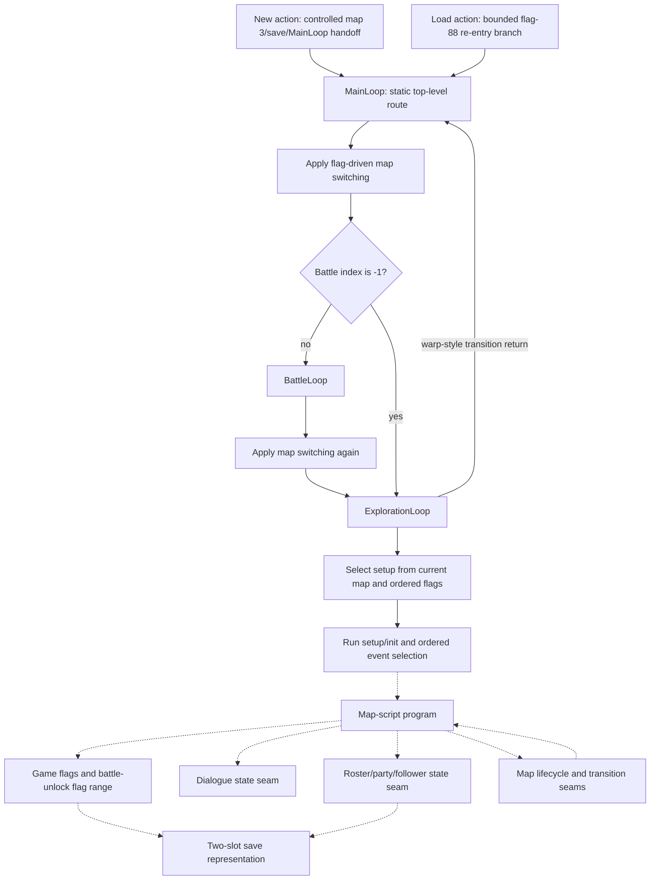

# Story Progression

- **Confirmed original behavior:** bounded New-game/re-entry handoffs, top-level map/battle/exploration
  routing, ordered setup and event selection, the complete map-script program graph, handler-local
  story-flag mutation, dialogue cursor/control seams, roster mutations, map lifecycle/transition
  boundaries, and the in-process save actions described below.
- **Inferred original behavior:** these independently confirmed seams form a reusable progression
  architecture in which map, flag, party, and battle state select later local behavior.
- **Unknown original behavior:** a complete normal-play chronology, plot-beat meaning, player-choice
  consequences, route exclusivity, full save persistence, and player-visible story presentation.
- Remake status: implementation-neutral Layer B synthesis; current engine direction belongs to
  [ADR 0019](../../decisions/0019-state-and-content-driven-remake-engine.md). This document selects no
  campaign rewrite or narrative data model.
- Evidence date: 2026-08-02.
- Source baseline: `ShiningForceCentral/SF2DISASM` `master`
  `c834c652b6862bc5679fd7f69a38a7093206efc6`.

## Judgment Boundary

This document explains how accepted original-game state and control boundaries can support story
progression. It is not a plot summary and not a chronological walkthrough. A source label, a static
incoming reference, or a successful handler-local replay does not establish that a normal save reaches
that code, when it reaches it, what the player sees, or what the event means in the fiction.

The safe synthesis is therefore a **progression framework**, not a campaign route:

1. top-level control chooses battle or exploration from current state;
2. current map plus ordered flags selects a six-part map setup;
3. ordered map events and map-script branches select local programs;
4. local programs may inspect or mutate flags, dialogue state, roster state, and map state;
5. warp-style exploration returns and returning `BattleLoop` handoffs re-enter the top-level route;
6. save services can serialize the bounded combatant-data region, but complete subsystem persistence
   is not yet demonstrated.

The [documentation roadmap](../documentation-roadmap.md) deliberately places this synthesis after the
[gameplay overview](gameplay-overview.md), [tactical battle loop](tactical-battle-loop.md), and
[progression/economy synthesis](progression-and-economy.md). Those documents explain the local
systems that story progression coordinates; none supplies missing narrative chronology.

## Read Story Content in Segments

[Opening through Battle 01](opening-through-battle01.md) connects the selected Map 3 opening,
messenger, castle/royal/tower phases, encounter and usable return. It supplies the location/entity/
dialogue/encounter reading route over accepted evidence, with additional interactions and conditional
branches kept separate from mandatory observed content.

Continue with [Battle 01 return through Battle 02 admission](battle01-return-through-battle02.md)
for the next conditional source-connected segment: castle return, exorcism/commission, Jaha's join
and west-exit admission. It preserves alternate callers and state/selector conditions. Its **Confirmed
static** content and **Inferred** narrative connection do not extend the original observed frontier
or remake acceptance below; natural continuity and legal walking remain **Unknown**.

[Battle 02 outcome through Battle 03 admission](battle02-outcome-through-battle03.md) follows with
outcome/return, conditional Yeel/Kazin guidance and the separate Map66 zone request/consumer path.
Following is distinct from recruitment; Yeel is not a demonstrated encounter prerequisite. This
segment also retains static/natural and original/remake boundaries.

[Battle 03 outcome through Battle 04 admission](battle03-outcome-through-battle04.md) continues
through the conditional return, Hawel-house initialization, Kazin recruitment and separate exit
request/encounter selector. House default versus repeat setup and joined/follower/unlock state remain
distinct; natural walking, caller/presentation/persistence and initialized Battle04 remain Unknown.

[Battle 04 outcomes through Battle 05 admission](battle04-outcomes-through-battle05.md) follows with
victory/special-defeat/escape distinctions, Galam prison/castle content, Slade following and the guard's
conditional unlock/request. It stops at before/start and preserves natural walking, actor/reentry and
active-party Unknowns; source branches do not establish a forced loss or a continuous walkthrough.

[Battle05 outcomes through Battle06 admission](battle05-outcomes-through-battle06.md) continues
with the separate position/HP consumer, first-completion jewel scene and Slade join, Galam exits and
conditional row-6 selection/before/start. F407 is written at entry, rather than completion or a proved
Battle07 route; walking, caller/party/reentry and presentation remain Unknown.

[Battle06 outcomes through Battle07 admission](battle06-outcomes-through-battle07.md) continues
with variable outcome returns, F506 town/castle content, optional Kiwi recruitment, royal following
and conditional tower requests. F407 admission remains separate from F506 content; F401 interception,
F999 substitution and F457/F88 skips retain walking, follower/reentry and party Unknowns.

[Battle07 outcomes and the exploration handoff](battle07-outcomes-and-aftermath.md) follows with
victory/repeat/defeat/escape, phased tower aftermath and separate jewel/current-follow/persistent-flag
effects. The return request precedes script/caller completion; void Map58 setup reconstructs followers
before conditional control restoration. F999, conflicting follower flags, natural service completion
and onward walking remain explicit limits; the guide stops at the immediate Map58 outgoing owner.

[Post-tower return through earthquake-town entry](post-tower-return-through-earthquake-entry.md) continues
through selected tower/castle exits, independent Astral dialogues, earthquake-map substitution and
first/repeat town initialization. It stops at the conditional control/event read; legal walking,
caller/follower state and natural service completion remain Unknown, with later evacuation separate.

[Earthquake-town exit through docks departure](earthquake-town-through-docks-departure.md) continues
through the changed harbor, same-map boarding, the old man's Yes/No choice and phased departure.
It distinguishes follower-flag clearing, actor reconstruction and in-script Map66 loading from the
conditional Map73 request handoff. Walking, occupancy, follower/service/pending state and the separate
zone-table anomaly retain their limits; destination initialization and later voyage remain outside it.

[Voyage and landing through damaged-ship control](voyage-through-damaged-ship-control.md) follows with
Map73 first/repeat selection, optional Kiwi content, landing/crowd instructions and the scripted
Jaha/plank scene. Two in-script Map14 loads bypass its init; F700 is written after script return
and before conditional control. Actor-reference reuse, follower/party state, natural arrival and
services/pending outcomes retain their limits; player plank progression and Battle08 remain separate.

[Damaged-ship plank choices through Battle08 admission](damaged-ship-plank-through-battle08.md) continues
with the optional plank response, explicit/same-map entry alternatives, timber handover and repeated
rescue request. F408/request production precedes caller F703/EGRESS_MAP writes; Map72 admission and
F458 before/start dispatch remain distinct from scene casts and the combat roster. It stops before
ActivateEnemies, preserving pending, walking, follower/service and suspended-entry limits.

[Battle08 outcomes through the New Granseal castle handoff](battle08-outcomes-through-new-granseal-handoff.md)
continues with first/repeat victory, defeat/escape, the worker and blocked-tunnel scene, conditional
Map73 construction and its outgoing request. BattleLoop's direct return-field read differs from
exploration pending consumption; F705 is written by the init caller after the script. Actor/follower,
reset, service and natural-route limits remain explicit. It stops before Map7 destination init.

[New Granseal castle: the year-later address and first control handoff](new-granseal-castle-year-later-control.md)
continues through setup priority, first/repeat init, rebuilding/trade speeches, dismissal and the
explicit ordinary-population reload. Caller F707/F411 writes precede the first pending/control
read; same-map display loads, actor mapping and named/unjoined waits retain their limits. It stops
at that read without claiming natural arrival, completed services or actual usable control.

[New Granseal town: Peter's first introduction](new-granseal-town-through-peter-introduction.md)
continues through conditional castle departure, town setup/init, the sailor/guard introduction and
Peter's reception. F706 and F701 independently gate the two zones; caller flags follow script return.
Hiding and named/unjoined actions remain distinct from recruitment, persistent dismissal and arrival.
It stops at the first post-Peter pending/control read without claiming natural travel or usable input.

[Peter's castle audience and the return to town](peter-castle-audience-through-town-return.md)
continues with conditional castle admission, Astral staying behind, Peter's join/AI and distinct
following mechanisms, the gift's narrative/state mismatch and town re-entry. Request production
precedes caller F702 then F67; destination setup/init precede the first pending/control read.
It stops there with natural travel, observed gold, service completion and usable input Unknown.

[New Granseal departure through Battle09 admission](new-granseal-departure-through-battle09.md)
continues through town departure, the selected east-then-south overworld connections and conditional
encounter admission. Scrolling retains exploration/cohort state; ordinary entry and a partial reload
reach ordered battle selection. Specific/default zones, carried request bytes and F409/F509/F459
remain distinct. It stops at the empty start-dispatcher return before enemy activation, with natural
travel, actor/request survival, service completion and battle readiness Unknown.

[Battle09 outcomes through Ribble's welcome](battle09-outcomes-through-ribble-welcome.md) continues
through variable battle returns, separate town entry, suspicion and Peter's explanation. Independent
welcome gates and distinct resident reload, door reconstruction, roof restoration and current follow
effects remain explicit. It stops after the mayor caller and first conditional restored control,
with natural travel, actor/service completion, pending and visible village changes Unknown.

[Ribble's optional May recruitment through Battle10 admission](ribble-may-through-battle10-admission.md)
continues with the linear invitation, distinct joined/active/current-follow state, directions and
selected departure. Ordinary entry rebuilds entities; the east scroll bypasses battle selection,
and a partial zone request reaches ordered Battle10/14 admission. It stops at the empty
start-dispatcher return before ActivateEnemies, with actor/party, request, service, cross-save
presentation and natural-route limits explicit.

[Battle10 outcomes through the optional East Shrine visit](battle10-outcomes-through-east-shrine-visit.md)
continues with variable battle return, separate shrine entry, mistaken identity, the grandfather's
account and invitation. Independent persistent/temporary gates permit different interaction orders;
current 129 following differs from the F77 rebuild under 30. It stops after the old-man caller and
first conditional control handoff, retaining mapping, service, save/reentry and natural-route limits.
This optional branch does not establish a mandatory Battle11 route.

[East Shrine return through Battle11 cave admission](east-shrine-return-through-battle11-admission.md)
continues from the optional shrine exit or direct Battle10 return through selected scroll/fixed
connections, exact F411 admission and Peter's exchange with the hobgoblin. F461 intro/F88 resume,
no-setup cave exploration, follower-selected placement and later combatant replacement remain distinct.
It stops at the new-battle start-dispatcher return before ActivateEnemies, retaining interruptions,
actor/party/service/pending and darkness-presentation limits. No mandatory shrine route is established.

[Battle11 outcomes through Polca's first Oddler arrival](battle11-outcomes-through-polca-arrival.md)
continues with variable cave return, carried egress, selected exits and separate F413 town admission.
The first X24 event stages the injured boy and villagers' response, then explicitly reloads the
F710 residents before caller F711 handling and the F710 write. Following is rebuilt and can retain
the same target/offset. It stops at first conditional restored control, preserving actor/HP/mapping,
service/pending, presentation and natural-route limits; it recruits neither Oddler nor Gerhalt.

[Polca's fairy interaction through Battle12 admission](polca-fairy-through-battle12-admission.md)
continues with the optional turtle test, fairy departure, independent east exit and searching-devils
confrontation. F711 caller/alternative-producer state, actual event lookup and transient/rebuilt
following remain distinct. F412 immediate admission, F512 empty population and F714/F712 init can
change the ordinary scene branch. The scene's unlock/request precedes caller F713 and consumption;
wildcard admission, actual battle placement and F462/F88 branches remain separate. It stops at the
new-battle start-dispatcher return before ActivateEnemies, with natural travel, supplied actors,
services/pending and rendered transformation Unknown; helping the turtle is not an exit prerequisite.

[Battle12 outcomes through Bedoe's initial guard encounter](battle12-outcomes-through-bedoe-entry.md)
continues with leader recognition, first/repeat mountain returns, Peter's response, selected Bedoe
entry and the guards' challenge, recognition and requests. HP/F512 leader/join tails, independent
F714/F712 response and F722 setup selection remain distinct. Final guard placements precede caller
F719 and optional F720 out-of-map movement; current following does not establish persistence.
It stops after default/alternate init and first conditional restored control, before the king's
address/audience, retaining natural-route, actor/party/AI, service/pending and presentation Unknowns.

[Bedoe's king address and first audience](bedoe-king-address-through-first-audience.md) continues
with the report, dispersing guards, Luke's greeting, introductions, Zeon warnings and the invitation
to Volcanon. F720/F721 independently admit the scenes; F722 replaces their zone table. Real hiding
differs from re-entry out-of-map movement, and shared 147/148 positions depend on prior scenes and
supplied state. The final command installs Peter following Bowie without joining anyone. It stops
after the audience caller and conditional control, preserving natural floor/order, actor/mapping,
service/pending and presentation Unknowns; shrine travel and Volcanon remain separate.

[Bedoe to the Volcanon audience](bedoe-to-volcanon-audience.md) continues through explicit shrine
entry, retained-population current-map entrance, Peter's return/introduction, Volcanon's refusal,
jewel advice and Peter's commitment. Scene attribution to Volcanon differs from speaker128's
birdman mapping. F722 alone admits the scene; later F722/F711 writes, F7 membership,
capacity-dependent F39/cached lists, AI bit2 clear, unchanged F67 and current following remain
distinct. It stops at first conditional Map11 control, retaining supplied-state, natural-floor,
service/pending and presentation Unknowns; its selected return continues separately below.

[Volcanon return through the Bedoe king choice](volcanon-return-through-bedoe-king-choice.md)
continues with selected shrine return, the optional Zeon question, refusal/repeat and Creed/river/raft
advice through Luke's requested departure. F722 selects setup independently of F799/F724; F75 can
supply follower Luke instead of the fixed row, and F67 supplies Peter. Yes requires confirmation,
No/B share refusal and no input stays pending. Destination-based facing has no HP guard; waited
actions, hide invalidation, later coordinate-only init and saved physical king-facing restore remain
distinct. Only script return reaches F799. It stops after the caller and conditional control, retaining
natural-floor, supplied-state, input/service/pending and presentation Unknowns. Bedoe exit, Polca/raft
fulfillment, hatchling/rescue, Luke recruitment and Battle13 remain separate.

[Bedoe's hatchling flight and rescue](bedoe-hatchling-flight-and-rescue.md) explains separate optional
content: the demonstration, repeat claim, fall/rescue and conditional return from each caller. F722
selects setup; F723 controls flight/repeat, while F13/F724 independently control rescue, without an
F799 king-choice prerequisite. Shared speed/sprite/priority state, nonwaited actors, real hide versus
coordinate-only init, HP-dependent following and retained versus rebuilt mappings remain distinct.
It stops at those caller/control boundaries, preserving natural access, supplied-state, contact,
service/presentation and persistence Unknowns; no future Skreech recruitment is promised.

[Bedoe return through Battle13 admission](bedoe-return-through-battle13-admission.md) continues the
selected main route through south/west exit requests, changed Polca population, the devils' confrontation,
Gerhalt joining and conditional new-battle start. F513/F799/F710 setup priority differs from the
F710/F799/F715 zone and independent F413 admission; F74 supplies Astral/king/minister, not Gerhalt.
F9/F41/cache timing, health, following and AI remain separate. Scripted birdmen death presentation
and Luke's interrupted animation/movement do not establish combat deaths or a frozen position.
Unlock/request precede caller F715 and consumption; empty before/start scripts, F463/F88 alternatives
and battle-population rebuilding retain their boundaries. It stops before ActivateEnemies, with
natural travel, supplied state, services/presentation and playability Unknown; hatchling content
imposes no prerequisite or forced order, and no raft fulfillment or Luke recruitment is asserted.

[Battle13 outcomes through Polca's raft grant](battle13-outcomes-through-polca-raft-grant.md)
continues through first/repeat victory, distinct Bedoe defeat/Egress, Luke's accompanying flag,
fresh Polca population and the optional mayor bargain. F75 differs from Luke membership/HP/AI;
F718/F717/F716 caller priority precedes temporary contacts, and only scene return reaches the
ordered F716/F64/Map72 `(43,48)` writes. Current following, hide133 and future recreation remain
separate. It stops at conditional caller/control return, retaining natural reach, actors/services,
presentation and persistence Unknowns; configured raft state proves no current Polca raft,
river availability or boarding. Oddler choice/departure and later travel remain outside scope.

[Polca's Oddler choices and following](polca-oddler-choice-and-following.md) explains the independent
Y11/Y30 requests, first refusal return and second refusal appeal that converges without another
prompt. F89 records the returned choice; F717/F718 caller predicates differ from internal
F68/clear75/F718 and future population. Current Peter→Bowie,140→Peter,Luke→140 differs from list
order and later FOLLOWER_B31 construction/NPC140 init removal. It stops at both caller/conditional
control returns, preserving input, actor/HP, service/presentation and persistence Unknowns;
actual Polca departure, river/boarding, Battle14 and recruitment remain separate.

[Polca departure and Luke recruitment](polca-departure-through-luke-recruitment.md) continues with
the selected south warp, conditional battle interruption and independent F716-set/F10-clear init.
Fresh followers and separate raft mapping differ from current-map population; new Luke allocation
can retain an old F75 follower. All six attributed texts and join446 lead through separate F10,
conditional F42/cache, current hide and later F416 effects, without transaction or retry repair.
It stops at conditional exploration control, retaining actor/HP, natural-route, service/presentation,
input and persistence Unknowns; Luke's Down1 proves neither boarding nor Battle14/16 route order.

[Polca raft boarding and South Parmecia entry](polca-raft-boarding-through-south-parmecia-entry.md)
continues from that control boundary through separate type3 production/physical alignment, staged
Bowie/raft/list changes and mode2 committed last. Physical31, FOLLOWER_D159/lookup63 and FOLLOWER_B31
remain distinct; the group wait polls only the last listed actor. Actual mode2 selects opcode8,
with type5 as the disembark-request stopping alternative. Both selected southern rows resolve to
Map69, distinct from Southeast70: row6 returns through conditional F409/F417 admission and fresh
population, while row9 preserves X/facing and retained actors within exploration without that scan.
It stops at the request, pre-init battle admission or conditional control, preserving natural-route,
supplied-state, service/presentation/input and persistence Unknowns; F416 alone starts no Map69 battle.

[South Parmecia, the Kraken reveal and Battle16 entry](south-parmecia-through-kraken-battle16-entry.md)
continues with selected Map69 row0→Map49 and F416/F516 admission, distinct from F466 intro/start
and F88 saved entry. The complete encounter has four Peter and three conditional FOLLOWER_B text
sites; scene actors, shared ENTNUM sprite slots and requested services differ from the later healed,
membership-sensitive combatant rebuild. Map49's no-admission fallback selects ms_Void. It stops
after the empty start wrapper, before activation/turns/combat/outcomes, preserving supplied-state,
natural-route, service/presentation/input and persistence Unknowns without Battle14/15 prerequisites.

[Battle16 outcomes, disembark and conditional Hassan entry](battle16-outcomes-through-hassan-entry.md)
continues through leader/defeat priority, first/repeat victory and distinct Polca loss/escape returns.
Victory reads the after-scene tuple and skips CheckBattle; the selected Hassan warp uses ordinary
exploration consumption without an explicit disembark prerequisite. Tuple saving, actor moves,
last-listed-actor waiting and flag-based follow restoration precede mode0. F518 cast selection and
F518/F65/F12 init preserve absent-Rick lookup→main0 and F84 Rohde-following limits. It stops at
conditional control before town interactions, retaining natural-route, supplied-state, service/input
and persistence Unknowns; town entry preserves transport mode and proves no usable walking.

[Hassan ancestry and Rohde's Caravan choice](hassan-ancestry-and-rohde-caravan-choice.md)
explains independent priest zones and Rohde talk/selected-item admission, complete initial/repeat
choices and conditional following/control. Joined-member sword search differs from selected sword
Use at physical0's `(16,58)`; repeat talk skips the search and suppressed item use returns to the
submenu. F726, F727 and F725 retain separate suppression roles; F84/F418 and Rohde-to-current-
FOLLOWER_B following confer no force membership, F65 unlock or item consumption. Attributed lore,
actual supplied actors/HP/input, unfinished services, fresh-population differences and usable control
remain bounded or Unknown. It stops before acquisition, Rick, departure, Taros and Caravan operation.

**Confirmed bounded original observation:** the
[current original frontier](map3-battle01-readiness.md#accepted-original-frontier) now reaches from
controlled R1 through a savestate-linked winning route and stable Map57 return; a separate accepted
extension observes ordinary Down input and displacement. The earlier generic handler matrices and
this document's historical audit remain bounded seams. Their Unknowns do not erase the later selected
route, and that route does not prove full campaign chronology, unobserved choices or durable story
persistence.

**Confirmed accepted private remake milestone:** the
[current composition](map3-battle01-readiness.md#accepted-current-milestone) accepts the selected
continuous victory and usable 5B return, including reached content consumers, completion and input
readiness under the modern clock/default-keyboard-A scope. Historical report verdicts remain with
their owners. The wider framework below does not require re-proving that accepted segment; original
hardware timing and wider reachability remain separate **Unknowns**.

## Pre-Synthesis Evidence Audit

The synthesis was checked against the exact executable owners instead of relying on prose or source
names alone. The audit kept the following distinctions intact:

- [gameflow research](../../research/gameflow-core.md) owns the static `MainLoop` and
  `ExplorationLoop` ordering. It has no runtime fixture for exact transition frames or interrupt-edge
  event/input timing.
- [map-data research](../../research/map-data-inventory.md) and the setup fixtures own ordered setup and
  event selection. Setup selection is **last set flag wins**; event dispatch is **first matching record
  wins**. These rules are not interchangeable.
- [common-scripting research](../../research/common-scripting.md) owns the complete program corpus and
  handler-local command families. Static references prove graph topology, not normal-story reachability.
- The map-lifecycle runtime fixture owns five direct handler replays, direct JSR-site order, the reset
  tail, and bounded layout/current-map fields. The separate map-script transition fixture owns five
  `ExecuteMapScript` streams, including `warp`, opcode/A6/dispatcher/handler/fall-through chronology,
  bounded `csc07` event bytes, and direct service entry/return seams. Neither owns event consumption,
  visible transition behavior, normal-story reachability, or persistence.
- [dialogue](../contracts/dialogue-system.md) and [party/roster](../contracts/party-roster-state.md) own their state and
  runtime boundaries. Neither fixture proves who speaks, why a member joins, or how either event is
  presented during normal play.
- [save](../contracts/save-system.md) owns the two-slot representation and bounded in-process action matrices.
  It does not prove that every story-relevant subsystem survives a process restart or power loss.

The focused audit reproduced the map-script, setup, event, story-state, dialogue, force-state,
control/audio, map-lifecycle, map-script-transition, New-game, and save-action fixtures. No mismatch
was found among those owners. Their exact fixture identities remain visible in the
[evidence matrix](#evidence-matrix).

## Progression Vocabulary

| Term | Confirmed meaning in this synthesis | Boundary that remains visible |
| --- | --- | --- |
| top-level route | Static `MainLoop` ordering applies flag-driven map switching, tests for battle, and otherwise reaches exploration; a returning `BattleLoop` invocation passes through map switching again. | Exact transition frames, battle-outcome semantics, and a complete campaign chronology are **Unknown**. |
| game flag | A bit addressable through confirmed check/set/clear handlers. The static map-script corpus has bounded read and write sites. | A numeric flag or source name does not establish its narrative meaning or lifetime. |
| setup route | Current map selects a default six-pointer setup and then scans every ordered flag variant; each set variant replaces the candidate. | Selection is confirmed, but a normal save's reachable map/flag combinations are **Unknown**. |
| event route | Ordered entity, zone, or item records select the first match and hand off to a bounded target identity. | The selected program's side effects and presentation are outside the event-dispatch fixture. |
| map-script program | One of 304 inventoried programs with guarded commands, labels, and explicit transfer targets. | A reference is not evidence that the program executes in normal play. |
| dialogue cursor | The state consumed or changed by bounded dialogue handlers; explicit cursor sites remain inside the source-backed text-ID domain. | Decoded text, speaker identity, portrait/audio output, waits, and input timing are **Unknown** here. |
| roster mutation | A bounded handler-local join, battle-party, AI, reset, death-list, revive, or follower operation. | Recruitment meaning, capacity lifecycle, save persistence, and presentation are **Unknown**. |
| battle-unlock flag | The source-named `setStoryFlag` handler adds 400 to its word operand before setting a flag. | The label and arithmetic do not prove battle chronology, completion, or story significance. |
| persistent story state | State that survives the complete original save/load lifecycle. | Only bounded combatant-data save actions are confirmed; subsystem-complete story persistence is **Unknown**. |

## Bounded Progression Architecture

Solid edges describe confirmed bounded control-flow seams, but the `MainLoop`/exploration layer is
currently static evidence rather than a frame-observed route. Dashed edges distinguish optional or
handler-local relations from one universal sequence: event selection exposes a target without running
its body, programs contain only the command families they actually reference, and lifecycle H3 closes
handler return rather than later visible effects. The two dashed save edges are explicit **Unknown**
questions, not claims of persistence.

The diagram deliberately cycles back to top-level routing because the static gameflow owner confirms
that exploration returns for warp-style transitions and battle return passes through map switching.
It does not order the 304 programs into a story timeline.

## Top-Level Route and Local Selection

### Main loop and exploration

**Confirmed static:** `MainLoop` applies flag-driven map switching before testing the current battle.
Battle index `-1` is the no-battle sentinel. A real battle calls `BattleLoop`; return then passes
through map switching again before exploration. `ExplorationLoop` establishes or resumes map/entity
state, loads map resources, runs the selected setup function, and alternates between pending map events
and A/C actions.

`WaitForEvent` polls `MAP_EVENT_TYPE` before reading A/C input, and the outer loop dispatches a pending
event before the player-action result. This proves static priority when both are already visible in one
polling iteration. The interrupt edge at which each value becomes visible remains **Inferred**.

The six source event categories at this layer are warp, enter caravan, enter raft, leave caravan,
leave raft, and zone event. These are control identities, not six narrative phases. An out-of-range
event plays the source-owned battlefield-death sound effect and returns; that fallback does not assign
story meaning to the invalid value.

### Setup selection

**Confirmed static and runtime:** the setup table contains 64 map rows, 66 ordered flag rows, and 126
unique six-pointer setup tables. Each setup points independently to entities, entity events, zone
events, area descriptions, item events, and an initialization function.

Selection begins with the map's default pointer, scans all variants in source order, and replaces the
candidate after every successful flag check. Therefore the last set flag wins. Four later rows point
back to a default setup, so a faithful model must preserve order and aliases rather than normalize the
variants into an unordered dictionary. The ten-case runtime matrix confirms missing-map fallback,
defaults, single and multiple set flags, last-set-flag behavior, and later default-restoring aliases.

This is a local selector. It does not prove which map/flag combinations occur in an ordinary save or
that a selected setup represents a particular plot beat.

### Event selection

**Confirmed static and runtime:** the event inventory retains 1,134 physical source/ROM records and
their separately weighted setup/route references. The nine-case runtime matrix confirms ordered
selection for entity-specific/default, zone exact/wildcard/overlapping-first/default, and item
index/facing/default variants. Unlike setup selection, these dispatchers select the first matching
record.

The runtime harness replaces each selected target's first instruction with `rts`. It confirms record
offset and target identity while intentionally excluding script side effects. A story model may use the
selection rule and target identity, but it may not infer dialogue, flag writes, facing, or transition
effects from this fixture.

## Local Script Graph and State Channels

### Program topology

**Confirmed static:** the complete map-script corpus contains 304 programs across 169 source files,
13,515 commands, 348 labels, and 184 explicit transfers. Of those transfers, 62 are same- or
cross-program unconditional/conditional edges and 122 call 68000 subroutines outside the program
graph. All encoded control targets resolve.

This provides a bounded graph on which later reachability work can operate. It is not itself a route:
static incoming references, same-file-only references, source-only programs, and unreferenced labels
remain distinct, and none establishes execution under a normal save state.

### Story-state reads and writes

**Confirmed static:** seven source forms account for 146 command sites:

| Source form | Sites | Bounded operation |
| --- | ---: | --- |
| `jumpIfFlagSet` | 24 | Test a flag; take the encoded target when set, otherwise skip it. |
| `jumpIfFlagClear` | 27 | Test a flag; take the encoded target when clear, otherwise skip it. |
| primary `csc10` | 0 | Physical toggle-command carrier with no direct source use. |
| `setF` | 37 | Alias that selects the set path. |
| `clearF` | 16 | Alias that selects the clear path. |
| `yesNo` | 22 | Controlled return 0 sets flag 89; nonzero clears it; both then call `Sleep` with 10. |
| `setStoryFlag` | 20 | Add 400 to the operand and set the resulting flag. |

The corpus has 51 conditional reads across six unique flags, 53 direct writes, 22 prompt writes, and
20 source-named battle-unlock writes. Only flags 71, 76, and 89 overlap the static read and write sets.
These counts describe source sites, not event frequency.

**Confirmed runtime:** ten handler-local cases cover both polarities of each conditional branch,
set/clear aliases, both controlled yes/no returns, base flag 400, and 16-bit wrap to flag 0. The
yes/no harness proves the result-to-flag polarity and ordered sleep handoff, not the visible prompt,
available choices, or downstream consequence.

### Dialogue as a progression seam

**Confirmed static and runtime:** six dialogue forms account for 2,883 commands in the complete
program corpus. The 21-case runtime matrix closes handler cursor movement, skip polarity, direct state
writes, modifier partitions, explicit cursor bounds, and ordered service-entry/return seams.

Those handlers can be represented as local progression effects on dialogue state plus service calls.
The services were shimmed for the bounded observation, so rendered text, character identity, portrait,
speech sound, controller timing, waits, and normal-story reachability remain **Unknown**. No decoded
dialogue is needed or reproduced by this synthesis.

### Roster and party state as a progression seam

**Confirmed static, with a bounded runtime subset:** source forms cover force joining, conditional
death/list checks, defeated-list mutation, revival, battle-party membership, AI activation,
battle-stat reset, and followers. The nine-case active-party matrix confirms bounded handler-local
chronology and state for already-active, replacement, AI clear/set, reset, and follower allocation
cases; it does not runtime-close every roster/death form.

The fixture intentionally does not convert labels such as `join`, `allyDefeated`, or follower names
into plot assertions. A local script may mutate party-related state; who joins, why, whether the change
is optional, and how it persists or appears to the player remain **Unknown** until a normal-route
fixture closes them.

### Control, audio, map lifecycle, and transitions

**Confirmed static and runtime:** seven control/audio forms account for 2,336 source occurrences. A
six-case matrix confirms bounded wait/skip, no-op dispatch, sound-command trap, subroutine call/return,
jump cursor replacement, and end behavior. It does not prove duration, audible output, or story meaning.

Four map lifecycle forms account for 108 commands: reset, fade-load, reload, and map-load. The
five-case runtime matrix confirms handler return and ordered direct call-site boundaries, including the
reset tail, selected layout markers, and current-map changes. It does not execute representative
streams from the interpreter or include `warp`.

**Confirmed bounded transition runtime:** the separate five-case transition matrix runs `warp`,
reset, fade-load, reload, and map-load streams through the unmodified `ExecuteMapScript` loop. It
confirms opcode and terminal-word consumption, A6 offsets, handler/dispatcher entry and return order,
the fade-load handler's fall-through into map-load, bounded `csc07` event bytes, and direct service
entry/return seams. The source writes `OUT_TO_BLACK` value 2 at `csc37` entry, while this bounded run
observes `FADING_SETTING` 0 at the first `csc48` `WaitForVInt` entry after `LoadMapTilesets`. Those
are distinct source/runtime facts, not a fade-duration or completion rule.

Event consumption, visible map/camera presentation, fade/display timing, entity placement,
collision/pathfinding, unobserved service effects, normal-story reachability, and persistence remain
**Unknown**. The transition fixture's `warp` event bytes and the top-level warp-style return establish
bounded producer and control handoffs; they do not close what consumes the event or what the player
sees.

## Entry, Re-entry, and Persistence

**Confirmed bounded New-game handoff:** four controlled cases enter the original New action, exercise
slot and difficulty flag paths, call `SaveGame`, and transfer to `MainLoop` with current/egress map 3.
The harness bypasses player-driven naming, menu selection, and text presentation. Map 3 is therefore a
confirmed handoff value, not permission to label a plot location or opening scene.

**Confirmed bounded Load handoff:** the in-process save matrix confirms two-slot Save/Load/Copy/Delete
services. After `LoadGame`, source flag 88 clear reaches `GetSavepointForMap`; flag 88 set reaches the
`BattleLoop` jump interface. The fixture retains the numeric flag identity without assigning it a
player-facing lifecycle meaning.

**Unknown persistence boundary:** the static save representation covers 4,016 logical bytes per slot
and the runtime matrix samples the combatant-data region in one process. No current fixture proves that
the complete game-flag bitset, map-script cursor, setup selection, followers, dialogue state, or every
other story-relevant field survives the original cross-process save/load lifecycle. A remake must not
declare a canonical story-save schema from these partial facts.

## What This Enables Now

An implementation-neutral prototype may safely model:

- ordered top-level battle/exploration handoffs;
- a current-map key and ordered flag-based setup selector;
- ordered first-match event tables whose results are target identities;
- a map-script graph with explicit conditional, jump, and subroutine edges;
- bounded flag, dialogue-state, roster-state, control, and map-lifecycle operations;
- save entry/re-entry adapters with explicit unproven persistence fields.

It must keep provenance on every imported program, edge, selector row, and mutation. It must also keep
`Confirmed`, `Inferred`, and `Unknown` separate so that future route observations can refine the graph
without rewriting source-backed facts.

## What Is Not Yet a Story Route

The following remain **Unknown** and block any claim that the original campaign has been reconstructed:

1. which of the 304 programs and 184 transfers execute in a normal playthrough;
2. the initial and reachable game-flag sets for each save/progression point;
3. a chronological ordering of maps, battles, dialogue, roster changes, and transitions;
4. whether any yes/no prompt creates a persistent or mutually exclusive route;
5. the narrative meaning of numeric flags, source labels, map IDs, and battle-unlock operands;
6. complete story-state persistence across save, load, process restart, and power loss;
7. decoded dialogue, speakers, plot beats, animation, audio, input cadence, and visible timing;
8. optional-content, missable-content, failure, backtracking, and post-battle route behavior.

These gaps require grouped runtime observations from natural callers and known save states. Source-name
interpretation, isolated target execution, or a synthetic all-flags experiment is not a substitute.

## Evidence Matrix

| Boundary | Evidence label and bounded claim | Exact executable owners | Remaining question |
| --- | --- | --- | --- |
| top-level gameflow | **Confirmed static** map switching, battle sentinel/call order, a returning `BattleLoop` invocation passing through map switching again, exploration return, and event-before-action branch priority | [gameflow research](../../research/gameflow-core.md); `sf2-gameflow-core-static-v1` ([`gameflow-core-static-v1.json`](../../../tests/fixtures/h2/gameflow-core-static-v1.json)) | Runtime timing, battle-outcome semantics, transition frames, normal campaign chronology |
| complete script graph | **Confirmed static** 304-program/13,515-command corpus and resolved explicit transfers | [common-scripting research](../../research/common-scripting.md); `sf2-map-script-engine-static-v1` ([`map-script-engine-static-v1.json`](../../../tests/fixtures/h2/map-script-engine-static-v1.json)) | Normal-save admission and reachable-route ordering |
| setup selection | **Confirmed static/runtime** ordered map/flag scan, last-set-wins, aliases, and missing/default cases | [map-data research](../../research/map-data-inventory.md); `sf2-map-setup-static-v1` ([`map-setup-static-v1.json`](../../../tests/fixtures/h2/map-setup-static-v1.json)) and `sf2-map-setup-selection-runtime-v1` ([`map-setup-selection-v1.json`](../../../tests/fixtures/h3/map-setup-selection-v1.json)) | Reachable map/flag combinations and selected setup effects |
| event selection | **Confirmed static/runtime** ordered records and first-match entity/zone/item target selection | [map exploration](../contracts/map-exploration.md); `sf2-map-events-static-v1` ([`map-events-static-v1.json`](../../../tests/fixtures/h2/map-events-static-v1.json)) and `sf2-map-event-dispatch-runtime-v1` ([`map-event-dispatch-v1.json`](../../../tests/fixtures/h3/map-event-dispatch-v1.json)) | Selected script effects, normal reachability, presentation |
| story-state commands | **Confirmed static/runtime** conditional polarity, direct set/clear, flag-89 prompt polarity, and 400-base write arithmetic | `sf2-map-script-engine-static-v1` ([`map-script-engine-static-v1.json`](../../../tests/fixtures/h2/map-script-engine-static-v1.json)) and `sf2-story-state-runtime-v2` ([`story-state-v2.json`](../../../tests/fixtures/h3/story-state-v2.json)) | Flag meanings, prompt consequences, persistence, normal reachability |
| dialogue seam | **Confirmed static/runtime** six-form corpus plus handler-local cursor, branch, state-write, and service-call boundaries | [dialogue contract](../contracts/dialogue-system.md); `sf2-map-script-engine-static-v1` ([`map-script-engine-static-v1.json`](../../../tests/fixtures/h2/map-script-engine-static-v1.json)) and `sf2-map-script-dialogue-runtime-v1` ([`map-script-dialogue-v1.json`](../../../tests/fixtures/h3/map-script-dialogue-v1.json)) | Content, speakers, unshimmed services, input/timing, normal route |
| roster/party seam | **Confirmed static/runtime subsets** roster/death forms and nine active-party/AI/reset/follower cases | [party/roster contract](../contracts/party-roster-state.md); `sf2-map-script-engine-static-v1` ([`map-script-engine-static-v1.json`](../../../tests/fixtures/h2/map-script-engine-static-v1.json)) and `sf2-force-state-active-party-runtime-v1` ([`force-state-active-party-v1.json`](../../../tests/fixtures/h3/force-state-active-party-v1.json)) | Recruitment meaning, capacity lifecycle, persistence, presentation |
| script control | **Confirmed static/runtime** wait/skip, no-op, sound trap, subroutine, jump, and end seams | `sf2-map-script-engine-static-v1` ([`map-script-engine-static-v1.json`](../../../tests/fixtures/h2/map-script-engine-static-v1.json)) and `sf2-map-script-control-audio-runtime-v1` ([`map-script-control-audio-v1.json`](../../../tests/fixtures/h3/map-script-control-audio-v1.json)) | Duration, service effects, audible result, normal reachability |
| map lifecycle | **Confirmed static/runtime** reset/load/reload handlers and ordered direct call-site boundaries | `sf2-map-script-engine-static-v1` ([`map-script-engine-static-v1.json`](../../../tests/fixtures/h2/map-script-engine-static-v1.json)) and `sf2-map-lifecycle-runtime-v1` ([`map-lifecycle-v1.json`](../../../tests/fixtures/h3/map-lifecycle-v1.json)) | Visible transition, entity/layout consequences, persistence, normal route |
| map-script transition | **Confirmed bounded runtime** five interpreter streams, including `warp`, with opcode/A6/handler/dispatcher/fall-through chronology, bounded event bytes, direct service seams, and source `OUT_TO_BLACK=2` versus observed first-wait `FADING_SETTING=0` | `sf2-map-script-engine-static-v1` ([`map-script-engine-static-v1.json`](../../../tests/fixtures/h2/map-script-engine-static-v1.json)) and `sf2-map-script-transition-runtime-v1` ([`map-script-transition-v1.json`](../../../tests/fixtures/h3/map-script-transition-v1.json)) | Event consumption, presentation/fade/display timing, normal reachability, persistence, collision/pathfinding, unobserved effects |
| New-game and load re-entry | **Confirmed bounded runtime** controlled map-3/save/MainLoop handoff and flag-88 load routing | [save contract](../contracts/save-system.md); `sf2-witch-new-game-lifecycle-runtime-v1` ([`witch-new-game-lifecycle-v1.json`](../../../tests/fixtures/h3/witch-new-game-lifecycle-v1.json)) and `sf2-witch-save-actions-runtime-v1` ([`witch-save-actions-v1.json`](../../../tests/fixtures/h3/witch-save-actions-v1.json)) | Player-driven UX, flag meaning, full persistence, cross-process behavior |
| save representation | **Confirmed static** two slots, checksum/check order, occupancy, and bounded combatant-data copy direction | `sf2-tech-services-static-v1` ([`tech-services-static-v1.json`](../../../tests/fixtures/h2/tech-services-static-v1.json)) | Canonical story-save schema and durable-medium behavior |

## Original Fidelity and Modernization

Original-fidelity behavior includes ordered selectors, branch polarity, target identity, alias rows,
handler-local mutation order, and the distinction between physical records and route-weighted
references. A parity implementation should preserve those facts before changing them.

Modernization decisions remain separate. A remake may choose explicit quest records, typed flags,
human-readable event IDs, atomic saves, skippable scenes, dialogue logs, route visualization, or
different failure/recovery policy. None of those choices should be described as recovered original
behavior, and none should erase the source identity needed for parity comparison.

## H4 Acceptance and Expansion Gates

An expansion beyond the accepted [opening segment](opening-through-battle01.md) needs evidence for
its specific new route or persistence claim rather than more label interpretation. The checklist below
describes a broader campaign/persistence claim; it is not a new gate on the accepted local segment.
For that broader claim, the evidence must:

1. start from identified original New/load states with explicit save provenance;
2. record current map, battle index, relevant flag deltas, selected setup, selected event/program,
   dialogue cursor changes, roster mutations, and loop handoffs at natural callers;
3. distinguish player input from scripted state and record both sides of any claimed choice;
4. prove save/load persistence for every story-state field it uses;
5. compare the observed route with the static 304-program graph without deleting unreachable or
   source-only rows;
6. keep decoded copyrighted text and captured audiovisual assets private;
7. retain disagreements and non-reached branches as explicit **Unknown** results.

Campaign chapters, wider optional-route consequences, quest semantics and complete player-facing
story choice remain bounded by the evidence needed for each claim. The opening guide may explain its
accepted local sequence and static alternatives now; neither generic program references nor that
one selected sequence completes the wider campaign.
