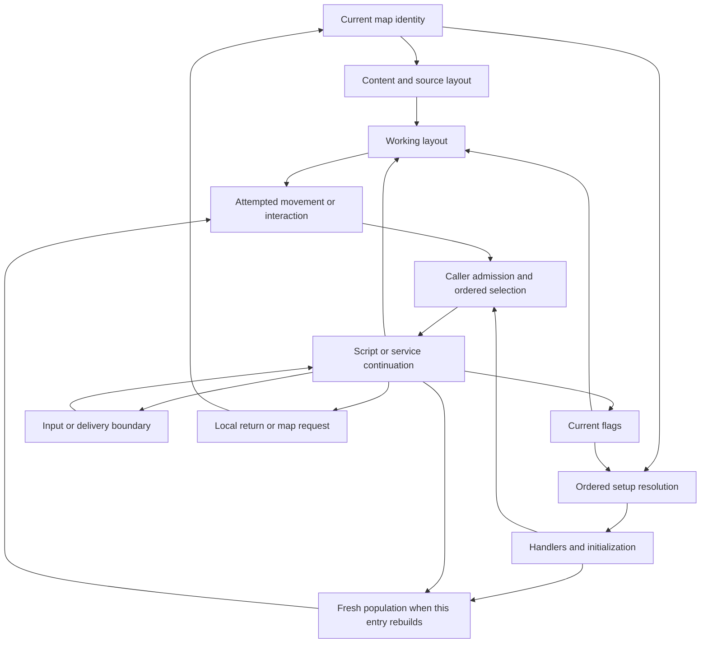

# Map Design Principles: Exploration, Interaction and World Continuity

Exploration connects an attempted action to the state that action leaves behind. A player moves or
turns, faces an actor or searchable place, and requests an interaction. The current map, flags,
working terrain and live actors determine whether the request can reach a handler. A returned
conversation may change a flag or configure transport; leaving and coming back may reconstruct the
place from those conditions. A battle return can change that reconstruction again. Continuing play
and saving it are separate boundaries.

This is an **Inferred Layer B explanation** of accepted original rules and selected chapter joins.
**Confirmed** below identifies a named static fact or bounded observation, with its scope stated;
**Unknown** retains an unresolved boundary. These joins are not a naturally played full-game route,
a judgment about map enjoyment or authorial intent, or an expansion of production support.

Start at the [Gameplay Overview](../gameplay-overview.md#exploration-moving-facing-and-discovering-a-result).
Then read this theme in order, or follow a question:

| Reader question | Reading route |
| --- | --- |
| Why can I turn, move, talk or search with different results? | [Action and interaction](#action-and-interaction). |
| Why does the same place have a different cast or terrain? | [Map state](#structural-vocabulary) and [lifecycle rules](#structural-principles). |
| When does dialogue actually let the next action proceed? | [Dialogue and continuation](#dialogue-and-continuation). |
| Does acquiring transport mean I am riding it? | [Transport](#transport-acquisition-boarding-travel-and-landing) and the [Polca example](#connected-example-polca-return-to-southern-travel). |
| What survives leaving, battle, saving or suspend? | [Return and persistence](#return-and-persistence). |
| Where do these statements stop? | [Evidence limits](#what-the-current-corpus-can-and-cannot-describe) and [review](#pre-synthesis-evidence-audit). |

The [Story Progression](story-progression.md#read-story-content-in-segments) chapters own detailed
content and branches. [Tactical Battle Loop](tactical-battle-loop.md#returning-from-battle-is-not-yet-usable-exploration)
owns outcome/control distinctions; [Progression and Economy](progression-and-economy.md#persistence-boundary)
owns resource and service consequences. This theme explains their exploration joins without
repeating their transactions or campaign transcripts.

## Judgment Boundary

The current Standard agreement is the [documentation roadmap](../../documentation-roadmap.md#current-baseline-and-near-term-synthesis)
and [Issue #1276](https://github.com/FrankHZ/md-sf2-reverse-engineering/issues/1276). The reader outcome
is to follow conditions → attempted action → changed or refused state → continuation or return.
Only this existing thematic owner changes. Research, contracts, other themes, code, UI/UX and Chinese
mirrors remain separate owners. No spatial analysis, original observation or verification platform
is required to explain already accepted facts.

Keep four frontiers separate: accepted static original knowledge extends through selected ending
and reset paths; bounded original observations have their own
[Map3–Battle01 lineage](../milestones/map3-battle01-readiness.md#accepted-original-frontier); English synthesis
consumes that evidence at its named scope; production capability belongs to the
[remake ledger](../../../../remake/docs/capability-status.md). The accepted private continuous
[Map3–Battle01 victory and usable return](../milestones/map3-battle01-readiness.md#accepted-current-milestone)
does not implement Polca, the raft journey or Taros. Broader routes, collision/presentation cases and
durable persistence remain **Unknown** where their owners say so. Reorganizing this explanation
establishes neither full-game completeness nor integrated English stability or Chinese readiness.

## Action and Interaction

### Moving or turning does not yet select a conversation

**Confirmed static:** ordinary controlled movement evaluates directional input against bounds and
actor obstruction before inspecting the proposed point's working-layout marker. An obstructing
actor can prevent the marker branch. The controlled walking path orders enter-Caravan, enter-raft,
door, warp, zone and then passability decisions. Door processing re-reads terrain after mutation.
These rules operate inside movement; they are separate from setup selection or action-button priority.
The [map contract](../../contracts/world/map-exploration.md#areas-events-and-items) and
[raft producer review](../../../research/chapters/southern-travel-creed/polca-raft-boarding-through-south-parmecia-entry.md)
retain exact marker and actor tests. A blocked or event-producing attempt need not advance the
actor's destination; the boarding example below can turn while requesting an event.

**Confirmed bounded movement observation:** entity action commands retain separate position,
destination, travel, velocity, facing and action-pointer state. The enabled update advances motion
before dispatching the next command. With the obstruction flag enabled, another nonempty slot's
candidate destination at Manhattan distance strictly below 384 internal units can hold a move
command at its pointer until it can proceed. This command-level predicate must not replace the controlled-walking
or vehicle controller's own obstruction tests. The
[entity movement section](../../contracts/world/map-exploration.md#entity-movement-and-action-timing)
and `sf2-entity-movement-runtime-v1` own the thirteen-case/twenty-tick boundary. Facing, installing a
move, reaching its destination and the player seeing movement are different claims.

**Confirmed static:** the exploration wait and outer dispatch both test pending map events before
player actions. With both already visible in one iteration, the event wins. The pending slot is
cleared before event dispatch; it is not a queue or a guarantee that every producer survives.
Within the action route, A precedes C. A opens the field-menu path; C can use the co-located Caravan,
activate an entity, inspect an area or fall back to the menu. Entity activation scans 48 candidates,
skips player/followers and uses its own distance/facing and desk/counter-extension rules. The
[control-flow contract](../../contracts/world/exploration-control-flow.md#player-action-and-entity-interaction-boundary)
and [gameflow research](../../../research/system/gameflow-core.md#main-and-exploration-contract)
retain the fixture-owned subset and broader source review. Neither the slot count nor a visible
sprite establishes a valid talk target; exact input-publication timing remains **Unknown**.

### Talk, Search, item use and a zone have different callers

A talk request needs an activated actor and its event identity. Search instead inspects a faced
layout point; item use has its selected item/coordinate/facing route; a walking zone is a map-event
producer. They can eventually request text or scripts, but they do not share every prerequisite.

**Confirmed static Search:** FieldMenu calls `CheckArea` with `d6=0`; the no-entity action route uses
`d6=1`. A negative view target returns. Otherwise the selected entity's position and facing derive
the inspected tile. The block-kind order is chest, vase, barrel, bookshelf, generic searchable, then
area-description fallback. A handled description closes text and returns handled; an unhandled
`d6=1` returns zero, whereas `d6=0` supplies the default response and returns handled. A miss therefore
does not always mean the same response. The
[field-search owner](../../../research/world/field-search-control.md#confirmed-static-spine),
`sf2-field-search-control-static-v1`, retains these caller polarities and exact values.

For an item, the source tries the leader's four-slot inventory before other eligible force members.
If no recipient can take it, the chest-close/non-chest-refill calls restore the opportunity. Gold has
its own handoff. These are static call/recipient rules, not a promise of observed presentation,
transaction atomicity or save persistence; [resource receipt and capacity](progression-and-economy.md#sources-receipts-and-the-capacity-decision)
explain the consequences. Item-use selection remains separate: the
[Ribble tree/Sword guide](../chapters/southern-travel-creed/ribble-tree-opening-and-achilles-sword.md) distinguishes an Up-facing Panel
Use at an exact actor coordinate from a faced-tile Search. Possession or a visually adjacent object
alone does not supply that caller.

For entity, zone, item and description tables, first matching record wins within that consumer.
A selected record establishes a target; an admitted caller, executed script, committed effect,
acknowledgement and restored field control require their own evidence. The nine original event
selection cases stub selected scripts with `rts`, so they cannot prove the scripts' outcomes.
Later accepted chapter/source and bounded text/return evidence can establish concrete additional
steps without making every selector case an end-to-end observation.

## Dialogue and Continuation

A displayed response may still own the interaction. **Confirmed original source and bounded
observation:** W1, W2 and plain input helpers are different consumers. W1's accepting poll includes
RNG draw/copy and wait work before its input test; W2 has its own helper/confirmation work. Plain
JOIN input tests input before waiting, and JOIN's text has no extra W1/W2 token. One displayed line
is not one universal acknowledgement. The
[dialogue contract](../../contracts/interface/dialogue-system.md#poll-order-and-distinct-consumers)
binds the reached original reads and keeps unobserved interleaving **Unknown**. The
[input contract](../../contracts/interface/input-system.md#runtime-matrix-boundary)'s direct sampling/repeat/wait
matrix does not establish every normal caller or hardware latency.

**Confirmed source choice rule:** `YesNoPrompt`'s returned Yes sets F89 and No clears it, followed
by the source delay/return. The full consumer includes opening, entry-held release, selection,
confirmation/cancel, closing and result publication. A flag write alone does not implement it.
The [source-bound choice owner](../../contracts/world/map-exploration.md#source-bound-choice-consumer)
keeps the original observed Yes path distinct from modern No verification. In story content,
[Polca's Oddler choices](../chapters/eastern-parmecia/polca-oddler-choice-and-following.md) show why refusal is a real branch:
the first refusal returns, while the later refusal appeal converges without another prompt.
The choice result, following and caller flags remain distinct effects.

**Confirmed accepted remake policy:** reveal-only input exposes text without acknowledging its
logical wait, adding tick/RNG work or completing a service. Actual matching view delivery,
acknowledgement and eligible explicit Wait are separate inputs. Mandatory accepting-poll work
belongs to the admitted logical consumer; adapter latency does not create extra polls or debt.
The [logical-input owner](../../contracts/interface/dialogue-system.md#logical-input-ownership-and-implementation-gap),
[ADR0010](../../../decisions/0010-map3-battle01-product-acceptance.md) and
[host semantic interface](../../../../remake/docs/godot/presentation.md#semantic-interface)
own this modern deterministic clock and continuation boundary. A script instruction returning is
not automatically the zone caller returning or ordinary input becoming usable.

The accepted [fast-text speech policy](../../../../remake/docs/godot/audio.md#accepted-fast-text-speech-policy)
omits speech for skipped character reveals. Reveal leaves an already playing tail intact; later
legitimate cue replacement remains possible. Source-specific confirmation remains required without
adding a sound to every acknowledgement; acknowledgement does not wait for every audio tail.
These are accepted modern choices at their admitted scope, not new original audio/cadence evidence.
No UI layout, art, accessibility, audio asset or additional clock is chosen here.

## Structural Vocabulary

The same visible place can retain its content identity while changing setup, terrain or population.
Those authorities need separate names to explain what a return reconstructs.

| Term | Meaning in this synthesis | Important distinction |
| --- | --- | --- |
| map definition | One of 79 records referencing geometry, palette/tilesets and ordered content tables. | Maps 24/46 share block/layout identities with 23/7; identity is not a unique asset bundle. |
| setup route | Ordered map/default/flag selection of a six-pointer setup. | The last set flag wins; it is not a chapter number or first-match dictionary. |
| setup definition | Entity list, entity/zone/item handlers, descriptions and init function. | Selecting it does not prove every referenced body executes. |
| source layout | Decoded immutable 64x64 block-index/flag words; blocks contain 3x3 tiles. | Raw geometry does not supply a complete traversability graph. |
| working layout | Mutable 8 KiB terrain on which flag/chest/roof/step/door/script changes act. | Its survival depends on the load path, not map ID alone. |
| live physical population and lookup | Current actors, their action/motion state, lists and logical-to-physical mappings. | A membership/follower flag or newly selected handler is not a rebuild of this population. |
| interaction selector | Consumer-local ordered match for a target. | Target identity is separate from effect and control release. |
| presentation adapter | Camera, windows, palette, animation, sound and drawing consume state. | Delivery does not choose story state or certify original visible parity. |

## Evidence-Bounded Map Model

This is an **Inferred composition** over separately owned rules, not an engine architecture or a
claim that every arrow ran in one original session. A return can retain actors, rebuild them, enter
battle or continue a special caller; use the named lifecycle rather than assuming the whole graph.

## Structural Principles

### 1. Treat a map as a layered package, not a monolithic level

**Confirmed static:** map content references resources independently of setup. Optional pointers
remain absent; shared geometry retains its identity. **Inferred consequence:** content, selected
configuration and live state explain different parts of one location. This does not select a new
editor, scene format, cache or importer architecture.

### 2. Separate place identity from stateful configuration

**Confirmed:** the 64 setup routes resolve 126 definitions; fifteen map IDs lack those routes.
All flag rows are scanned, each set row replaces the candidate, and later aliases can restore the
default. Polca's fresh post-victory setup prioritizes F513 over F799, F710 and default. That named
chapter supplies meaning to these flags; the aggregate selector does not prove every normal-save
combination reachable. A flag change against retained actors can select handlers whose expected
cast was never rebuilt.

### 3. Preserve order because order resolves ambiguity

**Confirmed:** setup is last-set-wins; entity/zone/item/description selection is first-match;
flag copies all apply in source order; roof-on-load and step/warp have their own first match.
Movement marker priority, pending-event precedence and A/C action priority are additional,
phase-specific rules. No universal priority list replaces them. Overlap must be interpreted by the
consumer actually reached, including its wildcard and miss behavior.

### 4. Make mutable terrain derived state

**Confirmed load-path rules:** a nonnegative map load and scrolling warp rebuild the working layout
from source and replay owned flag/chest state. A negative current-map reload preserves the buffer
before roof evaluation. Explicit reset clears that buffer and follows the preserving path; it does
not implicitly decode the source again. Map setup init follows `LoadMap` return. Flag, roof, chest,
step and door mutations occur at different phases. These are the
[map load contract](../../contracts/world/map-exploration.md#load-and-selection-order)'s rules.

Layout preservation and actor preservation are separate. A scroll can rebuild terrain while
retaining the current physical population; explicit entry can reconstruct followers from flags.
A local hide or changed action pointer therefore need not survive fresh entry. Neither a retained
buffer nor replayed flags establishes complete save/load persistence or all collision consumers.

### 5. Keep selection distinct from consequence

**Confirmed:** the old selector audit proves matching and targets at its seam. Later chapter owners
also inspect actual caller predicates, script bodies and immediate return consumers. Read those
additional effects at their stated static/observed boundary. A stubbed callback cannot prove them;
its limited audit cannot erase them either. Dialogue acknowledgement and ordinary input readiness
remain additional boundaries even after a script state write is confirmed.

### 6. Keep navigation, interaction, and presentation as separate questions

The movement and chapter owners now establish particular passability/obstruction and transition
rules. A complete campaign traversal graph, natural approach to every target, rendered-map parity,
landmarks, pacing, enjoyment and intended difficulty remain **Unknown**. Raw block indices are not
passability, camera command names are not visible framing, and a text direction is not a legal
walk. This thematic explanation does not need a new spatial or presentation collection programme.

## Transport: Acquisition, Boarding, Travel and Landing

A grant changes prerequisites for later operation. **Confirmed static:** Polca's mayor caller writes
F716, F64 and the Map72 raft tuple only after its scene returns. This does not board Bowie or prove
a raft currently exists in Polca. Ordinary fresh declaration needs its own mode/map/flag conditions;
actual raft boarding separately checks the physical raft's alignment. The example below follows
those gates without turning them into a guaranteed route.

Caravan has another lifecycle. [Taros's outcome/acquisition](../chapters/southern-travel-creed/battle18-outcomes-and-caravan-acquisition.md)
sets F65/clears F84 at the admitted first-victory scene boundary; it does not set transport mode.
The [Caravan travel owner](../chapters/southern-travel-creed/caravan-boarding-and-southwest-parmecia-travel.md) separates fresh
overworld population, walking's boarding marker, shrink/follower work and the final mode1 write.
C-button admission to its service menu is a different action from boarding or inventory storage.
There is no raft-style alignment recheck in the Caravan boarding consumer.

**Confirmed numeric boundary:** mode1 installs opcode7, named `eas_Raft` in the pinned source;
mode2 installs opcode8, named `eas_Caravan`. Their actual consumers control Caravan and raft
respectively. The names cannot override numeric dispatch. A Caravan landing request is event4;
the raft controller requests event5. After eligible layout checks, Caravan landing grows current
listed actors, reinstalls follower actions by flags and only then writes mode0. It reconstructs
neither the list nor all logical identities, and stalled work can leave a partial prefix in mode1.
Pending zero after the return permits walking installation, not observed responsive control.
The selected raft guide ends at the type5 request and does not establish its full consumption.

Vehicle controllers' bounds, current-position obstruction and marker decisions differ from walking.
They do not produce walking's zone6 event or decrement its step counter. In particular, Caravan
landing does not itself admit Battle19: a later walking zone and top-level battle check are separate.
Acquisition, operational mode, transport position, inventory services and party membership remain
different state; none proves natural travel or durable transport persistence.

## Connected Example: Polca Return to Southern Travel

This **Inferred connected explanation** composes accepted **Confirmed static** chapter seams.
It is conditional on the stated supplied flags/actors and services returning, not a naturally
played uninterrupted journey or a production feature. Fnnn denotes original flag nnn.

1. **Return from Battle13.** Under its admitted victory, the first F513-clear aftermath sets F75,
   requests Map13 `(16,12)`, Down, then returns. The common suffix clears F413 and sets F513 before
   reading the return tuple. Fresh Polca entry selects the F513 setup, clears temporary F256–383
   and reconstructs NPCs/followers. Luke following F75 is distinct from membership F10, health and
   active-party state. Repeat victory skips that aftermath and retains the variable return seed;
   defeat/Egress have the [different Bedoe return](../chapters/eastern-parmecia/battle13-outcomes-through-polca-raft-grant.md#battle-outcome-and-where-it-returns),
   without granting this new aftermath/completion.
2. **Request the raft.** With higher F718/F717/F716 clear and fresh temporary flags, three completed
   mayor contacts set F260, F261 and F262 one at a time; the fourth reaches the bargain scene.
   Only scene return reaches F716 → F64 → `RAFT_MAP=72`, X43, Y48. Ripster's current hide is local;
   a later fresh F513 Polca recreates him. Re-entering before the bargain clears those temporary
   contact flags. F716 already set gives repeat speech without repairing an absent raft.
   [Mayor contact and grant](../chapters/eastern-parmecia/battle13-outcomes-through-polca-raft-grant.md#optional-mayor-contacts)
   owns these branches and separate caller writes.
3. **Leave and rebuild.** The selected south warp requests Map72 `(43,47)`, Down. It does not require
   Oddler, the raft or Luke recruitment. Independently unlocked Map72 battles can interrupt before
   init. Otherwise explicit entry rebuilds followers and declares the separate physical31 raft
   when ordinary player mode, F64 and matching raft map admit it. F716-set/F10-clear admits Luke's
   init scene; joining, hiding his current actor and F416's later unlock are separate writes.
   F10 already set skips the scene without repairing F416. Current Polca following pointers are
   not carried as the same cast. [Departure and recruitment](../chapters/eastern-parmecia/polca-departure-through-luke-recruitment.md)
   owns the exact population and interruption conditions.
4. **Attempt boarding.** Walking needs an unobstructed eligible marker, no current battle and F64
   to request type3. The consumer clears pending, then compares physical0's destination plus one
   facing tile with physical31's destination. A mismatch consumes the request and leaves mode
   unchanged even with F64 set. With valid mappings and completed work, staged actor/sprite/list
   changes precede the final mode2 write. A stalled prefix can change presentation before mode;
   even the final write does not join every follower's completion or update the saved raft tuple.
5. **Choose a southern entry boundary.** The [two selected exits](../chapters/southern-travel-creed/polca-raft-boarding-through-south-parmecia-entry.md#two-southern-exits-one-correct-destination)
   both request South Parmecia **Map69**, distinct from Southeast70. At row6 `(40,62)`, no-scroll
   returns `(69,41,16,Down)` through top-level admission. F409 precedes F417; wildcard triggers
   do not test containment in their battle-area outputs. A completed selected battle clears its
   unlock but is still admitted on that call. With neither unlock, fresh Map69 reconstructs
   followers under preserved mode2 and has empty fixed NPCs plus a no-op init. Zero pending then
   permits its controller installation.

The meaningful alternative is row9's scrolling exit at Y63 away from earlier corner competitors.
It changes to Map69 inside the existing exploration loop, rebuilds terrain and retains actors/mode,
sets Y1, preserves X and does not consume the tuple's facing. It performs no fresh setup/init or
`CheckBattle` here. Thus supplied F417 can interrupt row6 before exploration but does not interrupt
this row9 call. This is a difference in source consumers, not proof that the player can naturally
choose either route or that battle has become permanently unavailable. Full disembark, later
encounters, actual services/input and saved transport persistence retain the selected guide's
**Unknown** boundary. The grant's promise, an admitted request and usable returned exploration
are never substituted for each other.

## Return and Persistence

**Confirmed static routing:** ordinary main entry switches map, then checks battle admission before
exploration. A returning normal `BattleLoop` invocation instead passes through map switching into
exploration. A helper's selected map or battle index is not itself a loaded map, a completed battle
or an input-ready return. `CheckBattle` checks map, unlock and trigger coordinates; its area rectangle
is an output and its completion handling can clear an unlock after selection. Use the
[routing contract](../../contracts/world/map-entry-routing-state.md#battle-candidate-selection)
with the actual caller, as the row6/row9 branch demonstrates.

| Boundary | What is established | What must stay separate |
| --- | --- | --- |
| Local interaction return | Caller can continue after its selected script/service returns. | Current actions may still run; acknowledgement, cleanup, pending state and input release have their own predicates. |
| Negative current-map reload | Working layout is preserved before roof handling. | It is not an explicit source rebuild, actor reconstruction or save. |
| Explicit map re-entry | The selected entry path can rebuild layout and actors, clear temporary flags and run init. | Scroll and retained-current-map paths differ; current hides/follow pointers are not universally replayed. |
| Victory return | Common completion/after-program flow and chapter-specific return tuple. | First/repeat gates, party state and special caller exceptions differ. |
| Defeat or admitted Egress/Angel Wing | Defeat has its HP/gold suffix; admitted retreat has its MP/item cost and separate result. | Neither grants victory's new aftermath; egress destinations and conditional raft resets are caller/map-specific. |
| `GetSavepointForMap` result | Selects return map/position/facing and conditionally a raft reset. | Its name does not establish a save write or durable checkpoint. |
| `SaveGame` call and return | Original two-slot save representation and bounded in-process effects; Church observes named entry/effective/call-site returns. | Not every service or map return calls it, and return does not prove cross-process survival. |
| Suspend entry | Ordinary battle source requests save and transfers toward suspend; Church has a bounded suspend-entry observation. | Entry is not complete suspend/resume or a durable user save. Hidden Battle0 has another caller. |
| Durable storage | **Unknown** at the unobserved cross-process/power-loss boundary. | Save-domain membership, a checksum or live flag cannot close it. |

[Tactical outcomes](tactical-battle-loop.md#victory-defeat-and-admitted-retreat-leave-different-state)
retain exact losses, retreat admission and Battle0's software-reset exception. The selected original
Battle01 lineage reaches a stable field endpoint and its separate movement extension; the accepted
private remake composes a usable return. Those named boundaries are stronger than a function return
and narrower than every campaign return.

[Save-system](../../contracts/system/save-system.md) owns two logical slots and in-process save/load/copy/delete.
The later [serialization review](../../../research/chapters/moun-nazca-grans/dwarven-village-and-mithril-smithing.md#existing-observations-and-serialization-boundary)
binds game flags, ally/item records, gold and order words to the saved domain. That inclusion does
not prove serialization of every live actor, working-layout word or pending interaction, nor every
route's complete persistence. [Church Save](progression-and-economy.md#church-recovery-promotion-and-saving)
separates refusal, actual SaveGame return, continue and observed WitchSuspend entry; its resource
owner remains authoritative. Current remake save policy 6A has absent user persistence surfaces
and restart to admitted state. This synthesis does not choose durable saves or recovery semantics.

## What the Current Corpus Can and Cannot Describe

| Reader question | Supported explanation | Remaining boundary |
| --- | --- | --- |
| Why did an attempt fail or miss? | Source-specific bounds, actor obstruction, faced selection, flags/capacity and caller branches. | Actual approach/state and response remain **Unknown** outside named observations. |
| Why did this place change? | Setup selection, working-layout phases and concrete chapter flag/live/rebuild joins. | No universal normal-save reachability, cast consistency or complete persistence guarantee. |
| Did interaction finish? | Selected target, source continuation and named text/input/return observations. | Every later effect or usable input is not established by selector or service return alone. |
| Is transport usable? | Separate grant, declaration, request, mode and landing consumers at selected chapter scope. | Natural water/land routes, full raft disembark and durable transport state remain **Unknown** here. |
| Is the map well designed? | No accepted claim about enjoyment, route quality, pacing, difficulty or authorial intent. | Counts and geometry cannot answer an experiential judgment. |

## Pre-Synthesis Evidence Audit

### Retained 2026-08-02 audit

The following is the original structural audit and its resolved #22 failure record. Its limits apply
to those fixtures at that date; later accepted chapter and consumer evidence qualifies the older
map-wide Unknown wording at named scope, rather than retroactively expanding the old observations.

The audit compared owning research prose, the evidence-bound
[map and exploration contract](../../contracts/world/map-exploration.md), fixture payloads and IDs, and the focused
commands named by each owner. It deliberately checked aggregate units, alias counts, selection
quantifiers, mutation lifecycle, and whether runtime harnesses execute later story or presentation
effects.

| Surface reviewed | Cross-check and disposition | Boundary retained |
| --- | --- | --- |
| map content and geometry | [Map-content research](../../../research/world/map-content.md), `sf2-map-content-static-v1`, `sf2-map-layout-decode-v1`, and `sf2-canonical-map-import-v1` agree on 79 map definitions, 77 block/layout payload pairs, two map aliases, 64x64 layouts, 3x3-tile blocks, and 1,027 map-content logical records. Fresh content, layout, and canonical-import reproduction passes after the owner correction recorded below. | The tracked fixtures retain aggregate structure, not redistributable layouts or a rendered-map result. |
| setup variants | [Map-data research](../../../research/world/map-data-inventory.md), the static setup fixture, and the ten-case runtime selector agree on 64 routed map IDs, 126 setup definitions, 15 missing routes, ordered flag scanning, and last-set-flag-wins. | The runtime matrix uses the debug Map Test path; normal-save flag combinations and story reachability are **Unknown**. |
| entity, zone, and item selection | The static event owner records 1,134 physical records and first-match dispatch. The nine-case runtime matrix confirms selected offsets/targets while replacing each selected script entry with `rts`. | Script effects, transition persistence, facing/presentation consequences, and normal-story admission are outside that fixture. |
| area descriptions | `sf2-map-descriptions-static-v1` owns 75 targets and 227 physical entries plus first-match consumer shape. It also distinguishes normal exploration's `d6=1` path from conditioned functions. | No runtime fixture closes text content, player-visible presentation, or nonstandard callers. |
| working-layout mutation | [Map-content research](../../../research/world/map-content.md) owns rebuild/preservation phases. The seven-case block-mutation fixture confirms ordered word copies and update-bit seams on bounded layout windows. | Collision, pathfinding, save/reload persistence, normal-story reachability, and visible VDP effects remain **Unknown**. |
| triggers, camera, and transitions | The interaction, camera, and transition fixtures confirm only bounded handler entry/return, state transfer, and service seams. | Source labels and successful returns do not prove player-visible movement, camera composition, fade duration, event consumption, or route meaning. |

No semantic contradiction was found among the accepted fixture payloads or their owning prose. Fresh
reproduction on the initial base `e9b60f18832e9e74ed8749239d7726e871710d7b` did find an owner
integration mismatch: `uv run sf2 h2 map-import` read stale `callTargets` from map-init source rows
that exposed `directCallTargets`, and exited with `KeyError`. The design lane did not alter that
tooling, fixture, or schema surface. The research owner corrected the mismatch through
[Issue #22](https://github.com/FrankHZ/md-sf2-reverse-engineering/issues/22); after this branch was
updated to main `5f1dbcca961a678cac774a4eadf1e21e3bd1c03b`, a fresh map-import run passed with
79 maps, 1,859 resources, and 15,805 logical records. This history records the adversarial review
without treating the earlier failure as a current evidence boundary.

The audit also found an important quantifier boundary: complete static corpora coexist with
deliberately narrow runtime cases. This document therefore uses corpus counts to describe available
channels and identities, but never uses the runtime matrices to claim complete campaign behavior.

### Current thematic evidence review

This revision reviewed the map-content/map-data and gameflow owners, relevant map/routing, dialogue,
input and save contracts, current thematic return/resource explanations and selected Polca/Caravan
research and guides. It inspected the public fixture facts/IDs and owning schema/verifier boundaries
for gameflow, Search, setup, event selection and map-init, including the selected Map69 init body.
A bounded reread of pinned exploration dispatch, vehicle boarding records/consumers and Map69's init
confirmed their selected source joins; this did not collect new original runtime evidence.
No original observation, extraction or historical suite was rerun for prose.

| Selected claim | Cross-check and disposition |
| --- | --- |
| Attempt, Search and order | `sf2-gameflow-core-static-v1`, `sf2-field-search-control-static-v1`, `gameflow.py` and `field_search_control.py` retain caller polarity, marker/fallback and inventory-call order; their schemas/semantic comparisons do not claim a natural player route. |
| Setup versus script effect | `sf2-map-setup-static-v1`, `sf2-map-event-dispatch-runtime-v1`, its schema and `map_event_dispatch.py` retain last-set selection, nine cases and target stubs. Later caller/script evidence adds concrete effects without converting these stubs into execution. |
| Polca grant and return | Selected outcome, caller temporary flags, F513 setup, F716/F64 tuple order, current Ripster hide versus fresh declaration, and Luke's independent init/membership gates agree across the accepted chapter and research owners. No speech implies HP, following implies recruitment, or stored tuple implies contact. |
| Boarding and destination | Request-state/consumption fixtures retain topology; the raft owner's adjacent source review owns physical31 alignment, mode2/opcode8 and exact Map72→69 rows. `sf2-map-init-static-v1` `primarySourceBodies` sourceOrder76 retains Map69's sole `rts`. The corrected PR818 destination join controls over an assumed Map70; aggregate fixtures do not cover a whole journey. |
| Dialogue, input, transport and saving | Current source-bound W1/W2/choice and host/audio owners distinguish original observations from modern input/clock/reveal. Caravan's event4 landing is separate from raft's event5 request. Later Church/serialization owners qualify old helper-only save prose without claiming durable storage. |

The historical map-data summary's broad side-effect/transition labels and old runtime question
queues are read at their owning fixture boundary. The current map contract, chapter source reviews
and accepted remake consumers establish selected additional rules; full campaign reach/collision,
original rendered parity and complete persistence stay **Unknown**. No blocking owner contradiction
was selected or repaired outside this file. Reproduction commands remain with each research owner;
no old queue becomes an automatic new collection task.

## Evidence Matrix

The retained structural matrix below describes each fixture's own proof boundary. “Unknown” in a
row means unproved by that fixture; it does not erase the later selected chapter/text/control joins
above. The contracts and research owners retain exact commands and original provenance.

| Design surface | Bounded evidence | Owner and exact executable trace | Remaining boundary |
| --- | --- | --- | --- |
| content envelope | **Confirmed static** 79 definitions, 662 source sections, 154 private payloads, optional-pointer boundary | [map-content research](../../../research/world/map-content.md); `sf2-map-content-static-v1` ([`map-content-static-v1.json`](../../../../tests/fixtures/h2/map-content-static-v1.json)) | Rendered content and private payloads are not tracked |
| geometry and aliases | **Confirmed static** 77 payload pairs serve 79 references, with two aliases; every decoded layout is 64x64 and every block reference is in range | [common-map research](../../../research/world/common-maps.md); `sf2-map-layout-decode-v1` ([`map-layout-decode-v1.json`](../../../../tests/fixtures/h2/map-layout-decode-v1.json)) | Passability, collision graph, and rendered parity |
| engine-neutral resource graph | **Confirmed static** 79 definitions and 1,859 identity-preserving resources with resolved non-null references and raw flags | [map-content research](../../../research/world/map-content.md); `sf2-canonical-map-import-v1` ([`canonical-map-import-v1.json`](../../../../tests/fixtures/h2/canonical-map-import-v1.json)) | Full generated import is private; no engine/editor decision |
| state-selected setup | **Confirmed static/runtime** 64 routes, 126 setup definitions, 15 missing routes, all-row scan, last-set-wins, and bounded default/alias cases | [map-data research](../../../research/world/map-data-inventory.md); `sf2-map-setup-static-v1` ([`map-setup-static-v1.json`](../../../../tests/fixtures/h2/map-setup-static-v1.json)) and `sf2-map-setup-selection-runtime-v1` ([`map-setup-selection-v1.json`](../../../../tests/fixtures/h3/map-setup-selection-v1.json)) | Normal-save combinations, selected-setup meaning, and story reachability |
| entity/zone/item selectors | **Confirmed static/runtime** 1,134 physical records, first-match rules, and nine bounded selected target cases | [map-data research](../../../research/world/map-data-inventory.md); `sf2-map-events-static-v1` ([`map-events-static-v1.json`](../../../../tests/fixtures/h2/map-events-static-v1.json)) and `sf2-map-event-dispatch-runtime-v1` ([`map-event-dispatch-v1.json`](../../../../tests/fixtures/h3/map-event-dispatch-v1.json)) | Selected scripts were stubbed; later effects and presentation are **Unknown** |
| area descriptions | **Confirmed static** 75 targets, 227 physical entries, first-match shape, and normal-exploration `d6` boundary | [map-data research](../../../research/world/map-data-inventory.md); `sf2-map-descriptions-static-v1` ([`map-descriptions-static-v1.json`](../../../../tests/fixtures/h2/map-descriptions-static-v1.json)) | Text, nonstandard callers, runtime reachability, and presentation |
| scripted block mutation | **Confirmed static/runtime seam** source-shaped block-copy commands plus seven bounded forward-copy/update observations | [map/exploration contract](../../contracts/world/map-exploration.md); `sf2-map-script-engine-static-v1` ([`map-script-engine-static-v1.json`](../../../../tests/fixtures/h2/map-script-engine-static-v1.json)) and `sf2-map-block-mutation-runtime-v1` ([`map-block-mutation-v1.json`](../../../../tests/fixtures/h3/map-block-mutation-v1.json)) | Collision/pathfinding consumers, persistence, normal reachability, and visible timing |
| roof and step triggers | **Confirmed bounded runtime** six hit/miss/gate cases over original handlers and table scans | [map/exploration contract](../../contracts/world/map-exploration.md); `sf2-map-interaction-trigger-runtime-v1` ([`map-interaction-trigger-v1.json`](../../../../tests/fixtures/h3/map-interaction-trigger-v1.json)) | Full layout effects, collision/pathfinding, audio/presentation, persistence, and story reachability |
| camera seam | **Confirmed bounded runtime** seven target/destination/speed handler cases and state/service chronology | [common-scripting research](../../../research/world/common-scripting.md); `sf2-map-camera-control-runtime-v1` ([`map-camera-control-v1.json`](../../../../tests/fixtures/h3/map-camera-control-v1.json)) | Player-visible camera behavior and normal-story reachability |
| transition seam | **Confirmed bounded runtime** five interpreter streams including `warp`, bounded event bytes, state fields, and direct service entry/return | [common-scripting research](../../../research/world/common-scripting.md); `sf2-map-script-transition-runtime-v1` ([`map-script-transition-v1.json`](../../../../tests/fixtures/h3/map-script-transition-v1.json)) | Event consumption, fade/display timing, persistence, collision/pathfinding, and normal-story reachability |

## Original Fidelity and Future Map Design

Original-fidelity explanations preserve identities, raw layout flags, optional references,
consumer-specific ordering, load paths and distinctions among request, effect and return. Public
fixtures contain minimum redistributable facts; original layouts, assets and generated imports
remain private. Source inspection does not establish strict clean-room development.

[ADR0019](../../../decisions/0019-state-and-content-driven-remake-engine.md) owns the accepted state/content-driven
engine: live state, validated content and implemented capability admit behavior through the common
session. This synthesis does not require a new map editor, renderer, navigation mesh, cache,
import format or compulsory H4 case for each map. Production must not depend on reference data.
Actual adapter delivery and input evidence apply where the selected acceptance profile requires
them; historical hardware-exact targets are not restored by this document.

## Expansion Gates

The remaining limit is claim-specific. Explaining another accepted chapter can reuse its sourced
conditions and branch/return boundaries. A genuinely new traversability, visible framing, natural
reach or persistence claim needs evidence at that precise consumer/lifecycle; unresolved questions
stay with their owners until a named decision requires more. Spatial metrics, rendered corpus
comparisons and normal-route collection are not prerequisites for this explanation and are not
automatically scheduled work.

The [retained comparisons](../../../../remake/docs/evidence/retained-comparisons.md) preserve completed
failures and the twelve completed unresolved comparisons. Earlier audits, original/corrected checks
and CI remain with their owning handoffs; no historical suite is restarted to clear prose. The
[English-first policy](../../documentation-roadmap.md#authoring-language-policy) preserves Chinese drift
and source anchors until a separate translation batch. Independent main-gate review and integrated
reader acceptance remain separate from completing this theme.
