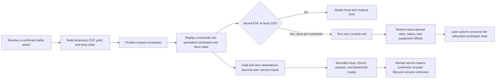

# Progression and Economy

- Status: **Confirmed** party/development and resource rules at the static and bounded observed seams below,
  with **Inferred** connections to later choices and explicit **Unknown** campaign and lifecycle limits.
- Audience: readers following the [Gameplay Overview](../gameplay-overview.md#the-force-membership-active-roles-and-character-growth),
  researchers, fidelity implementers and designers.
- Scope: connect membership, class/promotion, equipment, learned magic and reward-driven growth
  with item custody, gold, capacity, spending and recovery. This is not all-roster/service coverage,
  a campaign balance model, natural complete play or Chinese readiness.

## Reading Route and Current Agreement

The [roadmap's Standard agreement](../../documentation-roadmap.md#current-baseline-and-near-term-synthesis)
controls this English synthesis. Cross-system rules need source and claim reconciliation, while the
existing thematic owner is sufficient. Start with [party development](#party-development), follow
[battle-driven progression](#battle-driven-progression) into the
[worked example](#worked-example-growth-changes-preparation-without-healing), then use the
[evidence matrix](#evidence-matrix) for exact rules and fixtures. The
[resource/service sections](#gold-and-item-economy-boundaries) connect receipt, capacity and spending;
the [two resource examples](#connected-resource-examples) follow those choices across refusal and revisit.
[Story Progression](story-progression.md#read-story-content-in-segments) owns where recruitment and
service opportunities connect to the world; [Tactical Battle Loop](tactical-battle-loop.md) owns
whether a prepared actor's selected action is legal and effective.

The outcome is to explain how a retained member's class, equipment, spells and growth become inputs
to later choices, and how resources enable or constrain those choices. It does not choose a best party,
promotion time, balance curve, new product policy, engine architecture or acquisition programme.
Definitions and controlled observations remain separate from natural campaign reach, presentation
and current remake support.

## Judgment Boundary

This document explains how several accepted contracts connect. It does not replace the
[level-up contract](../../contracts/party/level-up.md), [physical combat contract](../../contracts/battle/combat-resolution.md),
[spell contract](../../contracts/battle/spell-resolution.md), [service contract](../../contracts/party/service-interactions.md), or
[save contract](../../contracts/system/save-system.md), and it is not independent evidence about the original game.

For the listed fixtures and source-static routes, the original has distinct action-reward
construction, persistent resource mutation, threshold-driven level-up, stat refresh, item-routing
and service-call stages. Their order and units matter.

The following judgments are not supported yet:

- intended encounter difficulty, level curve, price curve, scarcity, or grinding pressure;
- a complete list of campaign income and expenditure sources;
- optimal equipment, promotion timing, party composition, or roster choice space;
- universal shop/service availability, normal-story reachability, or lifetime purchase opportunity;
- universal persistence for service mutations across map changes, save/load, or power cycles;
- player-visible reward, menu, animation, sound, or timing behavior beyond fixture-owned seams.

## Party Development

### Joining, fighting, following and being alive

A recruit can belong to the force without taking an active battle place. **Confirmed static:**
`JoinForce` sets joined membership, rebuilds the joined/active/reserve lists, then sets the active
flag only when that rebuilt active count is below the ordinary maximum. The
[membership contract](../../contracts/party/party-membership-state.md#joinforce-chronology) owns this order;
[Creed's caller review](../../../research/chapters/southern-travel-creed/creed-return-fairy-and-recruitment-choices.md#join-and-capacity-are-separate-from-following)
binds the original maximum to twelve. Reserve is the joined-but-inactive classification produced by
a rebuild, rather than another independent membership flag.

The rebuild happens **before** conditional activation. Flags can therefore have changed while the
cached active/reserve lists still describe the earlier state. Read a list through its count and its
own rebuild boundary; neither stale tail bytes nor the existence of a joined flag supplies a current
battle formation. This distinction is relevant to ordinary joins, already-joined calls and explicit
active-party changes, not only one recruitment scene.

| Question | State or operation that answers it | Consequence for later choices |
| --- | --- | --- |
| Does the character belong to the force? | Joined membership. | Can be included in the joined list even when inactive or at zero HP. |
| Is the character selected for the active party? | Active flag, with counted lists rebuilt separately. | Ordinary auto-activation observes capacity; battle admission and formation still have their own consumers. |
| Can the character take this turn? | Current HP, position, status and the turn controller. | Joined or active alone does not establish a living, eligible actor. |
| Who chooses the action? | Activation/control state read by the turn dispatcher. | Ally membership does not imply player control. |
| Is someone following on the map? | Follower action and physical entity/list state. | Following alone does not join, activate, heal or initialize the character. |
| Which actor does the scene move or show? | Logical-to-physical lookup, current population and scene actions. | A scene actor can exist separately from battle selection; a lookup alias is not a stat copy. |

**Confirmed static example — Creed:** accepting an initial recruit's offer requests the join,
sets the choice flag only after that command returns, shrinks the three unselected scene actors and
adds the selected actor as a follower. Declining returns without those writes. With twelve other
active members, the recruit still joins, receives the join acknowledgement path and can follow;
the ordinary helper skips setting the new active flag and evicts nobody. HP zero likewise does not
block these commands and is not repaired by them. Later-return offers use a different branch without
the initial shrinks. These are source-confirmed branches, not evidence of a naturally completed
choice/UI session. Use [Story Progression's Creed account](story-progression.md#southern-travel-caravan-and-creed)
for the opportunity and return gates rather than assuming every recruit is always available.

**Confirmed static exception — Jaro:** the admitted Battle32 conversion calls `JoinBattleParty`
explicitly after `JoinForce`, so twelve other active members can become thirteen active flags;
the later AI command rebuild counts them. Enemy JAR is set to zero HP and off-map coordinates;
ally Jaro receives the old coordinates and physical lookup, while retaining his own HP, class,
equipment and stats. The nonzero `joinForceAI` operand sets AI control. The reached victory suffix
later requests an ordinary join, clears AI control, then leaves Jaro inactive without removing
joined membership or reviving him. The after-wrapper's later rebuild sees that cleared active flag.
The [conversion](../../../research/chapters/moun-nazca-grans/battle32-activation-jaro-and-first-turn-dispatch.md#logical-conversion-membership-and-physical-aliases)
and [victory](../../../research/chapters/moun-nazca-grans/battle32-outcomes-and-moun-entry.md#physical-population-aliases-and-logical-jaro-state)
owners explain the exact order and interruption branches; [Story Progression](story-progression.md#jaros-defection-frayjas-joining-and-mouns-survivors)
connects them to the campaign. This exception prevents treating twelve as a universal invariant or
recruitment as one atomic conversion from enemy to healed player-controlled follower.

### Definitions, current class and promotion

**Confirmed static:** an ally's start definition supplies class, stored level and four item bytes;
class data, base stats, spell initialization and derived-stat refresh have separate initialization
steps. The [ally-definition contract](../../contracts/party/ally-definition-data.md) separates those records
from current state and from story availability. The trailing unnamed start slots do not establish
additional recruitable characters. A later join reads current class for its announcement; it does
not itself restore the start record, grant that definition's gear or replay initialization.

Class connects several future rule inputs: growth selects an ally/class block, learning reads its
spell list, stat refresh reads base/class values and equipped effects, and equipment consumers test
class eligibility. These connections do not make all class-derived quantities interchangeable.
Stored level remains the actor's state; an effective level is calculated by a particular consumer.
The [reward vocabulary](#resource-and-level-vocabulary) distinguishes reward comparison from spell
learning. A promoted offset in either calculation does not add twenty to stored level.

**Confirmed source-static promotion route:** the Church first needs a member in the regular-base
promotion table and stored level at least twenty. An unmapped class or a lower level takes a refusal
or reselection path before `SetClass`/`Promote`. Regular and special destinations are paired data
relations, not a numeric addition to the class ID. The selected member is checked again after the
promotable-member count; the count does not make every member eligible.

For a class with a special mapping, the source searches the current target-list members' held items
for the corresponding promotion item; possession is not restricted to the promotion candidate.
A found item offers the special path; missing or declined special choice can fall back to regular
promotion. SORC has an extra confirmation whose refusal restarts selection. On the accepted special
path, the selected holder/slot receives `RemoveItemBySlot` before the class and promotion requests.
The route then calls `SetClass` followed by `Promote`, requests SORC default-spell replacement or
MMNK/NINJ weapon unequipping where selected, and later requests stored level one and EXP zero.
Unequipping leaves the weapon carried; it is distinct from removing the special promotion item.
The promotion route does not contain a gold-decrease call; Raise's price must not be reused as a
promotion price. These are ordered source requests, not a runtime-closed transaction or proof of
all resulting stats, inventory edges, prompt presentation or persistence.

The [service contract](../../contracts/party/service-interactions.md#church-source-boundary),
[common-menu owner](../../../research/presentation/common-menus.md#static-service-menu-state-machines) and its
`church.routeOperations.promote` / `helperOperations` records in
[`sf2-common-menus-static-v1`](../../../../tests/fixtures/h2/common-menus-static-v1.json)
own those gates and calls. Complete `Promote` mutation remains **Unknown** at this synthesis boundary.
The supported conclusion is that class selection can change later growth/learning/equipment inputs;
there is no evidence here for an optimal promotion time or a universal final-stat formula.

### Carried gear becomes an equipped contribution

A carried item occupies inventory; its equipped state determines whether equipment refresh applies
it. **Confirmed storage:** item identity and held status are distinct from definition data. Ally
start bytes pack an equipped bit beside the item ID, while runtime inventory helpers operate on item
words with additional status such as the broken bit. The [item-definition contract](../../contracts/party/item-definition-data.md#item-identity-and-fixed-record)
owns class-mask/type, range and effect fields as stored data, not a complete equip/use rule.

**Confirmed source consumers:** `IsWeaponOrRingEquippable` checks class mask and equipment type;
`EquipItemBySlot` checks Nothing, equippability and curse before setting equipped state, then tails
stat refresh even on rejection. Cursed-aware unequip can refuse removal of an equipped cursed item.
Thus receiving or carrying a weapon does not prove it replaces the old one, grants its effects or
makes an intended action effective. The accepted smith
[equipment continuation](../../../research/chapters/moun-nazca-grans/dwarven-village-and-mithril-smithing.md#fulfillment-inventory-and-optional-equipment)
retains both source order and bounded observations, including a previously equipped Dark Sword
blocking replacement while the newly received weapon remains carried. Detailed fulfillment/custody
appears in the [smith service account](#mithril-orders-placement-readiness-and-collection).

Broken and cursed describe different constraints. The
[tactical item route](tactical-battle-loop.md#items-custody-equipment-and-use-are-separate) distinguishes
fresh breakable equipment from already-broken equipment in post-use handling, and equipped-cursed
restrictions from carrying ordinary items. Do not infer that broken means unequipped, that curse is
only a definition flag, or that every item has the same use/break behavior.

**Confirmed bounded refresh:** level-up rebuilds derived ATT/DEF/AGI/MOV, resistance and prowess from
base/class state, applies status adjustments, then equipped effects. It does not stack the new gain
onto stale action-only stats. Equipped cursed definitions can reintroduce CURSE during refresh.
The [level-up owner](../../contracts/party/level-up.md#confirmed-current-and-derived-stat-refresh) also preserves
the original `INCREASE_DOUBLE` prowess defect; this synthesis does not silently correct it. How an
updated stat or equipped identity affects an attack, range or special target remains with
[Tactical Battle Loop](tactical-battle-loop.md#equipment-can-gate-an-effect-taros) and its resolution
owners. For example, entering Taros's battle and merely carrying the Achilles Sword do not satisfy
Bowie's actual equipped-weapon gate.

### Learning adds or upgrades an option

**Confirmed static storage and helper rules:** a learned entry keeps base spell identity and a level
code, using the six-bit identity/two-bit level packing described by
[ally growth](../../../research/party/ally-growth.md#storage-model). Spell level is separate from character
level. The accepted growth fixtures retain four ordered spell slots; learning does not append an
unbounded list of every spell level earned.
[Spellbook state](../../contracts/party/spellbook-state.md#learnspell-chronology) keeps two searches distinct:
first find the same base identity; only if none is known, search for an empty slot.

- A higher incoming level replaces the known entry, retaining that spell's slot.
- The same or a higher already-known level refuses the incoming entry, even if another slot is empty.
- A new identity needs an empty slot; a full book returns no-room instead of choosing a spell to forget.

The result identities are static helper outcomes, not proof of a particular failure message. In
particular, full slots do not block an upgrade to an already-known identity. Learning and upgrading
must therefore be explained separately from an inventory of spell definitions.

**Confirmed bounded caller behavior:** initialization scans thresholds at or below starting effective
level before replaying earlier level-ups. Ordinary `LevelUp` increments stored level and checks an
exact matching effective threshold, not every lower threshold again. The selected ally/class growth
record supplies the list; `$FE` inherits the ally's first block's list rather than an arbitrary
previous class list. The observed Kazin/WIZ case upgrades known BLAZE in place through this inherited
list. Karna's HEAL 3 initialization special branch changes prowess before ordinary level-up replay
learns the spell; it is not a general rule that knowing healing magic grants prowess.

The original spell-learning comparison misclassifies TORT/class 11 as promoted, unlike the class-cap
boundary at 12. The observed Kiwi case changes its internal learning threshold but learns no TORT
spell. A forced missing class can scan into a later ally's block or reach the final sentinel; these
controlled boundaries do not establish ordinary promotion legality. The
[level-up contract](../../contracts/party/level-up.md#confirmed-projection-cap-and-spell-boundaries) owns all
these defects, cap exits and observed cases. No single promoted-level predicate should replace the
separate original reward, cap and learning comparisons.

**Inferred connection to choices:** a learned or upgraded entry can supply a later magic option.
Actually casting still needs the applicable actor/turn, MP, targeting/range and effect rules. A
known spell alone proves neither affordability nor a useful result; higher maximum MP does not
refill current MP. Follow [tactical spell rules](tactical-battle-loop.md#magic-healing-and-support)
for action conditions rather than treating a learning threshold as an automatic combat effect.

## Resource and Level Vocabulary

The same everyday word can refer to different stages. A fidelity implementation and its tests must
keep these values separate.

| Term | Confirmed meaning in this synthesis | Boundary that must remain visible |
| --- | --- | --- |
| action EXP accumulator | Temporary battle-scene value built while an action resolves. Confirmed damage/kill paths saturate at 49; confirmed healing accumulation saturates at 25. | These are action-family boundaries, not one universal EXP cap for every spell or command. |
| final EXP command | The post-action amount emitted after the applicable battle-table adjustment, two ordered random checks, and the confirmed enemy-target minimum. | It is neither the accumulator nor stored EXP. Same-side and unsupported action paths must not inherit the enemy-target rule automatically. |
| stored EXP | Persistent actor byte increased by an EXP command and clamped at 200 before threshold handling. | One command subtracts at most one 100-point threshold; stored EXP may remain 100 afterward. |
| stored level | The class-local value retained on the combatant. Confirmed caps are 40 for classes below ID 12 and 99 from class ID 12 onward. | It is not automatically the level used by every comparison. |
| effective reward level | For the confirmed damage/kill bracket, a promoted actor adds 20 to stored level before comparing with target stored level. | The offset is scoped to the confirmed comparison; do not rewrite persistent level. |
| level-up spell threshold | `LevelUp` increments stored level, then applies its class-dependent effective-level rule for spell learning. | TORT's class-11 comparison defect and `$FE` spell-list inheritance remain original-fidelity facts. |
| current versus maximum/base/derived stats | Level-up changes maxima and base stats, then refreshes derived battle stats and equipment/status effects. | Current HP and MP do not increase merely because their maxima grow. |
| gold | Persistent unsigned 32-bit resource; confirmed increase behavior caps it at 9,999,999 on carry or above-cap addition. | Decrease behavior and non-battle mutation results are not covered by the gold H3 fixture. |
| held item, deals count, and caravan storage | Distinct item destinations with separate capacity and ordering rules. Deals counts are packed four-bit quantities and saturate at 15. | Static service helper order does not by itself prove persistence or final runtime state. |

## Connected Resource Flow



The links into later-action use and later service-choice use are **Inferred system relationships**:
stronger combatant state and retained resources can affect later choices because later systems read
those fields. The diagram does not claim the original designers intended a particular power curve,
spending cadence, or optimal loop.

## Battle-Driven Progression

### 1. Build an action-local reward

**Confirmed for the named physical and attack-spell paths:** reward comparison uses the actor's
consumer-specific effective level against the target's stored level. Damage contributes a
truncated fraction of the resulting bracket, and a lethal result adds its kill contribution to the
same action accumulator. Their shared cap is distinct from the healing cap. Healing instead depends
on eligible caster class and recovered HP relative to target maximum HP; ineligible classes, enemy
actors and a zero-maximum-HP target skip the confirmed contribution. Status and special spells keep
their own bounded rules. The [combat](../../contracts/battle/combat-resolution.md) and
[spell](../../contracts/battle/spell-resolution.md) owners retain the exact brackets, formulas and caps.

### 2. Finalize the command amount

**Confirmed for the enemy-target Battle01 seam:** a battle-table adjustment halves the accumulator,
then two ordered random checks can increase and decrease the result before the applicable minimum
and EXP command emission. The accumulator therefore need not equal awarded EXP: the connected
example below finalizes 49 into a 24-point command. The
[award fixture](../../../../tests/fixtures/h3/award-exp-randomization-v1.json)
owns the random branches and minimum; other battles, same-side awards and unsupported actions
retain their own boundaries. A reward adjustment is not a rewrite of stored level or stored EXP.

### 3. Replay into persistent EXP and process one threshold

The EXP command first increases stored EXP with a cap of 200. It then tests 100, subtracts that
threshold once, and calls `LevelUp` at most once. This ordering produces three important observed
boundaries:

- `75 + 24 -> 99`, with no level-up;
- `76 + 24 -> 100 -> 0`, with one level-up;
- `199 + 24 -> 200 -> 100`, still with only one level-up.

At base level 40 and promoted level 99, the command still subtracts 100 and calls `LevelUp`.
`LevelUp` returns 255 and leaves the capped level unchanged. In the observed `76 + 24` cap cases,
the subtraction leaves zero EXP. In general, the command retains the remainder after its one
100-point subtraction; a capped `LevelUp` result does not clear that remainder. A remake cannot
replace this sequence with a generic loop or discard-at-cap rule without recording an intentional
deviation.

### 4. Apply level-up and refresh combatant state

For a matching class block below its cap, `LevelUp` processes maximum HP, maximum MP, base ATT, base
DEF, and base AGI in that order; increments stored level; resolves the exact spell threshold; then
refreshes derived combatant state. The [level-up contract](../../contracts/party/level-up.md) owns the random-growth
formula, post-level-30 projection rule, class-block scan, learned-spell payload, caps, clamps, and
known original defects. Growth projections are inputs to curve/random/minimum-stat rules, not a
promise of the same gain every level. Active curves and `NONE` differ, and later levels use a
post-projection branch; these rules do not establish a campaign power curve.

The connected battle fixture demonstrates why this is part of the persistent replay stage rather
than an isolated stat calculator. Bowie starts level 1 at 99 EXP, receives a 24-point command,
passes through stored EXP 123 to residual 23, reaches level 2, and refreshes base and derived stats.
Current HP/MP remain `12/8` even though maximum HP becomes 14. Action-only ATT/AGI values are replaced
by refreshed values rather than carried forward.

Promotion is a separate operation. The [promotion explanation](#definitions-current-class-and-promotion)
separates source admission, class mapping and requested mutations. Complete promotion stat mutation,
inventory edge cases, visible choice flow and persistence remain **Unknown**
at their named owner; this is not an automatic observation queue.

## Worked Example: Growth Changes Preparation Without Healing

**Confirmed bounded observations:** the connected Bowie battle fixture in the preceding section
shows the reward-to-level handoff. The separate Slade case
`slade-thif-level39-equipped-refresh` in
[`sf2-level-up-refresh-v1`](../../../../tests/fixtures/h3/level-up-refresh-v1.json)
shows what the changed stats mean with ordinary equipment: THIF level 39 advances to 40, base ATT
rises from 45 to 47, and the equipped Short Knife contributes five to refreshed ATT 52. Maximum HP
rises from 42 to 44 while current HP stays seven. The item is still held/equipped; its effect is
reapplied to the new base, rather than being earned again or cumulatively added to stale ATT.

**Inferred preparation consequence:** for a later admitted physical action, the resolver can read
that refreshed ATT and the actual equipped weapon, while damage/life eligibility still reads current
HP and other action conditions. Slade remains wounded. Recovery or an applicable service is a
separate decision; the higher maximum does not solve the immediate HP constraint. If instead a new
weapon is only carried, its definition's attack value is not automatically part of that refresh.

**Confirmed non-happy path:** the separate `slade-thif-base-cap` case in
[`sf2-level-up-boundaries-v1`](../../../../tests/fixtures/h3/level-up-boundaries-v1.json)
starts at level 40 and returns the no-level result without growth. The
[EXP-command boundary](../../contracts/party/level-up.md#confirmed-battle-award-entry) still consumes one
threshold at the cap. More awarded EXP therefore need not produce another level, heal the member or
open another spell option. This is a class-cap consequence, not a claim that level 40 is the best
promotion point.

These cases connect reward, retained state, equipment and later rule inputs. They are separate
controlled seams, not one naturally played Bowie-to-Slade sequence. The full-party Creed branch and
spellbook refusals above check different ordinary valid states; they cannot be repaired by assuming
every successful join or EXP award grants an immediate usable new action.

## Gold and Item Economy Boundaries

### Confirmed battle outcomes

- Enemy gold is a 103-entry big-endian word table aligned with the 103 enemy definitions. A following
  69-word ROM tail is explicitly unused and cannot become additional enemy rows.
- The confirmed runtime addition uses an unsigned 32-bit intermediate. Ordinary `0 + 30` produces
  30; exact-cap, above-cap, and 32-bit-carry cases produce 9,999,999.
- Enemy drops use 30 records keyed by battle, enemy combatant, held item, and one-time flag. Three
  named boss weapons require `RNG(32) == 0`; the other 27 records do not consume drop RNG after their
  preconditions match.
- On a successful drop, the confirmed order is rare roll when applicable, test/set the persistent
  flag, remove the enemy item, then route it. A living actor with room receives it. If direct delivery
  fails, only a rare item enters Deals; a non-rare item is discarded.
- A repeated flag still follows the successful rare roll before aborting. Deals amount `14 -> 15`,
  while 15 remains saturated in its four-bit field.

These are resource mutations, not proof of how or when the player is shown a reward summary.

### Sources, receipts and the capacity decision

Gold, EXP and an item do not arrive through one indivisible reward. The
[tactical reward handoff](tactical-battle-loop.md#rewards-become-persistent-through-their-own-routes)
separates action construction from replayed gold/EXP commands and the kill-side item route.
Battle 01's EXP adjustment is not a gold reduction; the [growth account](#battle-driven-progression)
explains what stored EXP can subsequently change. The drop facts above describe success **after**
the named battle/enemy/item preconditions, not a prize attached to every victory. Leader cleanup
alone does not produce an earned kill/drop. The three conditional boss weapons retain their RNG
gate; the other matching records need no drop RNG, but still need their held item and clear once-bit.
The once-bit is set before enemy removal and delivery, so a failed direct route is not an unclaimed
item waiting to retry. A rare fallback is a Deals count, not custody in a member's usable slot.

**Confirmed static:** ordinary field Search has a different handoff. The
[field-search owner](../../../research/world/field-search-control.md#confirmed-static-spine) distinguishes
encoded gold content (which calls `IncreaseGold`) from an item pickup. Item delivery tries the leader's
four slots first, then the rebuilt joined-force alternatives. If none has room, `CloseChest` and
`RefillNonChestItem` restore the claim path; it is not the battle-drop discard/Deals route. An opened
chest flag or changed working-layout block can precede this capacity resolution. Exact Search dispatch,
coordinates and later reload behavior belong to their map/field owners, not an assumed universal
"collect treasure" action. This is source order, without a naturally observed pickup or save guarantee.

A mandatory story receipt can instead require making room. The
[Sky Orb](story-progression.md#nazca-cameela-and-the-sky-orb) and
[Force Sword](story-progression.md#attract-the-leader-extract-the-sword-then-use-it)
paths scan joined inventories without an active/alive filter. When all are full, cancel, declined
discard, an unsellable selection or an equipped cursed item can loop rather than finish. A rare
discard requests Deals and continues selection; the returning replacement path needs an accepted
non-rare discard. The caller therefore does not guarantee completion for every full inventory.
The Orb actor is hidden before its award attempt; Sword extraction's flag is written after the scene
without a separate grant-result check. Neither is an independent certificate of custody or equipment.

An optional custom receipt need not use either policy. The
[Moun Arm](story-progression.md#optional-moun-interactions-and-the-arms-custody) question can be
declined; all joined members full reports failure with the Arm still claimable and no discard menu.
Success adds it before recording the award. Losing it later does not clear that record, and an
interruption can leave custody before the record. These examples explain why a content flag, helper
request, successful receipt and later usable result must be named separately. They do not establish
a complete income catalog, item abundance or campaign scarcity.

### Custody, storage and active membership

There are three different capacity questions:

| Limit | What it constrains | What it does not imply |
| --- | --- | --- |
| Four member-held item slots | A particular member's next item receipt; equipped gear still occupies a slot. | No force-wide four-item cap, auto-equip, healing or guaranteed exchange. |
| Twelve ordinary active members | Caravan Join's relief choice and ordinary auto-activation; see [party membership](#joining-fighting-following-and-being-alive). | Reserves still belong to the force and can be inventory recipients in named routes; explicit Jaro conversion remains an exception. |
| Sixty-four Caravan stored items | Depot's separate deposit guard. | No extra member slots, active-party place, or proof that boarding grants every depot action. |

**Confirmed source-static service:** [Caravan actions](../../contracts/party/service-interactions.md#caravan-source-boundary)
select Join/Depot/Item/Purge. Join has a twelve-member comparison before choosing relief; its relief
path requests leave then join. Purge requests leaving the active party, distinct from losing joined
membership or deleting held items. Empty reserve/active lists and cancelled selections return through
their respective paths; Join has a separate zero-HP confirmation and relief/Purge refuse the leader.
Neither action revives a member. The [Taros/boarding example](story-progression.md#worked-example-taros-and-the-caravan)
separates acquisition, boarding/traversal and the C-interaction menu handoff. A transport state or a
named menu caller proves neither a completed storage transaction nor natural service availability.

Depot offers Look/Deposit/Derive/Drop; "Derive" is the source's withdrawal label. Deposit refuses its
full-storage boundary before member selection; cancellation or selected equipped-cursed refusal
also precedes `AddItemToCaravan -> DropItemBySlot`. Withdrawal to a member with room
requests `AddItem -> RemoveItemFromCaravan`; full recipient capacity selects the exchange path,
`RemoveItemBySlot -> RemoveItemFromCaravan -> AddItem -> AddItemToCaravan`.
Empty storage returns without withdrawal; item/recipient cancellation can leave or restart selection.
Exchange checks the selected member item for equipped curse before its removal. Thus exchanging
requires its own selected member item and guards. It is not a free extra slot or a universal refund scheme.
Depot Drop has an unsellable guard and tests rarity separately after removal for a Deals request.
Look's price display is not a sale or a gold credit.

Item offers Use/Give/Equip/Drop. Give has separate cancellation, self-give, normal and exchange
branches: normal transfer adds to the recipient before removing from the donor; self-give removes
then adds; full-recipient exchange removes both selected items before the two adds. Equipped-cursed
checks can reject the selected transfer or exchange. Use calls `UseItemOnField` before its removal
request; this call order does not establish that every selected item has an effective field use.
Equip is the source-selected equip-screen handoff. Drop and its rare Deals request are separate from
Use, Sell and Deposit. [Tactical item choices](tactical-battle-loop.md#items-custody-equipment-and-use-are-separate)
own the battle-specific give/drop/use rules; the
[field-item owner](../../../research/world/field-item-effects.md) owns field eligibility/effects.

At the lower [Caravan/Deals storage boundary](../../contracts/party/caravan-and-deals-state.md), Caravan add
strips status bits, full add is ignored, and removal compacts with an `ITEM_NOTHING` tail. That
contract deliberately keeps capacity and the numeric normalization mask outside its scope; the
sixty-four service guard above comes from the common-menu owner. Neither normalization nor the
service's ordered calls prove every equipment/broken-state consequence of a complete deposit/retrieve
cycle. Deals has independent packed four-bit counts, saturating additions and ignored zero removals;
the observed battle-drop case supplies `14 -> 15`/saturation, without making it a general menu result.
These are stores and boundaries, not interchangeable inventories.

### Source-static service exchanges

This stable heading routes earlier readers into the expanded service account. The
[service contract](../../contracts/party/service-interactions.md) owns action order, cancellation and direct
resource calls. Current Raise/Cure/Save observations and later smithing review add only their named
seams. Shared diamond/selection cancellation and local action loops are source-confirmed; they do
not prove identical rollback, complete service visits, presentation or return to usable exploration.

#### Shop: stock, price, recipient and commitment

**Confirmed static:** Buy takes the current shop's count-prefixed item row, selected by
`CURRENT_SHOP_INDEX`. The [item catalog](../../contracts/party/item-definition-data.md#shop-and-debug-catalogs)
owns the definitions and lookup; a listed definition or price is not natural availability in a
particular chapter. Ordinary catalog stock and mutable Deals counts have different owners. Deals
lists only identities with nonzero counts that are **absent from the current shop row**. A stored
rare item therefore need not appear in that shop's Deals list, and "rare" does not mean an independent
unlimited shop catalog.

| Action | Source prerequisites/refusals before the resource calls | Ordered resource requests |
| --- | --- | --- |
| Buy | Stock/item selection, price confirmation, gold at least the definition's word price, recipient selection and held count below four. Full recipient can reselect or abandon; the weapon-equippability warning can be accepted for carrying. | `DecreaseGold -> AddItem`, followed separately by optional equipment. |
| Deals purchase | Nonempty filtered Deals list, then the price/recipient route above; cancellation or no stock returns toward the action menu. | `DecreaseGold -> AddItem -> RemoveItemFromDeals`, then optional equipment. |
| Sell | Member/item selection; unsellable item refused; confirmation; selected equipped cursed weapon/ring can be refused. Source price is `(price * 3) >> 2`. | `IncreaseGold -> DropItemBySlot`, then a conditional rare-item `AddItemToDeals`. |
| Repair | Selected item must have the broken bit; confirmation, affordable `price >> 2`, and the selected equipped-cursed check must pass. Unbroken, declined or unaffordable paths return to selection without these calls. | `DecreaseGold -> RepairItemBySlot`. |

The actual [shop statement records](../../../../tests/fixtures/h2/common-menus-static-v1.json), not a
helper's name, establish these branches and unsigned affordability comparisons (equality passes).
Buy/Deals debit and add before asking whether to equip. Declining equipment or refusing removal of
old cursed equipment does not undo those earlier requests. The post-add equipment path recounts
inventory and uses count minus one; its source assumptions are not an arbitrary-hole repair rule.
Sell credits before its drop request; Repair pays before its repair request. There is no universal
atomicity/refund guarantee here. Final shop helper outcomes, interrupted UI effects and persistence
remain **Unknown** at this service boundary even where lower helpers or a smith seam have observations.
Buy/Sell/Repair repeat their selection paths and non-exit actions return toward the action menu;
this control flow is not an observed complete shopping visit.

Repair, Cure and Raise solve different problems. Repair addresses a carried item's broken state;
Cure addresses selected status/equipment commits; Raise addresses a zero-HP member. A repair is not
proof of curse removal, item replacement, member HP recovery or future action legality. Battle use
can consume an item or reach the equipment break/destruction route at its own
[tactical boundary](tactical-battle-loop.md#items-custody-equipment-and-use-are-separate); receiving or
repairing an item does not establish that every action may use it.

#### Church: recovery, promotion and saving

**Confirmed bounded Raise:** the [Raise seam](../../contracts/party/service-interactions.md#church-raise-runtime-seam)
enters the Church route, skips living members and processes dead members in list order. Price is
stored level times ten, plus the promotion-data-dependent 200 surcharge. Decline or insufficient
gold reaches no payment/HP/mapsprite helper in the named cases; exact funds passes. Accepted payment
precedes HP increase and mapsprite completion, with current HP `min(maxHP,200)`. This does not assert
MP restoration, removal of every status, complete caller/UI flow or a durable save.

**Confirmed bounded Cure:** the [Cure seam](../../contracts/party/service-interactions.md#church-cure-runtime-seam)
retains poison then stun then curse, with separate affordability, confirmation and commits. Poison
costs ten and stun twenty; each payment precedes its status write. Curse uses the selected cursed
held item's price shifted right two; the observed Dark Sword costs 4250. Its payment precedes
`UnequipAllItemsIfNotCursed` and stat-refresh completion. A no-status case has nothing to cure;
decline and one-below-funds cases do not become success merely because the menu was entered. The
ordered success case spends `4280 -> 4270 -> 4250 -> 0`, rather than applying one flat cure charge.
The named cohort owns the final status/equipment mutations; it does not establish every Cure caller,
UI/presentation or persistent aftermath.

**Confirmed source-static Promote:** use the [party-development explanation](#definitions-current-class-and-promotion)
for class mappings, level twenty, target-list special-item search, special confirmation and ordered
item/class/spell/weapon requests. Promotion has no gold-decrease call in this route. The removed
special item is a different resource from an unequipped MMNK/NINJ weapon, which remains carried.
Complete promotion effects remain **Unknown**; successful Raise/Cure evidence does not close them.

**Confirmed bounded Save:** the [Save seam](../../contracts/party/service-interactions.md#church-save-runtime-seam)
separates initial refusal from save and later continue/suspend. In the controlled first prompt,
nonzero exits without SaveGame/Fade/Witch callbacks; zero copies current map to Egress, sets flag399,
and calls original `SaveGame`. Positive records observe entry, effective return and call-site return.
The zero post-save prompt reaches the menu exit; nonzero observes a controlled Fade return and
original `WitchSuspend` **entry**, not full suspend or its return. These selector values are observed
inputs, not proof of user-facing prompt meaning. Save requests no HP/item recovery and has no payment
call in this route. It is a lifecycle choice with a different evidence boundary from Raise or Cure.

Recovery also has non-service routes. [Healing magic](tactical-battle-loop.md#magic-healing-and-support)
uses missing HP and its own MP/effect/reward conditions; a held healing item needs its admitted use
and consumption path. [Battle returns](tactical-battle-loop.md#victory-defeat-and-admitted-retreat-leave-different-state)
distinguish defeat's Bowie recovery/gold halving from paid retreat. The smith village's exploration
entry separately calls the living/immortal-ally healer: the
[entry owner](../../../research/chapters/moun-nazca-grans/dwarven-village-and-mithril-smithing.md#all-eighteen-warps-and-f80-lifetime)
pins thirty allies, living plus Peter/Lemon, HP/MP restore, retained status mask and equipment-derived
CURSE refresh. This is not blanket revival or removal of all afflictions whenever any map returns.
Growth still increases maxima without necessarily healing current HP/MP.

### Mithril orders: placement, readiness and collection

The later [village/smith owner](../../../research/chapters/moun-nazca-grans/dwarven-village-and-mithril-smithing.md)
connects an actual Map29 tail caller, placement, readiness and fulfillment. Its complete source/caller
review and retained controlled observations supersede a whole-lifecycle blanket Unknown, while
natural access, complete service play, presentation and durable persistence stay **Unknown**.
A commission's material owner, class-selected customer and eventual recipient are independent.
The stored order records only an item, not those people or a countdown.

**Confirmed source placement:** material selection must supply the exact Mithril word; cancellation
can leave or return to material selection. Customer class must be promoted and in the eligible-class
table; a refused confirmation retries the customer, while insufficient funds returns without charge.
Exact 5000 gold passes. The committed order is payment, pending-count increment, material slot drop,
weapon picker/order write, then clear flag80. Charge/removal precede selection storage, with no checked
rollback on a failed drop or full order array. The outer menu ordinarily avoids starting placement
with four unfulfilled orders; the **post-placement** effective-count comparison stops continuation at
four. It must not be recast as a free-slot admission check inside placement. A supplied full-array
helper case proves no-write, not that ordinary play naturally loses resources that way.

Class selects the weapon row deterministically for the first eight matched groups; normally admitted
BRN/RDBN uses a preceding range-two fallback between two rows. Selection then tests sequential random
ranges 16,8,4,1, accepting the first zero. Even range one advances the seed. These conditional,
correlated draws are not independent final item percentages. The
[class/RNG owner](../../../research/chapters/moun-nazca-grans/dwarven-village-and-mithril-smithing.md#complete-class-mapping-and-sequential-rng)
keeps exact classes/items; this synthesis adds no probability model or optimal commission advice.

**Confirmed source readiness:** a successful placement clears flag80. Explicit exploration entry
sets80, so an admitted leave/reenter via Map77/29 can classify existing nonzero order words as ready
on the next smith visit. Waiting, walking or CURRENT-map stairs supply no such producer; no elapsed
time field appears. Ready/pending classification is shared through that bit, not per-order age.
If a visit retains refused ready orders and places another, clearing80 makes all surviving words
classify pending on reopening. Save/load readiness cannot be inferred just from the stored flag.

**Confirmed source fulfillment and bounded helper/transaction observations:** ready orders are tried
in slot order. Recipient cancellation or full-capacity refusal retains that order while the outer
loop can try later slots. A recipient below four slots can accept carrying despite an equippability
warning. At commitment, `AddItem` precedes order-word clear and fulfilled-count increment; the caller
does not test the add result before clear. Ordinary capacity was checked earlier, without a universal
interruption or changed-state guarantee. Optional equipment comes **after** receipt/order clear;
declining it or refusing old cursed equipment retains the new carried weapon with the order gone.
The [equipment seam](../../../research/chapters/moun-nazca-grans/dwarven-village-and-mithril-smithing.md#fulfillment-inventory-and-optional-equipment)
includes the Dark Sword obstruction and refreshed CURSE. It supplies neither a refund nor recreated
Mithril. Complete UI, natural end-to-end revisit/collection and persistence are not proven by those
controlled entries or the separate caller-return rail that bypasses the service body.

### Connected resource examples

**Reward -> capacity -> later custody.** In the observed enemy-drop boundary, a matched rare item
with a successful required roll and clear once-bit loses its enemy custody before routing. A living
actor with four held items cannot receive it, so the rare branch requests Deals; a non-rare item in
the same failed direct route is discarded. A later shop can offer that Deals identity only if its
count is nonzero and its ordinary stock excludes it. Source-confirmed purchase then needs funds and
a recipient with room, then requests gold debit, item addition and Deals decrement. A full recipient can force
reselection or abandonment before that payment. An admitted Caravan withdrawal/exchange or member
transfer offers a different capacity route; acquiring/boarding the Caravan alone supplies none of
those transactions. Ordinary Search can instead restore a full-capacity chest claim, while the
mandatory Orb/Sword may remain in their discard loop. These are deliberately different fallback
policies, not one observed continuous loot-to-shopping journey.

**Spending -> equipment -> later eligibility, with revisit.** A selected eligible promoted customer,
Mithril owner and 5000 gold can pass smith placement; an unpromoted customer is sent back to selection
and insufficient funds returns before charge. After admitted placement the weapon is already chosen,
but clear80 leaves it pending. A later explicit village reentry can set readiness; waiting on the
stairs cannot. At collection a full recipient can leave the order uncollected. With room, receipt
commits before optional equipment. The bounded cursed-old-weapon refusal leaves the new weapon
carried, without its equipped contribution. Church Cure's separately observed paid curse/equipment
commits can change that obstruction; the next equip/action must still pass its actual consumers.
The [party equipment account](#carried-gear-becomes-an-equipped-contribution) and
[Taros action gate](tactical-battle-loop.md#equipment-can-gate-an-effect-taros) show why carrying,
equipping and a legal/effective attack are different questions, without suggesting a Mithril weapon
meets Taros's particular Sword rule. This connection is **Inferred** preparation logic across named
seams, not a naturally played smith-to-Church-to-battle trace or a guarantee that Cure equips the new
item. Neither payment nor returning from the service saves the changed state automatically.

## Persistence Boundary

The [save-system contract](../../contracts/system/save-system.md) confirms a two-slot representation, checksums,
save/load/copy/delete helper order, and a bounded in-process action matrix. It does not establish
cross-process SRAM survival, interrupted writes, or the persistence of every service, Deals, caravan,
order, drop-flag, gold, EXP, or combatant mutation across all lifecycle paths.

**Confirmed static save-domain membership:** the later
[smith serialization review](../../../research/chapters/moun-nazca-grans/dwarven-village-and-mithril-smithing.md#existing-observations-and-serialization-boundary)
binds SaveGame's 4,016 logical bytes to all thirty ally records and their item words, current gold,
game flags (including readiness80) and the four order words. The smith's stack counters are transient;
payment/collection does not call SaveGame. Domain inclusion is distinct from an in-memory mutation,
from Church requesting and returning from SaveGame, and from storage surviving another process or
power cycle. A later explicit exploration entry may set80 even if a loaded flag was clear. Map return,
service return or an ending completion bit is not an automatic save of all force state.

Therefore this synthesis may identify fields as persistent within an observed replay or original
state structure, but it does not claim that every connected mutation has an end-to-end save/load H3
case. Any future lifecycle claim needs evidence at that lifecycle boundary rather than treating the
existence of `SaveGame` as proof for every subsystem. This does not dispatch a new suite.

## Evidence Matrix

| Boundary | Evidence label and bounded claim | Exact owners | Remaining question |
| --- | --- | --- | --- |
| joined, active, following and control | **Confirmed static** distinct helpers and selected Creed/Jaro caller branches; roster contract retains bounded handler observations | [membership](../../contracts/party/party-membership-state.md), [roster](../../contracts/party/party-roster-state.md), [Creed](../../../research/chapters/southern-travel-creed/creed-return-fairy-and-recruitment-choices.md), [Jaro conversion](../../../research/chapters/moun-nazca-grans/battle32-activation-jaro-and-first-turn-dispatch.md), [Jaro victory](../../../research/chapters/moun-nazca-grans/battle32-outcomes-and-moun-entry.md) | All-recruit natural lifecycle, UI and capacity safety are not established |
| start/class/promotion inputs | **Confirmed static** definitions, paired mappings and ordered Church requests | [ally definitions](../../contracts/party/ally-definition-data.md), [services](../../contracts/party/service-interactions.md), `sf2-ally-data-static-v1` ([fixture](../../../../tests/fixtures/h2/ally-data-static-v1.json)), common-menu promotion statement records | Complete promotion stat/inventory outcomes and persistence |
| learned entries and equipment contribution | **Confirmed static** learning refusal/upgrade helper and class/type equip checks; **Confirmed bounded runtime** inherited upgrade, equipped refresh and selected cursed replacement refusal | [spellbook](../../contracts/party/spellbook-state.md), [level-up](../../contracts/party/level-up.md), [item definitions](../../contracts/party/item-definition-data.md), [smith equipment](../../../research/chapters/moun-nazca-grans/dwarven-village-and-mithril-smithing.md#fulfillment-inventory-and-optional-equipment) | Complete acquisition/equip/use lifecycle and every later action |
| growth storage and level-up | **Confirmed** curves/class blocks plus runtime gain, cap, spell, scan, and refresh cases | [ally-growth research](../../../research/party/ally-growth.md), [growth manifest](../../../../manifests/extractions/growth-data.json), [growth schema](../../../../schemas/growth-data.schema.json); `sf2-calculate-stat-gain-startup-v1` ([`stat-gain-v1.json`](../../../../tests/fixtures/h3/stat-gain-v1.json)), `sf2-level-up-tort-boundary-v1` ([`level-up-v1.json`](../../../../tests/fixtures/h3/level-up-v1.json)), `sf2-level-up-boundaries-v1` ([`level-up-boundaries-v1.json`](../../../../tests/fixtures/h3/level-up-boundaries-v1.json)), and `sf2-level-up-refresh-v1` ([`level-up-refresh-v1.json`](../../../../tests/fixtures/h3/level-up-refresh-v1.json)) | Natural campaign distributions, intended curves, remaining clamp edges |
| battle EXP to level-up | **Confirmed runtime** command replay through one threshold and persistent refresh | [runtime battle-math research](../../../research/battle/runtime-rng-and-battle-math.md); `sf2-battle-exp-level-up-v1` ([`battle-exp-level-up-v1.json`](../../../../tests/fixtures/h3/battle-exp-level-up-v1.json)) | Other award modifiers and repeated commands |
| reward bracket, finalization, and storage | **Confirmed runtime** effective-level brackets, Battle 01 adjustment/randomization/minimum, stored cap 200, and one threshold | `sf2-kill-exp-level-difference-v1` ([`kill-exp-level-difference-v1.json`](../../../../tests/fixtures/h3/kill-exp-level-difference-v1.json)), `sf2-award-exp-randomization-v1` ([`award-exp-randomization-v1.json`](../../../../tests/fixtures/h3/award-exp-randomization-v1.json)), and `sf2-exp-command-boundaries-v1` ([`exp-command-boundaries-v1.json`](../../../../tests/fixtures/h3/exp-command-boundaries-v1.json)) | Other battles, same-side routing, multiple-action/cap lifecycle |
| physical action construction and replay | **Confirmed runtime subset** damage/kill accumulator cap and persistent command replay | [combat contract](../../contracts/battle/combat-resolution.md); `sf2-physical-damage-application-v1` ([`physical-damage-application-v1.json`](../../../../tests/fixtures/h3/physical-damage-application-v1.json)) and `sf2-battle-scene-replay-v1` ([`battle-scene-replay-v1.json`](../../../../tests/fixtures/h3/battle-scene-replay-v1.json)) | Complete action set and presentation timing |
| spell progression contributions | **Confirmed runtime subsets** attack-spell bracket/cap and healer eligibility/minimum/cap | [spell contract](../../contracts/battle/spell-resolution.md); `sf2-spell-damage-exp-v1` ([`spell-damage-exp-v1.json`](../../../../tests/fixtures/h3/spell-damage-exp-v1.json)) and `sf2-healing-exp-boundaries-v1` ([`spell-healing-exp-boundaries-v1.json`](../../../../tests/fixtures/h3/spell-healing-exp-boundaries-v1.json)) | Unsupported spell families and generalized action policy |
| enemy gold | **Confirmed static/runtime** 103 used rows plus unused tail, and increase/cap/carry cases | [enemy rewards research](../../../research/party/enemy-promotions.md); `sf2-enemy-gold-v1` ([`enemy-gold-v1.json`](../../../../tests/fixtures/h2/enemy-gold-v1.json)) and `sf2-gold-boundaries-v1` ([`gold-boundaries-v1.json`](../../../../tests/fixtures/h3/gold-boundaries-v1.json)) | DecreaseGold and non-battle callers |
| enemy item drops and Deals routing | **Confirmed static/runtime** 30 records, three random items, one-time flags, recipient routing, and nibble saturation | `sf2-enemy-item-drops-v1` ([`enemy-item-drops-v1.json`](../../../../tests/fixtures/h2/enemy-item-drops-v1.json)) and `sf2-enemy-item-drop-behavior-v1` ([`enemy-item-drop-behavior-v1.json`](../../../../tests/fixtures/h3/enemy-item-drop-behavior-v1.json)) | Player-visible reward flow and full save lifecycle |
| service economy | **Confirmed static** prices/gates/calls; **Confirmed bounded runtime** Church Raise/Cure/Save and selected smith helper/transaction seams | [service contract](../../contracts/party/service-interactions.md), [common menus](../../../research/presentation/common-menus.md), [smithing](../../../research/chapters/moun-nazca-grans/dwarven-village-and-mithril-smithing.md); `sf2-common-menus-static-v1` ([fixture](../../../../tests/fixtures/h2/common-menus-static-v1.json)) | Complete promotion effects, unobserved caller/admission/return, atomicity and durable persistence |
| receipt and capacity | **Confirmed static** ordinary Search restoration versus mandatory discard and optional Arm refusal | [field Search](../../../research/world/field-search-control.md), [Orb](../../../research/chapters/moun-nazca-grans/battle34-outcomes-and-sky-orb-handoff.md#sky-orb-mandatory-inventory-award), [Sword](../../../research/chapters/final-confrontations-ending/battle39-outcomes-and-force-sword-route.md#map42-attraction-extraction-and-mandatory-inventory), [Arm](../../../research/chapters/moun-nazca-grans/moun-town-painter-and-golem-arm.md#arm-of-golem-appearance-and-search-admission) | Natural receipt, interrupted control and persistence |
| storage and active selection | **Confirmed static** separate capacities, transfer/exchange requests, normalization and packed counts | [service](../../contracts/party/service-interactions.md), [Caravan/Deals](../../contracts/party/caravan-and-deals-state.md); common-menu and common-stats fixtures | Complete menu/helper results and lifecycle |
| shared state helpers | **Confirmed static** helper surface; runtime claims belong to their named clamp/caller fixtures | [common-stats research](../../../research/party/common-stats.md); `sf2-common-stats-static-v1` ([`common-stats-static-v1.json`](../../../../tests/fixtures/h2/common-stats-static-v1.json)) | Caller-dependent mutation outcomes outside existing H3 fixtures |
| save handoff | **Confirmed representation and bounded in-process actions** | [save contract](../../contracts/system/save-system.md); `sf2-tech-services-static-v1` ([`tech-services-static-v1.json`](../../../../tests/fixtures/h2/tech-services-static-v1.json)) and `sf2-witch-save-actions-runtime-v1` ([`witch-save-actions-v1.json`](../../../../tests/fixtures/h3/witch-save-actions-v1.json)) | Cross-process/power-loss behavior and subsystem-complete persistence |

## Pre-Synthesis Evidence Audit

The original resource audit reviewed owning research, contracts, fixture payloads and exact IDs,
schema/verifier registrations, focused tests and CLI ownership before combining their conclusions.
The following narrow commands passed on 2026-08-01:

```powershell
uv run sf2 h2 common-stats
uv run sf2 h2 common-menus
uv run sf2 h2 enemy-gold
uv run sf2 h2 enemy-drops
uv run sf2 h3 growth
uv run sf2 h3 battle-exp
uv run sf2 h3 kill-exp
uv run sf2 h3 award-exp
uv run sf2 h3 exp-command
uv run sf2 h3 gold
uv run sf2 h3 enemy-drops
```

The executable owners agreed on the values and order synthesized here. The original audit also found
two owner-document discrepancies and deliberately did not copy them. Both findings have since been
resolved in their owning documents:

1. [Issue #11](https://github.com/FrankHZ/md-sf2-reverse-engineering/issues/11) recorded a stale
   reward queue for rare-drop RNG, full-inventory/deals routing, and an already-set drop flag. The
   merged [owner correction PR #18](https://github.com/FrankHZ/md-sf2-reverse-engineering/pull/18)
   removed that queue and explicitly retained the accepted ten-case
   `sf2-enemy-item-drop-behavior-v1` evidence covering those branches.
2. [Issue #12](https://github.com/FrankHZ/md-sf2-reverse-engineering/issues/12) recorded an
   over-broad Church Raise summary. The merged
   [owner correction PR #19](https://github.com/FrankHZ/md-sf2-reverse-engineering/pull/19) now
   preserves only the source-derived filtered mutation-helper order `j_DecreaseGold` →
   `j_IncreaseCurrentHp` (after `move.w #CHAR_STATCAP_HP,d1`) → `UpdateAllyMapsprite`. That order
   does not assert that no other calls intervene; final current HP and caller-visible runtime outcome
   remained **Unknown** at that audit boundary.

These are resolved audit findings, not pending follow-up work. This synthesis continues to consume the
accepted drop fixture and the historical Raise call seam. Later bounded Raise/Cure/Save observations
are owned by the [current service contract](../../contracts/party/service-interactions.md#church-raise-runtime-seam);
they supersede the old final-HP Unknown only at their named seams, without implying broader reward UX,
service completion, persistence, or player-visible outcomes.

### Party-development evidence review

The accepted party-development revision reviewed the research/contracts against the selected fixture payloads,
source-shaped statement records and their schema/verifier/CLI owners. It did not rerun the historical
H2/H3 commands above. Exact parameters remain at those owners rather than becoming another catalog.

| Selected explanation | Surfaces checked and disposition |
| --- | --- |
| Ordinary join, follower and Jaro exceptions | Membership/roster contracts, Creed return and both Battle32 research owners; `sf2-common-stats-static-v1` party facts and `stats.py`; map-script fixture/handler ownership and bounded active-party cases. Use later source/caller reviews for twelve and explicit Jaro overflow; do not expand the symbolic helper contract or claim complete recruitment runtime. |
| Definitions and promotion | Ally-definition/growth contracts, ally-data fixture and extraction schema; common-menu `church.routeOperations.promote` plus full `helperOperations`, `common-menus-church.schema.json` and `menus.py:_church_static_contract`. Separate selected class/item/spell/weapon/level/EXP requests from final `Promote` effects; no promotion gold debit appears in that route. |
| Learning, growth and refresh | Spellbook/common-stats, ally-growth and level-up owners; the boundary/refresh/EXP-command fixture inputs, outputs and exact case IDs; `h3/growth.py`, its declared schemas and CLI routes. Known-base-before-empty is a static helper rule; inherited Kazin upgrade, TORT threshold and equipped refresh have bounded runtime owners. No generalized class predicate or unconditional heal follows. |
| Equipment and later action | Item definitions, combatant-state fields, common stats, smith fulfillment/optional-equip review and tactical item/Taros rules. Definition flags are inputs; actual class/type/equipped/curse consumers and the reached action gate determine the claim. Carrying, equipping, breaking and using remain separate. |
| Old service summaries | Current Raise/Cure/Save contract seams and later smithing account supersede absolute Unknowns only within their named boundaries. The original audit above remains historical. No new service acquisition or full resource rewrite is implied. |

These are claim-review dispositions, not new original observations or blanket test PASS. The
[roadmap](../../documentation-roadmap.md#authoring-language-policy) retains Chinese drift and deferred
synchronization. Existing completed comparison failures and corrections remain at their
[retained evidence owner](../../../../remake/docs/evidence/retained-comparisons.md); this document does
not reset or reclassify them.

### Resource/service evidence review

The resource revision consumed the accepted party explanation and tactical reward/item/return
account, then reviewed the current source-shaped records and later owners. No historical H2/H3,
comparison or translation run was repeated. This is reconciliation of existing evidence, not a new
runtime acquisition or a second price/drop catalog.

| Selected explanation | Surfaces checked and disposition |
| --- | --- |
| Reward and receipt routes | Existing gold/drop fixtures and the tactical/growth review retain the once-bit/RNG/removal/recipient order. Field-search control prose/fixture and its schema/verifier retain leader-first capacity and close/refill. Later Orb, Sword and Moun owners bind their actual callers to mandatory looping versus optional refusal; no general rollback or battle-drop fallback is imported into Search. |
| Shop and Caravan | `sf2-common-menus-static-v1` complete selected `shop.routeOperations`/list helpers and `caravan.routeOperations`/`routeDerived`; `common-menus-shop.schema.json`, `common-menus-caravan.schema.json`, `menus.py:_shop_static_contract`/`_caravan_static_contract`, existing focused source/fixture checks and CLI ownership. Checked ordinary selection, full/empty/cancel, price comparisons and guarded mutation order. Calls and post-payment equipment branches remain static; twelve/four/sixty-four and price/physical-size fields stay distinct. |
| Lower storage and definitions | Item-definition, combatant-state and Caravan/Deals contracts; common-stats inventory facts and item-auxiliary shop consumer. Keep the storage contract's deliberate capacity/mask exclusion visible rather than pretending it supplies the service's numeric guard or a full transaction. Rarity, equipped curse, broken status and unsellable are different consumers. |
| Raise/Cure/Save | Current service contract and `sf2-church-raise-lifecycle-runtime-v1`, `sf2-church-cure-lifecycle-runtime-v1`, `sf2-church-save-lifecycle-runtime-v1` payloads; their source guards, schemas, observer/readback assertions and CLI routes. Exact-cost/one-below/decline, `poison-stun-curse-ordered-success`, and `slot2-save-rest-suspend-boundary` retain their own admissions and stops. The older common-menu static paragraphs' final-HP/continuation Unknowns remain historical at that seam; the newer bounded observations control this account, not a complete natural service guarantee. |
| Smith and later use | Later village owner's complete placement, class/RNG, entry/readiness, fulfillment and serialization reviews; selected `sf2-blacksmith-mithril-runtime-v6` helper/transaction/fulfillment/precommit/equip/prompt payloads and `blacksmith_mithril.py` schema/assertion boundaries. All-occupied no-write, pre-payment refusal, post-add order clear and cursed replacement refusal differ. Common-menu's older static summaries do not erase these newer bounded observations; the caller-return representative bypasses the body. No natural complete village session, measured distribution or durable save is inferred. |

The two resource examples compose different accepted seams and explicitly qualify that composition;
no fixture is presented as an end-to-end reward/shop or smith/Church/battle session. Original
in-memory behavior, static save-domain inclusion, a requested/returned save, natural observed play,
remake choice and production support remain separate judgments. The
[retained comparison owner](../../../../remake/docs/evidence/retained-comparisons.md) and Issue/PR records
retain #1047's twelve completed unresolved comparisons and #1260/#1268/#1269/#1272's original and
corrected results, invocation failures and actual CI. Chinese mirrors and source anchors retain
existing drift; this English revision neither repairs nor reclassifies those results.

## Original Fidelity and Modernization

Original-fidelity behavior keeps the evidence-owned stage boundaries even when a modern
implementation uses different internal structures. In particular, it preserves ordered RNG use,
integer truncation, action-family caps, command replay, the single-threshold rule, current/max stat
separation, the 32-bit carry-to-gold-cap case, one-time drop flags, item-routing order, and the
fixture-owned level-up defects.

A modernization may choose clearer level display, continuous multi-level processing, corrected TORT
classification, corrected prowess handling, atomic service transactions, different inventory
routing, or platform-native save durability. Each is a future product decision with a named expected
deviation and verification appropriate to that behavior under ADR 0019; none is introduced here as
a newly inferred original rule.

## H4 Acceptance and Expansion Gates

This heading remains a stable route for earlier readers. The current development direction is
[ADR 0019](../../../decisions/0019-state-and-content-driven-remake-engine.md): live state, validated
content and explicit capabilities govern the common engine. This synthesis does not require a new
reference runtime, universal ordered-trace adapter or a grouped runtime acquisition programme.
Historical fixtures remain evidence for their exact original boundaries; old reproduction commands
are not new obligations merely because this explanation changed.

The [capability owner](../../../../remake/docs/capability-status.md) records the bounded Battle01 growth,
spell-upgrade and outcome consumers, unsupported broader rules and deferred save/load. A source
contract, a controlled original observation and an implemented production capability answer different
questions. Adding this party/resource explanation advances none of those executable frontiers. Current
verification follows the [development/verification scope](../../../../remake/docs/development-and-verification.md#scope).

This connected party/resource account consumes the accepted party-development outcome and the
named service evidence. Milestone acceptance remains independent main-gate review. All-roster choice
analysis, optimal growth/promotion, campaign balance, unclosed promotion effects and broader persistence remain **Unknown** or future
scoped design/research decisions. They are not an automatic emulator queue. Independent English
acceptance and the roadmap's later stability decision precede any separate Chinese synchronization.
