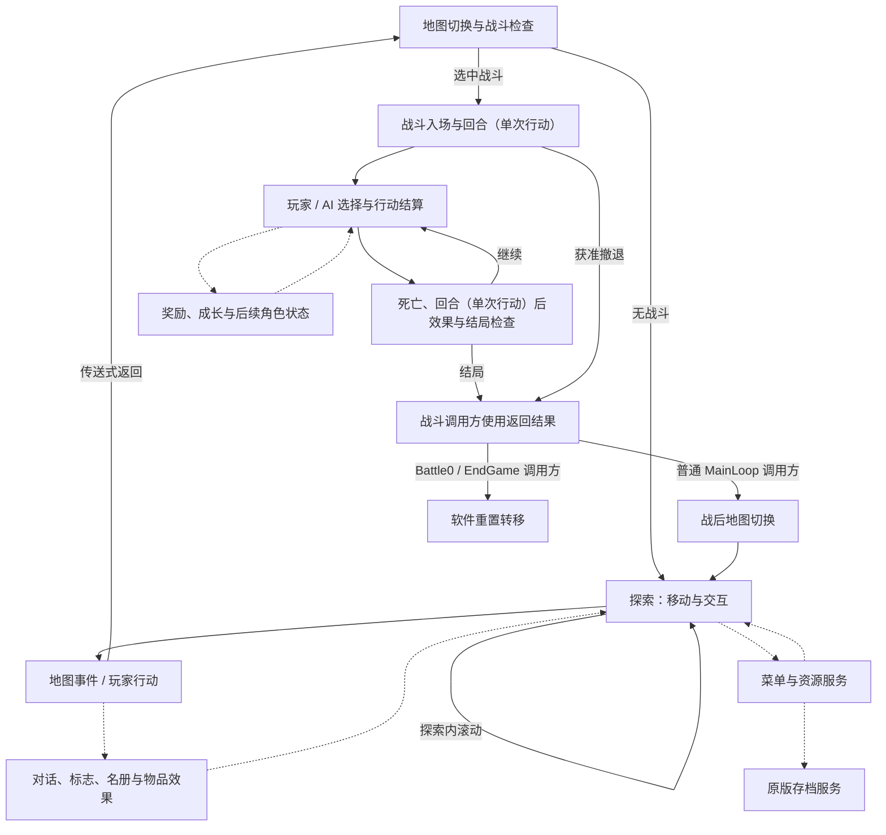

# 游戏总览与系统边界

- 状态：基于已接受证据的 Layer B 设计综合；其基础已由用户在
  [Issue #669](https://github.com/FrankHZ/md-sf2-reverse-engineering/issues/669) 中接受。
- 本阅读结构依据[当前范围约定](../../documentation-roadmap.md#current-baseline-and-near-term-synthesis)，
  消费已接受的 `main` 证据。
- 读者：希望选择玩法方向作进一步理解的读者，以及沿这些方向追溯证据所有者的研究者、设计文档作者与实现者。
- 范围：解释相互连接的玩法系统、已演示的私有 Map 3 → Battle 01 → 返回切片、已接受的重制选择与尚待解答的问题。
  本总览不新增原版游戏事实、平衡目标或产品决定。

> 本文件是规范英文 [`gameplay-overview.md`](../../synthesis/gameplay-overview.md) 的中文镜像，翻译基线为
> `f154275e875bd6cfd13496784a2f2ddaba775677`。英文始终是审阅基线；本镜像遵循
> [`glossary.md`](../../glossary.md) R1–R7。主题与已有详细指南之间使用中文页面及相应章节；
> 明示英文规范源、证据、研究、ADR 与引擎/验收的链接保留各自所有者。全部已索引设计文档已有经独立验收的完整中文镜像；
> 正文保留历史英文综合的判断边界，当前同步规则见[中文路线图](../documentation-roadmap.md)。

游玩把移动、交互与世界及军团（我方部队）的变化连接起来。探索时，玩家移动、面向实体或可搜索地点，并请求交互。
地图和剧情状态决定接下来发生什么：对话、物品转移、名册变更、地图过渡或战斗。
战斗中，玩家为成员选择位置和行动；结果改变战斗员与资源状态，战斗控制器据此让游玩继续或判定结局。
成长、装备与恢复将这一结果连接到后续行动。原版的存档与挂起服务则提供独立的重新进入边界。

这是对已接受规则的**推断性跨系统解释**，并非已证明的完整战役时间顺序。
私有重制现已接受一条从探索到胜利、再返回可操作地图的连接切片，其路线有范围明确的原版观察支持。
下文将已演示切片与更广泛的调用方、呈现或持久化仍属**未知**的规则区分开来。

[文档路线图](../../documentation-roadmap.md) 拥有写作和审阅约定。本文的**已确认**表示有源码支持的规则或具名的有界观察，
具体是哪一种由所在段落说明。**推断**表示受到支持、但尚未在更广边界上确立的连接。
**未知**表示已接受材料暂时无法回答的问题。重制决定单独陈述：重制中可运行的行为不能确立原版游戏事实。
精确参数与预期仍由所链接的合同和测试夹具保存。

## 沿玩法循环选择阅读深度

反复出现的关系是**探索 → 遭遇 → 战术行动 → 奖励或恢复 → 返回世界**。
**推断的设计连接：**每项活动都会为另一项留下条件。探索中找到的物品可能影响后续遭遇，战斗行动会消耗或改变资源，
结局也可能改变接下来选中的世界内容。这是有用的阅读循环，并非通用的唯一顺序：交互可以不经战斗而在原地返回，
败北与撤退有其他返回路径，取得某物也不必然激活它后来的用途。

先读下文的系统说明，再选择主题：

| 读者问题 | 后续阅读 |
| --- | --- |
| 战斗员可以尝试什么，回合（单次行动）如何变成效果与结局？ | [战术战斗循环](tactical-battle-loop.md)。 |
| 成员资格、成长、装备、物品、法术与服务怎样约束后续选择？ | [成长与经济](progression-and-economy.md)与[军团一节](#军团成员资格出战角色与角色成长)。 |
| 世界各部分之间会发生什么变化，哪些分支有独立门槛？ | [剧情推进的六组章节](story-progression.md#分段阅读故事内容)。 |
| 地点、朝向、布局、交互与过渡状态怎样组合？ | [地图设计原则](map-design-principles.md)。 |
| 哪些状态在返回后保留，实际保存的又是什么？ | [返回世界与持久化](#返回世界与持久化继续游玩与保存游戏是两回事)及[存档合同（规范英文）](../../contracts/save-system.md)。 |

要看一个跨系统例子，可沿[南方旅行章节](story-progression.md#南方旅行caravan-与-creed)
读到 [Taros 与车队](story-progression.md#完整示例taros-与-caravan)。
它连接了有条件的 Sword 拾取、Rohde 的提议、遭遇准入、Bowie 的已装备武器规则、结局，以及另行发起的通行选项。
物品未在手、拒绝、无效攻击和非胜利返回，解释了为什么不能把这些连接读成必然推进。
详细指南保存精确参数与证据，章节页解释它们之间的关系。

须区分四种前沿。**已确认的原版静态知识**现已有贯通结尾、字幕和隐藏战斗重置的已接受章节连接，
并包含选定的可选分支和明确的遗漏。**已确认的有界原版观察**保留其选定的 Map3–Battle01 谱系。
本文从已接受的所有者组织英文解释；后期章节研究不等于已完成一整套详细英文指南。
**已确认接受的重制支持**包括私有 Map3–Battle01 组合及有界的早期 Battle02/Yeel–Battle03 行为，
实际支持和 Unsupported 能力由[能力台账（规范英文）](../../../../remake/docs/capability-status.md)拥有。
Taros 与车队操作尚未获准作为生产内容。[覆盖所有者（规范英文）](../../../research/story-content-coverage.md#four-different-frontiers)
区分这些前沿；重组文字不会推进其中任何一项。解释仍属**推断**，缺口仍属**未知**，
[已接受的重制选择](#已作出的重制选择与尚待决定的产品选择)仍各有其决定所有者。

## 探索：移动、朝向与发现结果

**已确认的原版规则：**移动会改变受控实体的位置，面向附近实体或可搜索地点后，玩家可以请求交互。
地图配置与事件选择根据当前地图、实体和标志状态，确定哪些局部程序可用。
事件表选择首个匹配记录，而配置变体采用源码顺序中最后一个已置位标志。
条件重叠时，这两种不同规则很重要：状态变化后，同一地点可能选中不同的局部行为。

原版行动路径先检测 A，再检测 C：A 打开地图菜单路径，C 则可以激活实体、查看区域、进入同处一地的车队，
或回退到地图菜单。搜索会区分宝箱与其他对象类别。找到的物品先尝试交给玩家，再尝试另一名军团成员；
如果所有物品栏都满了，物品会被还原，而不会悄然丢失。这些是源码已确认的准入与交接规则，
不代表已确认每条搜索消息或动画。

同一次探索轮询中，如果待处理地图事件与 A/C 行动都可见，地图事件优先。
传送式过渡返回顶层路由，由地图切换和战斗检查选择后续游玩。
原版中发布事件的中断相对于输入采样的精确边沿仍属**未知**；这并不使已经记录的优先级变成未决问题。

**推断的设计连接：**位置、朝向、标志与物品栏容量共同决定一次探索行动能完成什么。
因此，成功交互改变的可能不只是玩家位置：它也可能提供资源，或改变后续程序的条件。
这解释了移动和交互如何连接剧情与出战队伍状态，但不为未观察路线赋予目的，也不声称所有路径都有用或可达。

[地图探索（规范英文）](../../contracts/map-exploration.md)说明几何、工作布局保留、有序选择器与移动规则；
[游戏流程研究（规范英文）](../../../research/gameflow-core.md)说明事件/输入优先级与交互准入。
[地图设计原则](map-design-principles.md)解释结构性内容。
**未知：**战役整体的路线质量、作者意图和原版移动手感。已接受私有切片中实际到达的地图/移动使用方有其自己的
[组合边界（规范英文）](../../contracts/map3-battle01-continuous-scenario.md#complete-reached-field-motion-and-consumer-binding)；
这不证明硬件帧一致，也不证明每张地图的行为。

## 交互与剧情：状态选择下一项局部行为

**已确认的原版结构：**地图程序检查并变更标志、对话状态、名册状态与地图状态。
对话命令通过游标选择文本，并保留继续、单窗口及关闭/清除等不同路径。
出战队伍命令也分别保留加入、出战队伍、AI 控制、重置、败北列表、复活与随从操作。
文本引用或名为 `join` 的命令确立的是源码操作；它本身不解释角色动机，也不解释正常流程何时到达该操作。

**推断的设计连接：**交互的持续意义来自它为后续选择器留下的状态，而不只是曾经请求文本这一事实。
标志变化可以选中不同的地图配置或程序；名册变化可以影响后续出战队伍状态；过渡会将当前世界状态交回路由。
对话和移动可以伴随这些变化，但程序返回本身不能证明玩家已看到或听到它们完成。

这种呈现区别对输入很重要。[对话合同（规范英文）](../../contracts/dialogue-system.md)
现已包含实际到达的文本等待绑定，范围超出较早的处理器局部矩阵。
已接受的私有组合绑定了实际到达的文本显示、确认、继续与实际输入就绪。
在该组合内，实际到达的呈现语义已获接受。**未知的原版行为**仍包括未观察调用方、完整的原版服务时序与硬件输出；
较早的垫片（shim）仍只是处理器观察，不会追溯性地证明未使用垫片的显示。

[剧情推进](story-progression.md)提供更广泛的状态路由解释；
[出战队伍/名册状态（规范英文）](../../contracts/party-roster-state.md)说明命令与运行时边界。
[连续场景（规范英文）](../../contracts/map3-battle01-continuous-scenario.md)拥有实际到达的路线及源码/使用方连接。
如果较早的综合文字仍保留更宽泛的未知项，实际到达行为以这些范围更窄的当前所有者为准。
**未知：**完整剧情时间顺序、路线互斥性、玩家选择后果及未观察剧情标志的含义。

## 军团：成员资格、出战角色与角色成长

**已确认的原版边界：**加入军团、进入出战队伍、AI 控制及在地图上跟随，是不同的状态操作。
随从不会自动成为被选中参战的战斗员，已加入成员资格也不能与出战队伍列表互换。
即使处理器局部列表暂时与已经变化的成员资格标志不同，出战队伍合同仍保留变更/调用顺序。
其受控矩阵确立的是选定效果，并非完整的面向玩家的招募或容量生命周期。

角色的当前 HP/MP、最大值、基础属性值与派生战斗属性也各不相同。装备与状态会影响后者。
**已确认（成长合同已观察路径）：**升级会应用属性增益、提高等级、处理相应的法术学习阈值，并刷新派生属性。
提高最大 HP 或 MP 本身不会补满当前 HP 或 MP。例如，观察中的 Slade 刷新提高了最大 HP，却让当前 HP 保持输入值。
所以，成长与即时恢复解决的是不同的状态变化。

战斗 EXP 将行动结果连接到成长。**已确认（具名奖励/回放接缝）：**行动局部 EXP 先最终确定为一条命令，
再应用到已存储 EXP；阈值处理可以调用 `LevelUp`。已存储等级、奖励比较用的有效等级与法术学习等级是不同的量。
职业/转职及法术列表规则必须来自各自所有者，不能归为一个笼统的“等级更高”概念。

**推断的设计连接：**交互及先前行动延续下来的军团状态，提供后续战斗所使用的成员、属性值、装备与法术。
这支持对准备和成长的解释，但不证明最优出战队伍、转职时机、角色定位或预期难度曲线。

定义和参数见[出战队伍/名册状态（规范英文）](../../contracts/party-roster-state.md)、
[通用属性（规范英文）](../../../research/common-stats.md)、[升级（规范英文）](../../contracts/level-up.md)与
[伙伴成长（规范英文）](../../../research/ally-growth.md)；[成长与经济](progression-and-economy.md)
连接各奖励阶段。**未知：**完整的玩家名册选择空间、招募生命周期及战役层面的成长体验。
已接受切片的名册与成长结果并未闭合这些更广泛问题。

## 战术战斗：合法选择变成效果与结局

**已确认的原版玩家控制规则：**移动与目标选择都是在当前战斗状态内作出的选择。
地形、占位、移动预算与行动范围约束合法位置及目标。行动菜单提供攻击、法术、物品及待机/搜索路径。
取消可以恢复行动前位置，并让行动保持未提交。选择目标、提交行动与应用结果是不同的交接；
仅仅放置光标不等于造成伤害或消耗资源。

控制器为这些选择提供上下文。**已确认的原版控制规则：**新战斗与挂起战斗以不同方式进入。
新战斗初始化先完成过场、名册、区域与加载工作，再进入回合（单次行动）。
每个新回合先激活敌人、执行区域过场与敌人生成工作，然后生成行动顺序。
一次回合（单次行动）按行动者的生命/状态/控制条件分发；该次行动由谁控制与属于哪个阵营是两回事。
玩家与 AI 路径先选择行动，再由结算路径使用它。

**已确认（交战/法术合同子集）：**物理攻击与法术根据行动者、目标、属性值、状态、地形及适用随机状态结算。
合同保留整数运算、分支条件与随机调用顺序；也区分构造战斗演出所用的临时状态与演出命令实际应用的状态。
回放前恢复临时 HP 并不是治疗目标。AI 评分同样不等于实际伤害：决策构造与已执行效果有不同的所有者。

行动后，控制器处理死亡，并在回合（单次行动）后效果的前后检查阵营。
继续游玩会选择另一行动者或开始新回合；出现结局则离开该循环。
胜利带有源码已确认的出战队伍恢复、战后程序和标志效果。败北与特殊的 battle-4 失利有各自的源码路径。
**已确认的有界原版观察：**选定的 Battle 01 谱系到达自然胜利、战后程序返回及稳定的地图就绪状态；
它不能作为每一种失利、撤退或特殊战斗路径的证据。

**推断的设计连接：**站位影响可用行动；行动影响 HP、状态与资源；这些效果影响谁仍可行动，以及战斗是否继续。
奖励与结局状态将局部战术循环重新连接到成长和世界。这解释了战术决策的选择空间，
但不推荐策略，也不推断公平性、平衡或节奏。

参阅[战术战斗循环](tactical-battle-loop.md)、
[战斗循环研究（规范英文）](../../../research/battle-loop.md)、[交战结算（规范英文）](../../contracts/combat-resolution.md)、
[法术结算（规范英文）](../../contracts/spell-resolution.md)及[随机性（规范英文）](../../contracts/randomness.md)。
已接受切片已经到达行动/AI/回合（单次行动）/演出的组合；更广泛行动类别与调用方状态仍保留各所有者的限制。
**未知：**通用全游戏模拟的预测准确性、完整遭遇行为及预期战术。

## 资源：物品、法术、服务与恢复

**已确认的有界原版例子：**观察中的 HEAL 1 行动消耗施法者 MP，并在允许恢复量内补回目标缺失的 HP。
根据适用的治疗者/奖励规则，它还可以产生 EXP。
[治疗测试夹具](../../../../tests/fixtures/h3/spell-healing-v1.json)与[法术合同（规范英文）](../../contracts/spell-resolution.md)
保留该受控自我施法的消耗、恢复与回放；它不是适用于每种法术或每名施法者的规则。

HP、MP、持有物品、金币、EXP 与服务中存储的资源属于不同状态。
**已确认的有界规则：**法术与物品路径各有针对行动的资格、消耗和结果规则；伤害、恢复、状态效果与奖励不能合并成一种通用效果。
已接受的私有战斗切片包括物理行动、HEAL 与 Medical Herb 消耗。
它不证明完整的原版法术/物品覆盖，也不使所有地图物品效果都变得可运行。

资源流转也有目的地与条件。探索拾取取决于物品栏容量。
源码已确认的商店行动包括购买、出售、修理和使用特卖：购买先减少金币，再授予物品；
出售先增加金币，再移除持有物品，珍稀物品另有路由。
车队/仓库行动区分成员持有物品与库存，并保留转移顺序。铁匠的交付与下单各有材料、成员和付款门槛。
这些静态交易解释资源接口，却不证明每项服务都能在某张地图/某名 NPC 处使用，也不证明结果会在之后重新加载时保留。

教堂的复活（教堂）、治疗（教堂）、转职（教堂）与存档路径，将资源连接到成员与持久化状态。
**已确认的有界运行时结果：**已接受的 Raise 用例观察了支付能力、付款、遵守原版上限的 HP 恢复及 mapsprite 辅助完成；
Cure 用例观察了有序的状态与装备提交；Save 用例观察了提示分支、原版存档调用完成，以及继续/挂起的入口分流。
每一项都确认其具名交易与终止接缝。更广泛的调用方返回、UI、持久存储与正常战役准入仍属**未知**。
转职保留源码等级/数据门槛与职业/转职调用顺序；这不是最优时机的证明。

**推断的设计连接：**一项活动中获得或保留的资源，会成为后续选择的输入。
受伤成员、法术的 MP 要求、物品栏容量或服务价格，都可能限制下一个合法行动。
如果缺少战役与平衡上下文，玩家遇到这些约束的频率，以及它们是否形成稀缺或反复刷取压力，仍属**未知**。

[服务合同（规范英文）](../../contracts/service-interactions.md)、[法术合同（规范英文）](../../contracts/spell-resolution.md)、
[通用属性（规范英文）](../../../research/common-stats.md)及[成长与经济](progression-and-economy.md)
拥有这些区别与参数表。源码清单或一次成功战斗不等于战役经济。
实际到达的 HEAL/物品呈现属于连续组合；切片之外的服务菜单仍保留各自的证据与实现限制。

## 返回世界与持久化：继续游玩与保存游戏是两回事

**已确认的原版路由：**外层循环先应用由标志驱动的地图切换，再检查战斗。
普通 `BattleLoop` 返回则经过地图切换直接进入探索，不会立即再做一次战斗检查。
传送式探索返回会重新进入外层准入路径；滚动留在探索内部，不执行该扫描。
[游戏流程所有者（规范英文）](../../../research/gameflow-core.md#main-and-exploration-contract)与
[地图生命周期解释](map-design-principles.md#返回与持久性)保留这些调用方区别。
隐藏 Battle0 返回 EndGame 的软件重置路径，详见[战术返回说明](tactical-battle-loop.md#从战斗返回尚不等于可用探索)。
从控制器返回是一个边界；地图稳定且可用输入则是后一个边界，在下文演示切片中另行确立。

下图展示源码已确认的路由骨架。实线箭头表示已记录的控制交接，虚线箭头概括**推断**的跨系统关系。
它们不确立每个调用方的返回、可见完成或存档状态生命周期。

**已确认的原版存档边界：**原版有两个逻辑 SRAM 存档槽位、校验和与占用标志，并有不同的存档/读档/复制/删除操作。
进程内矩阵观察了这些辅助及选定的女巫行动准入和新游戏交接。
战斗挂起另有存档/标志/转移路径和重新进入分支。
这些结果描述原版状态与控制；它们不证明完整的玩家驱动启动 UI、跨进程保留、断电恢复，也不证明每个子系统都已序列化。

即使只看名册状态，其所有者矩阵也区分了已保存战斗员数据域中的已加入成员资格与 HP，以及域外的败北列表。
游玩期间保留某项变更，不自动意味着它属于持久存档。
**未知：**完整战役状态的保留与物理介质行为。

这些原版边界见[存档系统（规范英文）](../../contracts/save-system.md)与
[出战队伍/名册（规范英文）](../../contracts/party-roster-state.md)。
当前重制里程碑在 [ADR 0010 的持久化范围（规范英文）](../../../decisions/0010-map3-battle01-product-acceptance.md#6-save-and-resume-scope)
中明确排除了用户存档/读档与挂起。因此，可玩的返回不等于声称具备现代存档系统。
自动存档、原子写入、恢复 UX 和更广泛持久化仍是未来产品决定，各有其验收范围。

## 一条已演示的连接切片

**已确认接受的私有重制里程碑：**
[当前验收所有者（规范英文）](../../synthesis/map3-battle01-readiness.md#accepted-current-milestone)
接受一条连续的 Map 3 → Battle 01 胜利 → 可操作地图返回组合。其面向玩家的连接为：

1. 进入受控且已获准的 Map 3 状态，沿选定必经路线使用普通移动与交互。
   这是产品起点接缝，并非完整可见的原版新游戏/读档流程，也不是不受限制的 Map 3 探索。
2. 经过信使、Map 19、王室/守卫及城堡/塔程序，继续到自然的 Battle 01 准入。
   对话、状态变化、移动、等待及战前/开始呈现是路线的一部分，不能用摘要卡片替代。
3. 通过移动、目标/行动选择、确认及获准的取消/重选路径，控制己方角色的回合（单次行动），
   同时由源码约束的敌人决策与战斗规则推动游玩。
   实际到达的行动、效果、奖励及其真正的呈现使用方在已接受组合内连接。
4. 获胜、完成战后程序和世界返回，然后到达接受普通输入的稳定地图。
   只有胜利结果还不够；可操作的返回才是终点。

[原版采集所有者（规范英文）](../../../research/map3-messenger-acceptance.md#native-victory-and-stable-field-readiness)
确立了一条范围明确、由即时存档连接的获胜谱系，从受控 R1 到自然胜利及稳定的 Map 57 就绪状态。
它不是连续不间断的墙钟时间，也不是自然的新游戏/读档路线。
另一个[返回输入观察（规范英文）](../../synthesis/map3-battle01-readiness.md#accepted-original-frontier)
确认了普通 Down 输入与稳定后的位移。原版终止配对仍不可恢复执行。
这些观察支持各自具名的原版边界；它们不会把现代时钟轨迹变成不变的原版黄金基准，也不确立全游戏呈现。

已接受组合包含玩法与实际到达的呈现语义：实际内容使用、命令/效果、完成、确认及输入就绪。
它排除像素/帧/波形/芯片及原版硬件时钟一致性。私有内容仅限本地；验收不授予公开分发权。
[组合审阅（规范英文）](../../../../remake/docs/evidence/retained-comparisons.md#accepted-composition-review)
拥有精确依赖和复现路线。

历史 A10/default/matrix 报告仍为 Unavailable，保留 `milestonePass=false`，限定范围的输出也保留其为 false 的里程碑字段。
没有生成新的完整可执行报告或修正后的完整 A 轨迹。
里程碑通过对已执行路线、父证据与子证据的独立组合审阅获准，而非靠重新标注这些报告。
历史种子、HEAL 时序及溯源/审阅失败仍保留；终止处内部完成属**推断**，其延迟属**未知**。
这些科学限制既不否定已接受边界，也不会自动安排新的运行时采集。

## 已作出的重制选择与尚待决定的产品选择

以下为**已确认接受的重制决定**，并非对原版行为的推断：

- **现代逻辑时间：**有限音乐采用已接受的[确定性时钟政策（规范英文）](../../contracts/music-wait-service.md#accepted-modern-finite-music-policy)。
  逻辑完成与实际匹配的播放完成是两道独立门禁。宿主交付延迟不增加逻辑机会或 tick 欠债。
  这可能改变共享 RNG 历史、行动者顺序和后续资源，因此验收保留匹配状态下的局部规则与必经路线效果，
  而不要求旧的整段历史轨迹保持不变。它不授权生产运行重新设种子。
- **玩家等待：**[有证据支持的 Wait 政策（规范英文）](../../contracts/map3-battle01-continuous-scenario.md#evidenced-gameplay-waits)
  仅在获准且具有所需调用方/服务/阶段绑定的使用方处，允许玩家等待。
  必须执行的逻辑工作、玩家 Wait 与显示/音频交付延迟是不同的事。
  不同交互选择可以偏离可复现的验收轨迹。
- **输入范围：**[默认键盘 A 为必需项（规范英文）](../../../decisions/0010-map3-battle01-product-acceptance.md#current-keyboard-scope)；
  键盘 C 为补充项，手柄 B/D 排除在当前里程碑比较之外。
  已有的重映射、按键互换、减弱闪光与可调文本，不会仅因存在就额外产生必须验证的全路线变体。
  里程碑仍要求玩家手动掌控。
- **快速文本与台词：**[已接受的省略政策（规范英文）](../../../../remake/docs/godot/audio.md#accepted-fast-text-speech-policy)
  在即时/全部显示文本中，对被省略的逐字显示跳过台词，跨越文本显现过程保留已经播放中的台词尾音，
  并保留之后合法的提示音替换。仅用于显现文本的输入不发出确认，也不产生玩法机会。
  已接受的受控显现尾音见证证明了该机制；历史补充 C 区间仍保留其采样限制。
- **内容与呈现：**[7C/8D/10A（规范英文）](../../../decisions/0010-map3-battle01-product-acceptance.md)
  要求实际到达的私有内容与呈现语义，包括实际使用与就绪，同时将硬件一致性和公开再分发排除在本里程碑之外。

引擎方向及可运行/不受支持能力仍由 [ADR 0019（规范英文）](../../../decisions/0019-state-and-content-driven-remake-engine.md)
与[能力台账（规范英文）](../../../../remake/docs/capability-status.md)拥有，而不由本总览拥有。
更广泛的美术/UI/UX、战役范围、手柄验收、持久用户存档和有意重平衡，属于独立产品选择。
在这里描述它们，并不产生首选方案或实现工单。

## 供用户下一次审阅的设计方向

这些方向指出进一步理解哪些内容会有帮助。它们不是优先级、完成目标或自动研究队列。
“研究”指解决原版游戏问题；“综合”指解释或组织已接受内容；“产品决定”指选择重制行为。
一个方向可能需要不止一种工作。

| 方向 | 已接受的知识与所有者 | 尚待解答的问题 | 有用的后续工作类型 |
| --- | --- | --- | --- |
| 探索与地图内容 | [地图探索（规范英文）](../../contracts/map-exploration.md)中的有序配置/事件、工作布局、交互与移动规则；[地图设计原则](map-design-principles.md)中的结构性解读；已演示一条连接路线。 | 读者还应理解哪些可达交互与路线，重制又应在必经切片之外提供哪些？ | 综合可以组织现有地图/交互内容。新的可达性/结果主张需要原版研究；更广泛的可玩探索需要产品决定。 |
| 剧情与世界推进 | [剧情推进](story-progression.md)和[对话（规范英文）](../../contracts/dialogue-system.md)中的标志/程序/对话/过渡边界，以及[连续场景（规范英文）](../../contracts/map3-battle01-continuous-scenario.md)中实际到达的时间顺序。 | 其他剧情路径的时间顺序与后果有哪些证据支持，而非由源码名称暗示含义？ | 先组织已接受的程序/状态关系。新的战役时间顺序或选择后果需要原版研究；叙事变更需要产品决定。 |
| 出战队伍、职业与成长 | [出战队伍/名册（规范英文）](../../contracts/party-roster-state.md)中不同的成员资格/出战/AI/随从状态；[升级（规范英文）](../../contracts/level-up.md)中有源码支持的成长与刷新。 | 支持怎样的完整玩家选择与容量生命周期，招募、转职、装备和成长在战役中怎样相连？ | 综合可以解释已接受的角色/职业内容。更广泛的生命周期和数值应用缺口需要研究；名册或平衡变更需要产品决定。 |
| 战术规则与遭遇 | [战术战斗循环](tactical-battle-loop.md)所链接的局部控制、移动/目标、结算与结局所有者，以及已接受、实际到达的 Battle 01 组合。 | 哪些尚未观察的行动、AI、地形或遭遇分支与下一个有界行为有关？已接受合同能否共同支持该行为？ | 组织现有行动/遭遇内容。具体缺失的原版规则需要研究；扩大行动范围或重平衡需要产品决定。这不意味着要建立通用模拟器。 |
| 物品、法术、服务与经济 | [成长与经济](progression-and-economy.md)、[法术（规范英文）](../../contracts/spell-resolution.md)和[服务（规范英文）](../../contracts/service-interactions.md)中的有界法术/物品/奖励流程，包括教堂运行时接缝。 | 服务何时何地获准，之后重新加载会保留什么，怎样的战役上下文足以支持资源或曲线解释？ | 综合可以连接现有定义与交易规则。新的准入/持久化或战役主张需要研究；现代服务 UX 或经济变化需要产品决定。 |
| 持久化与重新进入 | [存档系统（规范英文）](../../contracts/save-system.md)中的原版槽位及进程内存档/挂起边界；当前里程碑排除用户持久化。 | 哪些原版状态经过完整生命周期仍能保留，应提供怎样的现代存档/恢复行为？ | 如果保真主张需要，原版保留/失败行为须通过研究确立。现代存储与恢复需要先作产品决定再实现；可操作地图返回已有独立的已接受边界。 |
| 界面、反馈与可访问性 | [当前里程碑（规范英文）](../../synthesis/map3-battle01-readiness.md#accepted-current-milestone)及[呈现所有者（规范英文）](../../../../remake/docs/godot/presentation.md)中的实际到达使用方语义与已接受的输入/文本/音乐选择。 | 在这个私有键盘切片之外，希望获得怎样更广泛的信息、可访问性、资产与输入体验？ | 综合可以解释已接受的反馈与偏差。更广泛的 UX/美术/输入覆盖需要产品选择；只有具体必需的语义缺口才足以支持原版呈现研究，并非每项硬件未知都要研究。 |

[路线图选定的英文来源集合（规范英文）](../../documentation-roadmap.md#selected-english-source-set-and-reconciliation)
现已连接五个主题与六组章节。本轮不再计划对这些选定主题作实质重写；独立整体验收与合并确立其稳定性。
以上方向涉及已交付解释之外的问题，不派发新的研究。既有设计语料已完成中文翻译；后续实质变更仍须确认来源稳定性，并在明确范围内翻译、审阅和同步。
当更广泛的答案需要新事实、新决定、新采集或所有者变更时，本文必须止于所链接的证据边界。
