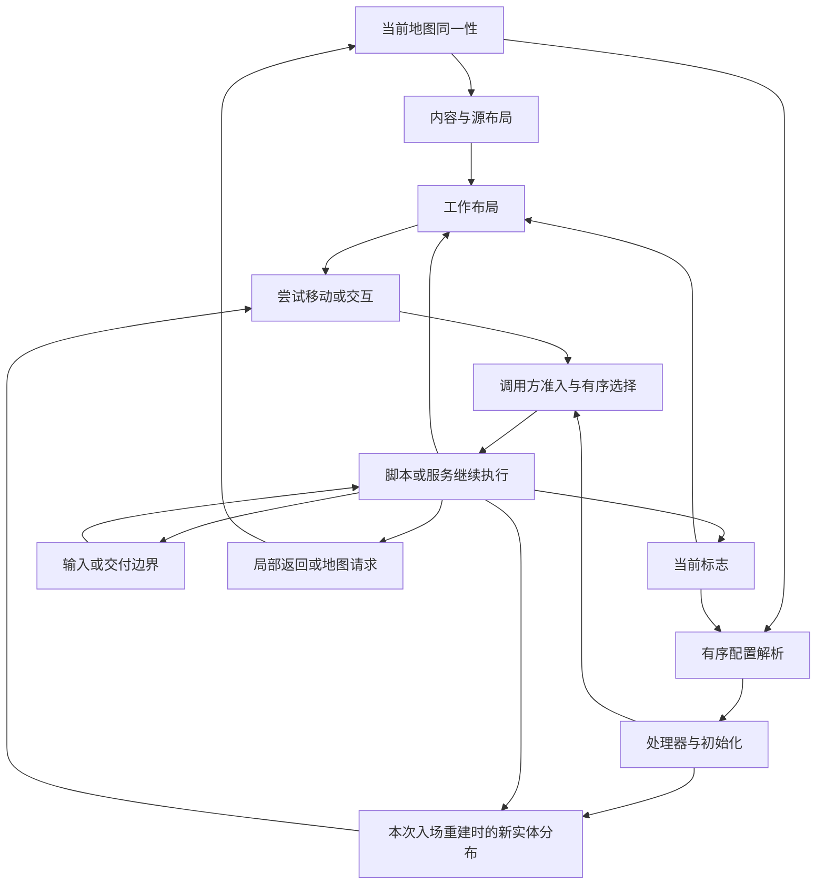

# 地图设计原则：探索、交互与世界连续性

> 本文件是 [`map-design-principles.md`](../../synthesis/map-design-principles.md) 的中文镜像，审阅基线为 `f154275e875bd6cfd13496784a2f2ddaba775677`。英文原文始终是审阅基线；本镜像为派生文档，遵循 [`glossary.md`](../../glossary.md) 的术语规则（R1–R7）。证据标签按 R1 使用固定中文译法；源码标识符、fixture ID 与路径按 R2 原样保留。下文未同步的合同、详细指南和其他所有者明确链接规范英文。正文中的修订、审计、复现与中文就绪判断均保留英文来源当时的范围；本批不产生新原版证据，也不完成其他镜像。

探索把一次行动尝试与它留下的状态连接起来。玩家移动或转向，面向一个行动者或可搜索的地点，然后请求交互。当前地图、标志、工作地形和当前活动的行动者共同决定该请求能否到达处理器。一次已返回的对话可能改变标志或配置交通工具；离开再回来时，地点可能根据这些条件重建。战斗返回又能改变这次重建。继续游玩与保存游戏是两个独立边界。

本文是对已接受原版规则和选定章节衔接的 **推断 Layer B 解释**。下文的 **已确认** 表示一个具名的静态事实或有界观察，并注明其范围；**未知** 保留未解决的边界。这些衔接不代表自然游玩得到的全游戏路线，也不评价地图趣味或作者意图，更不扩大生产支持范围。

从[游戏总览](gameplay-overview.md#探索移动朝向与发现结果)开始，然后依次阅读本主题，或按问题选择：

| 读者问题 | 阅读路线 |
| --- | --- |
| 为什么转向、移动、交谈或搜索会得到不同结果？ | [行动与交互](#行动与交互)。 |
| 为什么同一个地方的角色或地形会不同？ | [地图状态](#结构词汇)与[生命周期规则](#结构原则)。 |
| 对话何时才真正允许下一项行动继续？ | [对话与继续执行](#对话与继续执行)。 |
| 获得交通工具就表示已经乘坐了吗？ | [交通工具](#交通工具获取登乘行驶与登陆)与 [Polca 实例](#连接实例从-polca-返回到南方行程)。 |
| 离开、战斗、存档或挂起后，什么会保留？ | [返回与持久性](#返回与持久性)。 |
| 这些说明的边界在哪里？ | [证据限制](#当前语料能与不能描述什么)与[审阅](#综合前证据审计)。 |

[剧情推进（英文）](../../synthesis/story-progression.md#read-story-content-in-segments)的章节拥有详细内容与分支。[战术战斗循环](tactical-battle-loop.md#从战斗返回尚不等于可用探索)拥有结果与控制的区别；[推进与经济](progression-and-economy.md#持久性边界)拥有资源与服务后果。本主题解释它们与探索的衔接，不重复交易过程或战役逐段记录。

## 判断边界

当前 Standard 约定见[文档路线图（英文）](../../documentation-roadmap.md#current-baseline-and-near-term-synthesis)与 [Issue #1276](https://github.com/FrankHZ/md-sf2-reverse-engineering/issues/1276)。读者应能沿着“条件 → 尝试行动 → 状态改变或被拒绝 → 继续执行或返回”理解流程。只修改现有的本主题所有者。研究、合同、其他主题、代码、UI/UX 与中文镜像仍归各自所有者。解释已接受事实不需要空间分析、原版观察或验证平台。

保持四条前沿独立：已接受的原版静态知识延伸到选定结尾与重置路径；有界原版观察有各自的 [Map3–Battle01 证据谱系（英文）](../../synthesis/map3-battle01-readiness.md#accepted-original-frontier)；英文综合在具名范围内使用这些证据；生产能力归[重制能力台账（英文）](../../../../remake/docs/capability-status.md)所有。已接受的私有连续 [Map3–Battle01 胜利与可用返回（英文）](../../synthesis/map3-battle01-readiness.md#accepted-current-milestone)没有实现 Polca、木筏行程或 Taros。更广路线、碰撞/呈现用例与耐久持久性，在其所有者如此标记的地方仍为 **未知**。重新组织本说明既不确立全游戏完整性，也不确立整合英文的稳定性或中文同步就绪。

## 行动与交互

### 移动或转向尚未选择对话

**已确认静态：** 普通受控移动先按边界和行动者阻挡评估方向输入，再检查候选点的工作布局标记。阻挡的行动者能阻止进入标记分支。受控行走依次判断进入 Caravan、进入木筏、门、传送、区域（事件），然后判断可通过性。门处理会在变更后重新读取地形。这些规则在移动内部运作，与配置选择或行动按键优先级分开。[地图合同（英文）](../../contracts/map-exploration.md#areas-events-and-items)与[木筏请求产生方审阅（英文）](../../../research/polca-raft-boarding-through-south-parmecia-entry.md)保留精确的标记与行动者测试。被阻挡或产生事件的尝试未必推进该行动者的目的地；下方登乘实例能在转向的同时请求事件。

**已确认有界移动观察：** 实体行动命令分别保留位置、目的地、行进、速度、朝向与行动指针状态。启用的更新先推进运动，再分发下一条命令。启用阻挡标志后，若另一个非空槽位的候选目的地与其曼哈顿距离严格小于 384 内部单位，就可能让移动命令停留在当前指针处，直到能够继续。该命令层谓词不能替代受控行走或载具控制器自身的阻挡测试。[实体移动章节（英文）](../../contracts/map-exploration.md#entity-movement-and-action-timing)与 `sf2-entity-movement-runtime-v1` 拥有十三用例/二十 tick 的边界。转向、安装移动、到达目的地，以及玩家看到移动，是不同主张。

**已确认静态：** 探索等待与外层分发都在玩家行动之前测试待处理地图事件。若同一轮迭代已经同时看到二者，事件优先。待处理槽位在事件分发前被清除；它不是队列，也不保证每个产生方的请求都能保留。在行动路径内，A 先于 C。A 打开场景菜单路径；C 可以使用同位置的 Caravan、激活实体、检查区域，或退回菜单。实体激活扫描 48 个候选，跳过玩家/随从，并使用自身的距离/朝向和桌面/柜台延伸规则。[控制流合同（英文）](../../contracts/exploration-control-flow.md#player-action-and-entity-interaction-boundary)与[游戏流程研究（英文）](../../../research/gameflow-core.md#main-and-exploration-contract)保留 fixture 所属子集及更广的源码审阅。槽位数量或可见精灵均不能确立有效交谈目标；精确的输入发布时序仍为 **未知**。

### 交谈、搜索、物品使用与区域（事件）的调用方不同

交谈请求需要已激活的行动者及其事件同一性。搜索则检查面向的布局点；物品使用有其选定物品/坐标/朝向路径；行走区域（事件）是地图事件的产生方。它们最终都可能请求文本或脚本，但前提并不完全相同。

**已确认静态搜索：** FieldMenu 以 `d6=0` 调用 `CheckArea`；无实体的行动路径使用 `d6=1`。负的视野目标直接返回。否则，用所选实体的位置与朝向推导检查的瓦片。图块种类顺序为宝箱、花瓶、木桶、书架、通用可搜索对象，最后回退到区域描述。已处理的描述关闭文本并返回“已处理”；未处理的 `d6=1` 返回零，而 `d6=0` 提供默认回应并返回“已处理”。所以未命中并不总是得到同一种回应。[场景搜索所有者（英文）](../../../research/field-search-control.md#confirmed-static-spine) `sf2-field-search-control-static-v1` 保留这些调用方取值区别与精确数值。

对于物品，源码先尝试领队的四槽物品栏，再尝试其他合格的军团成员。若无人能接收，关闭宝箱/重新填充非宝箱的调用会恢复这次机会。金币有自己的交接。这些是静态调用/接收者规则，不保证已观察到的呈现、交易原子性或存档持久性；[资源接收与容量](progression-and-economy.md#来源接收与容量决策)解释其后果。物品使用选择仍独立：[Ribble 树/剑指南（英文）](../../synthesis/ribble-tree-opening-and-achilles-sword.md)区分在精确行动者坐标处面朝 Up 的 Panel Use 与面向瓦片的搜索。仅持有物品或视觉上邻近对象，并不能满足该调用方条件。

实体、区域（事件）、物品与描述表，都在各自使用方内部采用首匹配。选中记录确立一个目标；调用方获准进入、脚本执行、效果提交、确认继续和恢复场景控制，各自都需要证据。九个原版事件选择用例用 `rts` 替代所选脚本，所以无法证明脚本结果。后来接受的章节/源码证据和有界文本/返回证据，可以确立具体的额外步骤，但不会把所有选择器用例都变成端到端观察。

## 对话与继续执行

已显示的回应仍可能占有本次交互。**已确认原版源码与有界观察：** W1、W2 与普通输入辅助是不同使用方。W1 的接受轮询在输入测试前包含 RNG 抽取/复制与等待工作；W2 有自己的辅助/确认工作。普通 JOIN 输入先测试输入再等待，而且 JOIN 文本没有额外的 W1/W2 token。一行显示文本不对应一种通用的确认继续。[对话合同（英文）](../../contracts/dialogue-system.md#poll-order-and-distinct-consumers)绑定已到达的原版读取，并把未观察到的交错执行保留为 **未知**。[输入合同（英文）](../../contracts/input-system.md#runtime-matrix-boundary)的直接采样/输入重复/等待矩阵不能确立所有正常调用方或硬件延迟。

**已确认源码选择规则：** `YesNoPrompt` 返回的 Yes 设置 F89，No 清除 F89，随后执行源码中的延迟/返回。完整使用方包括打开、释放进入时已按住的输入、选择、确认/取消、关闭和结果发布。只写一个标志不能实现该流程。[源码绑定选择所有者（英文）](../../contracts/map-exploration.md#source-bound-choice-consumer)把原版已观察 Yes 路径与现代 No 验证分开。在剧情内容中，[Polca 的 Oddler 选择（英文）](../../synthesis/polca-oddler-choice-and-following.md)说明拒绝为什么是真实分支：首次拒绝直接返回，后一次拒绝后的劝说则不再提示，直接汇合。选择结果、跟随与调用方标志仍是独立效果。

**已确认的已接受重制政策：** 仅揭示文本的输入只让文本可见，不确认其逻辑等待、不增加 tick/RNG 工作，也不完成服务。实际匹配的视图交付、确认继续和符合条件的显式 Wait 是不同输入。必需的接受轮询工作归获准进入的逻辑使用方；适配器延迟不会产生额外轮询或欠账。[逻辑输入所有者（英文）](../../contracts/dialogue-system.md#logical-input-ownership-and-implementation-gap)、[ADR0010（英文）](../../../decisions/0010-map3-battle01-product-acceptance.md)与[宿主语义接口（英文）](../../../../remake/docs/godot/presentation.md#semantic-interface)拥有这一现代确定性时钟与继续执行边界。脚本指令返回，不会自动等于区域（事件）调用方返回或普通输入变得可用。

已接受的[快速文本台词政策（英文）](../../../../remake/docs/godot/audio.md#accepted-fast-text-speech-policy)省略被跳过字符揭示的台词音效。揭示保留已经播放中的尾音；之后仍可进行合法的音效提示替换。仍需源码特定的确认，但不为每次确认继续都增加声音；确认继续也不等待每段音频尾音。这些是在其获准范围内已接受的现代选择，不是新的原版音频/节奏证据。此处不选择 UI 布局、美术、无障碍、音频资源或额外时钟。

## 结构词汇

同一个可见地点能在改变配置、地形或角色分布的同时保留内容同一性。解释返回时重建了什么，需要给这些权威状态分别命名。

| 术语 | 本综合中的含义 | 重要区别 |
| --- | --- | --- |
| 地图定义 | 79 条记录之一，引用几何、调色板/瓦片集与有序内容表。 | 地图 24/46 与 23/7 共享图块/布局同一性；同一性不代表唯一资源包。 |
| 配置路由 | 按地图/默认/标志顺序选择六指针配置。 | 最后设置标志胜出；它不是章节编号或首匹配字典。 |
| 配置定义 | 实体列表、实体/区域（事件）/物品处理器、描述与初始化函数。 | 选择它不能证明每个被引用的主体都会执行。 |
| 源布局 | 解码后的不可变 64x64 图块索引/标志字；每个图块包含 3x3 瓦片。 | 原始几何不提供完整可遍历图。 |
| 工作布局 | 可变的 8 KiB 地形，标志/宝箱/屋顶/踩踏/门/脚本变更作用于其上。 | 能否保留取决于加载路径，而非仅取决于地图 ID。 |
| 当前活动的物理实体分布与查找 | 当前行动者、其行动/运动状态、列表及逻辑到物理的映射。 | 成员/随从标志或新选中的处理器，不等于重建这批实体。 |
| 交互选择器 | 使用方局部的有序目标匹配。 | 目标同一性与效果及控制释放分开。 |
| 呈现适配器 | 摄像机、窗口、调色板、动画、声音与绘制使用状态。 | 交付不选择剧情状态，也不认证与原版可见结果一致。 |

## 证据受限的地图模型

这是在分别拥有的规则之上的 **推断组合**，不是引擎架构，也不主张每条箭头都在同一个原版会话内执行过。返回可以保留行动者、重建行动者、进入战斗或继续特殊调用方；应使用具名生命周期，而非假定整个图都会发生。

## 结构原则

### 1. 把地图当作分层包，而不是单体关卡

**已确认静态：** 地图内容独立于配置引用资源。可选指针保持缺失；共享几何保留其同一性。**推断后果：** 内容、选定配置与当前活动状态解释同一地点的不同部分。这不选择新的编辑器、场景格式、缓存或导入器架构。

### 2. 把地点同一性与有状态配置分开

**已确认：** 64 条配置路由解析到 126 个定义；十五个地图 ID 缺少这些路由。扫描所有标志行，每个已设置行都替换候选，后面的别名可以恢复默认值。Polca 胜利后全新配置中，F513 优先于 F799、F710 和默认值。该具名章节赋予这些标志含义；聚合选择器不能证明每种正常存档组合都可达。在保留行动者时改变标志，可能选中预期角色分布从未重建的处理器。

### 3. 保留顺序，因为顺序消解歧义

**已确认：** 配置采用最后设置标志胜出；实体/区域（事件）/物品/描述选择采用首匹配；标志复制全部按源码顺序应用；加载时屋顶与踩踏/传送有各自的首匹配。移动标记优先级、待处理事件优先及 A/C 行动优先级，是另外的、特定阶段的规则。通用优先级列表不能替代它们。必须由实际到达的使用方解释重叠，包括其通配与未命中行为。

### 4. 让可变地形成为派生状态

**已确认加载路径规则：** 非负地图加载与滚动传送从源码重建工作布局，并重放各自所属的标志/宝箱状态。负的当前地图重载在屋顶评估前保留缓冲区。显式重置清空该缓冲区并走保留路径；它不会隐式重新解码源码。地图配置初始化在 `LoadMap` 返回后执行。标志、屋顶、宝箱、踩踏和门变更发生在不同阶段。这些规则归[地图加载合同（英文）](../../contracts/map-exploration.md#load-and-selection-order)所有。

布局保留与行动者保留分开。滚动可以在保留当前物理实体分布的同时重建地形；显式入场则可以按标志重建随从。因此，局部隐藏或改变的行动指针未必能在全新入场后保留。无论保留缓冲区还是重放标志，都不能确立完整存档/读档持久性或所有碰撞使用方。

### 5. 把选择与后果分开

**已确认：** 旧选择器审计证明的是其接缝上的匹配与目标。后来的章节所有者还检查了实际调用方谓词、脚本主体与紧接其后的返回使用方。应按这些额外效果所声明的静态/观察边界解读。被替换为空实现的回调不能证明它们；其有限审计也不能抹去它们。即使已确认脚本状态写入，对话确认继续与普通输入就绪仍是额外边界。

### 6. 把导航、交互与呈现作为独立问题

移动与章节所有者现在已确立特定可通过性/阻挡与过渡规则。完整战役遍历图、自然接近每个目标、渲染地图一致性、地标、节奏、趣味与预期难度仍为 **未知**。原始图块索引不是可通过性，摄像机命令名不是可见取景，文本中的方向也不是合法行走。本主题说明不需要新的空间或呈现采集项目。

## 交通工具：获取、登乘、行驶与登陆

授予改变后续操作的前提。**已确认静态：** Polca 镇长调用方只在演出返回后写入 F716、F64 与 Map72 木筏元组。这不会让 Bowie 登筏，也不能证明 Polca 当前存在木筏。普通全新声明需要独立的模式/地图/标志条件；实际木筏登乘还会单独检查物理木筏的对齐。下方实例沿这些门槛展开，不把它们变成保证可行的路线。

Caravan 有另一套生命周期。[Taros 的结果/获取（英文）](../../synthesis/battle18-outcomes-and-caravan-acquisition.md)在获准的首次胜利演出边界设置 F65/清除 F84；它不设置交通模式。[Caravan 行驶所有者（英文）](../../synthesis/caravan-boarding-and-southwest-parmecia-travel.md)区分全新世界地图实体分布、行走的登乘标记、缩小/随从工作，以及最后的 mode1 写入。通过 C 按键进入其服务菜单，与登乘或物品栏存储是不同的行动。Caravan 登乘使用方没有木筏式的对齐复查。

**已确认数值边界：** mode1 安装 opcode7，其在固定源码中名为 `eas_Raft`；mode2 安装 opcode8，名为 `eas_Caravan`。它们的实际使用方分别控制 Caravan 与木筏。名称不能覆盖数值分发。Caravan 登陆请求为 event4；木筏控制器请求 event5。在合格布局检查后，Caravan 登陆先放大当前列表中的行动者，按标志重新安装随从行动，最后才写入 mode0。它既不重建列表，也不重建所有逻辑同一性；工作停滞时可能留下 mode1 下的部分前缀。返回后待处理值为零，只允许安装行走，不代表已观察到可响应的控制。选定木筏指南止于 type5 请求，不确立其完整消费。

载具控制器的边界、当前位置阻挡与标记决策不同于行走。它们不产生行走的 zone6 事件，也不递减其步数计数器。尤其是，Caravan 登陆本身不准入 Battle19：之后的行走区域（事件）与顶层战斗检查是独立步骤。获取、运行模式、交通工具位置、物品栏服务与出战队伍成员资格仍是不同状态；任何一项都不能证明自然行驶或交通工具的耐久持久性。

## 连接实例：从 Polca 返回到南方行程

这个 **推断的连接说明** 组合了已接受的 **已确认静态** 章节接缝。它以所述已提供的标志/行动者以及服务能够返回为条件，不是自然游玩得到的连续旅程，也不是生产功能。Fnnn 表示原版标志 nnn。

1. **从 Battle13 返回。** 在获准的胜利下，首次 F513 未设置的战后处理设置 F75，请求 Map13 `(16,12)`、Down，然后返回。公共后缀在读取返回元组前清除 F413 并设置 F513。全新进入 Polca 选择 F513 配置，清除临时 F256–383，并重建 NPC/随从。Luke 的跟随标志 F75 与成员资格 F10、生命状态及出战队伍状态不同。重复胜利跳过该战后处理，并保留变量返回初值；败北/Egress 有[不同的 Bedoe 返回（英文）](../../synthesis/battle13-outcomes-through-polca-raft-grant.md#battle-outcome-and-where-it-returns)，不授予此次新的战后处理/完成状态。
2. **请求木筏。** 在更高优先级的 F718/F717/F716 未设置且临时标志为全新状态时，前三次完成的镇长接触依次分别设置 F260、F261、F262；第四次到达议价演出。只有演出返回才到达 F716 → F64 → `RAFT_MAP=72`、X43、Y48。Ripster 的当前隐藏是局部变化；之后全新 F513 Polca 会重新创建他。议价前重新入场会清除这些临时接触标志。F716 已设置时只给出重复台词，不修复缺失木筏。[镇长接触与授予（英文）](../../synthesis/battle13-outcomes-through-polca-raft-grant.md#optional-mayor-contacts)拥有这些分支及独立调用方写入。
3. **离开并重建。** 选定的南方传送请求 Map72 `(43,47)`、Down。它不要求 Oddler、木筏或 Luke 招募。独立解锁的 Map72 战斗可能在初始化前中断。否则，显式入场重建随从，并在普通玩家模式、F64 和木筏地图匹配允许时，声明独立的 physical31 木筏。F716 已设置/F10 未设置准入 Luke 的初始化演出；加入、隐藏他当前的行动者，以及稍后解锁 F416，是独立写入。F10 已设置则跳过演出，不修复 F416。当前 Polca 跟随指针不会作为同一批角色沿用。[离开与招募（英文）](../../synthesis/polca-departure-through-luke-recruitment.md)拥有精确实体分布与中断条件。
4. **尝试登乘。** 行走需要未被阻挡的合格标记、当前无战斗和 F64，才能请求 type3。使用方清除待处理值，然后比较 physical0 的目的地沿朝向增加一瓦片的位置与 physical31 的目的地。即使 F64 已设置，不匹配也会消费请求并保持模式不变。在映射有效且工作完成时，分阶段的行动者/精灵/列表变化先于最后的 mode2 写入。停滞的前缀可能在模式改变前就改变呈现；即使最后写入，也不会汇合等待每个随从完成，或更新已存储的木筏元组。
5. **选择南方入场边界。** [两条选定出口（英文）](../../synthesis/polca-raft-boarding-through-south-parmecia-entry.md#two-southern-exits-one-correct-destination)都请求 South Parmecia **Map69**，与 Southeast70 不同。在 row6 `(40,62)`，no-scroll 通过顶层准入返回 `(69,41,16,Down)`。F409 先于 F417；通配触发不测试坐标是否包含在其输出战斗区域内。已完成的所选战斗会清除其解锁，但本次调用仍准入该战斗。若两个解锁均无，全新 Map69 在保留 mode2 下重建随从，固定 NPC 为空，初始化无操作。随后待处理值为零才允许安装其控制器。

另一条有意义的路径是 row9 的滚动出口，位于 Y63 且避开更早的角落竞争记录。它在现有探索循环内部切换到 Map69，重建地形并保留行动者/模式，设置 Y1，保留 X，且不使用元组中的朝向。此处不进行全新配置/初始化或 `CheckBattle`。因此，已提供的 F417 能在 row6 探索前中断，却不会中断本次 row9 调用。这是源码使用方的差异，不证明玩家可以自然选择任一路线，也不证明该战斗永久不可用。完整离筏、后续遭遇、实际服务/输入和已保存交通工具的持久性，保留选定指南的 **未知** 边界。授予时的承诺、获准请求和可用的返回探索，绝不能互相替代。

## 返回与持久性

**已确认静态路由：** 普通主入口先切换地图，再在探索之前检查战斗准入。返回中的普通 `BattleLoop` 调用则经地图切换进入探索。辅助程序选中的地图或战斗索引，本身不是已加载地图、已完成战斗或输入就绪的返回。`CheckBattle` 检查地图、解锁和触发坐标；其区域矩形是输出，且完成处理可能在选择后清除解锁。应结合实际调用方使用[路由合同（英文）](../../contracts/map-entry-routing-state.md#battle-candidate-selection)，如 row6/row9 分支所示。

| 边界 | 已确立什么 | 必须保持独立的内容 |
| --- | --- | --- |
| 局部交互返回 | 调用方能在所选脚本/服务返回后继续。 | 当前行动可能仍在运行；确认继续、清理、待处理状态与输入释放各有自己的谓词。 |
| 负的当前地图重载 | 工作布局在屋顶处理前被保留。 | 它不是显式源布局重建、行动者重建或存档。 |
| 显式地图重新入场 | 选定入场路径可以重建布局与行动者、清除临时标志并运行初始化。 | 滚动与保留当前地图路径不同；当前隐藏/跟随指针不会一律重放。 |
| 胜利返回 | 公共完成/后置程序流程与章节特定返回元组。 | 首次/重复门槛、出战队伍状态与特殊调用方例外各有不同。 |
| 败北或获准的 Egress/Angel Wing | 败北有自己的 HP/金币后缀；获准撤退有 MP/物品消耗与独立结果。 | 两者都不授予胜利的新战后处理；撤退目的地与条件木筏重置依调用方/地图而定。 |
| `GetSavepointForMap` 结果 | 选择返回地图/位置/朝向及有条件的木筏重置。 | 名称不能确立存档写入或耐久检查点。 |
| `SaveGame` 调用与返回 | 原版双槽存档表示与有界进程内效果；教堂观察了具名入口/有效目标/调用位置返回。 | 并非每个服务或地图返回都会调用它，返回也不能证明跨进程存活。 |
| 挂起入口 | 普通战斗源码请求存档并向挂起转移；教堂有有界挂起入口观察。 | 入口不是完整挂起/恢复，也不是耐久用户存档。隐藏 Battle0 有另一个调用方。 |
| 耐久存储 | 未观察的跨进程/断电边界为 **未知**。 | 属于存档域、存在校验和或当前活动标志，都不能闭合此边界。 |

[战术结果](tactical-battle-loop.md#胜利败北与获准撤退留下不同状态)保留精确损失、撤退准入与 Battle0 的软件重置例外。选定原版 Battle01 证据谱系到达稳定场景端点及其独立移动扩展；已接受的私有重制则组合出可用返回。这些具名边界强于函数返回，也窄于所有战役返回。

[存档系统（英文）](../../contracts/save-system.md)拥有两个逻辑槽位及进程内存档/读档/复制/删除。后来的[序列化审阅（英文）](../../../research/dwarven-village-and-mithril-smithing.md#existing-observations-and-serialization-boundary)把游戏标志、己方角色/物品记录、金币与订单字绑定到存档域。包含这些内容，不证明序列化了每个当前活动行动者、工作布局字或待处理交互，也不证明每条路线的完整持久性。[教堂存档](progression-and-economy.md#教堂恢复转职与存档)区分拒绝、实际 SaveGame 返回、继续与已观察 WitchSuspend 入口；其资源所有者仍有权威。当前重制存档政策 6A 没有用户持久性界面，并会重启到获准状态。本综合不选择耐久存档或恢复语义。

## 当前语料能与不能描述什么

| 读者问题 | 支持的说明 | 剩余边界 |
| --- | --- | --- |
| 为什么尝试失败或未命中？ | 源码特定边界、行动者阻挡、面向选择、标志/容量与调用方分支。 | 具名观察之外的实际接近方式/状态和回应仍为 **未知**。 |
| 为什么这个地方改变了？ | 配置选择、工作布局阶段及具体章节的标志/当前活动状态/重建衔接。 | 不保证通用正常存档可达性、角色分布一致性或完整持久性。 |
| 交互完成了吗？ | 所选目标、源码继续执行及具名文本/输入/返回观察。 | 仅凭选择器或服务返回，不能确立每个后续效果或可用输入。 |
| 交通工具可用吗？ | 在选定章节范围内，区分授予、声明、请求、模式与登陆使用方。 | 自然水路/陆路、完整木筏离筏与交通工具耐久状态在此仍为 **未知**。 |
| 地图设计得好吗？ | 没有关于趣味、路线质量、节奏、难度或作者意图的已接受主张。 | 数量与几何不能回答体验判断。 |

## 综合前证据审计

### 保留的 2026-08-02 审计

以下为原始结构审计及其已解决的 #22 失败记录。其限制适用于当时的这些 fixture；后来接受的章节与使用方证据，在具名范围内限定了旧的地图整体未知措辞，而不会追溯扩大旧观察。

该审计比较了所属研究文章、证据绑定的[地图与探索合同（英文）](../../contracts/map-exploration.md)、fixture 载荷与 ID，以及每个所有者命名的聚焦命令。它特意检查了聚合单位、别名计数、选择量词、变更生命周期，以及运行时测试台是否执行后期剧情或呈现效果。

| 审查面 | 交叉检查与处置 | 保留的边界 |
| --- | --- | --- |
| 地图内容与几何 | [地图内容研究（英文）](../../../research/map-content.md)、`sf2-map-content-static-v1`、`sf2-map-layout-decode-v1` 与 `sf2-canonical-map-import-v1` 一致：79 个地图定义、77 对图块/布局载荷、两个地图别名、64x64 布局、3x3 瓦片图块与 1,027 条地图内容逻辑记录。在下方记录的所有者修正之后，新的内容、布局与规范导入复现通过。 | 受追踪 fixture 保留聚合结构，而非可再分发的布局或渲染地图结果。 |
| 配置变体 | [地图数据研究（英文）](../../../research/map-data-inventory.md)、静态配置 fixture 与十用例运行时选择器一致：64 个有路由的地图 ID、126 个配置定义、15 条缺失路由、有序标志扫描与最后设置标志胜出。 | 运行时矩阵使用调试 Map Test 路径；正常存档标志组合与剧情可达性为 **未知**。 |
| 实体、区域（事件）与物品选择 | 静态事件所有者记录 1,134 条物理记录与首匹配分发。九用例运行时矩阵在把每个选中脚本入口替换为 `rts` 的同时确认所选偏移/目标。 | 脚本效果、过渡持久性、朝向/呈现后果与正常剧情准入在该 fixture 之外。 |
| 区域描述 | `sf2-map-descriptions-static-v1` 拥有 75 个目标与 227 条物理条目以及首匹配使用方形状。它还区分正常探索的 `d6=1` 路径与带条件函数。 | 没有运行时 fixture 闭合文本内容、玩家可见呈现或非标准调用方。 |
| 工作布局变更 | [地图内容研究（英文）](../../../research/map-content.md)拥有重建/保留阶段。七用例图块变更 fixture 在有界布局窗口上确认有序字复制与更新位接缝。 | 碰撞、寻路、存档/重载持久性、正常剧情可达性与可见 VDP 效果仍为 **未知**。 |
| 触发、摄像机与过渡 | 交互、摄像机与过渡 fixture 只确认有界的处理器进入/返回、状态传递与服务接缝。 | 源码标签与成功返回不能证明玩家可见的移动、摄像机构图、淡入淡出时长、事件消费或路线含义。 |

在已接受 fixture 载荷或其所属文章之间没有发现语义矛盾。在初始基线 `e9b60f18832e9e74ed8749239d7726e871710d7b` 上进行新的复现时，确实发现一个所有者集成不匹配：`uv run sf2 h2 map-import` 从 map-init 源码行读取了过期的 `callTargets`，而该行暴露的是 `directCallTargets`，并以 `KeyError` 退出。设计车道没有改动该工具、fixture 或 schema 表面。研究所有者通过 [Issue #22](https://github.com/FrankHZ/md-sf2-reverse-engineering/issues/22)修正该不匹配；在本分支更新到 main `5f1dbcca961a678cac774a4eadf1e21e3bd1c03b` 之后，一次新的 map-import 运行以 79 个地图、1,859 个资源与 15,805 条逻辑记录通过。这段历史记录了对抗性审阅，而不把早期失败当作当前证据边界。

该审计还发现一个重要量词边界：完整静态语料与刻意狭窄的运行时用例并存。因此本文档用语料计数描述可用通道与同一性，但绝不用运行时矩阵声称完整战役行为。

### 当前主题证据审阅

本次修订审阅了地图内容/地图数据与游戏流程所有者、相关地图/路由、对话、输入和存档合同、当前主题的返回/资源说明，以及选定 Polca/Caravan 研究和指南。它检查了游戏流程、搜索、配置、事件选择和 map-init 的公开 fixture 事实/ID 及所属 schema/验证器边界，包括选定的 Map69 初始化主体。对固定版本探索分发、载具登乘记录/使用方和 Map69 初始化的有界重读，确认了选定源码衔接；这没有采集新的原版运行时证据。没有为文字说明重跑原版观察、提取或历史 suite。

| 选定主张 | 交叉检查与处置 |
| --- | --- |
| 尝试、搜索与顺序 | `sf2-gameflow-core-static-v1`、`sf2-field-search-control-static-v1`、`gameflow.py` 与 `field_search_control.py` 保留调用方取值区别、标记/回退及物品栏调用顺序；其 schema/语义比较不声称自然玩家路线。 |
| 配置与脚本效果 | `sf2-map-setup-static-v1`、`sf2-map-event-dispatch-runtime-v1`、其 schema 与 `map_event_dispatch.py` 保留最后设置标志胜出的选择、九个用例与空实现目标。后来的调用方/脚本证据增加具体效果，不把这些空实现变成执行。 |
| Polca 授予与返回 | 选定结果、调用方临时标志、F513 配置、F716/F64 元组顺序、Ripster 当前隐藏与全新声明的区别，以及 Luke 独立的初始化/成员资格门槛，在已接受章节与研究所有者之间一致。台词不隐含 HP，跟随不隐含招募，已存元组也不隐含接触。 |
| 登乘与目的地 | 请求状态/消费 fixture 保留拓扑；木筏所有者的相邻源码审阅拥有 physical31 对齐、mode2/opcode8 与精确 Map72→69 行。`sf2-map-init-static-v1` 的 `primarySourceBodies` sourceOrder76 保留 Map69 唯一的 `rts`。已修正的 PR818 目的地衔接优先于对 Map70 的假定；聚合 fixture 不覆盖整段旅程。 |
| 对话、输入、交通工具与存档 | 当前源码绑定的 W1/W2/选择与宿主/音频所有者，区分原版观察与现代输入/时钟/揭示。Caravan 的 event4 登陆与木筏的 event5 请求独立。后来的教堂/序列化所有者限定了旧的仅辅助程序存档说明，未声称耐久存储。 |

历史地图数据概要中的宽泛副作用/过渡标签与旧运行时问题队列，按其所属 fixture 边界解读。当前地图合同、章节源码审阅与已接受重制使用方确立了选定的额外规则；完整战役可达性/碰撞、原版渲染一致性与完整持久性仍为 **未知**。没有选择或在本文档外修复阻塞性的所有者矛盾。复现命令仍归各研究所有者；旧队列不会变成自动的新采集任务。

## 证据矩阵

下方保留的结构矩阵描述每个 fixture 自身的证明边界。某行中的“未知”表示该 fixture 未证明；它不抹去上文后来的选定章节/文本/控制衔接。合同与研究所有者保留精确命令及原始溯源。

| 设计面 | 有界证据 | 所有者与精确可执行溯源 | 剩余边界 |
| --- | --- | --- | --- |
| 内容包 | **已确认静态** 79 个定义、662 个源码区段、154 个私有载荷、可选指针边界 | [地图内容研究（英文）](../../../research/map-content.md)；`sf2-map-content-static-v1`（[`map-content-static-v1.json`](../../../../tests/fixtures/h2/map-content-static-v1.json)） | 渲染内容与私有载荷不受追踪 |
| 几何与别名 | **已确认静态** 77 对载荷服务 79 个引用，含两个别名；每个解码布局都是 64x64，且每个图块引用都在范围内 | [通用地图研究（英文）](../../../research/common-maps.md)；`sf2-map-layout-decode-v1`（[`map-layout-decode-v1.json`](../../../../tests/fixtures/h2/map-layout-decode-v1.json)） | 可通过性、碰撞图与渲染一致性 |
| 引擎中立资源图 | **已确认静态** 79 个定义与 1,859 个保留同一性的资源，含已解析的非空引用与原始标志 | [地图内容研究（英文）](../../../research/map-content.md)；`sf2-canonical-map-import-v1`（[`canonical-map-import-v1.json`](../../../../tests/fixtures/h2/canonical-map-import-v1.json)） | 完整生成导入为私有；无引擎/编辑器决定 |
| 状态选择的配置 | **已确认静态/运行时** 64 条路由、126 个配置定义、15 条缺失路由、全行扫描、最后设置标志胜出与有界默认/别名用例 | [地图数据研究（英文）](../../../research/map-data-inventory.md)；`sf2-map-setup-static-v1`（[`map-setup-static-v1.json`](../../../../tests/fixtures/h2/map-setup-static-v1.json)）与 `sf2-map-setup-selection-runtime-v1`（[`map-setup-selection-v1.json`](../../../../tests/fixtures/h3/map-setup-selection-v1.json)） | 正常存档组合、所选配置含义与剧情可达性 |
| 实体/区域（事件）/物品选择器 | **已确认静态/运行时** 1,134 条物理记录、首匹配规则与九个有界选中目标用例 | [地图数据研究（英文）](../../../research/map-data-inventory.md)；`sf2-map-events-static-v1`（[`map-events-static-v1.json`](../../../../tests/fixtures/h2/map-events-static-v1.json)）与 `sf2-map-event-dispatch-runtime-v1`（[`map-event-dispatch-v1.json`](../../../../tests/fixtures/h3/map-event-dispatch-v1.json)） | 所选脚本被替换为空实现；后续效果与呈现为 **未知** |
| 区域描述 | **已确认静态** 75 个目标、227 条物理条目、首匹配形状与正常探索 `d6` 边界 | [地图数据研究（英文）](../../../research/map-data-inventory.md)；`sf2-map-descriptions-static-v1`（[`map-descriptions-static-v1.json`](../../../../tests/fixtures/h2/map-descriptions-static-v1.json)） | 文本、非标准调用方、运行时可达性与呈现 |
| 脚本化图块变更 | **已确认静态/运行时接缝** 源码形状的图块复制命令加上七个有界前向复制/更新观察 | [地图/探索合同（英文）](../../contracts/map-exploration.md)；`sf2-map-script-engine-static-v1`（[`map-script-engine-static-v1.json`](../../../../tests/fixtures/h2/map-script-engine-static-v1.json)）与 `sf2-map-block-mutation-runtime-v1`（[`map-block-mutation-v1.json`](../../../../tests/fixtures/h3/map-block-mutation-v1.json)） | 碰撞/寻路使用方、持久性、正常可达性与可见时序 |
| 屋顶与踩踏触发 | **已确认有界运行时** 原版处理器与表扫描上的六个命中/未命中/门控用例 | [地图/探索合同（英文）](../../contracts/map-exploration.md)；`sf2-map-interaction-trigger-runtime-v1`（[`map-interaction-trigger-v1.json`](../../../../tests/fixtures/h3/map-interaction-trigger-v1.json)） | 完整布局效果、碰撞/寻路、音频/呈现、持久性与剧情可达性 |
| 摄像机接缝 | **已确认有界运行时** 七个目标/目的地/速度处理器用例与状态/服务时间线 | [通用脚本研究（英文）](../../../research/common-scripting.md)；`sf2-map-camera-control-runtime-v1`（[`map-camera-control-v1.json`](../../../../tests/fixtures/h3/map-camera-control-v1.json)） | 玩家可见摄像机行为与正常剧情可达性 |
| 过渡接缝 | **已确认有界运行时** 五条解释器流，含 `warp`、有界事件字节、状态字段与直接服务进入/返回 | [通用脚本研究（英文）](../../../research/common-scripting.md)；`sf2-map-script-transition-runtime-v1`（[`map-script-transition-v1.json`](../../../../tests/fixtures/h3/map-script-transition-v1.json)） | 事件消费、淡入淡出/显示时序、持久性、碰撞/寻路与正常剧情可达性 |

## 原版保真与未来地图设计

原版保真说明保留同一性、原始布局标志、可选引用、使用方特定顺序、加载路径，以及请求、效果与返回的区别。公开 fixture 只包含可再分发的最少事实；原版布局、资源与生成导入仍为私有。源码查阅不确立严格净室开发。

[ADR0019（英文）](../../../decisions/0019-state-and-content-driven-remake-engine.md)拥有已接受的状态/内容驱动引擎：当前活动状态、已验证内容与已实现能力通过公共会话准入行为。本综合不要求新的地图编辑器、渲染器、导航网格、缓存、导入格式，或每张地图强制拥有 H4 用例。生产不得依赖参考数据。在所选验收配置要求时，适用实际适配器交付与输入证据；本文档不恢复历史上的硬件精确目标。

## 扩展门禁

剩余限制取决于具体主张。解释另一个已接受章节，可以复用其有来源的条件与分支/返回边界。真正新增的可遍历性、可见取景、自然可达或持久性主张，需要在该精确使用方/生命周期处提供证据；未解决问题留在其所有者处，直到具名决定要求更多。空间度量、渲染语料比较与正常路线采集不是本说明的前提，也不是自动排期工作。

[保留比较（英文）](../../../../remake/docs/evidence/retained-comparisons.md)保留已完成失败与十二项已完成但未解决的比较。早期审计、原始/修正检查与 CI 仍归各自交接；不会为了清除文字中的问题重跑历史 suite。[英文优先政策（英文）](../../documentation-roadmap.md#authoring-language-policy)保留中文漂移与源码锚，直到独立翻译批次。独立 main-gate 审阅与整合读者验收仍与本主题完成分开。
