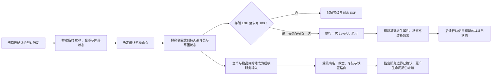

# 推进与经济

- 状态：下文静态分析与受限观察边界内的队伍发展和资源规则为**已确认**，与后续选择的联系为**推断**，战役与生命周期限制则明确列为**未知**。
- 读者：从[玩法总览](gameplay-overview.md#军团成员资格出战角色与角色成长)继续阅读的读者、研究者、保真实现者与设计师。
- 范围：将成员身份、职业/转职、装备、已学法术和奖励驱动的成长，与物品持有、金币、容量、支出和恢复联系起来。本文不覆盖全部名册/服务，不建立战役平衡模型，不证明自然完整游玩，也不表示中文文档已就绪。

> 本文件是[规范英文原文](../../synthesis/progression-and-economy.md)的中文镜像，依据已接受的英文基线 f154275e875bd6cfd13496784a2f2ddaba775677 完整同步。英文原文始终是审阅基线；本镜像为派生文档，遵循[术语表](../../glossary.md) R1–R7。五个已同步主题之间使用中文导航；路线图、合同、详细指南与其他范围外证据明确链接规范英文。正文所述历史中文漂移与后续同步决定保留其原有时间边界，不表示本次同步已完成其他主题。

## 阅读路线与当前约定

[路线图的 Standard 约定（英文）](../../documentation-roadmap.md#current-baseline-and-near-term-synthesis)约束本篇英文综合文档。跨系统规则需要核对源码与论断，现有主题所有者已足够承载这些内容。先读[队伍发展](#队伍发展)，再沿着[战斗驱动的推进](#战斗驱动的推进)进入[实例](#实例成长改变准备条件但不治疗)，最后通过[证据矩阵](#证据矩阵)查找精确规则与测试夹具。[资源/服务章节](#金币与物品经济边界)连接接收、容量与支出；[两个资源实例](#连接起来的资源实例)则追踪拒绝与重访分支中的这些选择。[剧情推进](story-progression.md#分段阅读故事内容)负责解释招募和服务机会如何与世界连接；[战术战斗循环](tactical-battle-loop.md)负责解释准备就绪的行动者所选行动是否合法、是否有效。

目标是解释保留成员的职业、装备、法术和成长如何成为后续选择的输入，以及资源如何支持或限制这些选择。本文不选择最佳出战队伍、转职时机、平衡曲线、新产品政策、引擎架构或采集计划。定义和受控观察始终与自然战役可达性、呈现及重制版当前支持范围分开。

## 判断边界

本文解释多个已接受合同如何连接，不替代[升级合同](../../contracts/level-up.md)、[物理交战合同](../../contracts/combat-resolution.md)、[法术合同](../../contracts/spell-resolution.md)、[服务合同](../../contracts/service-interactions.md)或[存档合同](../../contracts/save-system.md)，也不是关于原版游戏的独立证据。

对于所列测试夹具和源码静态路由，原版具有不同的行动奖励构建、持久资源变更、阈值驱动升级、属性刷新、物品路由和服务调用阶段。它们的顺序与单位都很重要。

以下判断尚无支持：

- 预期遭遇难度、等级曲线、价格曲线、稀缺性或刷级压力；
- 战役收入与支出来源的完整列表；
- 最优装备、转职时机、出战队伍构成或名册选择空间；
- 普遍的商店/服务可用性、正常剧情可达性或整个流程中的购买机会；
- 服务变更跨地图变化、存档/读档或断电后的普遍持久性；
- 超出测试夹具所属边界的玩家可见奖励、菜单、动画、声音或时序行为。

## 队伍发展

### 加入、参战、跟随与存活

新成员可以属于军团而不占用出战位置。**已确认（静态）：**`JoinForce` 设置已加入成员身份，重建已加入/出战/后备列表，然后仅在重建后的出战人数低于普通上限时设置出战标志。[成员身份合同](../../contracts/party-membership-state.md#joinforce-chronology)负责这一顺序；[Creed 调用方审阅](../../../research/creed-return-fairy-and-recruitment-choices.md#join-and-capacity-are-separate-from-following)将原版上限确定为 12。后备是重建产生的“已加入但未出战”分类，并非另一个独立的成员身份标志。

重建发生在条件激活**之前**。因此，标志可能已经改变，而缓存的出战/后备列表仍描述先前状态。读取列表时必须结合它的计数与自身重建边界；残留的尾部字节和已加入标志的存在，都不能给出当前战斗编队。这一区别适用于普通加入、对已加入成员的调用和显式出战队伍调整，并不限于某个招募场景。

| 问题 | 回答它的状态或操作 | 对后续选择的影响 |
| --- | --- | --- |
| 角色是否属于军团？ | 已加入成员身份。 | 即使未出战或 HP 为零，也可以列入已加入列表。 |
| 角色是否被选入出战队伍？ | 出战标志，带计数的列表另行重建。 | 普通自动激活检查容量；战斗准入与编队仍由各自的使用方处理。 |
| 角色能否进行本次行动？ | 当前 HP、位置、状态和回合控制器。 | 仅已加入或出战，不能证明行动者存活且符合条件。 |
| 谁选择行动？ | 回合分发器读取的激活/控制状态。 | 己方角色的成员身份不意味着由玩家控制。 |
| 是否有人在地图上跟随？ | 随从行动与物理实体/列表状态。 | 单独跟随不会使角色加入、出战、恢复或初始化。 |
| 场景移动或显示哪名行动者？ | 逻辑到物理查找、当前实体群与场景行动。 | 场景行动者可以独立于战斗选择存在；查找别名不是属性复制。 |

**已确认（静态实例——Creed）：**接受初次招募的提议会请求加入，等该命令返回后才设置选择标志，缩小三名未选场景行动者，再将选定行动者加入随从。拒绝则不作这些写入而返回。已有另外 12 名出战成员时，新成员仍会加入，走加入确认路径并可跟随；普通辅助程序跳过新出战标志的设置，不挤走任何人。HP 为零同样不阻止这些命令，也不会被这些命令修复。后续返回时的提议走不同分支，不执行初次的缩小操作。这些是源码确认的分支，并不证明自然完成过选择/UI 会话。机会与返回条件请参见[剧情推进中的 Creed 说明](story-progression.md#南方旅行caravan-与-creed)，不能假定每名新成员始终可招募。

**已确认（静态例外——Jaro）：**已准入的 Battle32 转换在 `JoinForce` 之后显式调用 `JoinBattleParty`，因此另外 12 名出战成员可以变为 13 个出战标志；后续 AI 命令重建时会计入这些标志。敌方 JAR 被设为零 HP 和地图外坐标；己方 Jaro 获得原坐标及物理查找，同时保留自己的 HP、职业、装备与属性。非零 `joinForceAI` 操作数设置 AI 控制。到达的胜利后缀随后请求普通加入、清除 AI 控制，再令 Jaro 未出战，但不移除已加入成员身份，也不复活他。战后包装器后续的重建会看到已清除的出战标志。[转换](../../../research/battle32-activation-jaro-and-first-turn-dispatch.md#logical-conversion-membership-and-physical-aliases)与[胜利](../../../research/battle32-outcomes-and-moun-entry.md#physical-population-aliases-and-logical-jaro-state)所有者解释精确顺序与中断分支；[剧情推进](story-progression.md#jaro-叛离frayja-加入与-moun-幸存者)将它们连接到战役。这个例外说明，不能把 12 当作普遍不变量，也不能把招募视为从敌人到已治疗、受玩家控制随从的一次原子转换。

### 定义、当前职业与转职

**已确认（静态）：**己方角色的起始定义提供职业、存储等级与四个物品字节；职业数据、基础属性、法术初始化及派生属性刷新分别具有初始化步骤。[己方角色定义合同](../../contracts/ally-definition-data.md)将这些记录与当前状态、剧情可用性分开。末尾未命名的起始槽位不证明还有可招募角色。后来的加入为公告读取当前职业，本身不会恢复起始记录、授予定义中的装备或重放初始化。

职业连接若干后续规则输入：成长选择己方角色/职业块，学习读取该块的法术列表，属性刷新读取基础/职业值与已装备效果，装备使用方检查职业资格。这些联系不意味着所有职业派生量可以互换。存储等级仍是行动者状态；有效等级由特定使用方计算。[奖励词汇](#资源与等级词汇)将奖励比较与法术学习分开。任一计算中的转职偏移，都不会给存储等级增加 20。

**已确认（源码静态转职路由）：**教堂首先要求成员位于普通基础职业转职表中，且存储等级至少为 20。未映射职业或较低等级在 `SetClass`/`Promote` 之前进入拒绝或重新选择路径。普通与特殊目标职业是成对的数据关系，并非给职业 ID 加上某个数值。统计可转职成员数量后还会重新检查所选成员；计数不意味着每名成员都符合资格。

对具有特殊映射的职业，源码在当前目标列表成员持有的物品中搜索对应转职物品；持有人不必是转职候选人。找到物品会提供特殊路径；缺少物品或拒绝特殊选择，可回退到普通转职。SORC 另有一次确认，拒绝会重新开始选择。接受特殊路径后，会先对选定持有人/槽位执行 `RemoveItemBySlot`，再请求职业设置与转职。随后路由调用 `SetClass`，再调用 `Promote`；按所选职业请求 SORC 默认法术替换或 MMNK/NINJ 武器卸下，之后请求存储等级为 1、EXP 为零。卸下后武器仍被携带，区别于移除特殊转职物品。该转职路由没有金币扣减调用，不能把 Raise 的价格用作转职价格。这些是有顺序的源码请求，并非运行时已闭合的事务，也不证明所有最终属性、物品栏边界、提示呈现或持久性。

[服务合同](../../contracts/service-interactions.md#church-source-boundary)、[公共菜单所有者](../../../research/common-menus.md#static-service-menu-state-machines)及其在 [`sf2-common-menus-static-v1`](../../../../tests/fixtures/h2/common-menus-static-v1.json) 中的 `church.routeOperations.promote` / `helperOperations` 记录负责这些条件与调用。完整 `Promote` 变更在本综合文档边界仍为**未知**。受支持的结论是，职业选择可以改变后续成长/学习/装备输入；这里没有最优转职时机或普遍最终属性公式的证据。

### 携带装备如何贡献已装备效果

携带物品占用物品栏；其已装备状态决定装备刷新是否应用它。**已确认（存储）：**物品身份、持有状态与定义数据相互独立。己方角色起始字节将已装备位与物品 ID 打包在一起，运行时物品栏辅助程序则操作物品字，其中还有损坏位等状态。[物品定义合同](../../contracts/item-definition-data.md#item-identity-and-fixed-record)负责作为存储数据的职业掩码/类型、范围和效果字段，并不提供完整装备/使用规则。

**已确认（源码使用方）：**`IsWeaponOrRingEquippable` 检查职业掩码和装备类型；`EquipItemBySlot` 先检查 Nothing、可装备性与诅咒，再设置已装备状态，即使拒绝也会在尾部转入属性刷新。识别诅咒的卸下操作可以拒绝卸下已装备的诅咒物品。因此，接收或携带武器不证明它替换旧武器、授予效果，或让预期行动有效。已接受的铁匠[装备后续流程](../../../research/dwarven-village-and-mithril-smithing.md#fulfillment-inventory-and-optional-equipment)保留源码顺序与受限观察，包括先前已装备的 Dark Sword 阻止替换，而新接收武器仍被携带。详细履行/持有关系见[铁匠服务说明](#秘银订单下单就绪与领取)。

损坏与诅咒描述不同限制。[战术物品路由](tactical-battle-loop.md#物品持有装备与使用各不相同)在使用后处理中区分尚未损坏的可损坏装备与已经损坏的装备，也区分已装备诅咒物品的限制和普通携带物品。不能推断损坏意味着已卸下、诅咒只是定义标志，或每种物品都有相同的使用/损坏行为。

**已确认（受限刷新）：**升级从基础/职业状态重建派生 ATT/DEF/AGI/MOV、抗性和特殊攻击概率（会心/二连/反击），应用状态调整，再应用已装备效果；不会把新增益叠加到残留的仅本次行动属性上。已装备的诅咒物品定义可以在刷新时重新引入 CURSE。[升级所有者](../../contracts/level-up.md#confirmed-current-and-derived-stat-refresh)也保留原版 `INCREASE_DOUBLE` 特殊攻击概率缺陷；本文不会默默修正它。更新后的属性或已装备身份如何影响攻击、范围或特殊目标，由[战术战斗循环](tactical-battle-loop.md#装备可以限制效果taros)及其结算所有者负责。例如，进入 Taros 战斗且仅携带 Achilles Sword，并不满足 Bowie 实际已装备武器条件。

### 学习新增或升级一个选项

**已确认（静态存储与辅助程序规则）：**已学条目保留基础法术身份和等级编码，使用[己方角色成长](../../../research/ally-growth.md#storage-model)所述的六位身份/两位等级打包。法术等级与角色等级分开。已接受成长测试夹具保留四个有序法术槽位；学习不会无限追加每个获得的法术等级。[法术书状态](../../contracts/spellbook-state.md#learnspell-chronology)区分两次搜索：先找相同基础身份；仅在尚未知晓该身份时，才搜索空槽位。

- 更高的传入等级替换已知条目，保留该法术槽位。
- 若已知等级相同或更高，则拒绝传入条目，即使另有空槽位。
- 新身份需要空槽位；法术书已满时返回无空间，不会选一个法术遗忘。

这些结果身份是静态辅助程序结果，不证明某条具体失败消息。尤其是，槽位已满并不阻止升级已知身份。因此，必须将学习与升级和法术定义清单分开解释。

**已确认（受限调用方行为）：**初始化在重放较早升级之前，扫描小于或等于起始有效等级的阈值。普通 `LevelUp` 先增加存储等级，再检查精确匹配的有效阈值，而非重新检查所有较低阈值。选中的己方角色/职业成长记录提供列表；`$FE` 继承该角色第一个块的列表，而非任意前一个职业列表。观察到的 Kazin/WIZ 用例通过该继承列表原位升级已知 BLAZE。Karna 的 HEAL 3 初始化特殊分支先改变特殊攻击概率，之后普通升级重放才学到法术；这不是“掌握治疗法术就获得特殊攻击概率”的通则。

原版法术学习比较把 TORT/职业 11 误判为转职后，与职业上限在 12 处的边界不同。观察到的 Kiwi 用例改变内部学习阈值，但未学到 TORT 法术。强制缺失职业的用例可能扫描进后续己方角色的块或到达最终哨兵值；这些受控边界不证明普通转职合法性。[升级合同](../../contracts/level-up.md#confirmed-projection-cap-and-spell-boundaries)负责所有这些缺陷、达到上限的退出和观察用例。不能用单一转职等级判定替代原版各自的奖励、上限和学习比较。

**推断（与选择的联系）：**已学或升级后的条目可以提供后续法术选项。真正施放仍需要满足相应行动者/回合、MP、目标选择/范围和效果规则。仅已知法术既不证明付得起消耗，也不证明有用；更高的最大 MP 不会补充当前 MP。行动条件请参见[战术法术规则](tactical-battle-loop.md#魔法治疗与辅助)，不能把学习阈值当作自动交战效果。

## 资源与等级词汇

同一个日常词语可能指不同阶段。保真实现及其测试必须区分这些值。

| 术语 | 本综合文档中已确认的含义 | 必须保持可见的边界 |
| --- | --- | --- |
| 行动 EXP 累加器 | 行动结算中构建的临时战斗演出值。已确认伤害/击杀路径饱和于 49；已确认治疗累加饱和于 25。 | 这些是行动类别边界，不是所有法术或命令共用的 EXP 上限。 |
| 最终 EXP 指令 | 行动后，在相应战斗表调整、两次有序随机检查和已确认敌方目标最小值之后发出的数量。 | 它既不是累加器，也不是存储 EXP。同侧奖励和未支持行动路径不能自动继承敌方目标规则。 |
| 存储 EXP | 由 EXP 指令增加、阈值处理前钳位于 200 的持久行动者字节。 | 一条命令最多减去一次 100 点阈值；此后存储 EXP 仍可能为 100。 |
| 存储等级 | 战斗员保留的职业内等级值。职业 ID 低于 12 时，已确认上限为 40；从职业 ID 12 起为 99。 | 它并非自动成为每次比较所用的等级。 |
| 有效奖励等级 | 对已确认伤害/击杀档位，转职后行动者先给存储等级加 20，再与目标存储等级比较。 | 偏移仅适用于已确认比较；不要改写持久等级。 |
| 升级法术阈值 | `LevelUp` 增加存储等级，再应用其职业相关的有效等级规则来学习法术。 | TORT 的职业 11 比较缺陷和 `$FE` 法术列表继承仍是原版保真事实。 |
| 当前属性与最大/基础/派生属性 | 升级改变最大值和基础属性，再刷新派生战斗属性及装备/状态效果。 | 当前 HP 和 MP 不会仅因最大值增长而增加。 |
| 金币 | 持久无符号 32 位资源；已确认增加行为在进位或加法超上限时将其封顶于 9,999,999。 | 金币 H3 测试夹具不覆盖扣减行为和非战斗变更结果。 |
| 持有物品、特卖计数与车队存储 | 不同物品目的地，具有各自容量和顺序规则。特卖计数为打包的四位数量，饱和于 15。 | 静态服务辅助程序顺序本身不证明持久性或最终运行时状态。 |

## 连接起来的资源流



通向后续行动使用和后续服务选择使用的联系属于**推断的系统关系**：更强的战斗员状态与保留资源可以影响后续选择，因为后续系统读取这些字段。图示不声称原作者意图形成某种力量曲线、支出节奏或最优循环。

## 战斗驱动的推进

<a id="1-构建动作局部奖励"></a>
### 1. 构建行动局部奖励

**已确认（指定物理与攻击法术路径）：**奖励比较使用行动者在特定使用方中的有效等级，与目标存储等级比较。伤害按所得档位的一定比例截断后贡献 EXP；致命结果将击杀贡献加入同一个行动累加器。它们共用的上限与治疗上限不同。治疗则取决于施法者职业是否符合条件，以及恢复 HP 相对于目标最大 HP 的比例；不符合条件的职业、敌方行动者及最大 HP 为零的目标跳过已确认贡献。状态与特殊法术保留各自受限规则。[交战](../../contracts/combat-resolution.md)和[法术](../../contracts/spell-resolution.md)所有者保留精确档位、公式与上限。

<a id="2-确定命令金额"></a>
### 2. 确定命令数量

**已确认（敌方目标 Battle01 边界）：**战斗表调整先将累加器减半，再由两次有序随机检查增加、减少结果，之后应用相应最小值并发出 EXP 指令。因此，累加器不必等于授予的 EXP：下方连接实例将 49 最终变为 24 点命令。[奖励测试夹具](../../../../tests/fixtures/h3/award-exp-randomization-v1.json)负责随机分支与最小值；其他战斗、同侧奖励和未支持行动保留各自边界。奖励调整不是改写存储等级或存储 EXP。

### 3. 回放到持久 EXP 并处理一个阈值

EXP 指令先增加存储 EXP，上限为 200；然后检查 100，只减去该阈值一次，最多调用一次 `LevelUp`。这个顺序产生三个重要的已观察边界：

- `75 + 24 -> 99`，不升级；
- `76 + 24 -> 100 -> 0`，升级一次；
- `199 + 24 -> 200 -> 100`，仍然只升级一次。

在基础职业等级 40 和转职后等级 99 时，命令仍减去 100 并调用 `LevelUp`。`LevelUp` 返回 255，上限等级保持不变。观察到的 `76 + 24` 上限用例中，减法留下零 EXP。一般而言，命令保留单次减去 100 点后的余量；达到上限的 `LevelUp` 结果不会清除此余量。重制版若以通用循环或“达到上限即丢弃”的规则替换这一顺序，必须记录为有意偏离。

### 4. 应用升级并刷新战斗员状态

对于低于上限的匹配职业块，`LevelUp` 依次处理最大 HP、最大 MP、基础 ATT、基础 DEF 和基础 AGI；增加存储等级；解析精确法术阈值；再刷新派生战斗员状态。[升级合同](../../contracts/level-up.md)负责随机成长公式、等级 30 之后的成长投影规则、职业块扫描、已学法术载荷、上限、钳位和已知原版缺陷。成长投影是曲线/随机/最低成长补偿规则的输入，不保证每级获得相同增益。有效曲线与 `NONE` 不同，后续等级使用投影之后的分支；这些规则并不确立战役力量曲线。

连接的战斗测试夹具展示了为何这属于持久回放阶段，而不是孤立的属性计算器。Bowie 从等级 1、99 EXP 起步，收到 24 点命令，经过存储 EXP 123 留下余量 23，达到等级 2，并刷新基础和派生属性。即使最大 HP 变为 14，当前 HP/MP 仍为 `12/8`。仅本次行动的 ATT/AGI 值由刷新值替换，不会延续。

转职是另一项操作。[转职说明](#定义当前职业与转职)区分源码准入、职业映射和请求的变更。完整转职属性变更、物品栏边界情况、可见选择流程和持久性在指定所有者处仍为**未知**；这不是自动观察队列。

## 实例：成长改变准备条件但不治疗

**已确认（受限观察）：**前一节连接的 Bowie 战斗测试夹具展示奖励到等级的交接。另一个 Slade 用例，即 [`sf2-level-up-refresh-v1`](../../../../tests/fixtures/h3/level-up-refresh-v1.json) 中的 `slade-thif-level39-equipped-refresh`，展示普通装备下属性变化的含义：THIF 从等级 39 升到 40，基础 ATT 从 45 升到 47，已装备 Short Knife 贡献 5，刷新后 ATT 为 52。最大 HP 从 42 升到 44，当前 HP 仍为 7。物品仍被持有/装备；效果重新应用到新基础值，而非再次获得或累加到残留 ATT 上。

**推断（准备条件的影响）：**对后续已准入物理行动，结算器可以读取刷新后的 ATT 和实际已装备武器，而伤害/存活资格仍读取当前 HP 及其他行动条件。Slade 仍负伤。恢复或适用服务是另一项选择；更高最大值没有解决眼前 HP 限制。若新武器只是被携带，其定义中的攻击值不会自动成为该次刷新的组成部分。

**已确认（非成功路径）：**[`sf2-level-up-boundaries-v1`](../../../../tests/fixtures/h3/level-up-boundaries-v1.json) 中另一个用例 `slade-thif-base-cap` 从等级 40 起步，返回不升级结果，不发生成长。[EXP 指令边界](../../contracts/level-up.md#confirmed-battle-award-entry)在上限处仍消耗一个阈值。因此，更多奖励 EXP 不一定产生下一级、治疗成员或打开另一法术选项。这是职业上限的结果，不是声称等级 40 为最佳转职点。

这些用例连接奖励、保留状态、装备和后续规则输入。它们是分开的受控边界，并非自然游玩的一段 Bowie 到 Slade 连续流程。上方满员 Creed 分支与法术书拒绝检查的是另一些普通有效状态；不能假定每次成功加入或 EXP 奖励都会立即提供可用新行动，以此修补这些边界。

## 金币与物品经济边界

### 已确认的战斗结果

- 敌人金币是 103 条大端字记录的表，与 103 条敌人定义对齐。后续 69 字 ROM 尾部明确未使用，不能变成额外敌人行。
- 已确认运行时加法使用无符号 32 位中间值。普通 `0 + 30` 得到 30；恰好达到上限、超过上限和 32 位进位用例均得到 9,999,999。
- 敌人掉落使用 30 条记录，以战斗、敌方战斗员、持有物品和一次性标志为键。三件指定首领武器要求 `RNG(32) == 0`；其余 27 条记录在前提匹配后不消耗掉落 RNG。
- 掉落成功时，已确认顺序为：若适用则先作珍稀随机判定，测试/设置持久标志，移除敌人物品，再分配去向。有空间的存活行动者接收物品。直接交付失败时，只有珍稀物品进入特卖；非珍稀物品被丢弃。
- 标志已设置时，仍先完成成功的珍稀随机判定，再中止。特卖数量 `14 -> 15`，15 则在其四位字段保持饱和。

这些是资源变更，不证明玩家何时或如何看到奖励汇总。

### 来源、接收与容量决策

金币、EXP 和物品并不通过一个不可分割奖励抵达。[战术奖励交接](tactical-battle-loop.md#奖励经各自路径变为持久状态)区分行动构建、回放的金币/EXP 命令及击杀侧物品路由。Battle 01 的 EXP 调整不是金币扣减；[成长说明](#战斗驱动的推进)解释存储 EXP 随后可以改变什么。上方掉落事实描述指定战斗/敌人/物品前提满足**之后**的成功，不是每次胜利附带的奖品。单独清理首领 不会产生已挣得的击杀/掉落。三件条件首领武器保留 RNG 条件；其他匹配记录无需掉落 RNG，但仍要求持有物品且一次性位未设置。一次性位在敌人物品移除和交付之前设置，因此直接路由失败并非留下尚未领取、等待重试的物品。珍稀回退是特卖计数，不是成员可用槽位中的持有物品。

**已确认（静态）：**普通场景 Search 有不同的交接。[场景搜索所有者](../../../research/field-search-control.md#confirmed-static-spine)区分编码金币内容（调用 `IncreaseGold`）与物品拾取。物品交付先尝试领队四个槽位，再尝试重建后的已加入军团其他成员。无人有空间时，`CloseChest` 和 `RefillNonChestItem` 恢复领取路径；这不是战斗掉落的丢弃/特卖路由。宝箱打开标志或工作布局图块变化可能发生在容量解析之前。精确 Search 分发、坐标与后续重新载入行为属于各自地图/场景所有者，不能假定存在普遍的“收集宝物”行动。这是源码顺序，没有自然观察到的拾取或存档保证。

强制剧情接收则可能要求腾出空间。[Sky Orb](story-progression.md#nazcacameela-与-sky-orb)与[Force Sword](story-progression.md#吸引首领拔取-sword再使用)路径扫描已加入成员物品栏，不筛选是否出战/存活。全满时，取消、拒绝丢弃、选择不可出售物品或已装备诅咒物品，都可能循环而非完成。丢弃珍稀物品请求特卖并继续选择；要进入返回的替换路径，需接受丢弃非珍稀物品。因此，调用方不保证每种满物品栏状态都能完成。Orb 行动者在尝试授予前隐藏；Sword 拔取标志在场景后写入，没有单独检查授予结果。两者都不能独立证明持有或已装备。

可选自定义接收不必采用任一政策。[Moun Arm](story-progression.md#可选-moun-交互与-arm-持有)提问可以拒绝；所有已加入成员全满时报告失败，Arm 仍可领取，不出现丢弃菜单。成功先添加物品，再记录已授予。之后丢失物品不清除此记录，中断也可能留下先持有、尚未记录的状态。这些实例解释了为何必须分别指明内容标志、辅助程序请求、成功接收和后续可用结果；它们不确立完整收入目录、物品丰裕度或战役稀缺性。

### 持有、存储与出战成员身份

这里有三个不同容量问题：

| 限制 | 限制什么 | 不意味着什么 |
| --- | --- | --- |
| 每名成员四个持有物品槽位 | 特定成员下一次物品接收；已装备物品仍占槽位。 | 不是军团整体四件物品上限，不表示自动装备、治疗或保证交换。 |
| 普通出战成员 12 人 | 车队 Join 的替换选择与普通自动激活；参见[队伍成员身份](#加入参战跟随与存活)。 | 后备仍属于军团，在指定路由中可以接收物品；显式 Jaro 转换仍是例外。 |
| 车队存储 64 件物品 | 仓库独立的存入守卫。 | 不增加成员槽位、出战位置，也不证明登车就能使用所有仓库行动。 |

**已确认（源码静态服务）：**[车队行动](../../contracts/service-interactions.md#caravan-source-boundary)选择 Join/Depot/Item/Purge。Join 在选择替换成员前比较是否有 12 名成员；替换路径先请求离队再加入。Purge 请求离开出战队伍，区别于失去已加入成员身份或删除持有物品。后备/出战列表为空和取消选择各走自己的返回路径；Join 对零 HP 另有确认，替换/Purge 拒绝领队。两种行动都不复活成员。[Taros/登车实例](story-progression.md#完整示例taros-与-caravan)区分获取、登车/通行与 C 交互菜单交接。交通状态或指定菜单调用方，既不证明已完成存储事务，也不证明服务自然可用。

Depot 提供 Look/Deposit/Derive/Drop；“Derive”是源码的取出标签。Deposit 在成员选择前拒绝存储已满边界；取消或所选已装备诅咒物品遭拒，也发生在 `AddItemToCaravan -> DropItemBySlot` 之前。向有空间成员取出时请求 `AddItem -> RemoveItemFromCaravan`；接收者容量已满则选择交换路径：`RemoveItemBySlot -> RemoveItemFromCaravan -> AddItem -> AddItemToCaravan`。存储为空时返回，不取出；取消物品/接收者选择可以离开或重新开始选择。交换在移除成员所选物品前检查已装备诅咒。因此，交换要求自己选定的成员物品与守卫，不是免费的额外槽位或普遍退款机制。Depot Drop 有不可出售守卫，并在移除后另行测试珍稀性以请求特卖。Look 的价格显示不是出售或金币入账。

Item 提供 Use/Give/Equip/Drop。Give 有独立的取消、自交付、普通与交换分支：普通转移先给接收者添加，再从给予者移除；自交付先移除再添加；接收者已满的交换先移除双方所选物品，再执行两次添加。已装备诅咒检查可以拒绝所选转移或交换。Use 先调用 `UseItemOnField`，再请求移除；这个顺序不证明每种所选物品都有有效场景用途。Equip 是源码选定的装备界面交接。Drop 及其珍稀特卖请求与 Use、Sell、Deposit 分开。[战术物品选择](tactical-battle-loop.md#物品持有装备与使用各不相同)负责战斗专用给予/丢弃/使用规则；[场景物品所有者](../../../research/field-item-effects.md)负责场景资格/效果。

在更底层的[车队/特卖存储边界](../../contracts/caravan-and-deals-state.md)，车队添加会剥除状态位，满时添加被忽略，移除会压紧存储并以 `ITEM_NOTHING` 填尾。该合同有意将容量与数值归一化掩码排除在范围外；上方服务的 64 容量守卫来自公共菜单所有者。归一化和服务的有序调用都不能证明完整存入/取出循环中的每项装备/损坏状态后果。特卖有独立打包的四位计数、饱和增加和零时忽略移除；已观察战斗掉落用例提供 `14 -> 15`/饱和边界，不将其变为通用菜单结果。这些是不同存储与边界，不是可互换物品栏。

### 源码静态服务交换

这个稳定标题将早期读者引向扩展后的服务说明。[服务合同](../../contracts/service-interactions.md)负责行动顺序、取消与直接资源调用。当前 Raise/Cure/Save 观察及后续铁匠审阅仅增加各自指定边界。共用菱形菜单/选择取消和局部行动循环由源码确认，不证明相同回滚、完整服务访问、呈现或返回可用探索状态。

#### 商店：库存、价格、接收者与提交

**已确认（静态）：**Buy 使用当前商店带计数前缀的物品行，由 `CURRENT_SHOP_INDEX` 选择。[物品目录](../../contracts/item-definition-data.md#shop-and-debug-catalogs)负责定义与查找；列出的定义或价格，不等于某章节自然可用。普通目录库存与可变特卖计数有不同所有者。Deals 仅列出计数非零且**不在当前商店行中**的身份。因此，存储中的珍稀物品未必出现在该店特卖列表，“珍稀”也不意味着独立、无限的商店目录。

| 行动 | 资源调用前的源码前提/拒绝 | 有序资源请求 |
| --- | --- | --- |
| Buy | 库存/物品选择、价格确认、金币至少达到定义中的字价格、接收者选择及持有数量少于四。接收者已满可重选或放弃；武器可装备性警告可以接受，以便携带。 | `DecreaseGold -> AddItem`，之后另行可选装备。 |
| 特卖购买 | 过滤后的特卖列表非空，再走上方价格/接收者路径；取消或无库存返回行动菜单方向。 | `DecreaseGold -> AddItem -> RemoveItemFromDeals`，之后可选装备。 |
| Sell | 成员/物品选择；拒绝不可出售物品；确认；选定已装备诅咒武器/戒指可能遭拒。源码价格为 `(price * 3) >> 2`。 | `IncreaseGold -> DropItemBySlot`，再条件执行珍稀物品 `AddItemToDeals`。 |
| Repair | 所选物品必须有损坏位；确认、付得起 `price >> 2`，且所选已装备诅咒检查通过。未损坏、拒绝或付不起路径不执行这些调用而返回选择。 | `DecreaseGold -> RepairItemBySlot`。 |

这些分支及无符号支付能力比较（相等可通过）由实际[商店语句记录](../../../../tests/fixtures/h2/common-menus-static-v1.json)确立，不能靠辅助程序名字判断。Buy/Deals 先扣款和添加，再询问是否装备。拒绝装备或旧诅咒装备卸下遭拒，不会撤销先前请求。添加后的装备路径重新计数物品栏，使用数量减一；其源码假设不是修复任意空洞的规则。Sell 先入账再请求丢弃；Repair 先付款再请求修理。这里没有普遍原子性/退款保证。即使底层辅助程序或铁匠边界已有观察，最终商店辅助程序结果、中断 UI 影响和持久性在此服务边界仍为**未知**。Buy/Sell/Repair 重复各自选择路径，非退出行动返回行动菜单方向；该控制流不是观察到的一次完整购物访问。

Repair、Cure 和 Raise 解决不同问题。Repair 处理携带物品的损坏状态；Cure 处理所选状态/装备提交；Raise 处理零 HP 成员。修理不证明诅咒移除、物品替换、成员 HP 恢复或未来行动合法。战斗使用可以消耗物品，或在自己的[战术边界](tactical-battle-loop.md#物品持有装备与使用各不相同)到达装备损坏/销毁路由；接收或修理物品不证明每种行动都可使用它。

#### 教堂：恢复、转职与存档

**已确认（受限 Raise）：**[Raise 边界](../../contracts/service-interactions.md#church-raise-runtime-seam)进入教堂路由，跳过存活成员，按列表顺序处理死亡成员。价格为存储等级乘 10，再按转职数据加收 200。指定用例中，拒绝或金币不足不会到达付款/HP/地图精灵辅助程序；恰好足额可通过。接受后的付款先于 HP 增加与地图精灵完成，当前 HP 为 `min(maxHP,200)`。这不声称 MP 恢复、移除所有状态、完整调用方/UI 流程或持久存档。

**已确认（受限 Cure）：**[Cure 边界](../../contracts/service-interactions.md#church-cure-runtime-seam)保留先中毒、再眩晕、再诅咒的顺序，各有支付能力、确认和提交。中毒花费 10，眩晕 20；每次付款先于状态写入。诅咒价格使用所选携带诅咒物品价格右移 2 位；已观察 Dark Sword 花费 4250。其付款先于 `UnequipAllItemsIfNotCursed` 和属性刷新完成。无状态用例无可治疗内容；拒绝和比所需金额少 1 的用例，不会仅因进入菜单就成功。有序成功用例按 `4280 -> 4270 -> 4250 -> 0` 支出，而非一次统一治疗收费。指定组负责最终状态/装备变更，不确立所有 Cure 调用方、UI/呈现或持久后续结果。

**已确认（源码静态 Promote）：**职业映射、等级 20、目标列表特殊物品搜索、特殊确认及有序物品/职业/法术/武器请求见[队伍发展说明](#定义当前职业与转职)。该转职路由无金币扣减调用。被移除的特殊物品是另一种资源，区别于被卸下但仍被携带的 MMNK/NINJ 武器。完整转职效果仍为**未知**；成功 Raise/Cure 证据不能闭合它们。

**已确认（受限 Save）：**[Save 边界](../../contracts/service-interactions.md#church-save-runtime-seam)将最初拒绝与存档、后续继续/挂起分开。在受控首次提示中，非零值退出，不触发 SaveGame/Fade/Witch 回调；零值将当前地图复制到 Egress，设置 flag399，调用原版 `SaveGame`。正向记录观察到进入、有效返回和调用位置返回。存档后提示为零时到达菜单退出；非零则观察到受控 Fade 返回和原版 `WitchSuspend` **进入**，不覆盖完整挂起或其返回。这些选择器值是已观察输入，不证明面向用户的提示含义。Save 不请求 HP/物品恢复，该路由也无付款调用。它是生命周期选择，证据边界与 Raise、Cure 不同。

恢复还有非服务路径。[治疗法术](tactical-battle-loop.md#魔法治疗与辅助)使用缺失 HP 及自己的 MP/效果/奖励条件；持有治疗物品需要已准入的使用与消耗路径。[战斗返回](tactical-battle-loop.md#胜利败北与获准撤退留下不同状态)区分败北时 Bowie 恢复/金币减半与付费撤退。铁匠村探索入口单独调用存活/不死己方角色治疗程序：[入口所有者](../../../research/dwarven-village-and-mithril-smithing.md#all-eighteen-warps-and-f80-lifetime)确定 30 名己方角色、存活者加 Peter/Lemon、HP/MP 恢复、保留的状态掩码与装备派生 CURSE 刷新。这不是任何地图返回时都全面复活或移除全部异常。成长仍是增加最大值，并不一定治疗当前 HP/MP。

### 秘银订单：下单、就绪与领取

后续[村庄/铁匠所有者](../../../research/dwarven-village-and-mithril-smithing.md)连接实际 Map29 尾部调用方、下单、就绪与履行。完整源码/调用方审阅及保留的受控观察替代了对整个生命周期一概标为未知的说法，而自然进入、完整服务游玩、呈现和持久保存仍为**未知**。委托的材料持有人、按职业选择的顾客与最终接收者相互独立。存储订单仅记录物品，不记录这些人或倒计时。

**已确认（源码下单）：**材料选择必须提供精确 Mithril 字；取消可以离开或返回材料选择。顾客必须是转职后职业且位于合格职业表；拒绝确认会重试顾客，资金不足则不扣款而返回。恰好 5000 金币可通过。提交订单依次执行付款、待处理计数增加、材料槽位丢弃、武器选择/订单写入，最后清除 flag80。扣款/移除先于选择结果存储，丢弃失败或订单数组已满时没有检查回滚。外层菜单通常避免在四个未履行订单时开始下单；**下单后**的有效计数比较在四个时停止继续。不能将其改述为下单内部的空槽准入检查。人为提供满数组的辅助程序用例证明不写入，不证明普通游玩会自然这样损失资源。

职业为前八个匹配组确定性选择武器行；正常准入的 BRN/RDBN 则使用前置范围为 2 的回退，在两行间选择。之后依次测试随机范围 16,8,4,1，接受首次为零的结果。即使范围为 1，也会推进种子。这些有条件、相互关联的抽样不是独立的最终物品百分比。[职业/RNG 所有者](../../../research/dwarven-village-and-mithril-smithing.md#complete-class-mapping-and-sequential-rng)保留精确职业/物品；本文不添加概率模型或最优委托建议。

**已确认（源码就绪）：**成功下单清除 flag80。显式探索进入设置80，因此经 Map77/29 已准入的离开/重入，可让已有非零订单字在下次铁匠访问时归类为就绪。等待、行走或 CURRENT 地图楼梯不提供这种写入方；没有经过时间字段。就绪/待处理分类通过同一位共享，而非逐单年龄。如果一次访问保留被拒绝的就绪订单，又下新单，清除80 会让所有剩余订单字在重开时都归为待处理。不能仅凭存储标志推断存档/读档后的就绪状态。

**已确认（源码履行及受限辅助程序/事务观察）：**就绪订单按槽位顺序尝试。接收者取消或容量已满遭拒，会保留该订单，外层循环仍可尝试后续槽位。少于四个槽位的接收者可以接受可装备性警告而携带物品。提交时，`AddItem` 先于订单字清除和已履行计数增加；调用方不在清除前检查添加结果。普通容量已提前检查，但没有普遍的中断或状态改变保证。可选装备发生在接收/订单清除**之后**；拒绝装备或旧诅咒装备遭拒，都会保留新携带武器，而订单已消失。[装备边界](../../../research/dwarven-village-and-mithril-smithing.md#fulfillment-inventory-and-optional-equipment)包括 Dark Sword 阻挡与刷新的 CURSE，不提供退款或重新生成 Mithril。这些受控入口及另一路绕过服务主体的调用方返回验证轨道，不能证明完整 UI、自然端到端重访/领取或持久性。

### 连接起来的资源实例

**奖励 -> 容量 -> 后续持有。**在已观察敌人掉落边界，匹配珍稀物品、所需随机判定成功且一次性位未设置时，会先失去敌方持有，再分配去向。持有四件物品的存活行动者无法接收，因此珍稀分支请求特卖；同样直接路由失败时，非珍稀物品被丢弃。后续商店只有在该身份计数非零且普通库存不含它时，才可提供该特卖身份。源码确认的购买随后要求资金和有空间的接收者，再依次请求金币扣减、物品添加、特卖扣减。接收者全满可以在付款前迫使重选或放弃。已准入的车队取出/交换或成员转移提供另一种容量路径；仅获得/登上车队并不提供任何这些事务。普通 Search 可以恢复容量全满时的宝箱领取，而强制 Orb/Sword 可能仍困在各自丢弃循环。这些有意不同的回退政策，不是一次已观察的连续战利品到购物旅程。

**支出 -> 装备 -> 后续资格，包含重访。**选定合格转职后顾客、Mithril 持有人和 5000 金币，可通过铁匠下单；未转职顾客被送回选择，资金不足则在扣款前返回。已准入下单后武器已选定，但 clear80 使其待处理。之后显式村庄重入可以设置就绪；在楼梯等待不行。领取时，接收者全满可让订单留待领取。有空间时，接收先提交，之后才可选装备。受限旧诅咒武器拒绝用例让新武器仅被携带，没有其已装备贡献。教堂 Cure 另行观察到的付费诅咒/装备提交可以改变这一阻挡；下次装备/行动仍须通过实际使用方。[队伍装备说明](#携带装备如何贡献已装备效果)和[Taros 行动条件](tactical-battle-loop.md#装备可以限制效果taros)说明携带、装备及合法/有效攻击是不同问题，并不暗示秘银武器满足 Taros 特定 Sword 规则。此联系是跨指定边界的准备逻辑**推断**，不是自然游玩的一段铁匠到教堂到战斗记录，也不保证 Cure 会装备新物品。付款和从服务返回都不会自动保存变更状态。

## 持久性边界

[存档系统合同](../../contracts/save-system.md)确认双槽位表示、校验和、存档/读档/复制/删除辅助程序顺序及受限进程内行动矩阵。它不确立跨进程 SRAM 存活、中断写入，或每种服务、特卖、车队、订单、掉落标志、金币、EXP、战斗员变更在所有生命周期路径中的持久性。

**已确认（静态存档域成员）：**后续[铁匠序列化审阅](../../../research/dwarven-village-and-mithril-smithing.md#existing-observations-and-serialization-boundary)将 SaveGame 的 4,016 个逻辑字节绑定到全部 30 名己方角色记录及其物品字、当前金币、游戏标志（包括 readiness80）和四个订单字。铁匠栈计数器是临时值；付款/领取不会调用 SaveGame。属于存档域，区别于内存中已变更、教堂请求并从 SaveGame 返回，也区别于存储跨另一进程或断电存活。之后显式探索进入可能设置80，即使载入的标志已清除。地图返回、服务返回或结局完成位，都不是自动保存全部军团状态。

因此，本文可以将字段认定为在已观察回放或原版状态结构中持久存在，但不声称每项相连变更都具有端到端存档/读档 H3 用例。未来任何生命周期论断都需要该生命周期边界的证据，不能把 `SaveGame` 的存在当作每个子系统的证明。这不派发新测试套件。

## 证据矩阵

| 边界 | 证据标签与受限论断 | 精确所有者 | 剩余问题 |
| --- | --- | --- | --- |
| 已加入、出战、跟随与控制 | **已确认（静态）**：不同辅助程序及选定 Creed/Jaro 调用方分支；名册合同保留受限处理器观察 | [成员身份](../../contracts/party-membership-state.md)、[名册](../../contracts/party-roster-state.md)、[Creed](../../../research/creed-return-fairy-and-recruitment-choices.md)、[Jaro 转换](../../../research/battle32-activation-jaro-and-first-turn-dispatch.md)、[Jaro 胜利](../../../research/battle32-outcomes-and-moun-entry.md) | 尚未确立全部招募者的自然生命周期、UI 与容量安全 |
| 起始/职业/转职输入 | **已确认（静态）**：定义、成对映射和有序教堂请求 | [己方角色定义](../../contracts/ally-definition-data.md)、[服务](../../contracts/service-interactions.md)、`sf2-ally-data-static-v1`（[测试夹具](../../../../tests/fixtures/h2/ally-data-static-v1.json)）、公共菜单转职语句记录 | 完整转职属性/物品栏结果与持久性 |
| 已学条目与装备贡献 | **已确认（静态）**：学习拒绝/升级辅助程序及职业/类型装备检查；**已确认（受限运行时）**：继承升级、已装备刷新及选定诅咒替换拒绝 | [法术书](../../contracts/spellbook-state.md)、[升级](../../contracts/level-up.md)、[物品定义](../../contracts/item-definition-data.md)、[铁匠装备](../../../research/dwarven-village-and-mithril-smithing.md#fulfillment-inventory-and-optional-equipment) | 完整获取/装备/使用生命周期与每个后续行动 |
| 成长存储与升级 | **已确认**：曲线/职业块及运行时增益、上限、法术、扫描与刷新用例 | [己方角色成长研究](../../../research/ally-growth.md)、[成长清单](../../../../manifests/extractions/growth-data.json)、[成长 schema](../../../../schemas/growth-data.schema.json)；`sf2-calculate-stat-gain-startup-v1`（[`stat-gain-v1.json`](../../../../tests/fixtures/h3/stat-gain-v1.json)）、`sf2-level-up-tort-boundary-v1`（[`level-up-v1.json`](../../../../tests/fixtures/h3/level-up-v1.json)）、`sf2-level-up-boundaries-v1`（[`level-up-boundaries-v1.json`](../../../../tests/fixtures/h3/level-up-boundaries-v1.json)）及 `sf2-level-up-refresh-v1`（[`level-up-refresh-v1.json`](../../../../tests/fixtures/h3/level-up-refresh-v1.json)） | 自然战役分布、预期曲线、剩余钳位边界 |
| 战斗 EXP 到升级 | **已确认（运行时）**：命令回放经过一个阈值与持久刷新 | [运行时战斗数学研究](../../../research/runtime-rng-and-battle-math.md)；`sf2-battle-exp-level-up-v1`（[`battle-exp-level-up-v1.json`](../../../../tests/fixtures/h3/battle-exp-level-up-v1.json)） | 其他奖励修正与重复命令 |
| 奖励档位、最终确定与存储 | **已确认（运行时）**：有效等级档位、Battle 01 调整/随机化/最小值、存储上限 200 及一个阈值 | `sf2-kill-exp-level-difference-v1`（[`kill-exp-level-difference-v1.json`](../../../../tests/fixtures/h3/kill-exp-level-difference-v1.json)）、`sf2-award-exp-randomization-v1`（[`award-exp-randomization-v1.json`](../../../../tests/fixtures/h3/award-exp-randomization-v1.json)）及 `sf2-exp-command-boundaries-v1`（[`exp-command-boundaries-v1.json`](../../../../tests/fixtures/h3/exp-command-boundaries-v1.json)） | 其他战斗、同侧路由、多行动/上限生命周期 |
| 物理行动构建与回放 | **已确认（运行时子集）**：伤害/击杀累加器上限与持久命令回放 | [交战合同](../../contracts/combat-resolution.md)；`sf2-physical-damage-application-v1`（[`physical-damage-application-v1.json`](../../../../tests/fixtures/h3/physical-damage-application-v1.json)）及 `sf2-battle-scene-replay-v1`（[`battle-scene-replay-v1.json`](../../../../tests/fixtures/h3/battle-scene-replay-v1.json)） | 完整行动集合与呈现时序 |
| 法术推进贡献 | **已确认（运行时子集）**：攻击法术档位/上限与治疗者资格/最小值/上限 | [法术合同](../../contracts/spell-resolution.md)；`sf2-spell-damage-exp-v1`（[`spell-damage-exp-v1.json`](../../../../tests/fixtures/h3/spell-damage-exp-v1.json)）及 `sf2-healing-exp-boundaries-v1`（[`spell-healing-exp-boundaries-v1.json`](../../../../tests/fixtures/h3/spell-healing-exp-boundaries-v1.json)） | 未支持法术类别与泛化行动政策 |
| 敌人金币 | **已确认（静态/运行时）**：103 个已用行、未用尾部及增加/上限/进位用例 | [敌人奖励研究](../../../research/enemy-promotions.md)；`sf2-enemy-gold-v1`（[`enemy-gold-v1.json`](../../../../tests/fixtures/h2/enemy-gold-v1.json)）及 `sf2-gold-boundaries-v1`（[`gold-boundaries-v1.json`](../../../../tests/fixtures/h3/gold-boundaries-v1.json)） | DecreaseGold 与非战斗调用方 |
| 敌人物品掉落与特卖路由 | **已确认（静态/运行时）**：30 条记录、三种随机物品、一次性标志、接收者路由与半字节饱和 | `sf2-enemy-item-drops-v1`（[`enemy-item-drops-v1.json`](../../../../tests/fixtures/h2/enemy-item-drops-v1.json)）及 `sf2-enemy-item-drop-behavior-v1`（[`enemy-item-drop-behavior-v1.json`](../../../../tests/fixtures/h3/enemy-item-drop-behavior-v1.json)） | 玩家可见奖励流程与完整存档生命周期 |
| 服务经济 | **已确认（静态）**：价格/条件/调用；**已确认（受限运行时）**：教堂 Raise/Cure/Save 与选定铁匠辅助程序/事务边界 | [服务合同](../../contracts/service-interactions.md)、[公共菜单](../../../research/common-menus.md)、[铁匠](../../../research/dwarven-village-and-mithril-smithing.md)；`sf2-common-menus-static-v1`（[测试夹具](../../../../tests/fixtures/h2/common-menus-static-v1.json)） | 完整转职效果、未观察调用方/准入/返回、原子性与持久保存 |
| 接收与容量 | **已确认（静态）**：普通 Search 还原、强制丢弃与可选 Arm 拒绝各不相同 | [场景 Search](../../../research/field-search-control.md)、[Orb](../../../research/battle34-outcomes-and-sky-orb-handoff.md#sky-orb-mandatory-inventory-award)、[Sword](../../../research/battle39-outcomes-and-force-sword-route.md#map42-attraction-extraction-and-mandatory-inventory)、[Arm](../../../research/moun-town-painter-and-golem-arm.md#arm-of-golem-appearance-and-search-admission) | 自然接收、中断控制与持久性 |
| 存储与出战选择 | **已确认（静态）**：独立容量、转移/交换请求、归一化与打包计数 | [服务](../../contracts/service-interactions.md)、[车队/特卖](../../contracts/caravan-and-deals-state.md)；公共菜单和公共属性测试夹具 | 完整菜单/辅助程序结果与生命周期 |
| 共用状态辅助程序 | **已确认（静态）**：辅助程序接口；运行时论断属于指定钳位/调用方测试夹具 | [公共属性研究](../../../research/common-stats.md)；`sf2-common-stats-static-v1`（[`common-stats-static-v1.json`](../../../../tests/fixtures/h2/common-stats-static-v1.json)） | 现有 H3 测试夹具外依赖调用方的变更结果 |
| 存档交接 | **已确认（表示与受限进程内行动）** | [存档合同](../../contracts/save-system.md)；`sf2-tech-services-static-v1`（[`tech-services-static-v1.json`](../../../../tests/fixtures/h2/tech-services-static-v1.json)）及 `sf2-witch-save-actions-runtime-v1`（[`witch-save-actions-v1.json`](../../../../tests/fixtures/h3/witch-save-actions-v1.json)） | 跨进程/断电行为与子系统完整持久性 |

## 综合前证据审计

原始资源审计在组合结论前，审阅了所属研究、合同、测试夹具载荷及精确 ID、schema/验证器注册、聚焦测试和 CLI 归属。以下窄命令于 2026-08-01 通过：

```powershell
uv run sf2 h2 common-stats
uv run sf2 h2 common-menus
uv run sf2 h2 enemy-gold
uv run sf2 h2 enemy-drops
uv run sf2 h3 growth
uv run sf2 h3 battle-exp
uv run sf2 h3 kill-exp
uv run sf2 h3 award-exp
uv run sf2 h3 exp-command
uv run sf2 h3 gold
uv run sf2 h3 enemy-drops
```

可执行所有者在本文综合的值与顺序上相符。原始审计也发现两处所有者文档不一致，有意未复制。两项发现此后均已在所属文档解决：

1. [Issue #11](https://github.com/FrankHZ/md-sf2-reverse-engineering/issues/11) 记录了过时的奖励工作队列，涉及珍稀掉落 RNG、满物品栏/特卖路由及掉落标志已设置。已合并[所有者修正 PR #18](https://github.com/FrankHZ/md-sf2-reverse-engineering/pull/18) 移除了该队列，并明确保留覆盖这些分支、已经接受的十用例 `sf2-enemy-item-drop-behavior-v1` 证据。
2. [Issue #12](https://github.com/FrankHZ/md-sf2-reverse-engineering/issues/12) 记录了过宽的教堂 Raise 概述。已合并[所有者修正 PR #19](https://github.com/FrankHZ/md-sf2-reverse-engineering/pull/19) 现在仅保留源码导出的、经过过滤的变更辅助程序顺序：`j_DecreaseGold` → `j_IncreaseCurrentHp`（在 `move.w #CHAR_STATCAP_HP,d1` 之后）→ `UpdateAllyMapsprite`。这个顺序不声称中间没有其他调用；在当时审计边界，最终当前 HP 与调用方可见运行时结果仍为**未知**。

这些是已解决的审计发现，不是待办后续工作。本文继续采用已接受掉落测试夹具与历史 Raise 调用边界。后续受限 Raise/Cure/Save 观察属于[当前服务合同](../../contracts/service-interactions.md#church-raise-runtime-seam)；它们仅在指定边界替代旧最终 HP 未知，不意味着更广奖励 UX（体验）、服务完成、持久性或玩家可见结果。

### 队伍发展证据审阅

已接受的队伍发展修订将研究/合同与选定测试夹具载荷、源码形状语句记录及其 schema/验证器/CLI 所有者核对，没有重跑上方历史 H2/H3 命令。精确参数留在各自所有者处，不另建目录。

| 选定说明 | 已检查的接口与处理结论 |
| --- | --- |
| 普通加入、随从与 Jaro 例外 | 成员身份/名册合同、Creed 返回及两个 Battle32 研究所有者；`sf2-common-stats-static-v1` 队伍事实与 `stats.py`；地图脚本测试夹具/处理器归属及受限出战队伍用例。12 与显式 Jaro 超额使用后续源码/调用方审阅；不扩展符号化辅助程序合同，也不声称完整招募运行时。 |
| 定义与转职 | 己方角色定义/成长合同、己方角色数据测试夹具及提取 schema；公共菜单 `church.routeOperations.promote`、完整 `helperOperations`、`common-menus-church.schema.json` 与 `menus.py:_church_static_contract`。将选定职业/物品/法术/武器/等级/EXP 请求与最终 `Promote` 效果分开；该路由没有转职金币扣减。 |
| 学习、成长与刷新 | 法术书/公共属性、己方角色成长与升级所有者；边界/刷新/EXP 指令测试夹具输入、输出和精确用例 ID；`h3/growth.py`、声明的 schema 与 CLI 路由。先已知基础身份、后空槽是静态辅助程序规则；继承的 Kazin 升级、TORT 阈值及已装备刷新有受限运行时所有者。不能推出通用职业判定或无条件治疗。 |
| 装备与后续行动 | 物品定义、战斗员状态字段、公共属性、铁匠履行/可选装备审阅及战术物品/Taros 规则。定义标志是输入；实际职业/类型/已装备/诅咒使用方及到达的行动条件决定论断。携带、装备、损坏和使用保持独立。 |
| 旧服务概述 | 当前 Raise/Cure/Save 合同边界及后续铁匠说明，仅在指定边界内替代绝对未知说法。上方原始审计仍属历史，不意味着新的服务采集或完整资源重写。 |

这些是论断审阅结论，不是新的原版观察或笼统测试 PASS。[路线图（英文）](../../documentation-roadmap.md#authoring-language-policy)保留中文漂移与延期同步。现有已完成比较失败与修正留在[保留证据所有者](../../../../remake/docs/evidence/retained-comparisons.md)处；本文不重置或重新分类它们。

### 资源/服务证据审阅

资源修订采用已接受队伍说明及战术奖励/物品/返回说明，再审阅当前源码形状记录与后续所有者。没有重跑任何历史 H2/H3、比较或翻译运行。这是现有证据的协调，不是新的运行时采集，也不是第二份价格/掉落目录。

| 选定说明 | 已检查的接口与处理结论 |
| --- | --- |
| 奖励与接收路由 | 现有金币/掉落测试夹具和战术/成长审阅保留一次性位/RNG/移除/接收者顺序。场景搜索控制正文/测试夹具及 schema/验证器保留领队优先容量与关闭/补回。后续 Orb、Sword、Moun 所有者将实际调用方绑定到强制循环或可选拒绝；不将通用回滚或战斗掉落回退引入 Search。 |
| 商店与车队 | `sf2-common-menus-static-v1` 完整选定 `shop.routeOperations`/列表辅助程序和 `caravan.routeOperations`/`routeDerived`；`common-menus-shop.schema.json`、`common-menus-caravan.schema.json`、`menus.py:_shop_static_contract`/`_caravan_static_contract`、现有聚焦源码/测试夹具检查与 CLI 归属。检查普通选择、全满/空/取消、价格比较和受守卫约束的变更顺序。调用及付款后装备分支仍为静态；12/四/64 与价格/物理大小字段保持独立。 |
| 底层存储与定义 | 物品定义、战斗员状态和车队/特卖合同；公共属性物品栏事实与物品辅助数据商店使用方。明确保留存储合同有意排除容量/掩码的边界，不假装它提供服务数值守卫或完整事务。珍稀性、已装备诅咒、损坏状态及不可出售由不同使用方处理。 |
| Raise/Cure/Save | 当前服务合同及 `sf2-church-raise-lifecycle-runtime-v1`、`sf2-church-cure-lifecycle-runtime-v1`、`sf2-church-save-lifecycle-runtime-v1` 载荷；各自源码守卫、schema、观察器/读回断言与 CLI 路由。精确费用/少一/拒绝、`poison-stun-curse-ordered-success` 和 `slot2-save-rest-suspend-boundary` 保留各自准入与停止条件。较早公共菜单静态段落中的最终 HP/后续流程未知仍保留当时边界；较新受限观察约束本文，不是完整自然服务保证。 |
| 铁匠与后续使用 | 后续村庄所有者完整下单、职业/RNG、进入/就绪、履行与序列化审阅；选定 `sf2-blacksmith-mithril-runtime-v6` 辅助程序/事务/履行/提交前/装备/提示载荷，以及 `blacksmith_mithril.py` schema/断言边界。全占用不写入、付款前拒绝、添加后订单清除及诅咒替换拒绝各不相同。公共菜单旧静态概述不抹去较新受限观察；调用方返回代表用例绕过主体。不能推断自然完整村庄会话、测得分布或持久存档。 |

两个资源实例组合不同的已接受边界，并明确限定这种组合；没有测试夹具被表述为端到端奖励/商店或铁匠/教堂/战斗会话。原版内存行为、静态存档域包含、请求/返回的存档、自然观察游玩、重制版选择与生产支持仍是不同判断。[保留比较所有者](../../../../remake/docs/evidence/retained-comparisons.md)及 Issue/PR 记录保留 #1047 十二项已完成未解决比较，及 #1260/#1268/#1269/#1272 的原始和修正结果、调用失败与实际 CI。中文镜像与源码锚保留既有漂移；这次英文修订既不修复也不重新分类这些结果。

## 原版保真与现代化

即使现代实现使用不同内部结构，原版保真行为仍保留证据所有者确定的阶段边界。尤其要保留有序 RNG 使用、整数截断、行动类别上限、命令回放、单阈值规则、当前/最大属性分离、32 位进位到金币上限用例、一次性掉落标志、物品路由顺序及测试夹具所属升级缺陷。

现代化可以选择更清晰等级显示、连续多级处理、修正 TORT 分类、修正特殊攻击概率处理、原子服务事务、不同物品栏路由或平台原生存档持久性。每项都是未来产品决定，需要具名的预期偏离及 ADR 0019 下适合该行为的验证；本文不将任何一项引入为新推断的原版规则。

## H4 验收与扩展门

该标题继续为早期读者提供稳定路线。当前开发方向是 [ADR 0019](../../../decisions/0019-state-and-content-driven-remake-engine.md)：实时状态、经验证内容与显式能力约束通用引擎。本文不要求新参考运行时、普遍有序轨迹适配器或分组运行时采集计划。历史测试夹具仍是各自精确原版边界的证据；旧复现命令不会仅因说明变化就变成新义务。

[能力所有者](../../../../remake/docs/capability-status.md)记录受限 Battle01 成长、法术升级和结果使用方、未支持的更广规则及延期存档/读档。源码合同、受控原版观察与已实现生产能力回答不同问题。添加本篇队伍/资源说明不推进任何可执行前沿。当前验证遵循[开发/验证范围](../../../../remake/docs/development-and-verification.md#scope)。

这篇连接的队伍/资源说明采用已接受队伍发展成果和指定服务证据。里程碑验收仍由 main-gate 独立审阅。全部名册选择分析、最优成长/转职、战役平衡、尚未闭合的转职效果和更广持久性，仍属**未知**或未来有范围的设计/研究决定，不是自动模拟器队列。英文独立验收与路线图后续稳定性决定先于任何单独中文同步。
