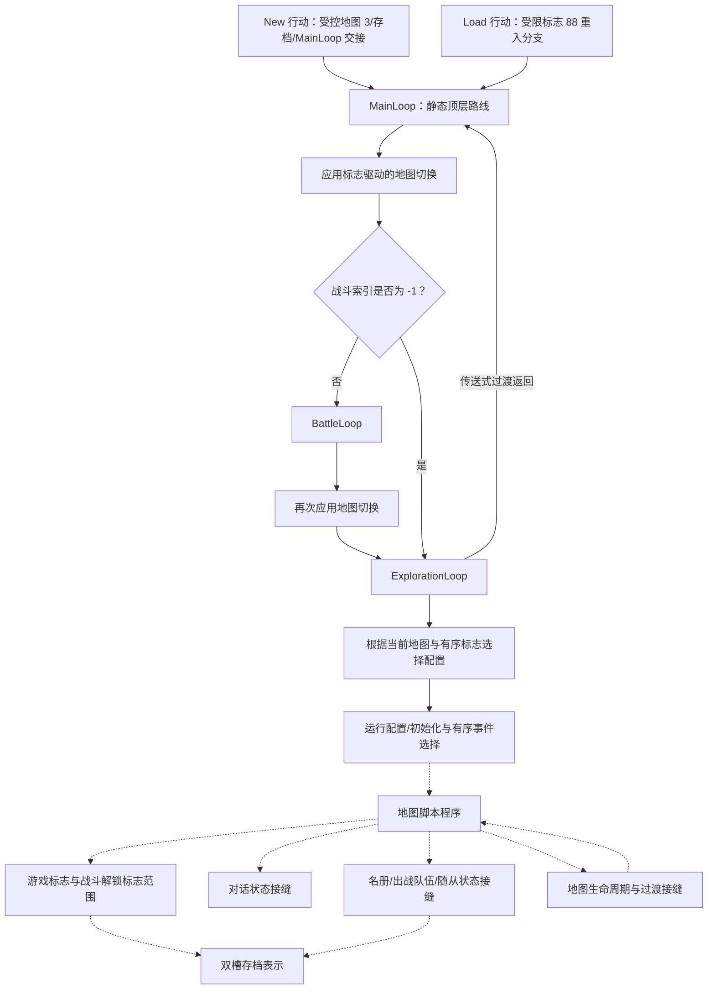

# 故事推进

- **已确认原版行为：** 受限的新游戏/重入交接、顶层地图/战斗/探索路由、有序配置与事件选择、完整地图脚本程序图、处理器局部故事标志变更、对话游标/控制接缝、名册变更、地图生命周期/过渡边界，以及下文所述的进程内存档动作。
- **推断原版行为：** 这些独立确认的接缝构成可复用的推进架构，由地图、标志、出战队伍和战斗状态选择后续局部行为。
- **未知原版行为：** 完整的正常游玩时间线、未经审阅的剧情/选择后果、路线排他性、完整存档持久性，以及未观察的故事呈现。选定静态章节的含义与受限原版观察仍由各自链接的所有者限定范围。
- 重制状态：实现无关的 Layer B 综合；当前引擎方向属于 [ADR 0019](../../../decisions/0019-state-and-content-driven-remake-engine.md)。本文档不选择战役重写或叙事数据模型。
- 框架证据日期：2026-08-02；章节导读与完整示例在[当前 Standard 严谨度范围约定](../../documentation-roadmap.md#current-baseline-and-near-term-synthesis)下，使用 `f6da6b1bd5384ce60d77e74271d8f8f3bc404a7a` 的已接受所有者。
- 源码基线：`ShiningForceCentral/SF2DISASM` `master` `c834c652b6862bc5679fd7f69a38a7093206efc6`。

> 本文是[规范英文原文](../../synthesis/story-progression.md)的中文镜像，完整同步的英文基线为 `f154275e875bd6cfd13496784a2f2ddaba775677`。英文始终是审阅基线；本镜像遵循 [glossary](../../glossary.md) R1–R7。五个已同步主题和选定已译详细指南之间使用中文导航；未译详细指南、证据合同及其他范围外文档仍链接规范英文。正文中的审阅、中文同步延期及验收判断保留英文基线当时的时间与范围；本镜像的同步不产生新观察，也不扩大原版或重制支持。

## 判断边界

本文档解释已接受的原版游戏状态与控制边界如何支持故事推进。它不是剧情摘要，也不是按时间线的攻略。源码标签、静态传入引用或成功的处理器局部回放，不能证明正常存档会到达该代码、何时到达、玩家看到什么，或事件在故事中的含义。

下方章节阅读路线解释选定的已接受内容依赖。底层**推进框架**仍受边界限制，不构成自然游玩的完整战役证明：

1. 顶层控制根据当前状态选择战斗或探索；
2. 当前地图加有序标志选择六部分地图配置；
3. 有序地图事件与地图脚本分支选择局部程序；
4. 局部程序可以检查或变更标志、对话状态、名册状态和地图状态；
5. 传送式探索返回与返回的 `BattleLoop` 交接重入顶层路线；
6. 存档服务可以序列化受限的战斗员数据区域，但尚未证明完整子系统持久性。

从[游戏总览](gameplay-overview.md#沿玩法循环选择阅读深度)进入，再用章节分组了解世界变化，用完整示例理解一条连贯依赖。[战术战斗循环](tactical-battle-loop.md)和[成长与经济](progression-and-economy.md)解释这些章节协调的局部系统。[文档路线图](../../documentation-roadmap.md)拥有范围与审阅顺序；这些解释均不补足缺失的自然时间线。

## 分段阅读故事内容

这六组是依据有意义的世界变化与内容依赖形成的**推断性编辑阅读顺序**。它们不是原作者的章节、强制战斗顺序或连续行走的证明。下文的**已确认静态内容**表示具名的已接受所有者支持特定选择器、操作或条件交接。其源码顺序不证明自然抵达、完整呈现、玩家控制或持久存档。

先读各组导读，再展开详细指南（已译中文，其余回退英文）了解精确局部行为，最后通过研究链接查证。北方章节到达条件 Battle32 准入；Moun/Nazca 章节继续经由返回 Grans，到达下一场遭遇的条件交接。最后一组把 Sword 和塔路线连接至尾声与隐藏战斗重置。这些分组不另建一套详细后期战役系列。[覆盖所有者](../../../research/story-content-coverage.md#four-different-frontiers)区分静态研究、原版观察、英文综合与重制支持。

1. [Grans 开篇与离开](#grans-开篇与离开)。
2. [New Granseal 与东部 Parmecia](#new-granseal-与东部-parmecia)。
3. [南方旅行、Caravan 与 Creed](#南方旅行caravan-与-creed)，包括 [Taros/Caravan 完整示例](#完整示例taros-与-caravan)。
4. [北方旅行、Pacalon、Tristan 与 Mitula](#北方旅行pacalontristan-与-mitula)。
5. [Moun、Nazca 与返回 Grans](#mounnazca-与返回-grans)。
6. [最终对决与结局](#最终对决与结局)。

### Grans 开篇与离开

开篇连接城镇交互、城堡/塔事件与战斗，随后通过被俘、塔后续、地震和乘船离开改变世界。**已确认：** 选定开篇有受限原版观察；后续局部指南解释静态结果/返回与事件门槛。地震城镇出口、登船选择、出航场景和损坏船只抵达是不同交接，并非一次过渡。脚本搬移也不等于玩家再次决定移动。

用[开篇至 Battle01（中文）](opening-through-battle01.md)阅读连贯开端，用[码头出航（中文）](earthquake-town-through-docks-departure.md)了解实际 Yes/No 分支。可选 Kiwi 及其他开篇交互仍和各自局部条件放在下列指南中。[Grans 覆盖](../../../research/story-content-coverage.md#grans-opening-captivity-and-the-first-tower)与[离开覆盖](../../../research/story-content-coverage.md#leaving-grans-and-establishing-new-granseal)通向已接受证据。败北、逃脱与重复配置保留各自返回；战斗编号和出航布置都不证明自然连续的旅程。

详细指南及其局部边界（本组十一篇中文；下一组选定二十一篇中文）

[开篇至 Battle 01（中文）](opening-through-battle01.md)连接选定的 Map 3 开篇、信使、城堡/王室/塔阶段、遭遇和可用返回。它在已接受证据上提供地点/实体/对话/遭遇阅读路线，将额外交互与条件分支同必需的已观察内容分开。

接着读 [Battle 01 返回至 Battle 02 准入（中文）](battle01-return-through-battle02.md)，了解下一段有条件、由源码相连的内容：返回城堡、驱魔/委任、Jaha 加入及西出口准入。它保留替代调用方与状态/选择器条件。其中的**已确认静态内容**和**推断**叙事联系不扩展下文的原版观察前沿或重制验收；自然连续性与合法行走仍为**未知**。

[Battle 02 结果至 Battle 03 准入（中文）](battle02-outcome-through-battle03.md)继续解释结果/返回、有条件的 Yeel/Kazin 指引，以及独立的 Map66 区域（事件）请求/消费者路径。跟随不同于招募；Yeel 并非已证明的遭遇前提。本段同样保留静态/自然和原版/重制边界。

[Battle 03 结果至 Battle 04 准入（中文）](battle03-outcome-through-battle04.md)继续经过条件返回、Hawel 住宅初始化、Kazin 招募及独立出口请求/遭遇选择器。住宅默认与重复配置、已加入/随从/解锁状态仍有区别；自然行走、调用方/呈现/持久性，以及已初始化的 Battle04 仍为未知。

[Battle 04 结果至 Battle 05 准入（中文）](battle04-outcomes-through-battle05.md)随后区分胜利/特殊败北/逃脱，解释 Galam 监狱/城堡内容、Slade 跟随与守卫的条件解锁/请求。它止于 before/start，保留自然行走、行动者/重入和出战队伍未知项；源码分支不证明强制败北或连续攻略。

[Battle05 结果至 Battle06 准入（中文）](battle05-outcomes-through-battle06.md)继续说明独立的位置/HP 消费者、首次完成的宝石场景与 Slade 加入、Galam 出口及条件 row-6 选择/before/start。F407 在入场时写入，并非完成时写入，也不证明 Battle07 路线；行走、调用方/出战队伍/重入和呈现仍为未知。

[Battle06 结果至 Battle07 准入（中文）](battle06-outcomes-through-battle07.md)继续说明随结果变化的返回、F506 城镇/城堡内容、可选 Kiwi 招募、王室跟随和条件塔请求。F407 准入与 F506 内容仍分开；F401 拦截、F999 替换和 F457/F88 跳过分支保留行走、随从/重入及出战队伍未知项。

[Battle07 结果与探索交接（中文）](battle07-outcomes-and-aftermath.md)随后解释胜利/重复/败北/逃脱、分阶段的塔后续，以及独立的宝石/当前跟随/持久标志效果。返回请求先于脚本/调用方完成；空 Map58 配置在条件恢复控制之前重建随从。F999、冲突随从标志、自然服务完成和后续行走仍是明确限制；指南止于紧接的 Map58 出站所有者。

[塔后返回至地震城镇入场（中文）](post-tower-return-through-earthquake-entry.md)继续经过选定的塔/城堡出口、独立 Astral 对话、地震地图替换及首次/重复城镇初始化。它止于条件控制/事件读取；合法行走、调用方/随从状态与自然服务完成仍为未知，后续撤离另行处理。

[地震城镇出口至码头出航（中文）](earthquake-town-through-docks-departure.md)继续经过变化后的港口、同地图登船、老人的 Yes/No 选择及分阶段出航。它区分随从标志清除、行动者重建、脚本内 Map66 加载与条件 Map73 请求交接。行走、占位、随从/服务/待处理状态及独立区域（事件）表异常保留各自限制；目的地初始化和后续航行不在其范围内。

[航行登陆至损坏船只控制（中文）](voyage-through-damaged-ship-control.md)随后解释 Map73 首次/重复选择、可选 Kiwi 内容、登陆/人群指令，以及脚本安排的 Jaha/木板场景。两次脚本内 Map14 加载绕过其 init；F700 在脚本返回后、条件控制前写入。行动者引用复用、随从/出战队伍状态、自然抵达与服务/待处理结果保留各自限制；玩家木板推进与 Battle08 仍分开。

### New Granseal 与东部 Parmecia

登陆并不立即确立一个安顿完毕的新城镇。木板/救援遭遇及其结果先于选定建设/演说和重建人口边界。从 New Granseal 出发，局部条件把 Peter 的介绍与觐见连接到东行、Ribble、Polca 和 Bedoe。**已确认静态内容：** 说话、跟随、加入军团和下一场遭遇准入有独立消费者。十二个编队位置不会招募十二名伙伴。

阅读[木板与救援指南（中文）](damaged-ship-plank-through-battle08.md)、[Peter 觐见（中文）](peter-castle-audience-through-town-return.md)及 [Volcanon 觐见（中文）](bedoe-to-volcanon-audience.md)了解这些变化。可选的 [May（中文）](ribble-may-through-battle10-admission.md)、[East Shrine（中文）](battle10-outcomes-through-east-shrine-visit.md)、[Bedoe 雏鸟救援（中文）](bedoe-hatchling-flight-and-rescue.md)与 [Oddler 选择（中文）](polca-oddler-choice-and-following.md)是条件分支，并非必经链。[东部章节证据](../../../research/story-content-coverage.md#eastern-parmecia-ribble-polca-and-bedoe)保留独立遭遇与返回。Polca 的木筏授予为之后的旅行选项作准备；[登筏（英文）](../../synthesis/polca-raft-boarding-through-south-parmecia-entry.md)是独立行动边界。

详细指南及其局部边界（本组选定二十一篇中文）

[损坏船只的木板选择至 Battle08 准入（中文）](damaged-ship-plank-through-battle08.md)继续解释可选木板回应、显式/同地图入口替代分支、木料交付与重复救援请求。F408/请求产生先于调用方 F703/EGRESS_MAP 写入；Map72 准入与 F458 before/start 分发仍不同于场景演员和交战名册。它止于 ActivateEnemies 之前，保留待处理、行走、随从/服务和挂起入场限制。

[Battle08 结果至 New Granseal 城堡交接（中文）](battle08-outcomes-through-new-granseal-handoff.md)继续解释首次/重复胜利、败北/逃脱、工人与封堵隧道场景、条件 Map73 建设及其出站请求。BattleLoop 直接读取返回字段，不同于探索消费待处理请求；F705 由 init 调用方在脚本之后写入。行动者/随从、重置、服务与自然路线限制均明确保留。它止于 Map7 目的地 init 之前。

[New Granseal 城堡：一年后的演说与首次控制交接（中文）](new-granseal-castle-year-later-control.md)继续解释配置优先级、首次/重复 init、重建/贸易演说、遣散及显式普通人口重新加载。调用方 F707/F411 写入先于首次待处理/控制读取；同地图显示加载、行动者映射与具名/未加入角色等待保留各自限制。它止于该读取，不声称自然抵达、服务完成或实际可用控制。

[New Granseal 城镇：Peter 的首次介绍（中文）](new-granseal-town-through-peter-introduction.md)继续经过条件城堡离开、城镇配置/init、水手/守卫介绍及 Peter 的接待。F706 与 F701 独立控制两个区域（事件）；调用方标志在脚本返回后写入。隐藏及具名/未加入角色动作仍不同于招募、持久遣离与抵达。它止于 Peter 之后首次待处理/控制读取，不声称自然旅行或可用输入。

[Peter 城堡觐见及返回城镇（中文）](peter-castle-audience-through-town-return.md)继续说明条件城堡准入、Astral 留下、Peter 加入/AI 及不同跟随机制、赠礼的叙事/状态不一致与城镇重入。请求产生先于调用方依次写 F702、F67；目的地配置/init 先于首次待处理/控制读取。它止于此，自然旅行、已观察金币、服务完成与可用输入均为未知。

[New Granseal 离开至 Battle09 准入（中文）](new-granseal-departure-through-battle09.md)继续经过离城、选定先东后南的大地图连接及条件遭遇准入。滚动保留探索/同行群体状态；普通入口与部分重新加载到达有序战斗选择。特定/默认区域（事件）、携带的请求字节与 F409/F509/F459 保持区别。它止于敌人激活之前的空 start 分发器返回，自然旅行、行动者/请求存活、服务完成和战斗就绪仍为未知。

[Battle09 结果至 Ribble 欢迎（中文）](battle09-outcomes-through-ribble-welcome.md)继续解释可变战斗返回、独立城镇入场、猜疑与 Peter 的说明。独立欢迎门槛，以及居民重新加载、门重建、屋顶恢复和当前跟随的不同效果均明确保留。它止于村长调用方之后及首次条件恢复控制，自然旅行、行动者/服务完成、待处理状态与可见村庄变化仍为未知。

[Ribble 可选 May 招募至 Battle10 准入（中文）](ribble-may-through-battle10-admission.md)继续解释线性邀请、不同的已加入/出战/当前跟随状态、方向指引与选定离开。普通入场重建实体；向东滚动绕过战斗选择，而部分区域（事件）请求到达有序 Battle10/14 准入。它止于 ActivateEnemies 之前的空 start 分发器返回，明确保留行动者/出战队伍、请求、服务、跨存档呈现与自然路线限制。

[Battle10 结果至可选 East Shrine 访问（中文）](battle10-outcomes-through-east-shrine-visit.md)继续解释可变战斗返回、独立神殿入口、误认身份、祖父的讲述和邀请。独立持久/临时门槛允许不同交互顺序；当前 129 跟随不同于 F77 下以 30 重建。它止于老人调用方之后及首次条件控制交接，保留映射、服务、存档/重入和自然路线限制。该可选分支不建立强制 Battle11 路线。

[East Shrine 返回至 Battle11 洞穴准入（中文）](east-shrine-return-through-battle11-admission.md)从可选神殿出口或 Battle10 直接返回继续，经过选定滚动/固定连接、精确 F411 准入和 Peter 与 hobgoblin 的对话。F461 开场/F88 恢复、无配置洞穴探索、随从选择的位置及后续战斗员替换仍分开。它止于 ActivateEnemies 之前的新战斗 start 分发器返回，保留中断、行动者/出战队伍/服务/待处理和黑暗呈现限制。未建立强制神殿路线。

[Battle11 结果至 Polca 首次 Oddler 抵达（中文）](battle11-outcomes-through-polca-arrival.md)继续说明可变洞穴返回、携带的 egress、选定出口与独立 F413 城镇准入。首次 X24 事件安排受伤男孩与村民反应，随后在调用方 F711 处理和 F710 写入之前显式重新加载 F710 居民。跟随被重建，也可能保留相同目标/偏移。它止于首次条件恢复控制，保留行动者/HP/映射、服务/待处理、呈现与自然路线限制；它既不招募 Oddler，也不招募 Gerhalt。

[Polca 妖精交互至 Battle12 准入（中文）](polca-fairy-through-battle12-admission.md)继续解释可选乌龟试探、妖精离开、独立东出口及搜寻恶魔对峙。F711 调用方/替代产生方状态、实际事件查找和临时/重建跟随保持区别。F412 立即准入、F512 空人口与 F714/F712 init 可以改变普通场景分支。场景解锁/请求先于调用方 F713 与消费；通配准入、实际战斗布置及 F462/F88 分支仍分开。它止于 ActivateEnemies 之前的新战斗 start 分发器返回，自然旅行、传入行动者、服务/待处理及渲染变身均为未知；帮助乌龟不是出口前提。

[Battle12 结果至 Bedoe 初始守卫相遇（中文）](battle12-outcomes-through-bedoe-entry.md)继续说明首领识别、首次/重复山地返回、Peter 回应、选定 Bedoe 入口及守卫质问、认出身份和请求。HP/F512 首领/加入尾部、独立 F714/F712 回应和 F722 配置选择仍分开。最终守卫布置先于调用方 F719 及可选 F720 地图外移动；当前跟随不证明持久性。它止于默认/替代 init 之后与首次条件恢复控制，早于国王演说/觐见，保留自然路线、行动者/出战队伍/AI、服务/待处理和呈现未知项。

[Bedoe 国王演说与首次觐见（中文）](bedoe-king-address-through-first-audience.md)继续说明报告、散开的守卫、Luke 问候、介绍、Zeon 警告和前往 Volcanon 的邀请。F720/F721 独立允许场景；F722 替换其区域（事件）表。真正隐藏不同于重入时移至地图外，而共享 147/148 位置依赖先前场景和传入状态。最终命令建立 Peter 跟随 Bowie，不加入任何人。它止于觐见调用方之后及条件控制，保留自然楼层/顺序、行动者/映射、服务/待处理和呈现未知项；神殿旅行与 Volcanon 仍独立。

[Bedoe 至 Volcanon 觐见（中文）](bedoe-to-volcanon-audience.md)继续经过显式神殿入口、保留人口的当前地图入口、Peter 返回/介绍、Volcanon 拒绝、宝石建议与 Peter 的承诺。场景归于 Volcanon，不同于 speaker128 的 birdman 映射。只有 F722 控制场景准入；后续 F722/F711 写入、F7 成员资格、依赖容量的 F39/缓存列表、AI bit2 清除、未变的 F67 和当前跟随保持区别。它止于首次条件 Map11 控制，保留传入状态、自然楼层、服务/待处理和呈现未知项；其选定返回在下文另行继续。

[Volcanon 返回至 Bedoe 国王选择（中文）](volcanon-return-through-bedoe-king-choice.md)继续说明选定神殿返回、可选 Zeon 问题、拒绝/重复和 Creed/河流/木筏建议，直至 Luke 被要求离开。F722 独立于 F799/F724 选择配置；F75 可提供随从 Luke 代替固定行，F67 提供 Peter。Yes 必须确认，No/B 共用拒绝，无输入则保持待处理。基于目的地的朝向没有 HP 守卫；等待动作、隐藏失效、后续仅改坐标的 init 及保存的物理国王朝向恢复仍分开。仅脚本返回才到达 F799。它止于调用方之后及条件控制，保留自然楼层、传入状态、输入/服务/待处理和呈现未知项。Bedoe 出口、Polca/木筏履约、雏鸟/救援、Luke 招募和 Battle13 仍独立。

[Bedoe 雏鸟飞行与救援（中文）](bedoe-hatchling-flight-and-rescue.md)解释独立可选内容：演示、重复宣称、坠落/救援及各调用方的条件返回。F722 选择配置；F723 控制飞行/重复，而 F13/F724 独立控制救援，不以 F799 国王选择为前提。共享速度/精灵/优先级状态、不等待的行动者、真正隐藏与仅改坐标的 init、依赖 HP 的跟随，以及保留/重建映射仍分开。它止于这些调用方/控制边界，保留自然访问、传入状态、接触、服务/呈现和持久性未知项；不承诺未来 Skreech 招募。

[Bedoe 返回至 Battle13 准入（中文）](bedoe-return-through-battle13-admission.md)沿选定主路线继续经过南/西出口请求、变化后的 Polca 人口、恶魔对峙、Gerhalt 加入及条件新战斗开始。F513/F799/F710 配置优先级不同于 F710/F799/F715 区域（事件）及独立 F413 准入；F74 提供 Astral/国王/大臣，而非 Gerhalt。F9/F41/缓存时序、健康、跟随与 AI 保持区别。脚本安排的 birdmen 死亡呈现与 Luke 被中断的动画/移动不证明交战死亡或固定位置。解锁/请求先于调用方 F715 和消费；空 before/start 脚本、F463/F88 替代分支及战斗人口重建保留各自边界。它止于 ActivateEnemies 之前，自然旅行、传入状态、服务/呈现与可玩性均为未知；雏鸟内容不施加前提或强制顺序，也不声称木筏履约或 Luke 招募。

[Battle13 结果至 Polca 木筏授予（中文）](battle13-outcomes-through-polca-raft-grant.md)继续经过首次/重复胜利、不同的 Bedoe 败北/Egress、Luke 同行标志、新 Polca 人口及可选村长交易。F75 不同于 Luke 成员资格/HP/AI；F718/F717/F716 调用方优先级先于临时接触，仅场景返回才到达依次 F716/F64/Map72 `(43,48)` 写入。当前跟随、hide133 与未来重建仍独立。它止于条件调用方/控制返回，保留自然可达、行动者/服务、呈现与持久性未知项；配置好的木筏状态不证明 Polca 当前存在木筏、河流可用或已登筏。Oddler 选择/离开和后续旅行仍在范围外。

[Polca 的 Oddler 选择与跟随（中文）](polca-oddler-choice-and-following.md)解释独立的 Y11/Y30 请求、首次拒绝返回，以及第二次拒绝后无需再次提示便汇合的恳求。F89 记录已返回选择；F717/F718 调用方谓词不同于内部 F68/clear75/F718 及未来人口。当前 Peter→Bowie、140→Peter、Luke→140 不同于列表顺序、之后 FOLLOWER_B31 构建/NPC140 init 移除。它止于两个调用方/条件控制返回，保留输入、行动者/HP、服务/呈现和持久性未知项；实际 Polca 离开、河流/登筏、Battle14 和招募仍独立。

[Polca 离开与 Luke 招募（中文）](polca-departure-through-luke-recruitment.md)继续解释选定南传送、条件战斗中断及独立 F716-set/F10-clear init。新建随从与独立木筏映射不同于当前地图人口；新分配 Luke 可保留旧 F75 随从。全部六条归属台词及 join446 通向独立 F10、条件 F42/缓存、当前隐藏与后续 F416 效果，没有事务或重试修复。它止于条件探索控制，保留行动者/HP、自然路线、服务/呈现、输入与持久性未知项；Luke 的 Down1 既不证明登筏，也不证明 Battle14/16 路线顺序。

### 南方旅行、Caravan 与 Creed

交通与物品持有把本组系统连接起来。授予木筏不同于登筏或登陆；Hassan 的 Rohde 提议不同于 Taros 准入；Sword 持有不同于 Bowie 装备后攻击资格。首次胜利可以改变 Caravan 人口条件，同时让玩家继续步行。[完整示例](#完整示例taros-与-caravan)解释这些选定依赖及其失败/拒绝分支，不规定旅行顺序。

在 Caravan 之外，[Elven Village 入场](../../synthesis/battle19-outcomes-through-elven-village-entry.md)独立于 Battle19 胜利。[Elric 招募](../../synthesis/battle20-outcomes-and-elric-recruitment.md)、Fairy Cave 与 Creed 小世界通道有各自的交互和结果门槛。恢复正常大小、咨询 Evil Spirit 和带 Fairy 离开同样是不同边界。可选 [Rick](../../synthesis/hassan-rick-recruitment.md)、村庄探索、[Fairy Woods 试炼](../../../research/battle44-fairy-woods-trial-and-records.md)及 [Creed 招募选择/拒绝](../../synthesis/creed-return-fairy-and-recruitment-choices.md)保留各自所有者；试炼链接通向研究，并非详细英文指南。

已接受证据路线覆盖[南方交通与 Taros](../../../research/story-content-coverage.md#southern-parmecia-transport-the-sword-and-taros)、[Elven Village 至 Fairy Cave](../../../research/story-content-coverage.md#elven-village-harpy-pond-and-fairy-cave)及 [Creed/咨询](../../../research/story-content-coverage.md#creeds-small-worlds-and-the-consultation)。[沙漠遭遇](../../../research/battle14-desert-encounter-and-outcomes.md)和[独立神殿进路](../../../research/battle15-shrine-approach-and-outcomes.md)是已接受静态研究分支；编号 Battle14/15 不会使它们成为必经行程。

详细指南及其局部边界（未译篇目回退英文）

[Polca 登筏与 South Parmecia 入场](../../synthesis/polca-raft-boarding-through-south-parmecia-entry.md)从该控制边界继续，经过独立 type3 产生/物理对齐、分阶段 Bowie/木筏/列表变化，最后才提交 mode2。Physical31、FOLLOWER_D159/lookup63 与 FOLLOWER_B31 保持区别；群体等待仅轮询列表最后一名行动者。实际 mode2 选择 opcode8，type5 则作为下筏请求的另一停止边界。两个选定南方行都解析到 Map69，与 Southeast70 不同：row6 经条件 F409/F417 准入和新人口返回，row9 则在探索内保留 X/朝向和现有行动者，不经过该扫描。它止于请求、init 前战斗准入或条件控制，保留自然路线、传入状态、服务/呈现/输入和持久性未知项；单凭 F416 不会开始任何 Map69 战斗。

[South Parmecia、Kraken 现身与 Battle16 入场](../../synthesis/south-parmecia-through-kraken-battle16-entry.md)继续解释选定 Map69 row0→Map49 与 F416/F516 准入，区分 F466 开场/start 和 F88 存档入场。完整遭遇有四个 Peter 与三个条件 FOLLOWER_B 台词位置；场景行动者、共享 ENTNUM 精灵槽及所请求服务，不同于随后已治疗、受成员资格影响的战斗员重建。Map49 无准入时的后备分支选择 ms_Void。它止于空 start 包装器之后，早于激活/单次行动/交战/结果，保留传入状态、自然路线、服务/呈现/输入和持久性未知项，不要求 Battle14/15 前提。

[Battle16 结果、下筏与条件 Hassan 入场](../../synthesis/battle16-outcomes-through-hassan-entry.md)继续解释首领/败北优先级、首次/重复胜利与不同的 Polca 败北/逃脱返回。胜利读取后续场景元组并跳过 CheckBattle；选定 Hassan 传送使用普通探索消费，不以显式下筏为前提。元组保存、行动者移动、等待列表最后行动者及按标志恢复跟随先于 mode0。F518 演员选择与 F518/F65/F12 init 保留缺席 Rick 查找→main0 和 F84 Rohde 跟随限制。它止于城镇交互之前的条件控制，保留自然路线、传入状态、服务/输入和持久性未知项；入城保留交通模式，不证明可用步行。

[Hassan 祖先传说与 Rohde 的 Caravan 选择](../../synthesis/hassan-ancestry-and-rohde-caravan-choice.md)解释独立祭司区域（事件）、Rohde 交谈/选定物品准入、完整首次/重复选择及条件跟随/控制。搜索已加入成员持剑不同于 physical0 在 `(16,58)` 使用选定 Sword；重复交谈跳过搜索，被抑制的物品使用返回子菜单。F726、F727、F725 保留不同抑制职责；F84/F418 及 Rohde 跟随当前 FOLLOWER_B 不赋予军团成员资格、F65 解锁或物品消费。所归属传说、实际传入行动者/HP/输入、未完成服务、新人口差异和可用控制仍受限或未知。它止于获得、Rick、离开、Taros 和 Caravan 操作之前。

[Ribble 树开口与 Achilles Sword](ribble-tree-opening-and-achilles-sword.md)单独解释选定宝箱容量及物品使用谜题，不作为时间线攻略。搜索使用朝向偏移瓦片；Panel 使用要求 physical 0 位于精确朝 Up 的行。场景返回先于 F731、军团范围按物品移除及已处理使用，部分/重复/新加载效果有别。Map50 的 F415 通配 Battle15 准入与树边探索竞争；F515 在选择后清除解锁。指南止于条件 Sword 持有与返回 Ribble，链接 Rohde 持有检查，不声称神殿区域间行走、强制战斗顺序或 Caravan 获得。

[Hassan 离开、Battle17 入场与条件返回](../../synthesis/hassan-departure-and-battle17-outcomes.md)解释北出口及有序通配 Battle9/17 优先级，独立于 Rohde 的 F418。步行区域（事件）、默认 Battle9 和实际木筏控制有别；重复计数器/RNG 决策与残留重载字节不证明概率或位置保留。空钩子保留共享入场/结果工作。首次/重复胜利使用选定成员的最终位置种子；败北/Egress 选择 Hassan，并有条件重置已保存木筏。它止于准入/start 或条件新探索/控制，保留状态、服务、自然路线和持久性限制。

[Southwest Parmecia、Taros 警告与条件 Battle18 入场](southwest-parmecia-through-taros-battle18-entry.md)解释向西原地滚动及独立神殿请求，其中 F418 战斗准入先于 F725 探索 init。完整警告/撤退与对峙保留行动者/HP/服务限制。新交战重建用 F518-clear neutral159/Left/HP0 替代场景 Caravan129/Down；F468 开场与 F518 完成独立起作用。它止于条件探索返回、无关准入或激活前 start，不声称车辆获得、Sword 伤害或已观察可玩性。自然路线、传入状态、完成/输入和持久性仍为未知。

[Battle18 结果与 Caravan 获得](battle18-outcomes-and-caravan-acquisition.md)解释首领清理与先败北后胜利的区别、首次/重复后续、Rohde 完整演示、实际 F65/F84 变化与共享 Bowie 加入。场景 Caravan128、before129、neutral159 与 raw physical1 保持区别；台词和分阶段运动不提供成员资格或交通操作。胜利保留更早的返回种子，F725 警告先于 F518 移出；败北/Egress 使用传入 EGRESS_MAP，并非强制 Hassan。它止于即时条件探索/控制或无关准入，保留存档点/木筏、行动者/服务、呈现、自然路线和持久性限制。Caravan 操作、Rick 及后续旅行仍在范围外。

[Hassan 可选 Rick 招募](../../synthesis/hassan-rick-recruitment.md)解释独立 F518 人口、F12/F44 成员资格、临时 F256 与 F65 上下文、普通交谈准入及完整对话。即时加入/确认与当前物理跟随保留 HP/容量、名册快照、目的地朝向、查找及重复/自身目标限制。新人口与现有人口重入有别；不提供持久 Rick 随从标志或强制返回路线。它止于条件普通控制/重入，自然可达、服务/输入/呈现和持久性为未知。Caravan 操作与后续旅行仍独立。

[Caravan 登乘与 Southwest Parmecia 旅行](caravan-boarding-and-southwest-parmecia-travel.md)解释新 Map68 人口前的选定神殿出口/准入、F65 跟随与传入模式的区别、numeric2 登乘、实际 mode1/opcode7 移动和 numeric4 登陆。逻辑行动者、原始物理槽、后缀/最后行动者等待及标志驱动的动作重装保持区别。步行独立的 default19 回调保留首次/重复计数器/RNG 决策、打包重载 X0/zoneY/残留朝向/声音和 F419 通配准入。它止于条件步行控制或 Battle19 交接，保留部分执行/服务/自然路线/持久性限制，不声称菜单事务、地形重建、村庄内容或战斗结果。

[Battle19 结果与独立 Elven Village 入场](../../synthesis/battle19-outcomes-through-elven-village-entry.md)解释空场景目标及共享包装器/首领/Bowie 加入效果、新/恢复入场、首次/重复胜利种子及败北/逃脱存档点。Map68 到 Map23 的独立入口不以 victory19 为前提；默认/F762 居民、传入随从/模式、仅返回的 init 及条件控制不同于结果返回。它止于村庄交互、楼梯、Map24/Battle20 及后续旅行之前，保留自然路线、服务和持久性未知项。

[Elven Village 对话与局部探索](../../synthesis/elven-village-conversations-and-local-exploration.md)解释可选默认/F762 对话、仅文本的 F13 分支、教堂调用边界与局部描述/物品。物品种类优先级先于描述；已加入列表收件人选择、重复/物品栏满时回滚及当前地图楼梯保留仍有条件。它止于教堂调用/返回或条件 Map23 控制，保留调用方、自然访问、服务/输入和持久性未知项，不声称招募、物品使用或后续旅行。

[Elven Village 离开至 Harpy Pond 入场](../../synthesis/elven-village-departure-through-harpy-pond-entry.md)解释选定村庄出口、保留人口的独立向西滚动、完整求救与共享池塘提示。直接/脚本请求、init 前 F420 准入及 F520 人口与 F470 提示仍分开。它止于条件池塘控制、另一待处理/获准继续或开场前 Battle20 准入，保留行动者/HP/模式/服务与自然路线未知项，不声称救援/招募、通道、接近/出口警告或战斗内容。

[Harpy Pond 接近至 Battle20 入场](../../synthesis/harpy-pond-approach-through-battle20-entry.md)解释选定对峙、独立南方警告/出口及有序 F420/请求/F470 交接。共享空 before/start 目标、条件出战队伍布置、重建敌人与独立中立 Elric 159 不同于探索演员及军团成员资格。新入场止于 ActivateEnemies 前，挂起入场止于各自单次行动前，保留传入状态、服务/输入/呈现和自然路线未知项，不声称结果、救援/招募或后续旅行。

[Battle20 结果与 Elric 招募](../../synthesis/battle20-outcomes-and-elric-recruitment.md)解释首次/重复胜利、败北/逃脱与完整招募场景，直至即时条件池塘控制或选定存档点继续。军团成员资格、临时场景跟随与新 F520 人口仍分开；传入标志/出战队伍/HP/查找及服务/持久性未知项均明确保留。它止于池塘离开、通道、Fairy Cave/Creed 与 Battle21 之前。

[Harpy Pond 离开至 Fairy Cave 入场](../../synthesis/harpy-pond-departure-through-fairy-cave-entry.md)解释独立池塘出口、Map67 准入/人口、Elric 条件通道场景及 Map32 实际 ms_Void/共享入场边界。当前图块、返回后 F751、待处理请求与已完成控制仍有区别。它止于条件洞穴控制、无关待处理继续或开场前 Battle21 准入，保留行动者/模式/服务、自然路线和持久性未知项，不声称后续洞穴探索或 Creed 内容。

[Fairy Cave 探索与 Devil's Tail 返回](../../synthesis/fairy-cave-exploration-and-devils-tail-return.md)继续解释四个宝箱奖励、实体优先的 C 与搜索、收件人/回滚及后续布局重新应用。两个洞穴出口保留独立 F421/F521 准入和条件 Map67 控制；东返回 `(57,24)` 不选择 F520。岩石检查保留 F751/F13/HP 与当前 Peter 映射，独立于通道打开。它止于已完成条件局部交互/搜索、Map67 控制/请求或开场前 Battle21 准入；自然访问、服务和持久性仍为未知，不含 Creed 或战斗内容。

[Battle21 开场与初始名册](../../synthesis/battle21-opening-and-initial-roster.md)解释完整拒绝/威胁对峙与条件新配置。传入 F421/F521 准入、F471 场景选择及 F88 存档入场保持独立；裁切/源码坐标、场景演员、实际出战队伍布置和成功物品掩码保留不同消费者。新入场止于 ActivateEnemies 前，挂起入场止于各自单次行动前，不声称结果/Creed 或战术；自然可达、服务、升级后的名册、呈现和持久性仍为未知。

[Battle21 结果与 Devil's Tail 返回](../../synthesis/battle21-outcomes-and-devils-tail-return.md)继续说明首领清理与 HP 变更、两个有序结果检查及完整首次后续场景。重复种子、裁切场景与完整地图返回、成员资格与随从映射及新人口仍分开。它止于条件 Map67 控制/待处理或传入败北继续，早于宅邸 init；自然可达、传入状态、已完成服务和持久性仍为未知。

[Creed Mansion 入口与首次 Goliath 阻拦](../../synthesis/creed-mansion-entry-and-first-goliath-scene.md)继续经过独立门口/请求/准入、基线配置及完整首次区域（事件）场景。最后设置的指针、传入行动者、当前门图块复制与 F774、延后的包装器/控制仍分开。它止于缩小前的条件首次场景返回/重复；自然访问、已完成服务、渲染表现、可用控制和持久性仍为未知。

[Creed 魔法门与 Desktop 转移](../../synthesis/creed-magic-door-and-desktop-transfer.md)继续解释独立 F783 区域（事件）门槛、完整警告/缩小/收取场景及条件 Map22 请求/准入。临时精灵操作、叙述中的拾取、当前门图块复制与 F422/F522 战斗选择仍分开。它止于目的地人口/init 或 Battle22 开场之前；自然可达、传入状态、并发/服务完成、渲染拾取和可用控制仍为未知。

[Desktop Kingdom 首次抵达与条件控制](../../synthesis/desktop-kingdom-first-arrival.md)从已准入的新探索继续，经过基线人口、完整落地/讨论/告别及建立跟随。传入映射、临时精灵操作、选定并发等待和调用方写入的 F776，仍不同于叙事归属和持久大小。它止于交互、cs_5996E 或 Battle22 内容之前的条件局部首次抵达返回/重复；自然可达、实际状态、服务/动作完成、可见/可听表现、有用控制和持久性仍为未知。

[Desktop 对话与 Chessboard 挑战](../../synthesis/desktop-kingdom-interactions-through-battle22-entry.md)继续解释村民、Eric/Karna、受限 Caravan/Church 交接、King Ponpei 许可及棋子。F777 许可、独立守卫标志、Y16 的通配 X 区域（事件）分发、遭遇完成、待处理传送和实际战斗准入保持区别。它止于开场/名册之前的 BattleLoop 入场，或条件局部绕过/返回；交谈不招募或开始交战，传说/夸口不定义机制。自然可达、实际状态、服务/包装器/呈现完成、有用控制和持久性仍为未知。

[Chessboard 初始化与初始名册](../../synthesis/battle22-initialization-and-roster.md)从条件 BattleLoop 准入继续，经过空钩子、符合资格的治疗、十二个已处理出战队伍槽、十六个敌人行、全图裁切及行动者重建。F422/F472/F522/F88、复制的装备与行中的 NOTHING、战斗局部坐标、中立 state159/158 与 B/A 脚本查找保持区别。它止于新 ActivateEnemies 或挂起 IndividualTurns_Loop 之前；自然准入、传入/当前状态、已完成服务、呈现/控制和持久性仍为未知。不暗示战术、结果或战后 Desktop。

[Chessboard 结果与 Desktop 返回](../../synthesis/battle22-outcomes-and-desktop-return.md)继续解释首领清理/计数、胜利/败北/Egress 及重建的 F522 探索。成员派生的全图种子不同于后续场景布置；F776/522/778 独立选择抵达和公告。十四个人口行、现有随从动作/别名、工作布局重新加载与 Maid F256 重置/重复保留各自限制。它止于条件局部控制/待处理或变化后的 King/Maid 回调返回，早于 Balloon 获得/使用、守卫放行与 Floor World。自然结果、传入状态、服务完成、呈现/控制和持久性仍为未知。

[Cotton Balloon 获得与前往 Floor World](../../synthesis/cotton-balloon-through-floor-world-entry.md)继续解释宝箱搜索/交付、F212/F258 守卫放行及任意朝向下在自身瓦片 `(35,24)` 使用。菜单选择不同于首个已加入持有者/逆序槽位移除；完整二十九命令离开使用六名传入行动者，带定时跳跃与特定行动者等待。存活请求经 SwitchMap/CheckBattle 到 Map26 `(26,8)`、Down，该地图没有战斗行。它止于条件目的地探索加载器准入，早于人口/init 或 Battle23。自然可达/持有/选择、传入状态、已完成移动/服务、呈现/控制和持久性仍为未知；下降叙事为推断。

[Floor World 首次抵达与条件探索](../../synthesis/floor-world-first-arrival.md)从已接受 Map26 准入继续，解释九个人口行及完整 41 命令落地/爆破场景。Randolf/Tyrin 在场不等于招募；随从、HP、模式/木筏和别名仍是传入前提。六个独立移动只等待 132；隐藏使查找失效，F780 则独立停放 129。场景返回先于 F779、再 EGRESS_MAP26，但 F779-set 重复分支跳过该 EGRESS 写入。当前地图/重载路径、中断前缀、最终跟随及先事件后输入的控制器安装保留各自限制。它止于居民/服务、戒指/搜索/出口或 Battle23 之前的条件局部控制/待处理处理。自然抵达/状态、服务完成、呈现/控制和持久性仍为未知；气球描绘为推断。

[Floor World 居民、巨大戒指与出站出口](../../synthesis/floor-world-interactions-and-exits.md)从局部控制继续，解释全部六个居民回调/默认分支、重复 1742–1747 对话、固定 NAME16 及 Church/Caravan 调用返回边界。独立的目的地派生 X14/anyY 区域（事件）检查 F780，再运行全部八条戒指命令与 moveUp8 主体；隐藏前仅等待129 的动作完成，调用方 F780 与包装器 physical0 等待分开。同次访问查找失效不同于之后新加载停放。全部三个 no-scroll 记录区分 CURRENT255 局部路线与 Map27 准入，保留共享待处理存储及有符号商/低字节/整字坐标限制，不测试 F780 出口门槛。F423/F523 战斗查找独立。指南止于目的地 init、隧道或 Battle23 内容之前。自然可达/状态、服务/呈现/控制完成及持久性仍为未知；举戒指失败为推断，没有已实现的质量/举起/物品收取规则。

[Willard Burrow 探索与 Battle23 准入](../../synthesis/willard-burrow-through-battle23-entry.md)从条件 Map27 请求继续。独立 F423 战斗查找、F523 新人口与 F781 场景准入解释直接入场绕过、三名基线居民与共享空列表终止符，以及保留的 CURRENT255 行动者。无台词局部回调和全部八个 no-scroll 记录描述请求，不是迷宫解法或已完成战后路线。目的地派生的 Y19 区域（事件）运行全部 41 条对峙命令，保留完整具名动作、实际说话者/六条文本与选择性 HP/别名/等待限制。F423、传送请求、场景返回、调用方 F781、physical0 包装器等待和待处理消费先于 CheckBattle 的 BattleLoop 调用；完成的 F523 可以清除423 而不取消该选择。有符号商/低字节覆盖/整字坐标限制仍在。指南止于战斗初始化或目的地 Floor World/Creed init 之前。自然可达/传入状态、已完成动作/呈现/控制和持久性仍为未知；吞食威胁为推断，没有已实现的气味/成长/食物/伤害规则。

[Battle23 初始编队与挂起入场](../../synthesis/battle23-initialization-and-roster.md)从获准的 BattleLoop 调用继续。它解释独立开场 F473、带包装器效果的空钩子、新治疗与十二名已处理成员布置容量、全部十二个敌人记录及初始化属性、一个区域与点，以及重建的局部裁切/实体映射。传入出战队伍、HP/职业/物品和别名使固定存活名册或呈现无法保证。F88 则绕过新配置，加载实际当前/已保存状态。新入场止于 ActivateEnemies/回合创建之前；存档入场止于单次行动读取/执行之前。配置顺序不证明战术、显示敏捷或单次行动结果。自然准入、服务完成、实际呈现/控制和持久性仍为未知；编队的遭遇布置为推断。

[Battle23 结果与返回 Willard Burrow](../../synthesis/battle23-outcomes-and-burrow-return.md)从行动后结束检查继续：首领清理与敌人数、零己方角色败北优先级，以及独立行动后检查。胜利使用按升序首个已加入/出战成员的当前位置与映射朝向，再执行公共 Bowie 加入/标志及替代 MainLoop 返回。败北和 Egress/Angel Wing 则费用不同，并用 EGRESS_MAP 作存档点选择器；保留 Floor World26 有条件。新 Map27 以完整布局、F523 选择的空居民和传入随从替换裁切/行动者；CURRENT255 保留不同状态。独立 F423/F473/F523/F781、缺失居民别名及八个现有出口请求保留待处理/坐标/准入限制。它止于目的地 init 或 Creed 内容之前。自然交战/路线、传入状态、服务、呈现/控制和持久性仍为未知。

[Creed 恢复与主房间离开](../../synthesis/creed-restoration-and-basement-departure.md)从独立获准的 Map33 加载继续，经过有序配置覆盖、七名返回居民及 F523/F783 控制的场景。Creed 呼叫 Goliath，听取 Peter 请求，执行精灵恢复序列并得知 Zeon 回归；随后他与 Fairy 离开去咨询 Evil Spirit。叙事恢复为推断；完整 212 命令/文本/动作顺序是已确认静态证据，保留实际映射/HP、共享精灵大小、未等待/被替换动作及呈现限制。场景返回后，init 先设置 F783、再 EGRESS_MAP9，应用条件 Goliath/己方角色布置，只有待处理/服务/控制器条件允许才返回探索控制。Hassan 选择器不是交通或已保存元组。地下室抵达、招募、自然可达、可见长大/控制和持久性仍在边界外或为未知。

[Evil Spirit Shrine 入口与咨询准入](../../synthesis/evil-spirit-shrine-entry-and-scene-admission.md)从宅邸独立 `(9,5)` 出口继续，经过 Map34 新配置、三个传送与保留的局部转移。F784 选择 21 名基线居民或空居民列表；主角/随从/木筏独立。Evil Spirit130 使用 physical47，十六个 EFFECT1 行则是不同的普通分配，不是已证明动画。仅返回的 init 不启动咨询。独立产生、Y low byte13（低字节13） 的区域（事件）请求到达独立 F784-clear 调用门槛；F783 不是前提。只有场景返回后调用方才能依次设置 F784、F802。其后续解释下述场景；招募/离开和可用场景后控制仍是更晚边界。实际布局/状态、自然可达、服务完成、呈现和持久性仍为未知。

[Evil Spirit 咨询与条件区域（事件）返回](../../synthesis/evil-spirit-consultation-and-zone-return.md)继续经过 Creed 召唤、接触受阻、宝石检查/展示、灵体报告及自称 Zeon 的声音。索取 Jewel of Evil 与提议用 Elis 交换仍是对话，没有物品栏事务。爆炸布置使用十六个独立效果、五次射线爆发与循环动作；灵体、效果、Creed 和 Fairy 依次隐藏。Actor131 的对话身份独立于特殊 physical47 及共享图形请求。隐藏轨道指针在 $7000-X 实体循环跳过下保持休眠；等待动作仅等待一名行动者，而非整个场景。侍从离开后，高字节/Bowie-HP 守卫的跟随请求先于脚本返回、条件 F784 再 F802，以及包装器 physical0 坐标等待。这是有序、非原子的源码行为，不是实测呈现、恢复原调色板、可用控制或持久性。完整 409 记录/73 文本范围保留仅 N 的 3254 继续、实际说话者/立绘/首领状态、调试跳过和变化状态限制。后续宅邸/Fairy/招募及 Oddler 事件仍在指南外。

[Creed 返回、Fairy 跟随与招募选择](../../synthesis/creed-return-fairy-and-recruitment-choices.md)继续经过显式神殿出口、选定 Map33 人口/init 及七个房间回调。F784/F786/F22 优先级和新/保留行动者不同于对话：Goliath 的帮助/灾难报告、Creed 的 Tristan 建议及 resident130 的 Fairy/Oddler 分支都是所归属台词。Fairy 当前图块复制与叙述先于高字节/Bowie-HP 守卫的当前跟随请求，再到调用方762/785；它们既不是加入军团，也不是即时69/68 交接。四个初始和四个 F22 邀请保留 Yes/No 极性、已加入与出战容量、出战写入前计数快照、787 前确认、精确其他三名行动者缩小顺序和当前最后随从目标。出战队伍满不拒绝加入，F22 绕过787 且不缩小其他人。缩小停放在63,63，同时保留查找/列表/成员资格；等待一人不等于三人全部完成。实际 HP/职业/名字/立绘、普通激活、别名、调试跳过、中断标志及条件返回均明确保留。Sword、治疗和自由承诺不是已实现事务。后续 cs_5B466 准入有下述独立告别指南。自然可达、已完成呈现/动作、可用控制和存档持久性仍为未知；不由此推出通用单人招募规则或完整战役验收。

[Oddler 留下与 Fairy 交接](../../synthesis/oddler-stays-and-fairy-handoff.md)继续经过 F774 优先、F785-set/F786-clear 区域（事件）准入及完整告别。Oddler 请求留下；Creed 建议休息并告别。场景布置行动者，隐藏四名招募者但不移除成员资格，用 Init 替换先前动作，让 Oddler 在告别中移动/做手势并隐藏 B31，随后请求 Peter→Bowie 和当前 Fairy130→Peter。两个编码高字节守卫都检查 Bowie HP；跳过最终 Fairy 跟随不会保留其更早动作。仅脚本返回后调用方才 set786、set69、clear68；包装器等待 physical0 坐标，而非全部行动者或可用控制。新 F786/F22 优先级、独立普通 init784 尾部与后续 Fairy158/ Oddler130 重建不同于当前房间。别名/HP、跳过/重复/中断路径、文本/动作/服务和存档未知项明确保留。没有选择变更、离开军团、治疗或自动旅程。指南止于步行离开宅邸、大地图旅行或矮人恢复之前。

[Creed 离开、矮人恢复与 Cannon 赠礼](../../synthesis/creed-departure-dwarf-recovery-and-cannon-gift.md)继续解释选定 Map33→67→68→30 连接，区分保留边界滚动与新准入、矿洞内部30 与外部29。Fairy 是当前 C158；病矮人130 与通常缺席的 B31/physical0 别名职责不同。F69-set/F760-clear 区域（事件）安排检查、闪光、病人恢复动画/自述、感谢及 Fairy 离开。这表达恢复，不执行交战 HP 治疗。辅助程序计数 Bowie 四个物品槽，独立于 LEADER 名字，并不检查 AddItem 结果。双手满会推迟赠礼，但仍允许调用方760/clear69；保留128 可重试，空间足够时重复辅助调用可再次授予。获准赠礼先设置761，再执行完整挖掘序列与当前2×2 布局复制；新761 则移除居民并执行两次复制。这不是通用一次性赠礼规则、全部行动者完成或路线打开证明。独立 init/对话标志、别名/HP/模式、中断前缀、继承台词、服务/控制/存档和自然可达未知项均明确保留。指南止于 Cannon 使用、后续旅程或 New Granseal/Astral 之前。

### 北方旅行、Pacalon、Tristan 与 Mitula

返回取 Cannon、Astral 跟随、Dynamite 与 North Cliff 围绕每次交互改变什么来组织。**已确认静态内容：** 这些赠礼、招募和出站请求有独立条件；返回觐见不检查 Cannon，Janet 不要求 Dynamite。[North Cliff 打开](../../synthesis/north-cliff-opening-and-rohde-recruitment.md)是之后 Rohde 加入交战队伍的边界，独立于更早提议和 Caravan 驾驶员场景。

下方详细英文指南到达 Ketto、Higins、干旱状态 Pacalon 和 Battle27 首次单次行动分发。它们仍是本章引言；从 [Cannon/North Cliff 证据](../../../research/story-content-coverage.md#returning-for-the-cannon-and-opening-north-cliff)与 [Ketto/Pacalon 证据](../../../research/story-content-coverage.md#ketto-higins-and-drought-state-pacalon)开始。以下解释从 Battle27 结果继续，直至**条件 Battle32 准入**，使用已接受 [Tristan–Mitula–恢复降雨所有者](../../../research/story-content-coverage.md#tristan-mitula-and-restored-rain-returns)。

**已确认静态内容**适用于下述选定条件、操作和交接。叙事联系为**推断**，对话归属于其说话者。表格是阅读辅助：各旅行请求与交互必须在实时状态下实际到达并被消费。它既不证明所列地点间无碰撞行走，也不证明自然游玩的时间线。下文局部场景记录表示脚本已返回，独立于成员资格或效果完成。服务完成、呈现、可用控制和存档持久性在此仍为**未知**；原版观察和重制生产仍由下文独立所有者负责。

| 到达的边界 | 改变或变得可能的内容 | 独立条件或替代分支 |
| --- | --- | --- |
| Battle27 结果 → 北方大地图 | 胜利记录完成并返回 Map74 探索。 | Tristan 需要自身入口请求；败北/获准撤退使用选定 egress 目的地。 |
| 桥梁支线 | 进入桥梁可准入 Battle28；其首次胜利有救援/Cameela 场景。 | 需要其解锁。桥梁入场和胜利都不是洞穴或 Battle29 所检查的前提。 |
| Tristan → 洞穴 → 神殿外部 | 城镇对话指向 Mitula；洞穴出口请求外部。 | 外部扫描仅在持有解锁时准入 Battle29；否则准入探索。 |
| 外部 → 神殿内部 | Battle29 胜利返回外部；独立门区域（事件）场景改变门状态。 | 内部请求和 Battle30 解锁独立于该结果及门场景。 |
| Zalbard 结果 → 神殿探索 | Battle30 首次胜利可运行 Mitula 场景；完成选择后续恢复状态内容。 | Taya 需要独立交互/搜索。败北/获准撤退不会新完成该战斗。 |
| 神殿 → Tristan → Pacalon | 独立出口和向南滚动连接返回；恢复状态人口提供变化后的对话。 | Skreech 需要更早救援状态且局部场景记录未设。Frayja 城堡邀请是另一交互。 |
| Frayja 邀请 → Battle31 → 后续扫描 | 邀请解锁 Battle31，另行记录跟随；胜利返回 Pacalon 城镇。 | Battle32 需要自身解锁和 Map74 扫描。Battle31 完成与 Frayja 成员资格不是其前提。 |

#### Battle27 返回与可选桥梁

[Battle27 结果所有者](../../../research/battle27-outcomes-through-tristan-admission.md)区分赢得遭遇与进入 Tristan。在选定状态未变时，胜利清除 Battle27 解锁、记录完成，然后进入新 Map74 探索，不先扫描另一战斗。返回位置来自首名出战成员当前战斗坐标和映射朝向；不是固定城镇入口。空 after 程序仍有共享 Bowie 成员资格尾部，但不提供新同伴或抵达 Tristan 事件。位于 `(52,20)` 的显式 Map74 入口独立请求 Tristan，其地图没有战斗行。

败北和获准 Egress 或 Angel Wing 改走 egress 路线。此处撤退以选定逃脱行动通过可用性和资源检查为前提；取消或不可用行动不是撤退返回。败北恢复 Bowie HP 并减半金币；获准撤退支付法术/物品费用，没有该败北惩罚。这些路径不新记录 Battle27 完成，也不运行其 after 程序。目的地依实际 egress 选择而定：可能的 Tristan 存档点返回不同于大地图入口。更早交战与物品变化不会回滚。胜利也不新解锁 Battles28–30：独立北方大地图区域（事件）可能在 Battle27 获胜前已一起设置这些解锁。

[Pangoat Valley Bridge/Battle28 所有者](../../../research/battle28-bridge-and-outcomes.md)解释带两个大地图入口的支线。该战斗需要桥梁解锁；解锁未设时，相同地图请求选择探索。开场呈现怪物啃桥和受困女子求助。紧迫对话与地震请求不建立倒计时或物理桥塌规则。在首次选定胜利场景中，看似女子的角色显露为 Cameela，索要 Jewel of Evil，并在与顾问对峙后撤离。投射物、精灵变化和口头宝石要求是场景操作；它们不执行宝石转移或交战伤害事务。

该首次胜利经当前地图重新加载返回，保留桥梁场景行动者与战斗状态。已持有完成的重复胜利跳过 after 场景，改为重建新桥梁探索。败北/获准撤退使用 egress，不新完成该分支。桥梁两个出口独立请求 Map74；之后大地图扫描仍可在 Battle32 前选择符合资格的 Battle27。Cameela 离开及 Tristan 建议不会把出战队伍运送到那里。这些选定表格没有把桥梁胜利设为神殿路线必需条件。

#### Tristan 居民与通向 Mitula 的洞穴路线

[Tristan 局部所有者](../../../research/tristan-entry-interactions-and-exits.md)描述选定人口依赖 Battle30 完成的城镇。在持有该状态前，居民谈及 Mitula 统治、干旱、失踪神殿访客和洞穴彼端神殿；妖精提及 Mitula 雕像处的 Ground Orb。这些对话提供方向和传说，不授予 Orb、不设置局部任务门槛，也不移动出战队伍。物品/武器商店和教堂有独立回调。接触提供服务，不证明买得起、已治疗或已完成存档。搜索可描述雕像、欢迎牌和 Code book，城镇拾取表则不声明物品奖励。

四个城镇出口请求 [Tristan 洞穴](../../../research/tristan-caves-and-shrine-exterior-admission.md)。洞穴没有固定配置人口、对话或局部脚本任务门槛。旅行表包括返回城镇、洞穴内房间转移和两个请求神殿外部的出口。部分房间连接不对称，不能当作自动可逆路径。三个声明宝箱仅经独立搜索与物品栏消费者提供 Protect Milk 和 Healing Seeds；它们不是外部请求的前提。

被消费的外部请求有自身准入决策。持有 Battle29 解锁则选择 Battle29；该解锁未设则选择外部探索。单凭 Battle27 完成不建立解锁历史，桥梁 Battle28 位于另一地图。此扫描中，已持有完成标志不会否决其他条件符合的战斗：选择器清除其解锁，同时仍准入一次。这同样影响本章各处重访。

#### 神殿外部、Zalbard 与 Mitula

[Battle29 结果与外部所有者](../../../research/battle29-outcomes-and-shrine-exterior-route.md)区分胜利、邀请和进入神殿。胜利清除该战斗解锁、记录完成，并在成员派生位置返回新外部探索。不提供新招募或 Battle30 解锁。败北/获准撤退使用配置的 egress 选择，不新完成 Battle29。

独立到达任一门区域（事件）触发点，可在场景记录未设时运行邀请场景。对话确认 Zalbard 身份、邀请队伍入内，并用 Odd Eye 名字转移 Astral 注意；这些是归属明确的叙事陈述。场景复制工作门图块并设置后续加载选择器；只有脚本返回后回调才记录该返回。因此中断或状态变化后，门布局、该选择器与场景完成可能不同。已有场景记录不修复不一致的关闭布局。三者均不是 Battle30 解锁。

两个外部出口请求神殿内部；另外两个请求洞穴。内部扫描仅在持有其独立解锁时选择 Battle30，否则选择探索。这些传送行自身不检查新胜利、门场景或物品要求。实际通行仍依赖到达其布局/调用方边界，因此表格不证明可穿过关闭的门。精确场景和布局机制仍归外部所有者。

[Battle30 结果/Mitula 所有者](../../../research/battle30-outcomes-and-mitula-scene.md)继续解释选定 Zalbard 遭遇。其首领清理钩子可在选定首领死亡后移除其余存活敌人，终局计数独立决定结果；本说明不声称覆盖 Zalbard 每次行动或完整首领策略。首次选定胜利的 after 场景安排 Zalbard 在 Ground Orb 光中消失与 Mitula 返回。Astral 将功劳归于 Orb；Mitula 警告 Zeon 恢复、谈及宝石和封印力量，并指引队伍先听讲述者再去 Grans。这些话与效果不授予 Orb、宝石、剑或交通。Orb 是场景行动者，不是物品栏奖励。

胜利在该场景前保存成员派生的 Map1 返回位置。场景改变行动者与跟随，不替换已保存种子；返回后运行共享尾部，清除 Battle30 解锁并设置完成。探索随后在神殿开始，不再扫描战斗。已持有完成时，胜利跳过 Mitula 场景，但仍执行共享尾部及最终标志写入。败北/获准撤退跳过该 after 场景，不新设置完成；使用实际 egress 选择，不保证返回神殿。这些战斗的公共胜利/入场治疗不复活每名死亡己方角色，也不清除每种状态效果。

#### 神殿探索与可选 Taya

[神殿探索](../../../research/mitula-shrine-exploration-and-taya-recruitment.md)提供下一批局部选择。八个传说交互讲述 Arc Valley、敌对恶魔、宝石、圣剑和塔的封印。它们提供故事，不提供物品栏物品或后续解锁。独立房间传送保留当前地图状态；南出口请求外部。重新启用的 Battle30 或 Battle29 解锁可让各自房间/外部请求再次转入交战，即便已持有完成。通常已清除的解锁则允许探索返回。

Taya 是可选的：激活 `(44,26)` 物体，或到达其独立搜索描述回调，会在局部场景记录未设时运行显露。场景内没有 Yes/No 拒绝，回调中也没有局部 Battle30 完成或现有成员资格检查。Taya 讲述从石头恢复，表明自己是 Mitula 的 sorceress 并提出帮助。场景随后调用其加入军团并建立当前跟随；之后 Nazca 建议不发布旅行请求。不交互/搜索便离开，会使本次招募未尝试。

已加入成员资格、出战状态、场上行动者和场景记录是不同事物。加入设置成员资格；容量低于十二允许设置出战位，出战队伍满则不会清除已持有的出战位。本调用不初始化其属性或治疗她。仅脚本返回后才记录该返回。已有记录却缺失成员资格会跳过场景，不作修复；记录未设时，独立到达的场景即便已有成员资格也可重复加入。加入后的新入场隐藏物体并丢弃临时场景随从安排；Taya 没有普通标志随从行。加入公告与行动者在场都不证明当前出战槽或持久存档。

四个神殿宝箱另行提供 Critical Sword、Mithril、Power Water 与 Healing Seed。到达宝箱仍需搜索/布局与物品栏事务。若全部符合资格的物品栏都满，正常失败分支恢复关闭宝箱及获得标志，不授予物品；已获得标志产生空结果。这些奖励独立于 Orb 场景和可选招募，不构成新的完整收集路线。

#### 经 Tristan 返回与可选 Skreech

[返回所有者](../../../research/mitula-return-and-skreech-recruitment.md)连接神殿到外部、外部到洞穴、洞穴到 Tristan 的独立南出口。重新启用的外部 Battle29 可中断返回；城镇和洞穴没有战斗行。持有 Battle30 完成时，新 Tristan 选择变化后人口：对话改为感谢队伍拯救 Mitula/Pacalon，讨论恶魔威胁、西方空中船和 Moun 紧闭大门。商店、教堂及局部描述仍可经各自回调使用。阅读这些变化台词不是新奖励，也不证明所述事件全部发生。

该替代城镇配置还在地图外声明 Skreech，并增加 `(24,18)` 区域（事件）。只有更早 Bedoe 救援状态标志已设、且自身局部场景记录未设时，场景才运行。没有救援状态则不可用；已有局部场景记录则跳过，不修复成员资格或跟随。后续检查读取救援标志，不证明每次 Bedoe 访问、飞行或先前交互都救了他。加载后改变人口选择器，也不会重建行动者以匹配新回调。

选定场景呈现 Skreech 飞行、认出救过自己的首领、致谢及请求同行。它没有 Yes/No 回答：若到达加入命令，则在与 Taya 相同的容量区别下设置成员资格与条件出战状态，再请求场上跟随。仅脚本返回允许设置局部场景记录。中断可留下已设成员资格而记录未设；新访问重建行动者，不保留场景飞行/随从安排。因此固定行动者、已加入、出战与临时跟随描述不同事物。南出口不要求 Skreech 或 Taya，自行产生 Map74 请求。

#### 恢复降雨、Pacalon 与 Frayja 邀请

[Pacalon 返回所有者](../../../research/pacalon-return-frayja-and-battle31-admission.md)仅从 Map74 探索获准时开始。独立到达的向南滚动请求先前干旱区域地图，在持有 Battle30 完成时替换为恢复降雨版本。该滚动保留当前行动者，不扫描战斗或重建城镇。独立入口请求 Pacalon 城镇、再城堡。预持有 Battle31 解锁可在访问城堡前已拦截城镇请求；城堡本身没有战斗行。

城镇与城堡选择各自恢复状态内容。城镇有水洼/井变化；城堡居民描述降雨、恢复、残余虚弱和被人类救援动摇的自豪。国王感谢是对话，没有另一任务门槛。商店、教堂及现有拾取保留自身条件。恢复天气内容不证明服务完成或每名 centaur 都恢复，入场后改变选择器也不替换已构建人口。

在恢复后的城堡表中，Frayja 交互在其返回记录未设时运行邀请。Frayja 感谢救出 Mitula，请求同行帮助 Moun 幸存者；Peter 支持。脚本没有 Yes/No 拒绝。它请求 Frayja 跟随，再解锁 Battles31、33 和34。脚本返回后，回调先设置邀请返回记录，再设置普通随从标志。它从不把 Frayja 加入军团或设置出战槽。即便请求的跟随也可因 Bowie-HP 检查跳过，并使用当前行动者映射；之后标志不证明跟随完成。已有邀请返回记录跳过场景，不重新启用已清除 Battle31 解锁。

城堡独立南出口请求城镇。持有 Battle31 解锁时该扫描准入遭遇；解锁未设时仍可探索城镇。同时持有完成会清除解锁，但仍选择一次 Battle31。因此叙述中决定同行、当前随从、之后重建的标志随从及战斗准入是不同边界。

#### Battle31 结果与条件后续准入

[Battle31 结果/后续所有者](../../../research/battle31-outcomes-and-battle32-admission.md)通过共享终局及空 after 脚本包装器记录胜利。胜利清除其解锁、设置自身完成，在成员派生位置返回新 Pacalon 城镇探索，中间不扫描战斗。Frayja 普通随从标志可在那里重建场上行动者，而无需军团成员资格。after 尾部加入的是 Bowie，不是 Frayja，也不写 Battle32 解锁或完成。败北及获准 Egress/Angel Wing 则为该战斗选择 Pacalon 城堡存档点。败北恢复 Bowie HP 并减半金币；撤退支付自身费用，没有这些败北效果。两者都不新完成 Battle31，也不撤销更早变更。

之后城镇南出口、恢复区域入场和向北滚动是返回 Map74 的独立请求。滚动不会自动运行其区域（事件）。在独立到达的北方区域（事件），Battle27 仍未完成会选择更早解锁分支，设置 Battle27 和 Battles28–30 解锁。Battle27 完成时，只有持有 Frayja 邀请返回记录且 Battle32 未完成，回调才设置 Battle32 解锁并发布重载。缺少邀请或 Battle32 已完成不产生新写入，也不抹除先前持有解锁。此处不检查 Battle31 完成、Frayja 军团成员资格或出战状态。

请求消费后，有序 Map74 扫描仍给予符合资格的 Battle27 优先级。仅较早解锁未设时，所持 Battle32 解锁才能选择 Battle32；两者都未设则返回探索。完成可清除选定解锁，但不取消本次扫描战斗准入。这是条件准入，不是 Battle31 胜利自动奖励或不可逆战役顺序。

**下一边界：** 止于 [Battle32 开场](../../../research/battle32-initialization-and-opening.md)之前。其主体、Jaro 换边、Frayja 后续加入军团、Moun 和 Nazca 超出本章已交付解释，经[下一组](#mounnazca-与返回-grans)继续。静态章节不推进原版观察与重制前沿。

详细英文指南及其局部边界

[New Granseal 返回与 Astral 跟随](../../synthesis/new-granseal-return-and-astral-following.md)沿选定30→68→73→6→7 连接继续，Map68 的 Battle19 拦截与保留边界滚动不同于新入场/历史。802-priority/805-clear 觐见欢迎队伍，听 Peter 报告 Elis，并叙述此前旅程。国王要求打败 Zeon、救出 Elis；Astral 提议 Tristan 并作为顾问同行。Minister128、king129 和当前 Astral139 要求实际映射；变化的707 init、HP、别名与异步动作保留已接受限制。调色板重映射/恢复、公告音乐与直接持有输入确认不证明可见完成或交战军团招募。Peter 当前跟随检查 Bowie HP；139 随后跟随实际探索列表最后条目，不必是已有 Peter。脚本70 先于调用方805/70 及 physical0 包装器等待。新70 派生 B31 与805 省略 resident139 独立于当前跟随。重复/直接/中断前缀、自然可达、服务、可用控制和存档持久性明确保留；Janet 与 North Cave 仍是独立后续边界。

[New Granseal 发明家与 Dynamite 赠礼](../../synthesis/new-granseal-inventor-and-dynamite-gift.md)继续经过选定城堡南返回与当前/新城镇配置。Inventor141、当前城堡 Astral139 和新 B31 保持区别。回调让 F802 优先于较早 F702 对话，再让 F804 优先于 F805。标志符合资格时，搜索实际已加入军团的 Cannon 物品栏；F761/F70、存活或出战状态及实际 Astral 不是前提。更早爆炸警告、许可要求、不安全引爆对话，或 Cannon 适用/点头/邀请依所选分支执行，没有 yes/no 提示、Cannon 消费或洞穴打开。受计数限制的降序搜索依赖紧密排列；接收则计数全部四槽，选最早有空间的已加入成员，包括后备/死亡成员。AddItem 插入首个空槽，不检查唯一性，也不检查结果。收件人 NAME/物品替换及继承的发明家上下文先于两个持有输入服务、helper0、调用方 bit0/F804 和实体包装器清理。全满 option0 不允许强制丢弃，并保留 F804 未设以重试。已持有物品、变化 B 映射、变化选择器及中断前缀保留各自限制；插入、可见收取、完成标志、可用控制和持久性独立。指南止于局部返回及必要新入场后果；Janet 招募与 North Cave 使用/爆破仍在范围外，自然可达和服务仍未知。

[New Granseal Janet 招募与离开](../../synthesis/new-granseal-janet-recruitment-and-departure.md)从城镇区域（事件）`(19,29)`/`(20,29)`、805 已设/806 未设继续，独立于804、Cannon/Dynamite、70、Elric 成员资格、HP 或出战容量。Janet 找到队伍，请求陪伴 Elric，在 B 警告后坚持，得到脚本接受/Bowie 点头；没有 yes/no 选择。LEADER 与 NAME;13 保留出战列表/显式名字含义。无条件 Janet 分配、实际职业/死亡精灵和物理映射仍不同于 joined18 与条件 active50。出战队伍满仍让她作为后备加入；UpdateForce 先于出战位写入，使缓存不同。Direct446、音乐与一个持有输入服务先于加入返回，不初始化属性/物品/AI/HP，也不证明已确认。P→Bowie、B→P、J→B 解析有偏移和实际移动的物理依赖，不是固定终点；三个跟随守卫都读取 Bowie HP。安装先于列表去重，因此缺失/别名行动者、重复分配和旧列表条目保留实际失败/覆盖限制。场景返回先于806、区域（事件）窗口/VInt/physical0 清理及条件控制重置。新 Map6 不声明 Janet；军团/完成标志不重建临时链。中断、跳过/直接及变化状态路径、服务/控制/存档和自然可达未知项明确保留。已解释静态段止于局部返回和新城镇后果；独立南传送仅指出下一路线。Battle24、North Cave 爆破/Rohde 及后续旅行/交战有独立范围，未在此消费。

[New Granseal 离开至 Battle24 准入](../../synthesis/new-granseal-departure-through-battle24-admission.md)继续解释独立南出口进入新 Map73、再向东滚动至72。不需要 Janet/物品/805/806 前提。滚动保留行动者/模式，跳过战斗选择及72 init；南方替代分支为 Map68。之后步行区域（事件）可在阻挡前写入。首个特定26/洞穴选择抑制默认，默认523 则选择8/24；completed524、计数器/RNG 和部分请求残留仍支配产生。产生的424 不同于有序8/24/26 准入，其中408 可拦截，而选定完成仅在选择后清除解锁。通配触发不是裁切范围包含。新24 使用局部坐标、带474 顺序的空钩子、治疗和十二个已处理已加入且出战的己方角色槽，不保证 Janet 布置。十六名敌人、三个区域和 point0 提供编队/指令；编写的物品标志、存储字、复制定义/装备与难度 baseATT 保持区别。Completed524 可通过实际职业/等级/RNG 升级路径改变初始化，不保证统一成功的重复名册。物理行动者独立重建；88 挂起保留传入状态，不保证本名册。已解释静态段止于新 start 分发器返回后、ActivateEnemies 前，不声称已执行战术、交战/结果/Egress、洞穴准备/爆破/Rohde 或 Battle25。自然旅行、传入状态、服务/呈现/控制/存档和变化状态未知项明确保留。

[Battle24 结果至 North Cliff 准备](../../synthesis/battle24-outcomes-through-north-cliff-preparation.md)继续解释实际己方/敌人数及败北优先级：Bishop128 的 LEADER AI 不覆盖零首领存在字节。空 end/after 钩子保留共享包装器/JoinForce0 工作。胜利在 join/424-clear/524-set 之前，从当前首个出战成员资格生成字节位置与映射朝向种子；败北和 Egress 使用 EGRESS_MAP 及各自费用/恢复。全部结果绕过即时 CheckBattle 进入探索。新72 重建行动者与临时标志；CURRENT255 重载/滚动及88 挂起保留各自历史。后续特定26/洞穴优先级与默认523→8/24 仍不同于有序8/24/26 准入。

洞穴有序750/805/256 守卫允许当前先 Cannon、后 Dynamite 搜索，包括后备/死亡的已加入持有者及空隙限制。两种缺失分支都点名 Dynamite，不消费物品并运行相同斥责；之后没有回城传送、选择或招募。实际 A/B/P/Bowie 映射、职业/HP 守卫、不等待的目的地与 Idle、文本/上下文/替换、手势、编译到达等待步骤与定时跳跃及调试跳过支配场景。最终跟随都测试 Bowie HP，形成 A→Bowie/P→A/B→A，受别名/分配限制，不保证演员安定到位。场景返回先于256，再到 physical0 位置等待和条件控制。步行/当前重载保留256；新入场在750 未设/805 已设时允许重试。直接调用与中断前缀保留实际效果，不回滚。实际移除/爆破/Rohde 在下一指南继续；洞穴内部与 Battle25 仍是独立范围。自然可达、传入状态、服务完成、可见安定、可用控制和存档/读档仍为未知。

[North Cliff 打开与 Rohde 招募](../../synthesis/north-cliff-opening-and-rohde-recruitment.md)继续解释已获准的双物品路径。每次移除重新搜索当前已加入物品栏并紧缩一个选定物品；忽略返回值允许部分消费而不回滚。叙述点名 LEADER 不证明实际持有者或 Cannon 转移给 Rohde。当前 A/B/P/Bowie 与无条件新 R/O/E 分配保留映射、HP/职业和容量限制。完整布置、爆破、十六条对话与 join446 没有 yes/no 选择；定时睡眠、目的地/Idle 等待和普通文本跳过效果不同。两格当前复制先于 joined11/条件 active43、撤离和分支跟随。Physical1 缩小克隆不同于逻辑 A；隐藏保留指针，但隐藏 X 抑制普通 VInt 更新。所有最终跟随测试 Bowie HP，缓冲区独立分配。

Unlock425 先于调用方750 再256、区域（事件）physical0 位置等待及条件控制。中断前缀保留效果。新750 重建读取重新加载的源码格子，而非当前可变格子；新 Rohde 按84 跟随，独立于 joined11/750/425。CURRENT 重载、滚动和新入场保留不同的行动者/锁存生命周期。仅指出下一条27,33→Map48(55,29)Up 传送；场景不直接走它。洞穴内部/Battle25、自然可达、传入状态、服务完成、呈现/控制和存档/读档仍在已建立边界外。

[North Cliff 入场至 Battle25 准入](../../synthesis/north-cliff-entry-through-battle25-admission.md)继续解释独立 no-scroll 请求到 Map48 `(55,29)` Up。有序 Battle11/25 触发检查要求各自解锁；completion525 在选择后清除425，不拒绝该次入场。未准入时，Map48 哨兵配置仍运行共享人口/随从/加载行为。新25 使用带475 顺序的空 before/start 钩子，在实际名册布置前治疗，并加载完整十五敌人/三区域遭遇。已加入 Rohde 不保证出战、健康、已布置或已装备成员。源码物品标志被掩码；难度在当前属性之前修改基础 ATT，而25 没有随机战斗类型升级。`(28,0)` 裁切独立于实际视野目标描述器选择及 byte128 次层跟随。

F88 继续、传入出战队伍/HP/职业/模式/RNG 和中断前缀保留不同效果。指南止于新 start 分发器返回、`ActivateEnemies` 之前。自然可达、已完成服务、渲染黑暗、控制/存档、实际交战/结果及之后穿越/Ketto 仍在已建立边界外。

下文原版观察与重制前沿不因这段静态解释而改变。

[Battle25 结果至 Ketto 入场](../../synthesis/battle25-outcomes-through-ketto-entry.md)继续解释空 end/after 钩子与首领 byte0：仅杀死128 不会胜利，实际 X-byte/HP-word 计数与零己方优先级支配两个死亡检查点。胜利治疗符合资格的己方角色，在 JoinForce0 前从实际首个已加入/出战成员生成坐标/朝向种子，清除425 并设置525，不解锁426。败北/Egress 费用与 EGRESS_MAP 选择不同；之后探索治疗不是通用复活。所有结果绕过即时战斗扫描。显式48 即便是哨兵配置也重建共享随从/临时状态；CURRENT/滚动/F88 保留不同生命周期。

独立洞穴出口请求72，有序通配8/24/26 准入可介入。F750/716/10 init 及 helper26 的526 检查仍独立于525；裁切/地理不证明无阻旅程。独立31,26→Map25(16,30)Up 请求没有城镇战斗行。新 Ketto 在实际随从后声明八名行动者；F800 通过 setPos 而非行走重定位 merchant133/woman135，不选择不同人口。CURRENT/缺失映射、变化标志/模式/容量及中断写入保留实际后果。

指南止于 init 之后和条件控制器安装请求。自然旅行、传入状态、已完成服务、渲染/可用抵达及存档/读档仍为未知。后续对话、商人奔跑、服务/物品、Battle26 交战和之后任务是独立范围。本扩展不推进原版观察或重制前沿。

[Ketto 交互与商人搬移](../../synthesis/ketto-interactions-and-merchant-relocation.md)继续解释全部八名居民及实际激活/查找/朝向包装器。UP1/DOWN3 是转向/恢复动作位。叙事禁令和商人假定同意不增加选择或玩法门槛。女子 Yes/No/B 提示选择对话；临时257 在分支文本之后写入。F800 用商店27 覆盖其提示/重复。祭司256 仅抑制警告，两条路径都调用教堂。实际精灵上下文和文本清理仍不同于预期说话者与已完成服务。

商人在1966–1969 前后保存/恢复文本速度，场景前设置800、安装速度64、朝向前等待 Bowie 行动者0 目的地，再依次等待五段商人相对移动，然后摇头并最终布置133/135。仅高位变体跳过 Bowie 目的地等待。部分写入、变化原点/映射、死亡 Bowie 朝向和新/CURRENT/滚动生命周期均明确保留。库存9/27 为零基；调用不证明购买。只有选定 Save 把25 复制到 EGRESS_MAP 并在 SaveGame 前设置399；其存档点25(12,11)Up 与挂起分支是独立边界。

十一个标牌/书本检查保留实际坐标/布局准入与成员0 NAME 替换；偏移10 缺席。BRIGHT_HONEY(4,22)/170 与 HEALING_WATER(29,18)/171 在物品栏成功前设置收集标志，使用已加入军团后备路径，并在正常全满失败时恢复可拾取状态。收集不是消耗品使用。空/默认局部回调保留共享处理器。通配 Y31 请求72(31,27)Down，没有局部426 写入；有序8/24/26 准入与后续 helper26 仍独立。指南止于 Battle26 场景/名册/交战之前。自然访问、传入状态、服务完成、可用控制和存档持久性仍为未知。原版观察与重制前沿均未推进。

[Battle26 准入与 Geshp 对峙](../../synthesis/battle26-admission-and-geshp-confrontation.md)从条件 Map72 请求后继续。有序通配候选8/24/26 使用独立解锁；完成清理仍返回选定战斗。Helper26 在请求426 前检查526/计数器/RNG；购物、800 与 victory525 不建立该路线。新88-clear 在场景前分配72/26 并检查476；持有476 跳过其人口，但不跳过之后新初始化。传入88 继续绕过该场景和传入72/26 分配。

场景重建实际场上行动者/随从查找，包括不要求成员资格的 Peter 与 Higins、Geshp、Demon、Bishop、Lizardman、Cloud 及两名 centaurs。Geshp 嘲讽 Higins 和士兵；各士兵为他辩护或质问他，再执行场景死亡动作。Geshp 自称 Zeon 顾问，声称占有 Higins 身体并欢迎新首领。FOLLOWER_B 打断并点名 Granseal；Geshp 命令恶魔阻止军团，并在视觉安排中离开。B 是实际传入别名，不保证是 Astral；A/B/职业/HP/缺失映射改变命令行为。表面死亡与附身均不变更交战 HP/状态/阵营，此处也不招募 Higins。

等待动作轮询 Idle；相对原点、计时器跳跃、异步替换和仍更新的隐藏行动者保留各自前提。stopEntity/motion OFF 禁用动画，并非全部运动。实际 NAME19、立绘/提示音/窗口和文本跳过游标随传入状态变化；问题不产生选择。before 尾部既不恢复全部行动者/效果状态，也不恢复 Demon 最后异步动作，更不授予控制。指南止于 before 包装器返回，早于新区域重置/治疗/编队/加载/start。后续 [Battle26 初始编队与中立 Higins](../../synthesis/battle26-initialization-and-roster.md)解释已接受的新后缀：恢复72/26、区域重置、符合资格的治疗、实际排序成员资格/序数布置、十五名配置敌人、AI 清除、
物理场景替换、地图加载与空 start。十二个布置位置不保证十二名具名存活伙伴；死亡/较少/超额/空/变化职业用例保留实际消费者。Completion526 不同于 intro476/unlock426：clear526 保留六个基础定义，held526 允许等级/职业/RNG 升级并抑制中立加载。难度/装备改变当前 ATT；成功插入 Black Ring 会剥离其编码装备/AI 使用/掉落位，保留 Bishop 的 Flail 已装备。不由此推出战术、伤害或掉落。

三个区域与一个点配置后续工作。场景 Geshp128 被新 Lizardman128 替换。Clear526 在局部18,14 增加 Higins，state159 HP0/status0/neutral、有条件 physical N+15，但使用脚本查找 B31，而非敌人 lookup63。Down 朝向与请求的 left 朝向有别；不建立 ally19 复制/治疗/加入或已观察倒地姿势。Map72 从28,0 的36x32 裁切、局部坐标、实际视野后备/完整加载参数、地形和 MAIN_THEME1 请求保留服务限制。Start 在空解释器尾部前设置476；中断可留下标志而未返回。F88 传入加载跳过新配置，使用带中立重写的实际当前状态。

初始化指南止于第一次 ActivateEnemies 之前。[Battle26 激活与首次单次行动交接](../../synthesis/battle26-activation-and-first-turn-dispatch.md)继续解释已接受 #1009，直到首次 ExecuteIndividualTurn 调用。未变的新布置位于全部三个区域之外：F90–92 保持未设，低检查位被设置，其余传入检查位保留。主区域优先激活保留先前位；额外 slot160 顺落可在变化状态下有条件写 Goddess Staff 特卖计数位，但新清标志不产生特卖写入。Battle26 不匹配完整区域钩子表中的任何行。

全部 32 个生成候选在该新状态都被掩码为 mode0，因此列表长度0 跳过生成，即便可能有激活位变化。行动顺序生成则扫描 allies0–29/enemies128–157，用 X/非零 HP，不检查成员资格/Y/激活区域。全部 15 名新敌人都符合资格。当前 AGI、有序 RNG（包括 range0）、第二记录及有符号稳定比较决定缓冲区。已接受的新最大值39 容纳于64 记录；正数敌人允许在更早服务返回时发出首次调用，但出战队伍/当前 AGI/种子决定行动者。填充和更大变化状态保留自身限制。当前单次行动字节是偏移；255 重入准备。初始 F88 分发在任何此类准备之前使用传入字节，哨兵重入另行区分。

激活指南止于所调用单次行动主体之前；不建立控制归属、已执行单次行动或战术。其后续 [Battle26 结果与 Higins 招募](../../synthesis/battle26-outcomes-and-higins-recruitment.md)解释已接受终局/掉落/救援/返回分支，不虚构中间交战。两个计数都为零时，败北先于胜利。Bowie 存活且 Lizardman128 死亡时，首领清理追加非零 HP 敌人；普通剩余计数则使用 X/非零 HP。清理可以移除 Dark Bishop130，而不执行独立 Black Ring 行动/目标/物品/掉落位事务。该事务交付给有容量、存活且正在行动的己方角色，或使用珍稀特卖后备路径，即使饱和仍消费标志/物品；中断不是原子收取。

胜利在加入前治疗符合资格的槽，在救援布置 Map72 之前，从首个出战列表字节生成地图/位置/朝向种子。Clear526 允许完整云/救援对话；B 是实际随从别名，定时绕圈/旋转替换不证明完整转圈或安定姿势。Higins 的 Pacalon 请求和恢复陈述既不旅行，也不治疗属性。Join19 设置已加入/条件出战标志，列表有滞后；后续 addNewFollower19 建立临时跟随，没有持久表行。共享 JoinForce0 尾部先于 clear426/set526；476 保留独立准入所有者。Held526 跳过救援，但仍执行共享尾部。

败北在 egress 前减半金币/恢复 Bowie；获准 Egress 支付 MP，Angel Wing 移除选定物品。其存档点/木筏返回不同于胜利的场景前种子。指南止于 BattleLoop 返回 MainLoop 时，早于 SwitchMap/ExplorationLoop 完成。自然可达、传入状态/奖励、已完成服务、渲染救援与持久性仍为未知。已接受后续 [Battle26 返回至条件 Pacalon 入场](../../synthesis/battle26-return-through-pacalon-entry.md)解释该交接后的新重建。显式入场治疗符合资格的己方角色、清除待处理/临时状态，并重建标志随从、固定实体和 Bowie；F19/F51 保留，但没有持久 Higins 随从行重建其临时救援行动者。Map72 变化历史716-set/10-clear Luke init 仍独立于 Battle26 完成。

选定东边缘请求滚动72→71，在530 下显式替换78。它保留脚本/映射/步行暂存，而普通随从位置和目的地在实际模式/木筏分支下刷新。它不治疗、不重跑配置/init，也不扫描战斗；记录的 X1、负 Y 与朝向保留字节/字及未应用朝向限制。缺失71/78 配置不提供已填充或随机战斗默认项，这些地图也没有战斗表行。不同布局不建立已解码可行走路线或已刷新区域元数据。Higins 请求和边界行都不证明向东旅行。

两个大地图城镇入口都请求 no-scroll Map02，名义21,30/Up。普通 MainLoop 此时扫描战斗：431 准入31，不论531；held531 清除431，但该次调用仍选择31。只有 clear431 才到达新城镇探索。F530 在实际标志随从之后选择十名或九名固定 NPC；成员资格、物理映射、职业/HP 精灵、有限步行存储与木筏模式仍独立。共享 init 为空。WaitForEvent 的 pending 为零允许实际数字模式控制脚本；非零则绕过。指南止于首次事件/控制读取或 Battle31 执行之前。其后续 [Pacalon 对话、补给与城堡交接](../../synthesis/pacalon-interactions-and-castle-handoff.md)解释城镇探索路径当前两种 F530 居民事件替代配置。Clear530 对话表达恐惧、饥饿、自豪和对 Geshp 的矛盾看法；set530 对话欢迎访客、将降雨归功诸神、仍然饥饿，并询问 Mitula/Tristan/恶魔。这些是口头主张/问题，不是独立证明的世界状态或旅行前提。当前事件选择可在人口构建后变化，甚至由同一保留商人调用不同服务。物理激活、首个逆向别名及实际精灵立绘/SFX 有别；UP1 转向而不恢复朝向。

两种配置复用武器商店10 的十种、物品商店25 的六种商品及祭司共享服务菜单。目录/接触不完成事务。仅接受首次提示时，Save 才将当时 CURRENT_MAP 写入 EGRESS_MAP 并设置399；存档后继续与挂起分歧。Map02 存档点是返回数据，不是自动旅行。两份完整描述表共享标牌/雕像，在井处不同；布局优先级及当前选择先于文本，不授予水/物品。空宝箱表和两个其他物品行独立：33,6 的 bread13/flag172 与27,24 的 herb0/flag173 要求符合资格的检查。标志写入先于 member0/全军团交付；到达的全满恢复允许重试。已持有标志、变化物品栏和中断可阻止交付或留下部分效果。

北出口记录19,0→36/20,30 和23,0→36/22,30 先于保留所采样 X、Y30 的通配北行；通配南行请求71/22,16。全部要求适用布局/控制消费者与首匹配扫描；对话/服务/拾取不增加行前提。待处理类型/参数可变，负目的地字节保留采样字，正字节仅替换低字节。朝向仍是出站操作数。指南止于 MainLoop 返回，早于目的地 CheckBattle/配置/init，包括之后任何530 替换71→78。自然可达/状态、服务完成、渲染、可用控制和持久性仍为未知。原版观察/重制前沿不推进。

[Pacalon 城堡：入场与首次干旱状态访问](../../synthesis/pacalon-castle-entry-and-first-visit.md)继续解释三个北请求进入条件 Map36 探索。没有36 战斗坐标行匹配完整请求；显式探索治疗符合资格的己方角色、清除待处理/临时状态、重建行动者/映射/布局并调用当前 init。530 未设时，十三个固定行表示 ally22 加十二名 NPC，位于实际标志随从之后。F82 随从准入与己方角色行去重，不同于 joined22 的 init 位移至$7000；保留脚本/映射未删除，缺失查找不等于安全缺席。之后当前530 读取可针对保留演员选择回调。

默认对话描述干旱、饥饿、Moun 被遗弃和 Mitula/Tristan。国王请求不写任务标志或 YesNo 分支；具名文本替换与精灵呈现不证明行动者身份或世界状态。可选 Event4 在设置810 及最终饥饿文本前运行完整移动/手势场景。相对目的地、被覆盖动作、保留16/16 再8/8 速度、HP 守卫朝向、摄像机和独立解释器/手势等待仍有条件，不是实测动画或寻路。脚本返回、回调返回与可用控制不同。

九个共享描述包括两本书、锁门陈述和六尊雕像；检查优先级先于文本，不证明解锁/可访问。Mithril123/176、FairyPowder5/174 与 PegasusWing118/175 要求符合资格的布局/调用方状态。标志/图块写入先于交付；Bowie/全军团后备、实际音乐/文本顺序、未经检查的 AddItem 返回、重复及到达的全满恢复使收集保持非原子。祭司调用委托已接受服务限制；Map36 的40,5/Up 存档点是返回数据，拒绝另一服务不同于存档后继续/挂起。

四个 CURRENT 楼梯请求保留行动者/映射/步行/临时状态和已加载图块/布局，同时在实际模式的随从重定位后刷新区域/显示并重跑 init。通常保留810 及到达的 centaur 状态；新显式36 重建不必保留场景位置。南行保留采样 X，请求 Map02/Y1/Down，止于 MainLoop、城镇战斗扫描之前。F530-set 人口/指针上下文不消费后续 Frayja/cs_5DA28 推进。自然可达、呈现/控制完成和持久性仍为未知；不推进重制前沿。

[Pacalon 离开：向北滚动与条件 Battle27 准入](../../synthesis/pacalon-departure-to-battle27-admission.md)继续解释城堡南请求。Town2 在持有431 时可准入31，即便531 在该扫描清除解锁。否则显式城镇探索重建行动者/映射/临时状态/布局；south71 在当前530 下变为78，两张大地图均无战斗行或配置。共享主角/随从/木筏构建仍运行。模式与待处理类型决定控制。国王话语、F810、物品和服务不是此处前提。

有序向北滚动加载74，但除显式过渡变化之外，保留人口/脚本/映射、临时标志、CURRENT_BATTLE 和区域元数据。记录的 Up 朝向不应用；实际模式可重定位随从或改变木筏状态。普通区域（事件）产生方需要 layout-kind1400，并发布候选 XDEST/YDEST 加移动增量，先类型后坐标字；之后碰撞逻辑仍可跳过移动。首匹配 `(255,61)` 选择 Map74_ZoneEvent0，不证明已解码路径或抵达，之后包装器清理/VInt/运动等待仍独立。

Clear527 设置427、写重载，再设置428/429/430。Held527 用811/532 选择432/重载或不写；旧解锁保留。F811 不证明延后的 Frayja 历史。四字节000100FF 仅替换 type/PARAM1/PARAM2：保留的区域（事件）Y003D 成为传送 X0/Y61，带旧朝向/声音。高字节、待处理替换与中断仍是实际可变状态。

重载到达 MainLoop 有序 Map74 扫描：27 先于32，均为通配触发，裁切是输出而非包含范围。持有完成会清除选定解锁，但仍立即准入。无匹配恢复 CURRENT255，并可刷新区域元数据，同时保留行动者/临时状态/已加载布局及旧 CURRENT_BATTLE。该确定性回调不同于随机辅助与普通移动计数器。止于 BattleLoop 初始化之前；自然可达、完成/控制/持久性仍为未知，原版观察与重制前沿均不推进。

[Battle27：初始编队与限制通行对峙](../../synthesis/battle27-initialization-and-opening.md)继续解释74/27 交接。**已确认：** 新入场分配当前地图/战斗，通过空 F477 门控 before 钩子、重置90–105、治疗符合资格的己方角色并重建实际成员资格/位置和十六个敌人行。十二个编队槽不指定固定出战队伍；死亡成员消耗已处理槽但不推进布置，超额成员离开出战成员资格，不一致空状态没有已建立的安全守卫。六类敌人定义、装备、法术、难度调整属性及初始区域/激活存储不证明战术。Battle27 没有随机升级或中立组；Battle32 的 Jaro 特例不适用。

加载替换探索行动者/映射，选择实际职业/类型精灵，使用传入 Map74 裁切内局部坐标。物理扫描测试位置/中立状态而非 HP，没有分配守卫。逻辑战斗员、物理行动者、精灵与文本说话者保持区别。start 包装器在完整九命令场景前设置477：Soldier133 问来历/目的，Soldier132 提及限制，Lizardman128 斥责无知。任何问题都不产生选择。新精灵使用无立绘/bleep6 后备；缺失/别名行动者、已有立绘、持有输入及调试跳过可改变消费。摄像机/速度请求不建立渲染完成；中断477 可抑制未完成回放。

新入场止于 ActivateEnemies 前。F88 则加载传入当前战斗状态，不重置/治疗/运行钩子，止于单次行动执行前；下一单次行动字节仍可为分支到 Start 的哨兵。在该特定74/27 入场，d0 保持74，读取64 字节查找之外；这不建立自然挂起/恢复的入口/寄存器。**推断：** 这段对话涉及朝源码具名 Tristan 方向的通行限制。**未知：** 自然可达、传入状态、已完成服务/呈现/控制和持久性。激活、单次行动、行动、结果和后续故事仍在指南外，不推进原版观察或重制前沿。

[Battle27 激活与首次单次行动交接](../../synthesis/battle27-activation-and-first-turn-dispatch.md)仅在新开场返回后继续。**已确认：** 实际整数消费者下，全部十二个编队位置位于全部四个区域之外。几何扫描全部30 名有正有符号 HP/已放置的己方角色，独立于成员资格；激活和单次行动准入则使用非零 HP/不检查 Y。检查字成为传入值 OR `$000F`，不一定是15，F90–105 保持未设。全部十六个敌人激活字不变，但十六名均符合行动记录资格。主区域优先及保留 bit1 有影响；Bishop12/13 次级 FOLLOW_ENEMY0 指令不替换次级 trigger15。

额外 slot160 辅助有条件别名到打包特卖数量；新清标志防止写入。完整区域钩子表无27 匹配，全部32 个 mode0 槽产生零生成列表。变化隐藏/重生模式保留触发/最大 HP/行边界144/占位/自身阻挡/重置/服务限制。行动构建提供0–29/128–157，排除158/159。十六名新敌人在己方抽样后消费48 次抽样；初始化记录 `16+N+T <= 40` 容纳于64 槽。顺序 RNG、字节回绕、有符号排序、稳定同值、填充和无守卫溢出仍是实际消费者边界，不是首次行动者预测。

停止点是首次 ExecuteIndividualTurn 调用、**主体之前**。F88 初始绕过准备，使用未经验证的传入单次行动/顺序字节；哨兵以实际当前状态重入 Start。准备不是原子操作，前序选择器/映射/先标志后完成限制仍保留。**推断：** 编队安排在区域之前接触。**未知：** 自然可达、实际状态/种子/首次行动者、服务/呈现完成、控制和持久性。不推进 AI/行动、已完成单次行动、结果、后续故事、原版观察或重制前沿。

### Moun、Nazca 与返回 Grans

本章承接[条件 Battle32 准入](#battle31-结果与条件后续准入)。连贯主题是队伍变化、Moun 幸存者与古代船，随后是独立坠船后旅行、Roft 及返回 Grans 的遭遇。可选招募与锻造放在各自门槛旁。证据路线是 [Moun/Jaro/Nazca 进路](../../../research/story-content-coverage.md#moun-jaro-and-the-nazca-approach)、[Nazca/Dojo/Roft](../../../research/story-content-coverage.md#nazca-ship-optional-dojo-and-roft)及 [Grans 返回](../../../research/story-content-coverage.md#grans-return-prism-flowers-lemon-and-geshp)。

**已确认静态内容**描述下文选定条件、操作和返回。叙事联系为**推断**，主张归属于说话者。每场遭遇、交互或旅行请求必须在实时状态下实际到达；阅读顺序不证明连续行走或强制序列。请求、场景内地图加载、已返回初始化器和可用玩家控制是不同终点。超出链接观察范围的自然执行、已完成呈现/服务和完整存档持久性仍为**未知**。本章不赋予后期游戏重制支持。

| 到达的边界 | 变化或后续可能性 | 独立条件或替代分支 |
| --- | --- | --- |
| Battle32 → Moun | 条件区域场景改变 Jaro 阵营；首次胜利有后续招募场景并返回北方大地图。 | 新布置本身不触发其转变。Moun 入场与 Battle33 需要各自请求/解锁。 |
| Battle33 → 城镇/地下 | Frayja 在开场加入；首次胜利有岩石/Zynk 场景。地下交互可让 Gyan 加入并建立 Zynk 跟随。 | 城镇人口、Zynk 成员资格和 Arm 持有有独立权威。 |
| Nazca 进路 → Battle34 | 后续显式 Nazca 请求可准入 Cameela 遭遇。首次胜利尝试授予 Sky Orb。 | 向西滚动不扫描战斗。物品栏容量/丢弃可阻止授予辅助返回。 |
| 登船 → 航行 → 坠船 | 完成标志控制的区域（事件）请求船；精确 Orb 使用和地下 Zynk 记录允许出航。 | 登船不测试 Orb 持有。坠船记录和后续解锁在五个已返回场景之后。 |
| 坠船后 → Dojo/Roft 区域 | 共享船出口与场景返回建立 Nazca 大地图上下文。Dojo 可选；向西滚动通向 Roft 区域。 | Astral 对话不是出口条件。Battle35 与 Roft 城镇是独立准入。 |
| Roft → Galam 区域 | Zynk 有城镇招募；区域连接 Prism Flowers、Red Baron 和 Dry Stone/村庄分支。 | Zynk 不要求 Battle35 胜利；Battle37 不要求 Battle36 完成。 |
| Grans 大地图 → Geshp/Yeel | Red Baron 完成可启用之后 Geshp 解锁区域（事件）。Yeel 提供独立局部场景与招募。 | 较早符合资格的遭遇可优先赢得大地图扫描；Lemon 后续不是招募。 |
| Geshp 返回 → 下一章 | 之后区域（事件）可解锁 Battle39；下一章拥有其主体与 Force Sword 路线。 | Battle38 胜利自身不运行该区域（事件）、扫描或战斗。 |

普通结果区别由这些遭遇共享；精确机制见 [Battle35 结果/返回说明](../../../research/battle35-outcomes-and-roft-return.md#victory-seed-empty-after-wrapper-and-completion-tail)及其[败北/撤退分支](../../../research/battle35-outcomes-and-roft-return.md#defeat-egress-and-angel-wing-actual-destination-state)。胜利在选定 after 程序之后记录完成并清除相应解锁；已完成遭遇可跳过首次 after 场景。保存返回位置先于场景，通常来自首个出战成员实际战斗位置和映射朝向，再加遭遇裁切。场景布置不是新返回种子。败北恢复 Bowie 并减半金币；获准 Egress/Angel Wing 支付自身资源费用并使用实际 egress 目的地。这些未成功路径不新完成遭遇或运行胜利场景，也不回滚先前交战/物品变化。取消或逃脱被拒不是撤退。之后扫描即便已记录完成仍可准入所持解锁，在该扫描清除解锁并选择遭遇。

#### Jaro 叛离、Frayja 加入与 Moun 幸存者

[Battle32 的 Jaro 所有者](../../../research/battle32-activation-jaro-and-first-turn-dispatch.md#region-hook-admission-and-complete-jaro-scene)区分战斗中条件转变与后续仪式。两个选定区域中任一个，都可在共享已播放标志未设时准入场景；包装器在脚本前设置该标志。未经改动的新编队不在两个区域内，因此开场模板不证明转变。到达转变时，将敌方 Jaro 战斗员移出战斗坐标，把其位置和物理行动者引用复制给己方 Jaro，设置成员资格/出战状态并启用 AI 控制，包括容量满时强制出战准入。它不复制敌方 HP，也不初始化/治疗己方角色，因此不保证存活单次行动。场景将叛离归因于拒绝恶魔。中断可在转变前留下已播放标志，不自动重试或修复。

[Battle32 首次胜利场景](../../../research/battle32-outcomes-and-moun-entry.md#complete-after-scene-actions-and-text)呈现 Jaro 请求为军团效力，独立于区域转变是否发生。它调用加入仪式并清除其 AI 控制位，再显式将他移出出战队伍并建立物理跟随。因此加入、受 AI 控制、部署与跟随是不同变化。此处没有玩家 Yes/No 招募选择。新大地图重建不保留整个场景跟随链。两个独立大地图入口请求 Moun；Battle33 准入需要自身解锁，由 Frayja 更早 Pacalon 邀请提供，不是 Battle32 完成或 Jaro 成员资格。解锁未设时，请求可改入城镇探索。

[Battle33 开场](../../../research/battle33-initialization-and-opening.md#keyed-texts-join-ceremony-and-actual-replacement-rule)将开门归于 Frayja 使用钥匙，再呈现他面对敌意欢迎的痛苦和参战请求。叙述不执行物品栏钥匙检查或移除。更早跟随没有已经招募他：本开场调用正式加入，再确保出战成员资格。若尚未出战，其替换辅助选择所测试前缀中首名死亡成员，否则选重建出战列表最后成员；这不是玩家选择替补。因此普通满队情况可将另一成员送回 Caravan。开场另行记录局部场景状态，并在后续重建前清除 Frayja 随从标志。变化/短列表限制保留在所有者中；它不是通用安全队伍替换服务。

[Battle33 首次胜利](../../../research/battle33-outcomes-and-zynk-handoff.md#complete-rock-and-zynk-scene)有移动岩石/Zynk 场景：Zynk 说幸存者在下面，并请队伍跟随。岩石、Zynk 当前物理行动者和之后布局复制记录是独立效果。该场景既不加入 Zynk，也不设置其普通随从标志。新 Moun 探索从当前标志重建行动者与布局，不保留场景位置。两个声明地下入口独立于 Zynk 成员资格检查；实际地形/移动准入仍未观察。

在[地下](../../../research/moun-underground-gyan-and-zynk.md#gyans-complete-zone-scene-and-formal-recruitment)，初始区域（事件）场景呈现 Gyan 得知隧道及回家路线可用，继而选择帮助对抗恶魔。它正式加入 Gyan 并尝试当前跟随；只有返回后调用方才设置选择有人城镇/地下内容的共享记录。出战队伍满可让普通招募者留在后备。改变该记录会切换后续回调，同时保留已加载居民。Zynk 的[独立交互](../../../research/moun-underground-gyan-and-zynk.md#zynks-entity-scene-and-later-reconstruction)表达想去 Grans，建立跟随，再记录随从标志与局部对话状态。不加入他。因此跟随中断和标志写入中断可产生不同当前/重建队伍；岩石场景及未触发开场都不建立其之后招募。

#### 可选 Moun 交互与 Arm 持有

[有人 Moun](../../../research/moun-town-painter-and-golem-arm.md#residents-and-ordinary-interaction)在地下返回之外增加居民、商店与教堂访问。选定对话和服务有自身调用方；抵达不完成事务或收集全部物品。[画家](../../../research/moun-town-painter-and-golem-arm.md#painter-first-choice-movement-revisit-and-picture)在询问 Yes/No 前记录首次交互。拒绝（包括 B）重复恳求与选择，不退出。接受则继续布置绘画场景；之后交谈使用重复对话。独立调查画作位置使用同一记录。因此首次尝试被中断，可在未证明肖像完成时选择重复对话或画作请求。该源码路径不建立渲染画作。

[Arm of Golem](../../../research/moun-town-painter-and-golem-arm.md#arm-of-golem-appearance-and-search-admission)是自定义搜索交互，独立于普通宝箱/地面物品拾取和画家。城镇区域（事件）先显露当前行动者，场景后记录出现。在该位置，菜单搜索可到达拾取回调；普通快捷行动的资格值不同。已出现且授予记录未设才允许实际拾取问题。No 留下物品；Yes 尝试已加入军团物品栏，包括后备，而非仅 Bowie 槽位。全员满时，该调用方报告失败并保留 Arm 可领取，不启用丢弃菜单。成功先增加物品，再记录授予并将行动者移至地图外。

[重载/重试后果](../../../research/moun-town-painter-and-golem-arm.md#award-removal-and-reload-are-separate-state-changes)体现这种区分：有人城镇重载时，已记录出现但未授予会清除出现记录，使之后区域（事件）可再次显露。已授予记录抑制再次拾取，即便物品之后遗失。反之，增加物品后、记录前中断，可留下持有却无记录。不提供自动协调。持有 Arm 只是独立 [Claude 支线](#可选-magic-tunnel-与-claude)的物品条件。

#### Nazca、Cameela 与 Sky Orb

[Moun 至 Nazca 路线](../../../research/moun-to-nazca-and-battle34-admission.md)经北方大地图返回。向西滚动加载 Nazca 区域，同时保留当前人口和探索调用；不扫描战斗或运行新人口配置。之后显式 Nazca 入口请求在持有解锁时可选择 Battle34。Frayja 更早邀请提供该解锁，独立于 Moun 人口或 Zynk 跟随；无解锁则选择探索。遭遇编号和滚动本身都不提供准入。

在 [Battle34 首次后续](../../../research/battle34-outcomes-and-sky-orb-handoff.md#complete-cameela-geshp-and-orb-scene)，Cameela 承认败北、显露 Orb、解释其用于船只，并开始警告 Geshp 的花。Geshp 威胁她并声称陷阱早已安排；顾问对其被杀作出反应并怀疑陷阱。Zynk 可选、依赖跟随的台词将花与古代边界联系。这些是归属明确的叙事含义。物理 Cameela、Geshp 和 Orb 行动者是场景资源：Geshp 远程台词不证明地图上抵达，死亡呈现独立于此前战斗结果。Wish Staff 与条件 Iron Ball 是[行动侧掉落](../../../research/battle34-outcomes-and-sky-orb-handoff.md#terminal-selection-cleanup-and-separate-battle-drops)，有各自攻击/物品/掉落条件；它们不是 Sky Orb 或保证胜利奖励。

场景[在尝试物品栏授予前隐藏 Orb 行动者](../../../research/battle34-outcomes-and-sky-orb-handoff.md#sky-orb-mandatory-inventory-award)。辅助先尝试全部已加入成员，包括后备/死亡成员。全满时，该调用方要求丢弃流程：取消或拒绝丢弃会循环，不可出售物品被拒，诅咒已装备物品也可被拒。丢弃珍稀物品会送到特卖并继续选择，不立即接受新空槽；返回的替换要求接受一次非珍稀丢弃。因此静态代码不保证每个满物品栏状态都能完成授予。隐藏行动者可与未完成物品栏/场景进度并存。物品增加也先于其消息及战斗完成尾部。已持有完成跳过整个 after 场景，不检查或修复缺失 Orb 持有。

#### 登船、起航与被中断的航行

[登船](../../../research/nazca-ship-boarding-and-departure-admission.md#boarding-request-and-actor-preconditions)使用持有 Battle34 完成的 Nazca 区域（事件）。它依次请求 Bowie、Peter 和当前顾问随从缩小/移动，并在持有 Zynk 随从标志时有条件请求 Zynk，再发布船内部请求。不测试物品栏、地下 Zynk 对话记录或坠船标志。未返回的行动者等待可阻止请求产生。新船配置布置船员并抑制普通随从；按已加入状态隐藏独立于固定模板。船员位置不证明招募。

[起航](../../../research/nazca-ship-boarding-and-departure-admission.md#sky-orb-producer-callback-and-launch-boundary)是另一行动：站在船的 `(8,11)` 瓦片，朝 Left 使用 Sky Orb。匹配回调要求坠船记录未设、地下 Zynk 对话记录已持有。缺后者则给出选定拒绝/建议对话，不起航。位置/朝向/物品错误或坠船记录已设时，经通用无效果物品路径返回。自然菜单选择通常提供已持有物品；回调自身不复查持有。可见场景 Orb 和单凭 Battle34 完成都不满足这些使用条件。登船和起航不提供新的 Yes/No 离开选择。

[航行程序](../../../research/nazca-voyage-and-map59-arrival.md#admission-and-complete-voyage-order)请求振动、Zynk 驾驶舱移动与升起/旅行服务，交替加载船内部和 Nazca 大地图场景，重建舞台行动者，再发布 Map59 请求。它不移除 Sky Orb、不加入任何人，也不设置坠船记录或后续遭遇解锁。这些场景加载并非每次都经过普通探索/战斗准入。最终请求需要独立消费者和实时目的地选择器：后续战斗解锁及完成/坠船状态未设时，新 Map59 探索分发敌方会议。变化标志可选择不同边界；地图名字不证明遭遇或带可用控制的抵达。

[击落/坠船说明](../../../research/nazca-ship-shootdown-and-crash-handoff.md#five-scenes-in-source-order)连接该会议、Prism Flower 准备、飞行切镜、开火及受损船下降。场景投射物、闪光和对话描绘攻击，不实现战斗伤害或己方 HP 损失。最后场景发布返回船请求。仅五个场景全部返回后，初始化器才记录坠船、选择 Dojo 作 egress 地图并设置多个后续遭遇解锁，包括 Prism Flowers。已发布传送或更早场景地图变化不建立该尾部。服务中断可留下已到达前缀，而无后续写入或控制。在调用不中断且无外部变更时，更早航行加本序列保持 Orb 持有不变；保留它不允许在坠船记录已设时再次起航。

新的[坠船后船入场](../../../research/post-crash-ship-and-nazca-overworld-return.md#first-post-crash-scene-and-return-to-event-waiting)使用替代船员/init 路径。Peter 抱怨着陆并寻找 Astral；局部记录是临时的，场景后设置，之后新入场清除。Astral 独立交谈警告追兵、催促撤离，并在设置另一临时记录前隐藏当前行动者。与他交谈不是共享出口条件。该出口请求 Nazca；通常已清除的 Battle34 解锁允许探索，而传入的已持有解锁可重新准入遭遇。

持有坠船记录时，[Nazca 初始化器向外返回场景](../../../research/post-crash-ship-and-nazca-overworld-return.md#map55-initializer-and-the-resulting-map75-context)在场景内加载大地图、重建当前随从并移动 Bowie，再通过既有探索调用在新地图上下文返回。即便船中行动者之前已隐藏，Astral 也可从普通随从标志重建。这既不是新战斗扫描，也不保证可用输入：待处理事件优先，运动/显示服务必须完成。当前登船/航行编译器限制和原生/特殊行动者缺口仍由所有者负责；这些静态连接不构成可玩航行包。

#### 可选 Dojo 与 Sheela

[Dojo 分支](../../../research/dojo-exploration-and-sheela-recruitment.md#entrance-live-setup-and-the-two-areas)是独立 Nazca 大地图入口，传送行没有坠船或招募谓词。它不是 Roft 前提。当地僧侣提供训练对话，祭司调用教堂服务。搜索记录只有在实际搜索/标记与收集状态条件通过时才提供 Mithril、Vigor Ball 和 Brave Apple。全军团物品栏满走既有拾取失败/标志修复路径；抵达或听到服务提议均不授予这些物品。

[被调用的 Y17 区域（事件）](../../../research/dojo-exploration-and-sheela-recruitment.md#zone-admission-and-complete-recruitment-command-order)可在 Sheela 未加入时运行其场景。对话确认她是 Astral 旧学生，并将其目的归于 Red Baron 冲突。场景最终调用加入并建立临时跟随；没有 Yes/No 招募提示或物品栏费用。普通加入仅在容量允许时让她进入出战队伍，因此满队可获得后备成员。之后区域（事件）在已持有成员资格时跳过场景，即便先前加入后效果被中断。[返回/重访所有者](../../../research/dojo-exploration-and-sheela-recruitment.md#join-effects-changed-states-and-five-returns)区分内部保留人口传送与新大地图出口：后者丢失 Sheela 场景专用跟随，不撤销成员资格。均不建立从 Dojo 到下一遭遇的强制或自然行走旅行。

#### Roft、Petro 与 Zynk 独立招募

[Nazca 向西滚动](../../../research/nazca-to-roft-and-battle35-admission.md#west-scroll-and-the-regional-declarations)加载 Roft 区域，保留人口且不扫描战斗。之后调用的区域事件在 Battle35 未完成时设置其解锁并发布当前地图重载。仅后续扫描可准入遭遇。独立城镇传送请求 Roft 及条件问候。表格和脚本均不使入城与 Battle35 成为强制顺序。

[Battle35 结果](../../../research/battle35-outcomes-and-roft-return.md)的 defeated/after 脚本为空，但其首领规则可在选定首领死亡且 Bowie 存活后移除剩余敌人。胜利返回区域探索；不是抵达城镇或 Zynk 招募场景。Heat Axe 是独立条件行动侧掉落。败北/获准撤退使用实际 egress 状态，没有 Battle35 特定 Roft 目的地。Roft 入口与教堂存档点是不同种子。

[Roft 局部说明](../../../research/roft-town-interactions-and-zynk-recruitment.md#two-zone-callbacks-and-their-changed-state-admission)分别解释 Petro 场景与之后 Zynk 区域（事件）。对话呈现 Petro 与 Paseran 失去的飞行/家园希望；其动画/音乐/文本操作既不删除 Petro，也不写其 HP。调用方返回后记录场景。招募区域（事件）要求该记录，以及 Zynk 普通随从标志，或另一种后期状态组合：F921 已持有、Zynk 未加入、且本次访问持有 Paseran（resident137）首次交谈记录。另一居民交谈设置不同记录，不足以满足替代条件。新重访清除临时交谈记录；F921 init 可不重放场景而设置 Petro 场景记录。随从分支不检查替代条件的成员资格/交谈守卫。没有条件检查 Battle35 胜利。精确变化状态谓词留在所有者中，不暗示通用对话行程。

[招募场景](../../../research/roft-town-interactions-and-zynk-recruitment.md#complete-zynk-scene-join-and-following)将 Zynk 愤怒与参战决定归于恶魔残酷。它正式加入他，再清除普通 Zynk 跟随并建立场景链；区域（事件）返回后再次清除随从标志。出战准入依赖容量。因此更早地下同伴可在此成为军团成员，不保证部署或永久场上跟随。已完成成员资格可与中断的对话/跟随并存。商店、教堂、搜索及显式返回区域仍是独立行动。

#### Galam 区域旅行、Dry Stone 与可选锻造

[Roft 出口与区域向西滚动](../../../research/roft-to-galam-and-battle36-admission.md#roft-departure-and-retained-regional-scrolling)连接 Galam 区域。滚动不执行新入场或遭遇扫描。两个独立入口请求 Prism Flowers 地图；其战斗需要击落尾部提供的 Prism Flowers 解锁。在区域本身，被调用的默认区域（事件）可在 Red Baron 遭遇未完成时独立解锁它并请求重载。该事件与 Red Baron 准入均不检查 Prism Flowers 完成。因此跳过访问、击败编号遭遇和到达区域（事件）是不同前提。

[Dry Stone 交互](../../../research/roft-to-galam-and-battle36-admission.md#dry-stone-caller-scene-and-changed-layout-lifetime)要求在 `(43,42)` 朝 Left 使用该物品。首次使用在隆隆声/地震及工作布局复制之前记录标志；重复使用报告无效果，不重放场景。两者都保留 Stone。之后基础布局加载应用记录的复制，普通当前地图重载则保留现有布局。因此首次场景中断可留下标志与当前地形不一致。区域另行声明 Dwarven Village 入口；布局变化、可通行、匹配传送和自然行走是不同主张。该村庄不是之前 Fairy/Cannon 说明中的矿洞。

[村庄铁匠](../../../research/dwarven-village-and-mithril-smithing.md#complete-placement-gates-and-committed-order)可在确认及金币足够后，为符合资格的转职后职业用 Mithril 委托武器。材料持有者、顾客职业及之后收件人是不同选择。取消、材料错误、未转职/不合资格顾客或资金不足，走各自拒绝/重试分支；仅交谈不会获得武器。付款与 Mithril 移除先于所选武器订单写入。武器在此时选择，而非领取时，四个订单槽是普通容量边界。中断或变化存储没有回滚保护。

[就绪](../../../research/dwarven-village-and-mithril-smithing.md#all-eighteen-warps-and-f80-lifetime)使用探索入场标志，不用经过时间：成功下单清除，之后显式探索入场可再次设置。等待、走楼梯或重复交谈不提供新就绪过渡。内部当前地图传送保留标志；按所述路线条件离开并显式重入可使订单就绪。[领取](../../../research/dwarven-village-and-mithril-smithing.md#fulfillment-inventory-and-optional-equipment)时，取消或收件人物品栏满可让订单未领取。无法装备武器的收件人仍可同意携带。交付先于可选装备，因此拒绝装备或受诅咒装备阻挡不恢复订单或退还材料/金币。再下订单会在下一次菜单入场清除剩余订单就绪。村庄返回区域面对既有战斗选择器；锻造绕行不绕过区域遭遇。

#### Prism Flowers、Red Baron 与 Geshp 返回

[Battle36 结果](../../../research/battle36-outcomes-and-galam-return.md)记录 Prism Flowers 完成，并用场景前种子返回其地图。首次 after 场景中，Geshp 注意到 Flowers 失去，威胁带 Red Baron 返回。其舞台地图和行动者变化既不覆盖该种子，也不开始 Battle37。Battle Sword 是 Executioner 的独立行动侧掉落，不是胜利奖励。两个地图出口均请求 Galam 区域，之后区域（事件）/扫描仍独立于 Battle36 完成。

[Battle37 首次后续](../../../research/battle37-outcomes-and-lemon-aftermath.md#complete-lemon-scene-and-identity-boundaries)在移除面具后把败北 Red Baron 呈现为 Lemon。Lemon 回忆杀戮，顾问归因于恶魔控制，Lemon 谈着以死赎罪离开。之后不死解释是对话，不是新 HP 规则。场景己方 Lemon 行动者不同于交战 Red Baron；该场景和公共 after-join 尾部均不招募 Lemon。Red Baron 的 Dark Sword 不是胜利奖励，该遭遇没有敌人掉落记录。胜利记录完成，并在已保存成员位置重建区域探索，而非场景最终姿势。重复可跳过揭示，同时仍走公共结果路径。

[向南滚动到 Granseal 大地图](../../../research/granseal-overworld-return-and-battle38-admission.md)保留行动者，不扫描战斗。仅之后调用 Y9/Y10 区域（事件），在 Red Baron 完成且 Geshp 未完成时，才设置 Geshp 解锁并发布重载。独立有序扫描随后可选择 Battle38。四个较早符合资格的大地图遭遇先于它，包括一个已完成但解锁仍持有的遭遇；默认区域（事件）也可请求较早随机遭遇。它们可在该扫描抢先于 Geshp。战斗裁切是输出，不要求队伍站在矩形内。单凭 Red Baron 完成既不是自动请求，也不是 Battle38 选择器重新检查的新前提。

[Battle38 结果](../../../research/battle38-outcomes-and-geshp-aftermath.md#complete-geshp-scene-and-identities)区分交战 Geshp 败北与后续场景 Geshp、效果行动者及画面外说话者。Geshp 试图逃跑；顾问表示宽恕，远程说话者随后因失败的宝石任务谴责他。顾问对 Zeon 残酷作出反应，队伍决意继续。这些归属明确的含义不会把场景效果变为另一交战行动。Buster Shot 是条件行动侧掉落，不是后续奖励。首次胜利可运行场景；已持有完成则跳过。公共尾部清除解锁、记录完成，再由新 Map66 探索在场景前种子重建行动者。败北/获准撤退保留上文公共未成功结果区别。两种结果都不自动访问 Yeel 或运行 Battle39。

#### 可选 Magic Tunnel 与 Claude

[Magic Tunnel 说明](../../../research/magic-tunnel-hub-and-claude-recruitment.md)把 Granseal 大地图入口与 Achilles Shrines 连接到枢纽、桥切换、内部传送和脚本 Pipe 旅程。它们是 Grans 返回旁的可选声明，不证明自然行走绕路，也不授予新 Arm。各自布局/行动者生命周期不同；脚本 Pipe 重建与新入场不同于保留当前地图旅行。返回大地图或神殿仍面对各自遭遇选择。

对 [Claude](../../../research/magic-tunnel-hub-and-claude-recruitment.md#talk-and-explicit-item-use-custody-and-result)，未加入时交谈搜索已加入军团的 Arm of Golem。没有则给出选定缺 Arm 对话；有则在唤醒前尝试移除；在 `(21,26)` 朝 Up 显式使用 Arm 是另一调用方。移除搜索整个已加入军团，包括后备/死亡成员，因此消费的 Arm 不必是菜单所选持有者的那份。两个调用方均不要求 Moun 授予记录。它们在场景前忽略移除结果，因此注入匹配物品请求不证明自然持有或保证事务。

[唤醒场景](../../../research/magic-tunnel-hub-and-claude-recruitment.md#awakening-membership-and-immediate-following)呈现恢复移动及 Claude 保护队伍的提议，再加入他并追加当前跟随。出战队伍满可让他作为后备加入。移除后、加入前中断可失去 Arm 却未招募；成员资格提交而跟随未完成，会使后续有守卫调用跳过修复。新入场或 Pipe 重建丢失场景专用 Claude 跟随，同时保留成员资格。因此 Moun 收集的 Arm、变化雕像精灵和出战战斗员是三个不同边界。

#### 后期 Yeel：钢琴、Chaz 与 Lemon

[后期 Yeel](../../../research/late-yeel-chaz-and-lemon-recruitment.md#live-setup-complete-late-populations-and-local-interactions)有两个独立大地图入口，后期人口由较早神殿战斗完成标志选择，或由更高优先级 Lemon 成员资格选择。入口自身不检查任一招募。若标志变化而不重建，当前行动者可与之后回调不一致。首次选定后期初始化器可布置 Lemon 内疚与悬崖场景，再记录它；之后访问使用其浸没姿势。对话解释不死，但场景不写 HP 死亡或招募。加入 Lemon 选择另一初始化器，绕过该前缀。交谈或调查洞可产生独立文本/姿势分支，不是加入。

[调查钢琴](../../../research/late-yeel-chaz-and-lemon-recruitment.md#piano-and-the-church-entrance-scene)在记录未设时提供真正 Yes/No 问题。No/B 返回，不打开楼梯；Yes 请求音乐/地震、复制教堂楼梯格，再记录。复制与标志之间中断可留下部分进展；之后新布局加载消费标志。随后教堂区域（事件）需要该记录及自身场景记录未设。场景呈现祭司误认队伍为恶魔，再认出 Hawel 之子 Chaz。继续依较晚故事标志 F930 不同：未设讨论 Chaz 工作与问题；已持有讨论已解秘密/塔。两分支都不加入 Chaz 或将队伍传送到地下。调用方只在返回后记录完成；实际楼梯/传送准入是另一步。

[地下初始化器](../../../research/late-yeel-chaz-and-lemon-recruitment.md#late-init-cliff-scene-and-underground-return)使用自身一次性记录与实际物理入场位置，在任何先前 Lemon 场景之后检查。不会仅因钢琴或教堂对话完成便触发。其 F930-clear 继续呈现顾问寻 Holy Sword、Chaz 查书找到不完整段落，以及队伍被催促寻找剑/门；已持有分支承认之后知识并要求平安返回。两者都不加入 Chaz 或设置 F930。这些替代对话不建立强制对话顺序或打开最终塔。当前地图楼梯保留行动者/布局并重跑 init；新访问重建并应用已记录布局复制。

[与 Chaz 交谈](../../../research/late-yeel-chaz-and-lemon-recruitment.md#chaz-join-lemon-join-and-changed-party-states)是独立招募场景：他请求旅行，顾问最初反对，Peter 支持，顾问同意。场景调用加入及当前跟随，没有玩家 Yes/No、Sword 持有检查或局部 F930/楼梯/对话记录前提。交谈没有局部已加入守卫，虽然后续新 init 会把已加入 Chaz 移至地图外。Chaz 已加入、Lemon 未加入时，实际调用 Y42 区域（事件）可运行 Lemon 请求参战场景。它加入 Lemon、建立跟随，仅在返回后记录普通跟随与局部状态。加入后中断可留下成员资格而没有后续效果；下一次区域（事件）便跳过场景。普通容量可把两位任一招募者置于后备，加入不治疗、不重置职业/物品，也不保证部署。

Yeel [大地图出口](../../../research/late-yeel-chaz-and-lemon-recruitment.md#entrances-resources-and-six-exits)仍是独立请求，返回时可被符合资格遭遇拦截。内部楼梯、服务访问与可选搜索不保证全部内容或持久存档。Lemon 另有[替代后期招募所有者](../../../research/battle39-outcomes-and-force-sword-route.md#map41-opening-and-lemon-recruitment)，条件独立；Yeel 招募无需 Sword 使用，该后续路线不在本章。

#### 后续交接与证据限制

[Geshp 返回](../../../research/battle38-outcomes-and-geshp-aftermath.md#exploration-rebuild-and-battle39-admission-boundary)之后，后续调用的大地图 Y28 区域（事件）需要 Battle38 完成且 Battle39 未完成，才设置下一解锁并发布重载。Battle38 返回自身不进行新战斗扫描。之后扫描中，较早符合资格的 Map66 遭遇（包括重新持有 Geshp 解锁）仍可先于 Battle39。这是通向[最终对决与结局](#最终对决与结局)的出站接口，止于 Battle39 主体、Force Sword 获得/使用、Devils Head 及最终塔/结局之前。

本章复用已接受所有者的选定源码/消费者连接和变化状态审阅。审阅检查其开场/激活/结果区别、具键文本归属、物品栏及加入/随从操作、请求消费者和新/保留返回。链接的[名册合同](../../contracts/party-roster-state.md#evidence-and-runtime-boundary)及 `sf2-force-state-active-party-runtime-v1` 测试夹具确认处理器局部接缝，不确认这些自然招募；[服务合同](../../contracts/service-interactions.md#blacksmith-source-boundary)和 `sf2-common-menus-static-v1` 保留铁匠源码顺序，不确认已完成村庄访问。后续局部说明提供历史通用测试夹具缺失的含义与谓词；旧未知项不取代选定静态事实。不增加原始提取、新运行时、降低过程重跑或历史比较。原生/特殊实体与未绑定后期内容缺口仍由所有者负责；[原版与重制前沿](#原版观察与重制支持)不变，保留的已完成失败及延后的中文同步同样不变。

### 最终对决与结局

本章承接 [Geshp 至 Battle39 交接](#后续交接与证据限制)：之后 Map66 区域（事件）可解锁 Battle39，但后续扫描仍让较早符合资格遭遇优先。**推断设计联系：** 最终路线连接已获得的关键武器、已打开入口、迷宫与塔过渡、连续对峙，以及剩余决定围绕 Elis 的返回。这些是连贯内容依赖，不是强制编号行程。

以下操作在链接的已接受所有者内为**已确认静态内容**。对话含义归属其说话者；手势和场景请求不是额外玩家选择。超出具名观察的自然穿越、完整呈现和持久存档仍为**未知**。[Force Sword/塔覆盖](../../../research/story-content-coverage.md#force-sword-devils-head-and-the-final-tower)与[结局覆盖](../../../research/story-content-coverage.md#epilogue-credits-and-the-hidden-battle)提供证据路线；[原版观察与重制支持](#原版观察与重制支持)保留现有前沿。Fnnn 表示编号游戏标志；地图/战斗编号和行动者别名识别局部源码记录，不保证物理行动者或自然行程。

| 连接 | 使下一部分可行的条件 | 重要替代分支或限制 |
| --- | --- | --- |
| Battle39 → 神殿与 Devils Head | 胜利返回 Map66；声明入口连接 Map41 与 shrine42。 | 结果、到达有标记出口及完成转移独立。 |
| 神殿 → 打开的头部 | 搜索可拔取 Force Sword；在 Map41 指定位置/朝向选定使用打开头部。 | 吸引、收取、装备、使用和 Lemon 成员资格条件独立。 |
| Labyrinth28 → Odd Eye 战场54 | 出站有标记传送可请求 Map54；解锁 F440 准入 Battle40。 | 当前踩踏复制不创建持久已解谜标志。 |
| Odd Eye 返回 → tower56 | Map54 有南北出口；北请求进入 Map56。 | 后续场景行动者/位置在普通返回时被替换。 |
| Creed/登塔 → Battle41 → stairway60 | Creed 区域（事件）可设置 F441；后续 map56/Y24 扫描可选择 Battle41。 | 单纯交谈不解锁；阶梯旅行有自身标记/请求调用方。 |
| 阶梯 → Galam42 → Zeon43 | 持有 F999 将 Map58 请求替换为 Map59；符合资格 Battle42 先于 Battle43。完整首次 Battle42 后续设置 F443。 | 胜利返回绕过即时战斗扫描；之后请求提供扫描。 |
| Zeon → Granseal 尾声 | 胜利设置 F543；选定普通59 init 准入后续场景及其发布的 Granseal 返回。 | 战斗后续不是完整封印/撤离场景。 |
| 城镇 → 议事 → 房间 | Astral 护送被接受后设置 F981；议事返回后缀设置 F982。 | 议事对话选定 Bowie；房间另行询问玩家是否亲吻 Elis。 |
| 接受亲吻 → 字幕/终场 → 隐藏 Battle0 | 返回的服务进入结局调用方，由其提供 map63 和解锁 F400。 | 结局存储、战斗结果和软件重置是不同边界。 |

#### Battle39 结果与神殿进路

[Battle39 开场/控制所有者](../../../research/battle39-opening-and-first-control.md)区分舞台介绍、新交战初始化和条件首次控制。其 Hydra 使用普通首领 AI；没有区域不代表敌人不存在或战斗已胜。[结果所有者](../../../research/battle39-outcomes-and-force-sword-route.md#terminal-detection-and-selected39-hooks)保留败北优先级：Bowie HP0 即败，即便敌人也已消失。Bowie 存活且 Hydra128 HP0 时，首领钩子可将其余敌人扫出计数；普通零敌人数也可不经该钩子获胜。不因此授予每名敌人声明物品。Evil Ring 和 Holy Thunder 需要独立行动侧掉落事务；被扫除的存活敌人不提供这种事务。

本章复用[公共结果/返回机制](tactical-battle-loop.md#行动后单次行动后与结果)，在此链接局部例外，不重复整个算法。未变 Battle39 的胜利没有编写的后续，经共享 join-byte0 调用重新加入 Bowie，清除解锁 F439 并设置完成 F539。返回 Map66 位置在后续包装器前从首个出战成员生成种子，不是固定神殿坐标。败北经公共路径减半金币并恢复 Bowie；获准 Egress/Angel Wing 支付自身 MP/物品并绕过败北效果。两者到达39 特殊 egress 辅助，即便 F539 未设也清除 F439。均不完成遭遇。之后返回 Y28 区域（事件），仅在 F538 已持有、F539 未设时可重新启用 F439；完成 F539 自身不会在该区域（事件）抹除独立传入的 F439。

[Map41 两个入口](../../../research/battle39-outcomes-and-force-sword-route.md#map-connections-and-complete-local-data)通向独立头部与神殿外部区域。Map41 向前连接 shrine42，并在头部连接 labyrinth28；神殿有内部当前地图转移及返回41。传送记录不增加 F539、Sword 或 Lemon 谓词。布局标记、碰撞及到达的请求调用方仍有影响，因此声明入口不证明从胜利返回点行走。Sword 通过配置描述回调获得，不是宝箱记录或 Battle39 奖励。

#### 吸引首领、拔取 Sword、再使用

[神殿所有者](../../../research/battle39-outcomes-and-force-sword-route.md#map42-attraction-extraction-and-mandatory-inventory)区分三个操作。在调用的19,21 区域（事件），持有 F999 且 F901 未设准入吸引场景，返回后设置 F901。叙述描述宝石光吸引首领；FOLLOWER_B 评论开口。场景改变工作布局，但不授予 Sword 或设置拔取 F902。缺 F999 或已持有 F901 跳过吸引；此处不检查 F902。

F902 未设时，对39,2 的搜索由激活的场景菜单搜索回调运行拔取，再设置 F902。不要求 F999、F901、Battle39 完成或 Lemon。快捷调查用另一回调：F902 未设时描述嵌入 Sword，不拔取。F902 一旦已持有，两种描述都使用拔取后后备，即便物品已不在物品栏。这是在同一目标尝试不同动作，不是一次自动拾取的矛盾说明。

拔取通过已加入军团物品栏服务请求强制收取 Force Sword（item 67）。扫描有空间成员，不过滤 HP/出战状态，也不装备武器。全部物品栏满时，选定强制路径进入丢弃选择：取消、拒绝确认、不可出售物品或已装备诅咒物品会循环，不完成收取。移除珍稀物品同样加入特卖并循环回选择；非珍稀移除分支返回替换槽位。服务结果未经检查、UI 中断仍是限制。F902 在外层场景之后写入，没有独立授予结果测试；不是独立收取、物品栏或装备证明。

重访行为同样不能简化成一个“已获得 Sword”状态。持有 F901 在新加载时重放两次布局复制；持有 F902 重放 Sword 替换。拔取的当前大复制在 F901 而非 F902 下重放。因此传入 F901-clear/F902-held 可跳过拔取却仍准入吸引；此处丢失物品不重置两标志。部分当前复制或物品栏效果可先于标志，没有回滚。当前地图转移和新重建必须各自保留布局语义。

在 [Devils Head](../../../research/battle39-outcomes-and-force-sword-route.md#map41-opening-and-lemon-recruitment)，头部仍关闭时，激活搜索检查已加入军团所持 Sword，并可描述嘴缝；快捷描述则给出警告。真正打开用 Item → Use：玩家首个实体位于6,8、朝 Up，选择已持有 Force Sword。持有者不必是 Bowie、HERO 职业或已装备；选定持有经场景菜单到达回调。匹配不额外检查 F999/F901/F902/F539/F71。位置、朝向或物品错误走通用无效果路径。该事件不消费 Sword。

F930 未设则运行打开，随后设置 F930。若 Lemon28 未加入，独立编写的恳求/邀请场景加入他、建立跟随，再设置 F71；该序列无 Yes/No 拒绝。Lemon 已加入则跳过招募和 F71 写入。持有 F930 跳过两主体，既不修复缺失成员资格，也不修复缺失 F71。因此打开中断可在招募前留下 F930 已持有；之后重入恢复打开头部布局，不重放恳求。这是[后期 Yeel 招募](#后期-yeel钢琴chaz-与-lemon)的替代路线，谓词独立：不能引入 Yeel 条件，也不能将随从 F71 当作已加入/出战成员资格。头部声明传送目标为 labyrinth28,16,30/Up；到达并消费仍独立于成功物品使用场景。

#### 迷宫交互与 Odd Eye 准入

[迷宫所有者](../../../research/devils-head-labyrinth-and-battle40-admission.md#default-zone-callback-and-the-two-direction-scripts)解释局部动作，而非已解迷宫。默认区域（事件）回调分发后，等待 physical entity 0 停止，再读其朝向字节。Right0 选择右下移动脚本；每个非零字节都选择左下，并在跳跃前增加延迟。脚本通过 Bowie 别名行动，不写故事标志。相对移动从服务处理过的当前位置开始，因此仅入场坐标不能预测最终瓦片。空固定 NPC 记录仍允许普通玩家/随从初始化。

[两个踩踏触发布局复制](../../../research/devils-head-labyrinth-and-battle40-admission.md#working-layout-copies-f100-and-ordered-exits)可经门标记调用方改变当前工作地图。不设置完成标志，也不从已保存踩踏历史重放。独立已持有 F100 复制在新加载应用；F100 也是战斗 region10 的数字标志，有自身产生方和清除规则。迷宫不设置或清除它。因此传入 F100 可独立于踩踏改变重建布局。所有这些复制均不证明永久解谜、可通行已解码路线或持久存档。

Y15 行出站有标记传送可请求 Map54,16,41/Up；Y31 则请求返回 Devils Head。记录中通配 X 不使两行每个瓦片都有标记或可通行。[Map54 Battle40 扫描](../../../research/devils-head-labyrinth-and-battle40-admission.md#map54-admission-fallback-and-reentry-interface)要求 F440，其已知较早产生方为 Nazca 交接，而非迷宫已解谓词或 Sword 持有。F440 未设时，扫描顺落至普通探索。持有 F440 则选择 Battle40；已持有 F540 仅在选择后清除 F440，该次调用仍返回 Battle40。普通 Map54 有带玩家/随从的空配置后备，不是地图缺失失败。

#### Odd Eye 告别与登塔

[Battle40 结果及后续](../../../research/battle40-outcomes-and-odd-eye-aftermath.md)再次保留败北优先级及 Bowie 存活/首领 HP0 扫除。Fairy Tear 与 Counter Sword 为条件行动掉落；Counter Sword 还需选定随机抽样。单凭胜利不保证任何一个。首次完成时，F540 守卫的后续将 Odd Eye 布置为 scene131，与 combat128 分开。Odd Eye 回忆作为 Oddler 与大家旅行，承认他们力量，并希望能过上非恶魔生活。Peter 催他活下去；Lemon 记得他，编写的 FOLLOWER_B 台词将责任转向 Zeon 并催促队伍前行。这些是所请求对话的归属含义，不证明每个当前别名就是该说话者。

[普通返回](../../../research/battle40-outcomes-and-odd-eye-aftermath.md#ordinary-exploration-rebuild-and-exits)使用布置前保存的 Map54 种子。它重建普通实体和布局，不保留告别行动者、位置、效果或跟随链。当前后续复制与按标志重载复制不同；无条件当前复制不会新设置 F388。持有 F540 在重复胜利跳过场景，但仍加入 Bowie、清除 F440、设置 F540 并用预存种子。败北/获准撤退在原 F540 未设时保留 F440，原 F540 已持有时清除；既不运行告别，也不新完成40。Egress 目的地仍是实时存档点状态。

Map54 南出口请求 labyrinth28；北出口请求 tower56,16,48/Up。记录不增加 F540 或 Creed 检查。[塔所有者](../../../research/ancient-tower-ascent-creed-and-battle41-admission.md)随后区分对话、服务、内部旅行与战斗准入。F903 未设时和 Creed128 交谈会运行欢迎、返回后设置 F903，再提供 Church 服务。重复跳过欢迎，仍提供服务。Creed 说来帮忙，并在附近没有教堂处提供祭司服务。交谈或取消服务均不写 F441/F904；仅确认 Church Save 在 SaveGame 前把 egress 选择更新为本图。仅抵达不足。

被调用的43,40 区域（事件）先测试 F904。未设时，仅在 F903 未设才运行欢迎，再设置 F903、解锁 F441 和 F904。F904 已持有则什么也不做，即便缺 F441。因此先交谈与先到区域（事件）不同：前者让战斗保持锁定直到区域（事件）；后者可无需之后对话便解锁。区域（事件）返回到探索等待循环。后续 [map56/Y24 扫描](../../../research/ancient-tower-ascent-creed-and-battle41-admission.md#selected-battle41-boundary)需要 F441 和匹配 Y；初始16,48 入场不匹配。持有 F541 可清除 F441，但该次调用仍选择 Battle41。仅听 Creed 从不替代此链。

无战斗优先时，塔内部 CURRENT-map 传送保留行动者、别名、临时标志和工作布局。显式请求另一地图会重建目的地。内部抵达43,40 不自动调用区域（事件）；仍需移动标记与事件分发。后续阶梯也适用这些区别，不能把每次淡入淡出视为新楼层，或每对声明楼梯视为保证互逆行走路线。

#### 阶梯、Galam 与之后 Zeon 扫描

Battle41 有自身 [Reaper 开场与条件首次控制](../../../research/battle41-opening-activation-and-first-control.md)；Creed 服务 NPC 不是该交战身份。[Battle41 结果所有者](../../../research/battle41-outcomes-and-ancient-tower-stairway.md#empty-aftermath-return-seed-and-state-ownership)记录没有编写后续或新招募：共享 join-byte0 重新加入 Bowie，胜利清除 F441 并设置 F541，普通 Map56 重建使用场景前首个出战成员种子。条件 Holy Staff 掉落独立于胜利。败北/获准撤退既不完成41，也不重跑 Creed 区域（事件）；原 F541 未设保留 F441，已持有则清除 F441。任何结果都不改 F903/F904。因此局部不自动修复已消耗 F904 而缺 F441 的状态。

Y5 独立有标记塔出口请求 stairway60,57,24/Up。60 没有战斗地图行。[内部 CURRENT 转移和出站请求](../../../research/battle41-outcomes-and-ancient-tower-stairway.md#all23-warps-and-direct-receiving-interfaces)按实际目标类型保留或重建状态。较早精确传送行可胜过后续通配，因此仅行坐标不是充分路线描述。一个出站请求指定58,13,36/Up。MainLoop 的 SwitchMap 仅在持有 F999 时替换为59，保留坐标；F999 未设则保留58 及旧 Battle7 接口。另一出口到57 保留旧 Battle1 接口。Battle41 胜利与携带 Sword 均不执行替换或写 F999。

对有效 Map59，扫描先检查 Battle42、再 Battle43，各有自身解锁。持有 F442 即使也持有 F443 仍优先；持有 F542 清除 F442，但当前仍选择 Battle42。[Galam 首次后续](../../../research/battle42-outcomes-and-zeon-admission.md#complete-aftermath-in-narrative-order)由 F542 守卫。加载场景并独立重建行动者：scene128 Galam、129 Elis 和130 Zeon 不是交战槽或后续结局配置别名。Elis 醒来、Galam 移动、震颤与 Zeon 对峙引出队伍参战决心；脚本结尾设置解锁 F443。场景手势和台词不招募 Elis、不改变其交战 HP，也不初始化43。

因此[完整首次 Battle42 胜利](../../../research/battle42-outcomes-and-zeon-admission.md#return-loop-and-conditional-battle43-handoff)为：场景设置 F443 → 加入 Bowie → 清除 F442 → 设置 F542 → 普通59 重建。战斗返回绕过即时 CheckBattle。F543 未设时，持有 F999 和 F443 使默认配置发布新59,13,34/Up 请求。只有该事件消费后，MainLoop 才再次扫描并可能选择 Battle43。不证明两战之间存在玩家控制时段。F442 仍/再次持有则42 先胜出；完成 F542 不使扫描跳过它。胜利时 F542 已持有，则跳过场景不重建缺失 F443。传入 F999 未设改走更早 Nazca init 分支，可重新启用 F442 和 F443。保留这些局部状态，不能假定不可变“下个首领”指针。败北/获准撤退使用实时 egress 状态，不授予场景解锁或新完成。

#### Zeon 胜利准入结局，之后场景提供返回

[Battle43 结果](../../../research/battle43-outcomes-and-ending-admission.md#victory-defeat-retreat-and-repeated-completion)保留败北优先级与自身条件 Healing Rain 事务。完整首次胜利在 F543 未设时运行 after43：隐藏战斗 Zeon 别名，请求连续布局/效果变化，写返回参数59,12,11/Up 并清除随从标志 F67/F70/F71/F76。共享 join0 再先于清除 F443、设置 F543。传送命令参数替换较早成员种子，通过 BattleLoop 返回；探索在入场时清除所发布事件。不是第二个独立消费的传送。持有 F543 在重复胜利跳过场景，保留成员种子和随从状态，但仍加入/设置完成。败北/获准撤退不运行 after43 或新设 F543；原 F543 未设保留 F443，原 F543 已持有则清除。任何分支都不建立已完成尾声。

F543 稳定时，普通59 人口和 init 选择结局配置，其主体在调用[完整后续场景](../../../research/zeon-aftermath-and-granseal-return.md)前再次检查 F543。选择器是独立实时读取，不是原子场景快照。此入口未证明有独立已播放结局守卫。战斗 Zeon128 与中立 Elis 被该配置的效果、固定己方与非己方角色替换；必须重新读取行动者身份。

编写场景中 Galam 看似恢复，随后成为 Zeon 人质对峙。Peter 移除宝石及 Zeon 恢复由叙述和布置表达，没有物品栏 AddItem/RemoveItem。Lemon 经受攻击，随后在消失序列带走 Galam。Astral 报告 Elis 仍呼吸；Mitula 指出她昏迷且中毒，请求两颗宝石重新封印，并让队伍撤离。她将后续苏醒与毒消退及亲吻联系，恢复间隔不确定。Astral 将扰动解释为封印；Bowie 在撤退时抱着 Elis。这些是场景请求支持的说话者/叙述者含义，不是新交战、中毒状态、宝石持有或永久队伍移除事务。After43 清除的随从标志、场景隐藏/别名和已加入成员资格仍是独立状态通道。

[共享尾部](../../../research/zeon-aftermath-and-granseal-return.md#shared-tail-scene-load-reset-text-and-posted-return)加载 Granseal 景色并保留场景行动者，尚未构建城镇人口。叙述说重新封印后已过两年，保留的 Woman136 评论 Elis 气色。这是叙事时间跳跃，不是时钟/日历增量。尾部清除 F384/F385，重置全部 30 名己方角色战斗属性，并发布 Granseal3,56,3/Down。重置包括未加入、后备与 HP0 记录，恢复 HP/MP 并重算当前属性，不抹除等级、EXP、物品栏或成员资格。STUN/POISON 保留；CURSE 从已装备诅咒物品重算，因此中间状态掩码不保证最终诅咒保留。没有存档调用。

待处理请求在普通玩家控制行动前消费。MainLoop 仍应用 SwitchMap：F640 未设得到3；持有 F640 则替换为 earthquake4，该尾部不防止。Map3 上稳定 F543 赢得较后配置选择，重建普通居民和己方角色并运行仅 rts 的 init。先前抱人姿势、场景人口与临时跟随不是新城镇。独立 Map59 zone36 可在 F543 下仅调用尾部，不证明此前抱人、封印或撤离；已返回前缀同样不证明被省略工作。

#### Granseal 居民、Astral 护送与议事

[城镇尾声所有者](../../../research/granseal-epilogue-and-castle-admission.md#what-the-residents-say)将恢复与重建报告归于居民。工人报告 Elis 好转与 Lemon 纪念设施；己方角色谈 Astral 召集和亲吻。普通对话不唤醒 Elis、不授予物品、不招募或选择亲吻者。可选搜索及布置的 Woman135/Man136 对话保留自身交互。新 Man136 不是此前 Granseal 景色上说话的保留 Woman136。西侧区域（事件）调用守卫接近与限制对话；所引不许离开命令不是全局出口表锁定。

[与城镇 Astral138 交谈](../../../research/granseal-epilogue-and-castle-admission.md#astrals-choice-and-complete-escort)询问 Bowie 是否准备去城堡。Yes0 显示接受回应，在护送前设置 F981，并发布 Castle2F19,26,30/Up。No 或 B 取消显示 Astral 反对，返回而无护送；不清除已持有 F981。回调无一次性 F981 守卫，因此再次 Yes 可再次请求护送。已持有 F981 也可能是中断前缀，不证明抵达城堡。脚本跟随是临时实体工作，不是招募，完成独立于所发布地图请求。

普通19 入场时，选定 F543/F982 init 将未加入的可选 Sheela/May/Chaz 行动者移至地图外，不改成员资格，并请求 Rohde NPC 精灵。[议事分支](../../../research/granseal-royal-council-and-chamber-admission.md#admission-and-actor-continuity)需要持有 F981、F982 未设。F981 未设或 F982 已持有则走音乐/淡入淡出，不重放议事。场景对话提名并选定 Bowie：Peter/Luke 推荐他，Jaha 自荐，Sarah 反应，Kazin 陪她离场，Astral 确认选择。May 自己的发言依赖已加入标志。此处无玩家 Yes/No 投票，台词不暗示婚姻或队伍成员资格写入。

仅完整议事返回后，init 才设置 F982 并终止临时随从列表。Sarah/Kazin 隐藏移除当前别名，不取消加入。当前行动者保持场景状态，后续交互立即针对这些别名重选 F982 事件表。未来普通重建使用 F982 的不同人口；设置标志并不已经执行重建。重复宾客交谈是可选对话，不是另一议事或选择。共享楼梯可请求 chamber20,23,37/Down，没有表级 F981/F982 检查；仍需实际标记和旅行。Map20 用 F543 而非 F982 作最终配置选择器。持有 F982 仅在短 init 移动 Minister；两种 init 均不亲吻 Elis 或写提示标志。

#### Minister 提示与玩家真正的亲吻选择

[房间交互](../../../research/granseal-chamber-interactions-and-ending-kiss.md#zone-admission-flags-and-complete-choice-route)区分可选建议与接受。在被调用的 X26/通配 Y 区域（事件），持有 F982 且 F983 未设准入 Minister 首个提示，再设置 F983；重复跳过。27,52 处 F984 未设准入第二提示，再设置 F984，不检查 F982/F983。普通 Minister 对话也随 F982 变化，但不设置这些提示标志。搜索描述书、壁橱和 Elis；其立绘眼睛服务和睡眠描述不写 HP、睡眠状态或苏醒标志。

被调用的19,52 区域（事件）中，实际亲吻问题不检查 F982/F983/F984。它淡出声音、初始化 Bowie 动作脚本、请求颤抖，再经原始 YesNoPrompt 提问。Yes0 运行接近与亲吻图像服务；No 或 B 取消恢复声音驱动/城镇音乐并返回。拒绝保留提示标志原样，不保存永久选择；后续获准分发可再次询问。不保证静止玩家自动重触发。因此 Minister 提示不是编码前提，提示前编写的颤抖不是玩家同意。

Yes 时，[接近和服务](../../../research/granseal-chamber-interactions-and-ending-kiss.md#kiss-service-resourcewindow-interface-and-return)请求移动、呈现资源、窗口工作与等待。安装运动不证明此前每个移动已完成，实时 HP/别名/服务状态仍有影响。局部主体不写婚姻、苏醒或结局完成标志。只有亲吻脚本返回后，调用方才进入 PlayEndingCredits。该调用边界区分已接受答案、已请求图像及服务完成，无需逐字抄录或虚构已苏醒世界行动者。

#### 字幕、终场、完成存储与隐藏战斗

[字幕/终场所有者](../../../research/ending-credits-finale-and-bonus-admission.md#credits-entry-portraits-and-completion)继续已返回的 Yes 分支。字幕构建已加入军团立绘列表，不过滤 HP 或限于出战队伍，在上下文服务下推进制作人员数据。局部主体无控制器跳过分支；不证明外部中断不可能。字幕返回后，城堡终场布置 Bowie、Elis、宫廷与抵达同伴，没有对话或婚姻/苏醒标志。脚本点头和抵达不是额外选择。调用方随后尾部进入 WitchEnd 和 EndGame，不返回普通房间探索。

[EndGame 完成写入](../../../research/ending-credits-finale-and-bonus-admission.md#witchend-text-and-completion-storage)设置 SRAM 映射 SAVE_FLAGS 字节 bit7，保留其余位。独立于故事 F543、任何所选存档槽数据及 SaveGame/校验和操作。女巫释放与告别属于归属明确的结局文本；随后女巫/宝石显示请求和长等待不是实测硬件时序。已有 bit7 不独证该路线执行，因为存在其他已接受写入方。硬件写入成功、断电保留及整队结局存档在此边界为**未知**。

宝石呈现及额外内容通知后，[特殊调用方](../../../research/ending-credits-finale-and-bonus-admission.md#battle0-admission-and-normal-return-reset)清除实体、设置解锁 F400、提供 map63，调用 CheckBattle 再 BattleLoop。选定 row0 使用通配坐标；持有完成 F500 清除 F400，但该调用仍选择0。这是具体 EndGame 准入，不是从 Magic Tunnel 普通旅行，也不是任何地图都能进入 Battle0 的一般权利。继承挂起 F88 仍是独立传入状态路径；普通 Battle0 菜单不能产生它。

[隐藏 Battle0](../../../research/battle00-bonus-battle-and-reset.md#outcomes-escape-and-the-actual-reset-return)无首领扫除：仅打败其中 Zeon 仍留下其他可计数敌人，同时终局条件下败北仍优先。首次胜利请求短 game-over 文本、重新加入 Bowie、清除 F400 并设置 F500；已持有 F500 跳过文本，保留包装器/标志工作。败北执行公共 Bowie 恢复/金币损失。获准 Egress 或 Angel Wing 要求普通可行动玩家选择/支付条件，再绕过胜利和败北后缀；取消、MP 不足或未确认目标不准入逃脱。普通 Suspend 在提示、标志 F88 写入、SaveGame 或 WitchSuspend 之前被拒；选择它返回战斗菜单。

每次实际胜利、败北或获准撤退返回，EndGame 都忽略返回参数和结果。它请求白色淡入淡出、清除上下文 VInt、禁用显示/中断、恢复初始栈、加载起始向量并跳转。BattleLoop 内计算的 Egress 坐标在该调用方下不导致场景探索。明确的**软件重置**是本章终点。等待/中断/不返回服务不建立其已发生；产生的菜单、新游戏加行为和持久重置后状态仍为**未知**。更早 SRAM 映射位写入不序列化隐藏战斗之后的 HP、金币、物品或结果标志。

#### 证据审阅与章节边界

本章审阅十四个具名[最终路线与尾声所有者](../../../research/story-content-coverage.md#force-sword-devils-head-and-the-final-tower)、选定源码/调用方连接、归属文本及变化状态表，复用保留审阅，不重跑源码提取或运行时观察。更严格局部边界支配本说明：吸引与收取/使用、当前与重建布局、交谈与解锁、当前与未来行动者、结果与后续扫描、脚本手势与选择、场景请求与返回、完成存储与存档。较早静态/处理器总结不取代后续选定事实。尤其是后续[全己方角色刷新推导](../../../research/zeon-aftermath-and-granseal-return.md#shared-tail-scene-load-reset-text-and-posted-return)限定了把中间诅咒掩码描述为最终状态保留的旧总结。

历史选择器测试夹具 `sf2-map-setup-selection-runtime-v1`（[载荷](../../../../tests/fixtures/h3/map-setup-selection-v1.json)）包括 Map3 的 F543 和 Map19 的 F982 最后持有用例；未观察这些尾声访问。过渡测试夹具 `sf2-map-script-transition-runtime-v1`（[载荷](../../../../tests/fixtures/h3/map-script-transition-v1.json)）观察受限处理器/事件产生，不观察本章自然旅行、事件消费、服务完成或呈现。其 schema、聚焦验证器/测试所有者及复现命令保留在链接研究和[历史证据矩阵](#证据矩阵)；不暗示回放或新运行时闭合。

原生/服务拒绝、未绑定生产内容、中断前缀及保留的详细所有者失败均留在各自所有者中；中文同步仍延后。本最终章节提供直至重置的可读静态依赖说明。它不验收整个章节主线或五主题轮次，不完成中文同步，不扩展原版观察前沿，也不交付可玩重制战役。这些判断保留独立所有者和验收边界。

## 完整示例：Taros 与 Caravan

问题是探索物品、遭遇规则和后续穿越选项如何连接。**推断设计联系：** Sword 谜题为对抗 Taros 作准备，首次胜利为 Caravan 旅行作准备。下文**已确认静态内容**解释各选定依赖。它们是条件连接，不是自然连续行程、获胜策略或已准入重制内容。Fnnn 仅在有助区分消费者时标识具名源码标志。

### 获得物品，再决定是否接受 Rohde

[Ribble 谜题指南](ribble-tree-opening-and-achilles-sword.md)连接 Wooden Panel 使用、树打开及独立 Achilles Sword 宝箱。请求打开时，玩家须位于两个获准位置之一、面朝树，在场景中选 Panel 使用。别处持有不足。打开脚本返回后，处理器设置打开状态标志，并尝试按物品身份移除。单凭标志既不证明移除，也不证明 Sword 持有。

Sword 宝箱仍需自身朝向偏移搜索及物品栏空间。无持有者空间时，完成的容量路径恢复可用性，不授予物品。成功收取增加**未装备**物品。宝箱标志和树打开状态均不为 Bowie 装备，共享神殿地图存储也不证明 Panel 与 Sword 区域间行走。

[与 Rohde 交谈](../../synthesis/hassan-ancestry-and-rohde-caravan-choice.md#talking-to-rohde)最初搜索已加入军团物品栏，包括后备。识别不要求 Sword 在 Bowie 身上或已装备。没有 Sword 且识别尚未记录时，Rohde 结束交互，不提供选择。之后重复选择有自身识别状态门槛，不必再搜索物品栏；不是每次重新进行的通用持有测试。

Rohde 实际 Yes/No 提示允许拒绝。接受写入提议接受 F725、随从 F84 和 Battle18 解锁 F418，再请求跟随；拒绝绕过这些接受写入。既不消费/装备 Sword，也不获得 Caravan 或招募 Rohde 参战。[选择指南](../../synthesis/hassan-ancestry-and-rohde-caravan-choice.md#choosing-yes-or-no)拥有重复和选定物品替代分支。这些替代分支不要求规定唯一 Sword→Hassan 行程。

### 准入与警告回答不同问题

[Taros 神殿扫描](southwest-parmecia-through-taros-battle18-entry.md#战斗选择先于神殿警告)中，F418 在**探索初始化之前**准入 Battle18。扫描不测试 Sword 持有、装备、Rohde 成员资格或 F725。已接受 Yes 路径一起产生多个标志，但消费者仍独立。独立传入解锁可以准入不满足之后装备规则的队伍。

F418 未设时，神殿探索改为检查 F725：未设运行 Taros 警告并请求撤退，已设跳过警告。Bowie 点头和撤离是脚本动作，无 Yes/No 提示。不能把手势描述为玩家同意。待处理请求与已返回服务仍决定实际返回；不保证神殿有可玩暂停。即便战斗完成，也不在该警告检查替代 F725。

### 装备资格是交战条件

[Battle18 初始化与规则所有者](../../../research/battle18-initialization-and-first-control.md#bowies-equipped-achilles-gate-and-its-lifetime)晚于准入指南的激活前终点，提供实际出战队伍/装备及首次条件控制边界。Battle18 初始 Taros 伤害门槛仅在行动者为 **Bowie**、行动为 **ATTACK**、当前目标具有 Taros 敌人定义且 Bowie 实际已装备武器为 **Achilles Sword** 时允许选定攻击。仅携带 Sword、由其他己方角色装备，或 Bowie 选择法术/物品使用，都不满足该初始门槛。符合资格仍不保证命中、伤害量、完成单次行动或胜利。

这是初始行动脚本/伤害辅助边界，不是关于所有目标/效果或反击路径的定理。所有者保留生命周期与反击方向例外。编队位置、场景说话者和中立 Caravan 精灵不证明实际交战成员资格或已获得交通。Taros 独立条件 Sword 掉落也不授予 Caravan。

### 结果改变之后的世界状态

[结果/获得指南](battle18-outcomes-and-caravan-acquisition.md#战斗如何结束)区分胜利、败北和获准 Egress/Angel Wing。Taros 败北可触发首领清理，但零己方先于零敌人检查：Bowie 同时死亡不变成胜利。败北恢复 Bowie HP、减半金币并使用传入存档点。获准撤退花费自身 MP/物品并使用存档点，没有败北金币惩罚。两者都不运行获得场景；撤退可用性自身仍有条件。

首次胜利在完成 F518 未设时运行 Rohde 演示。终端写入设置 Caravan 获得 F65 并清除其普通随从 F84；胜利之后清除 F418 并设置 F518。驾驶员台词和叙述中的陪同不把 Rohde 加入军团。共享加入尾部属于 Bowie。重复胜利跳过场景、保留传入 F65/F84，因此单凭完成不修复缺失获得标志。

返回位置在场景前生成种子，不来自戏剧化布置。新神殿探索在按完成隐藏 Taros 前检查 F725；F725 未设仍可产生警告/撤退。神殿没有 F65 选择的 Caravan 随从。之后获准的新大地图人口可声明该随从，同时玩家仍步行。场景车辆、中立战斗行动者、获得标志和当前控制器是不同事实。

### 另行登乘以使用穿越选项

[登乘/旅行指南](caravan-boarding-and-southwest-parmecia-travel.md#步行请求登乘c-请求菜单)解释下一次尝试行动。在战斗外、F65 已设时，选定登乘布局属性处符合资格的方向步行尝试可发布登乘事件。获得本身未发布，阻挡或未满足条件可阻止产生方。事件返回的缩小/随从序列**仅在末尾**将玩家切至 Caravan mode 1。缺行动者、服务停滞或部分序列不保证模式变化或可用控制。

随后 Caravan 移动可依自身布局/控制器规则请求传送或登陆。登陆独立返回 walking mode 0。步行区域（事件）产生方随后可请求 Battle19；Caravan 控制器没有该产生方。不禁止独立传入解锁在另一次地图扫描准入 Battle19。同样，C 交互的 Caravan 菜单调用是不同准入，不证明存储或队伍事务。可选 [Rick 招募](../../synthesis/hassan-rick-recruitment.md)不是获得与使用之间必经绕路。

**未知：** 该组合示例的自然接近及不中断持有/旅行、实际标志/出战队伍/装备、服务与呈现完成、响应控制及存档/恢复持久性。[当前生产前沿](../../../../remake/docs/capability-status.md)不含 Battle18 和该交通链；已接受静态解释既不授予引擎支持，也不授予分发权。示例让条件可理解，不闭合这些缺口。

### 本示例的证据审阅

本解释复用五个起始所有者中的已接受审阅：[Sword 指南追踪/审阅](ribble-tree-opening-and-achilles-sword.md#证据追踪与审查限制)、[准入指南追踪/审阅](southwest-parmecia-through-taros-battle18-entry.md#证据追踪与审查边界)、[Battle18 初始化/规则](../../../research/battle18-initialization-and-first-control.md)、[结果指南追踪/审阅](battle18-outcomes-and-caravan-acquisition.md#证据追踪与审查边界)及[登乘指南追踪/审阅](caravan-boarding-and-southwest-parmecia-travel.md#证据追踪与审查边界)。Rohde [选择所有者](../../synthesis/hassan-ancestry-and-rohde-caravan-choice.md)提供不同拒绝与重复条件。相关地图/对话/名册/交战/服务边界保留精确源码、测试夹具/schema/消费者身份、复现命令和已接受交接。

审阅区分掩码收取与已装备武器查找、F418 准入与 F725 警告选择、首次/重复 F518 与获得 F65，以及 F65 人口与最终 mode 1 写入。公共测试夹具投影不包含组合 Sword→Taros→Caravan 运行；较新 Battle18 规则说明不增加可执行遭遇测试夹具。支持交战段落的是选定已接受源码连接，而非聚合测试夹具计数或准入指南更早停止点。本文不要求新提取、运行时获取或历史比较。未选出需要 Layer A 修复的冲突。详细所有者保留已完成失败与未知项。另有 [#1047 已完成结果交接](https://github.com/FrankHZ/md-sf2-reverse-engineering/issues/1047#issuecomment-6204168133)保留十二项未解决比较；它们不是中断运行，也不是本示例新证据。

## 原版观察与重制支持

**已确认受限原版观察：** [当前原版前沿](../../synthesis/map3-battle01-readiness.md#accepted-original-frontier)现从受控 R1 经存档状态关联的获胜路线到稳定 Map57 返回；另一个已接受扩展观察普通 Down 输入与位移。更早通用处理器矩阵和本文历史审计仍是受限接缝。其未知项不抹除后续选定路线，该路线也不证明完整战役时间线、未观察选择或持久故事状态。

**已确认已接受私有重制里程碑：** [当前组合](../../synthesis/map3-battle01-readiness.md#accepted-current-milestone)在现代时钟/默认键盘 A 范围下接受选定连续胜利与可用 5B 返回，包括已到达内容消费者、完成与输入就绪。历史报告结论仍由各自所有者负责。下方更广框架不要求重新证明已接受段；原版硬件时序和更广可达性仍是独立**未知项**。

## 综合前证据审计

下方原框架审计对照精确可执行所有者；已复现结果是保留证据，不是本次章节修订的新运行。[完整示例审阅](#本示例的证据审阅)覆盖选定较新内容。历史审计不只依赖文字或源码名字，并保留这些区别：

- [gameflow 研究](../../../research/gameflow-core.md)拥有静态 `MainLoop` 与 `ExplorationLoop` 顺序，没有精确过渡帧或中断边缘事件/输入时序的运行时测试夹具。
- [map-data 研究](../../../research/map-data-inventory.md)及配置测试夹具拥有有序配置与事件选择。配置选择是**最后设置标志胜出**；事件分发是**首个匹配记录胜出**。两者不可互换。
- [common-scripting 研究](../../../research/common-scripting.md)拥有完整程序语料及处理器局部命令族。静态引用证明图拓扑，不证明正常故事可达性。
- map-lifecycle 运行时测试夹具拥有五个直接处理器回放、直接 JSR 位置顺序、重置尾部和受限布局/当前地图字段。独立 map-script transition 测试夹具拥有五个 `ExecuteMapScript` 流，包括 `warp`、opcode/A6/dispatcher/handler/fall-through 时间顺序、受限 `csc07` 事件字节及直接服务进入/返回接缝。两者都不拥有事件消费、可见过渡行为、正常故事可达性或持久性。
- [对话](../../contracts/dialogue-system.md)与[出战队伍/名册](../../contracts/party-roster-state.md)拥有自身状态及运行时边界。两个测试夹具均不证明谁说话、成员为何加入或正常游玩中事件如何呈现。
- [存档](../../contracts/save-system.md)拥有双槽表示与受限进程内动作矩阵。不证明每个故事相关子系统在进程重启或断电后存活。

聚焦审计复现 map-script、配置、事件、故事状态、对话、force-state、控制/音频、map-lifecycle、map-script-transition、新游戏及存档动作测试夹具。这些所有者之间未发现不一致。精确测试夹具身份仍见[证据矩阵](#证据矩阵)。

## 推进词汇

| 术语 | 本综合中的已确认含义 | 必须保持可见的边界 |
| --- | --- | --- |
| 顶层路线 | 静态 `MainLoop` 顺序应用标志驱动的地图切换、测试战斗，否则到达探索；返回的 `BattleLoop` 调用再次经过地图切换。 | 精确过渡帧、战斗结果语义和完整战役时间线为**未知**。 |
| 游戏标志 | 可由已确认检查/设置/清除处理器寻址的位。静态地图脚本语料有受限读写位置。 | 数字标志或源码名字不建立叙事含义或生命周期。 |
| 配置路线 | 当前地图选择默认六指针配置，再扫描每个有序标志变体；每个已设变体替换候选。 | 选择已确认，但正常存档可达的地图/标志组合为**未知**。 |
| 事件路线 | 有序实体、区域（事件）或物品记录选择首匹配，并交接至受限目标身份。 | 所选程序副作用与呈现在事件分发测试夹具之外。 |
| 地图脚本程序 | 带守卫命令、标签与显式转移目标的 304 个已清单程序之一。 | 引用不是正常游玩执行程序的证据。 |
| 对话游标 | 受限对话处理器消费或改变的状态；显式游标位置保持在带源码支持的文本 ID 域内。 | 解码文本、说话者身份、立绘/音频输出、等待与输入时序在此为**未知**。 |
| 名册变更 | 受限处理器局部加入、出战队伍、AI、重置、死亡列表、复活或随从操作。 | 招募含义、容量生命周期、存档持久性和呈现为**未知**。 |
| 战斗解锁标志 | 源码具名 `setStoryFlag` 处理器在设置标志前，将 400 加到其字操作数。 | 标签和算术不证明战斗时间线、完成或故事意义。 |
| 持久故事状态 | 在完整原版存档/读档生命周期中存活的状态。 | 只有受限战斗员数据存档动作已确认；子系统完整故事持久性为**未知**。 |

## 受限推进架构

实线边描述已确认受限控制流接缝，但 `MainLoop`/探索层当前是静态证据，不是逐帧观察路线。虚线区分可选或处理器局部关系与通用单一序列：事件选择暴露目标而不运行主体，程序只含实际引用的命令族，lifecycle H3 闭合处理器返回而非之后可见效果。两条虚线存档边是明确**未知**问题，不是持久性主张。

图有意循环回顶层路由，因为静态 gameflow 所有者确认探索为传送式过渡返回，战斗返回经过地图切换。它不把 304 个程序排序为故事时间线。

## 顶层路线与局部选择

### 主循环与探索

**已确认静态内容：** `MainLoop` 在检查当前战斗之前应用标志驱动的地图切换。战斗索引 `-1` 是无战斗哨兵值。真实战斗调用 `BattleLoop`；返回后在探索之前再次经过地图切换。`ExplorationLoop` 建立或恢复地图/实体状态、加载地图资源、运行选定配置函数，并在待处理地图事件与 A/C 行动之间交替。

`WaitForEvent` 在读取 A/C 输入前轮询 `MAP_EVENT_TYPE`，外循环在玩家行动结果前分发待处理事件。这证明两者在同一轮询迭代中都已可见时的静态优先级。各值变为可见的中断边缘仍为**推断**。

该层六个源码事件类别是传送、进入车队、进入木筏、离开车队、离开木筏和区域（事件）。它们是控制身份，不是六个叙事阶段。超范围事件播放源码拥有的战场死亡音效并返回；后备行为不为无效值赋予故事含义。

### 配置选择

**已确认静态与运行时内容：** 配置表包含 64 个地图行、66 个有序标志行和 126 个唯一六指针配置表。各配置分别指向实体、实体事件、区域（事件）、区域描述、物品事件及初始化函数。

选择从地图默认指针开始，按源码顺序扫描全部变体，每次标志检查成功便替换候选，因此最后设置标志胜出。四个较后行指回默认配置，因此忠实模型必须保留顺序和别名，不能将变体规范化为无序字典。十用例运行时矩阵确认缺失地图后备、默认、单/多标志、最后设置标志行为及较后恢复默认别名。

这是局部选择器，不证明普通存档会出现哪些地图/标志组合，或所选配置代表特定剧情节拍。

### 事件选择

**已确认静态与运行时内容：** 事件清单保留 1,134 个物理源码/ROM 记录及分别加权的配置/路线引用。九用例运行时矩阵确认实体特定/默认、区域（事件）精确/通配/重叠首个/默认，以及物品索引/朝向/默认变体的有序选择。与配置选择不同，这些分发器选择首个匹配记录。

运行时测试台（harness）将各选定目标首条指令替换为 `rts`，确认记录偏移和目标身份，同时有意排除脚本副作用。故事模型可用选择规则与目标身份，但不能从此测试夹具推导对话、标志写入、朝向或过渡效果。

## 局部脚本图与状态通道

### 程序拓扑

**已确认静态内容：** 完整地图脚本语料包含横跨 169 个源文件的 304 个程序、13,515 条命令、348 个标签和 184 个显式转移。其中 62 个是同程序或跨程序的无条件/条件边，122 个调用程序图外的 68000 子程序。所有编码控制目标均可解析。

这提供可供后续可达性工作使用的受限图，本身不是路线：静态传入引用、仅同文件引用、仅源码程序和未引用标签仍有区别，均不建立正常存档状态下执行。

### 故事状态读写

**已确认静态内容：** 七个源码形式合计 146 个命令位置：

| 源码形式 | 位置数 | 受限操作 |
| --- | ---: | --- |
| `jumpIfFlagSet` | 24 | 测试标志；已设则跳至编码目标，否则跳过。 |
| `jumpIfFlagClear` | 27 | 测试标志；未设则跳至编码目标，否则跳过。 |
| 主 `csc10` | 0 | 无直接源码使用的物理切换命令载体。 |
| `setF` | 37 | 选择设置路径的别名。 |
| `clearF` | 16 | 选择清除路径的别名。 |
| `yesNo` | 22 | 受控返回 0 设置标志 89；非零清除；随后均以 10 调用 `Sleep`。 |
| `setStoryFlag` | 20 | 将 400 加到操作数并设置所得标志。 |

语料有跨六个唯一标志的 51 个条件读取、53 个直接写入、22 个提示写入和 20 个源码具名战斗解锁写入。只有标志 71、76、89 同时出现在静态读写集合。这些计数描述源码位置，不是事件频率。

**已确认运行时内容：** 十个处理器局部用例覆盖每个条件分支的两种极性、设置/清除别名、两个受控 yes/no 返回、基础标志 400 和 16 位回绕到标志 0。yes/no 测试台证明结果到标志极性及有序睡眠交接，不证明可见提示、可用选择或后续后果。

### 对话作为推进接缝

**已确认静态与运行时内容：** 六个对话形式在完整程序语料中合计 2,883 条命令。21 用例运行时矩阵闭合处理器游标移动、跳过极性、直接状态写入、修饰符分区、显式游标边界和有序服务进入/返回接缝。

这些处理器可表示为对话状态的局部推进效果加服务调用。受限观察使用服务垫片（shim），因此渲染文本、角色身份、立绘、台词音效、控制器时序、等待和正常故事可达性仍为**未知**。本综合不需要或复现解码对话。

### 名册与队伍状态作为推进接缝

**已确认静态内容，带受限运行时子集：** 源码形式覆盖加入军团、条件死亡/列表检查、败北列表变更、复活、出战队伍成员资格、AI 激活、战斗属性重置及随从。九用例出战队伍矩阵确认已出战、替换、AI 清除/设置、重置及随从分配用例的受限处理器局部时序与状态；不在运行时闭合每个名册/死亡形式。

测试夹具有意不将 `join`、`allyDefeated` 或随从名字等标签转为剧情断言。局部脚本可以变更队伍相关状态；谁加入、为何加入、是否可选以及如何持久化或向玩家呈现，仍为**未知**，直到正常路线测试夹具闭合。

### 控制、音频、地图生命周期与过渡

**已确认静态与运行时内容：** 七个控制/音频形式合计 2,336 个源码出现位置。六用例矩阵确认受限等待/跳过、空操作分发、声音命令 trap（系统调用）、子程序调用/返回、跳转游标替换和结束行为。不证明时长、可听输出或故事含义。

四个地图生命周期形式合计 108 条命令：重置、淡入淡出加载、重载及地图加载。五用例运行时矩阵确认处理器返回与有序直接调用位置边界，包括重置尾部、选定布局标记和当前地图变化。不从解释器执行代表流，也不包含 `warp`。

**已确认受限过渡运行时内容：** 独立五用例过渡矩阵通过未修改的 `ExecuteMapScript` 循环运行 `warp`、重置、淡入淡出加载、重载和地图加载流。它确认操作码和终止字消费、A6 偏移、处理器/分发器进入返回顺序、淡入淡出加载处理器顺落到地图加载、受限 `csc07` 事件字节及直接服务进入/返回接缝。源码在 `csc37` 入口写 `OUT_TO_BLACK` 值 2，受限运行则在 `LoadMapTilesets` 之后首次 `csc48` 的 `WaitForVInt` 入口观察到 `FADING_SETTING` 为 0。这是不同源码/运行时事实，不是淡入淡出时长或完成规则。

事件消费、可见地图/摄像机呈现、淡入淡出/显示时序、实体布置、碰撞/寻路、未观察服务效果、正常故事可达性和持久性仍为**未知**。过渡测试夹具的 `warp` 事件字节与顶层传送式返回建立受限产生方及控制交接，不闭合谁消费事件或玩家看到什么。

## 进入、重入与持久性

**已确认受限新游戏交接：** 四个受控用例进入原版 New 行动、执行槽位和难度标志路径、调用 `SaveGame`，以当前/egress 地图 3 转移到 `MainLoop`。测试台绕过玩家命名、菜单选择和文本呈现。因此 Map 3 是已确认交接值，不意味着可为其标注剧情地点或开场场景。

**已确认受限 Load 交接：** 进程内存档矩阵确认双槽 Save/Load/Copy/Delete 服务。`LoadGame` 后，源码标志 88 未设到达 `GetSavepointForMap`；标志 88 已设到达 `BattleLoop` 跳转接口。测试夹具保留数字标志身份，不赋予玩家可见生命周期含义。

**未知持久性边界：** 静态存档表示每槽覆盖 4,016 个逻辑字节，运行时矩阵在一个进程中抽样战斗员数据区域。当前没有测试夹具证明完整游戏标志位集、地图脚本游标、配置选择、随从、对话状态或每个其他故事相关字段能在原版跨进程存档/读档生命周期存活。重制不能据这些部分事实声明规范故事存档 schema。

## 现在能支持什么

实现无关原型可安全建模：

- 有序顶层战斗/探索交接；
- 当前地图键和有序标志配置选择器；
- 结果为目标身份的有序首匹配事件表；
- 带显式条件、跳转和子程序边的地图脚本图；
- 受限标志、对话状态、名册状态、控制及地图生命周期操作；
- 明确标出未证明持久字段的存档进入/重入适配器。

每个导入程序、边、选择器行和变更必须保留溯源；也须区分已确认、推断和未知（分别对应 `Confirmed`、`Inferred`、`Unknown`），使未来路线观察能细化图，而不改写有源码支持的事实。

## 尚不是故事路线

上方选定章节与示例所有者已经解释受限提示后果、标志使用、对话/说话者归属、可选交互和结果/返回分支。它们保留**已确认**静态事实与**推断**含义；未观察自然执行是独立限制。超出这些选定说明和观察的以下内容仍为**未知**，限制完整自然游玩战役的主张：

1. 全部 304 个程序和 184 个转移的完整正常游玩可达性；
2. 每个存档/推进点的完整初始与可达游戏标志集合；
3. 地图、战斗、对话、名册变化和过渡的完整自然到达时间线；
4. 超出各已审阅提示传入状态分支与变更的持久或互斥路线后果；
5. 未审阅标志、源码标签、地图 ID 与战斗解锁操作数的叙事含义；
6. 存档、读档、进程重启及断电间完整故事状态持久性；
7. 未观察的自然对话/呈现、动画、音频、输入节奏与可见时序；
8. 超出具名局部分支、横跨战役状态的完整可选/可错过内容、失败、回溯、重访及战后行为。

只有缺口阻塞具体解释或实现决定，且已接受所有者无法回答时，才需要新研究。为主张选择最小证据边界；静态内容问题不自动要求运行时工作。必要自然执行主张需要从自然调用方及已识别存档状态取得观察；源码名解释、孤立目标执行或合成全标志实验不能提供该可达性。此列表不创建自动观察队列，也不为已接受选定说明增设门禁。

## 证据矩阵

本矩阵保留历史框架审计的具名测试夹具和结果。剩余问题描述**仅凭这些测试夹具**不能建立什么，不是覆盖上方选定章节、示例或后续观察所有者的全局未知项。尤其通用处理器测试夹具缺少提示后果、内容或说话者，不抹除之后已接受局部源码说明；已观察接缝同样保留自身执行边界。历史数据与失败不变。

| 边界 | 证据标签与受限主张 | 精确可执行所有者 | 这些测试夹具的剩余问题 |
| --- | --- | --- | --- |
| 顶层游戏流程 | **已确认静态内容**：地图切换、战斗哨兵/调用顺序、返回的 `BattleLoop` 调用再次经过地图切换、探索返回和先事件后行动分支优先级 | [gameflow 研究](../../../research/gameflow-core.md)；`sf2-gameflow-core-static-v1`（[`gameflow-core-static-v1.json`](../../../../tests/fixtures/h2/gameflow-core-static-v1.json)） | 运行时时序、战斗结果语义、过渡帧、正常战役时间线 |
| 完整脚本图 | **已确认静态内容**：304 程序/13,515 命令语料和已解析显式转移 | [common-scripting 研究](../../../research/common-scripting.md)；`sf2-map-script-engine-static-v1`（[`map-script-engine-static-v1.json`](../../../../tests/fixtures/h2/map-script-engine-static-v1.json)） | 正常存档准入及可达路线顺序 |
| 配置选择 | **已确认静态/运行时内容**：有序地图/标志扫描、最后设置胜出、别名与缺失/默认用例 | [map-data 研究](../../../research/map-data-inventory.md)；`sf2-map-setup-static-v1`（[`map-setup-static-v1.json`](../../../../tests/fixtures/h2/map-setup-static-v1.json)）和 `sf2-map-setup-selection-runtime-v1`（[`map-setup-selection-v1.json`](../../../../tests/fixtures/h3/map-setup-selection-v1.json)） | 可达地图/标志组合及所选配置效果 |
| 事件选择 | **已确认静态/运行时内容**：有序记录和首匹配实体/区域（事件）/物品目标选择 | [地图探索](../../contracts/map-exploration.md)；`sf2-map-events-static-v1`（[`map-events-static-v1.json`](../../../../tests/fixtures/h2/map-events-static-v1.json)）和 `sf2-map-event-dispatch-runtime-v1`（[`map-event-dispatch-v1.json`](../../../../tests/fixtures/h3/map-event-dispatch-v1.json)） | 所选脚本效果、正常可达性、呈现 |
| 故事状态命令 | **已确认静态/运行时内容**：条件极性、直接设置/清除、标志 89 提示极性和 400 基础写入算术 | `sf2-map-script-engine-static-v1`（[`map-script-engine-static-v1.json`](../../../../tests/fixtures/h2/map-script-engine-static-v1.json)）和 `sf2-story-state-runtime-v2`（[`story-state-v2.json`](../../../../tests/fixtures/h3/story-state-v2.json)） | 标志含义、提示后果、持久性、正常可达性 |
| 对话接缝 | **已确认静态/运行时内容**：六形式语料及处理器局部游标、分支、状态写入和服务调用边界 | [对话合同](../../contracts/dialogue-system.md)；`sf2-map-script-engine-static-v1`（[`map-script-engine-static-v1.json`](../../../../tests/fixtures/h2/map-script-engine-static-v1.json)）和 `sf2-map-script-dialogue-runtime-v1`（[`map-script-dialogue-v1.json`](../../../../tests/fixtures/h3/map-script-dialogue-v1.json)） | 内容、说话者、无垫片服务、输入/时序、正常路线 |
| 名册/出战队伍接缝 | **已确认静态/运行时子集**：名册/死亡形式和九个出战队伍/AI/重置/随从用例 | [出战队伍/名册合同](../../contracts/party-roster-state.md)；`sf2-map-script-engine-static-v1`（[`map-script-engine-static-v1.json`](../../../../tests/fixtures/h2/map-script-engine-static-v1.json)）和 `sf2-force-state-active-party-runtime-v1`（[`force-state-active-party-v1.json`](../../../../tests/fixtures/h3/force-state-active-party-v1.json)） | 招募含义、容量生命周期、持久性、呈现 |
| 脚本控制 | **已确认静态/运行时内容**：等待/跳过、空操作、声音 trap、子程序、跳转及结束接缝 | `sf2-map-script-engine-static-v1`（[`map-script-engine-static-v1.json`](../../../../tests/fixtures/h2/map-script-engine-static-v1.json)）和 `sf2-map-script-control-audio-runtime-v1`（[`map-script-control-audio-v1.json`](../../../../tests/fixtures/h3/map-script-control-audio-v1.json)） | 时长、服务效果、可听结果、正常可达性 |
| 地图生命周期 | **已确认静态/运行时内容**：重置/加载/重载处理器及有序直接调用位置边界 | `sf2-map-script-engine-static-v1`（[`map-script-engine-static-v1.json`](../../../../tests/fixtures/h2/map-script-engine-static-v1.json)）和 `sf2-map-lifecycle-runtime-v1`（[`map-lifecycle-v1.json`](../../../../tests/fixtures/h3/map-lifecycle-v1.json)） | 可见过渡、实体/布局后果、持久性、正常路线 |
| 地图脚本过渡 | **已确认受限运行时内容**：含 `warp` 的五个解释器流，带 opcode/A6/handler/dispatcher/fall-through 时序、受限事件字节、直接服务接缝及源码 `OUT_TO_BLACK=2` 对照观察的首次等待 `FADING_SETTING=0` | `sf2-map-script-engine-static-v1`（[`map-script-engine-static-v1.json`](../../../../tests/fixtures/h2/map-script-engine-static-v1.json)）和 `sf2-map-script-transition-runtime-v1`（[`map-script-transition-v1.json`](../../../../tests/fixtures/h3/map-script-transition-v1.json)） | 事件消费、呈现/淡入淡出/显示时序、正常可达性、持久性、碰撞/寻路、未观察效果 |
| 新游戏和读档重入 | **已确认受限运行时内容**：受控地图 3/存档/MainLoop 交接与标志 88 读档路由 | [存档合同](../../contracts/save-system.md)；`sf2-witch-new-game-lifecycle-runtime-v1`（[`witch-new-game-lifecycle-v1.json`](../../../../tests/fixtures/h3/witch-new-game-lifecycle-v1.json)）和 `sf2-witch-save-actions-runtime-v1`（[`witch-save-actions-v1.json`](../../../../tests/fixtures/h3/witch-save-actions-v1.json)） | 玩家驱动 UX、标志含义、完整持久性、跨进程行为 |
| 存档表示 | **已确认静态内容**：双槽、校验和/检查顺序、占用状态及受限战斗员数据复制方向 | `sf2-tech-services-static-v1`（[`tech-services-static-v1.json`](../../../../tests/fixtures/h2/tech-services-static-v1.json)） | 规范故事存档 schema 及持久介质行为 |

## 原版保真与现代化

原版忠实行为包括有序选择器、分支极性、目标身份、别名行、处理器局部变更顺序，以及物理记录与按路线加权引用的区别。一致性实现应先保留这些事实，再作改变。

现代化决定保持独立。重制可选择显式任务记录、带类型标志、人可读事件 ID、原子存档、可跳过场景、对话日志、路线可视化或不同失败/恢复政策。这些选择都不应描述为恢复的原版行为，也不应抹除一致性比较需要的源码身份。

## H4 验收与扩展门

超出已接受[开篇段落（中文）](opening-through-battle01.md)的扩展，需要针对具体新路线或持久性主张的证据，而非更多标签解释。下方清单描述更广战役/持久性主张，不为已接受局部段落增设门禁。针对更广主张，证据必须：

1. 从已识别原版 New/load 状态出发，具显式存档溯源；
2. 在自然调用方记录当前地图、战斗索引、相关标志增量、所选配置、所选事件/程序、对话游标变化、名册变更和循环交接；
3. 区分玩家输入与脚本状态，并记录任何所声称选择的两侧；
4. 证明所用每个故事状态字段的存档/读档持久性；
5. 将观察路线与静态 304 程序图比较，不删除不可达或仅源码行；
6. 将解码的受版权保护文本和捕获视听资产保留为私有；
7. 将分歧与未到达分支保留为明确**未知**结果。

战役章节、更广可选路线后果、任务语义与完整玩家可见故事选择，仍由各主张所需证据限定。开篇指南现在可以解释已接受局部序列和静态替代分支；通用程序引用和这一选定序列均不完成更广战役。
